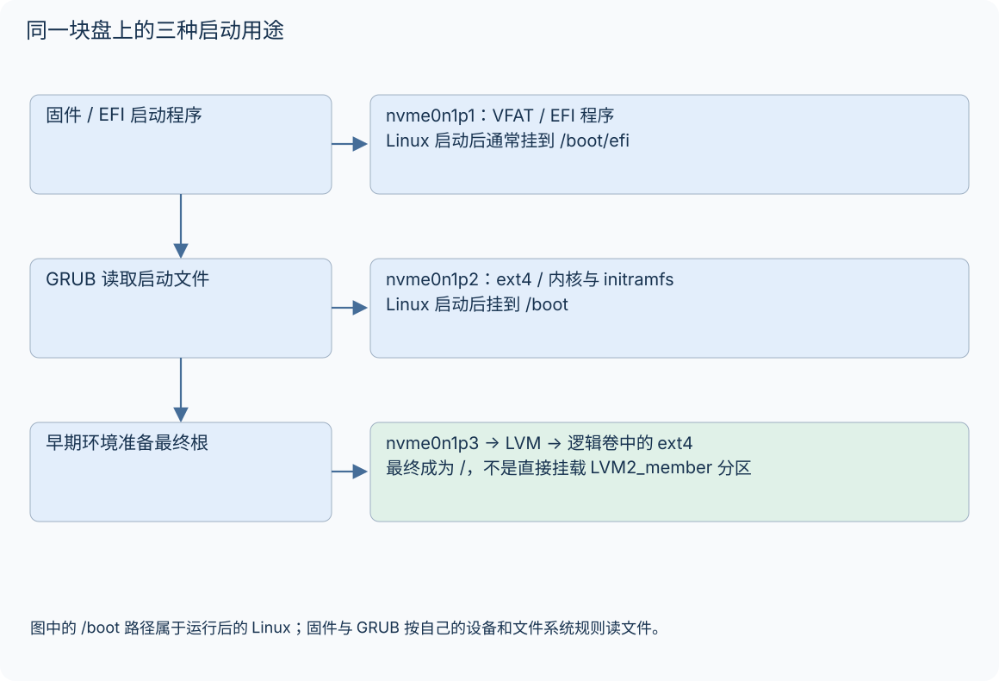
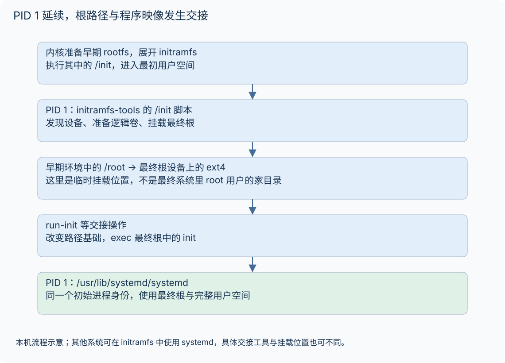
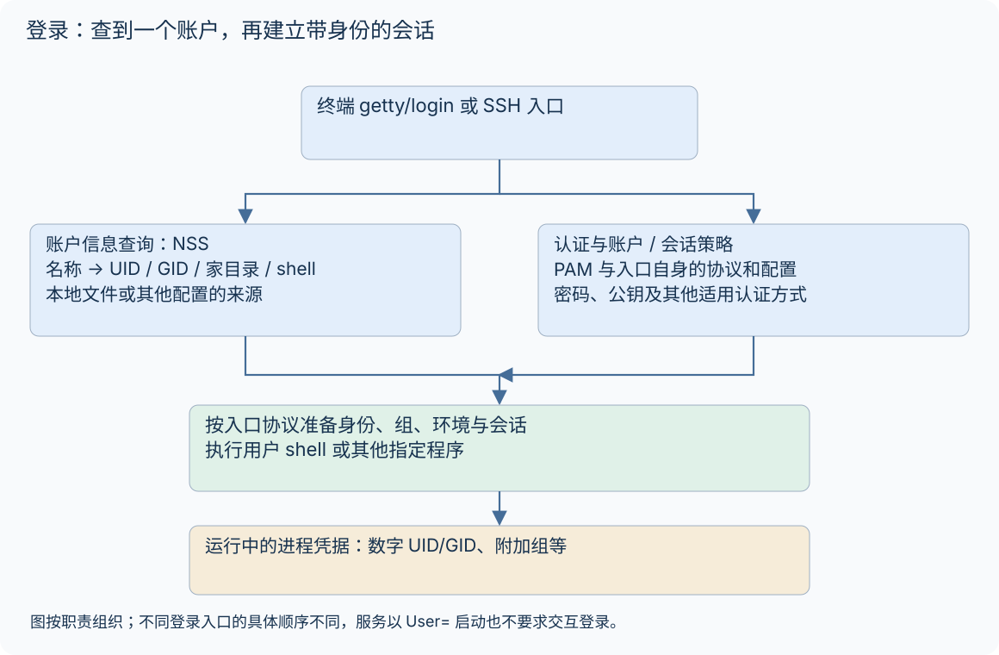

按下电源之后，磁盘上的内核文件还不能自己运行，最终根文件系统也尚未挂载。固件怎样找到启动程序？内核访问根分区所需的驱动又从哪里来？等到 shell 提示符出现，进程为什么已经有了用户和组身份？

本篇沿一台 Ubuntu ARM64 虚拟机的实际配置，按“固件 → 引导器 → 内核 → 早期用户空间 → 最终根 → 系统服务 → 登录”展开。账户与组管理放在登录阶段介绍，服务之间的组织交给[下一篇 systemd](/p/linux-systemd-service-management/)。

实验环境为 VMware Fusion，当前运行内核 `6.8.0-149-generic`，systemd `259.5-0ubuntu3.4`。内核机制参照上游 Linux v6.8；磁盘、EFI 文件和 initramfs 工具以本机为准。命令读取当前配置，不修改引导项、不更新内核，也不重启机器。

收尾系列：**启动与账户** · [systemd 服务管理](/p/linux-systemd-service-management/) · [namespace 与 cgroup v2](/p/linux-namespaces-cgroup-v2/)。

## 一、先把启动涉及的几份文件放回磁盘

### 1.1 /boot、EFI 分区与根分区分别在哪里

```bash
lsblk -o NAME,TYPE,FSTYPE,MOUNTPOINTS
```

本次完整输出：

```text
NAME                      TYPE FSTYPE      MOUNTPOINTS
sr0                       rom  iso9660
nvme0n1                   disk
├─nvme0n1p1               part vfat        /boot/efi
├─nvme0n1p2               part ext4        /boot
└─nvme0n1p3               part LVM2_member
  └─ubuntu--vg-ubuntu--lv lvm  ext4        /
```

这台虚拟机的磁盘分为三层用途：

| 位置 | 本机承载方式 | 谁在启动时使用 |
| --- | --- | --- |
| EFI 系统分区 | `nvme0n1p1`，VFAT，启动后挂到 `/boot/efi` | UEFI 固件和 EFI 启动程序 |
| 启动文件分区 | `nvme0n1p2`，ext4，挂到 `/boot` | GRUB 读取配置、内核和 initramfs |
| 最终根文件系统 | 第三个分区提供 LVM 后备，逻辑卷内为 ext4 | 早期用户空间准备并挂载，随后系统持续使用 |

逻辑卷管理（LVM，Logical Volume Manager）在物理存储和逻辑卷之间增加管理层。这里先辨认路径：根不是直接挂载 `nvme0n1p3`，而是挂载它承载的逻辑卷。



固件和 GRUB 访问文件时，并不是先等待 Linux 把 `/boot/efi`、`/boot` 挂好。这些是 Linux 启动后的挂载路径；启动程序使用自己的设备定位和文件读取能力。

### 1.2 vmlinuz 与 initrd.img 不是同一种镜像

本机 `/boot` 中有两组版本：`6.8.0-149-generic` 和 `7.0.0-43-generic`。可以按实际运行版本选择对应文件：

```bash
uname -r
```

```text
6.8.0-149-generic
```

| 文件 | 内容和用途 |
| --- | --- |
| `vmlinuz-6.8.0-149-generic` | 可供相应启动链加载的内核镜像；具体封装、解压和入口与架构及构建有关 |
| `initrd.img-6.8.0-149-generic` | 本机早期用户空间的 initramfs 归档，包含 `/init`、脚本和工具等 |
| `config-6.8.0-149-generic` | 构建该内核时的配置记录，供核对功能，不是每次启动重新解释的构建配置 |
| `System.map-6.8.0-149-generic` | 内核符号与地址信息，主要用于相应调试与分析 |
| `grub/grub.cfg` | 生成的 GRUB 菜单和加载指令 |

`initrd.img` 是文件名沿袭；现代系统常在里面保存压缩的 cpio initramfs，而非一个需要按 ext4 解释的传统 RAM 磁盘镜像。观察其内容应优先用发行版工具 `lsinitramfs`。

本机的通用链接 `/boot/vmlinuz` 指向 7.0，当前实际运行的却是 6.8。**磁盘上的默认链接或菜单，不等于本次已经加载的版本**；确认运行状态要看 `uname`、内核命令行和启动日志。

## 二、UEFI 怎样找到 GRUB，GRUB 又怎样找到内核

### 2.1 EFI 启动项指向一个程序文件

统一可扩展固件接口（UEFI，Unified Extensible Firmware Interface）在本机通过启动变量选择 EFI 程序。读取本次启动项：

```bash
sudo efibootmgr -v | sed -n '/^BootCurrent:/p;/^Boot0005/p'
```

完整筛选输出：

```text
BootCurrent: 0005
Boot0005* Ubuntu	HD(1,GPT,192f5485-9b2f-43c5-b44a-fd9ab6bcf45b,0x800,0x1dc800)/\EFI\ubuntu\shimaa64.efi
```

`BootCurrent` 表示这次使用的启动项；条目中的分区标识和文件路径让固件定位 ARM64 的 shim。EFI 分区中同时存在 `ubuntu/grubaa64.efi`、`ubuntu/grub.cfg` 等文件，形成这套 Ubuntu 引导链的组成部分。

本例可以按“UEFI → shim → GRUB”理解。shim 参与相应信任与引导衔接，但文件存在不代表安全启动已开启。本机 `mokutil --sb-state` 输出 `SecureBoot disabled`。

其他机器可能用 systemd-boot、直接 EFI stub 加载或统一内核镜像等路径。这里沿本机 GRUB 分析，不把它写成所有 Linux 的固定要求。[GRUB 手册](https://www.gnu.org/software/grub/manual/grub/grub.html)

### 2.2 GRUB 的 root 与 Linux 的 root 不一样

读取 6.8 菜单中加载内核与早期镜像的两条指令：

```bash
sudo grep -E '^[[:space:]]*(linux|initrd)[[:space:]].*6\.8\.0-149-generic' /boot/grub/grub.cfg | head -n 2
```

完整筛选输出：

```text
        linux   /vmlinuz-6.8.0-149-generic root=/dev/mapper/ubuntu--vg-ubuntu--lv ro  console=tty0
        initrd  /initrd.img-6.8.0-149-generic
```

这里 `/vmlinuz-...` 相对的是 GRUB 此时选择的文件系统；本机它对应独立的 `/boot` 分区。内核参数 `root=/dev/mapper/...` 则指定 Linux 最终根的目标。两个 root 分属不同阶段，不能混为一个目录。

| 指令或参数 | 交给谁解释 | 本例用途 |
| --- | --- | --- |
| `linux` 的文件路径 | GRUB | 找到并装入内核镜像 |
| `initrd` 的文件路径 | GRUB | 把早期用户空间镜像装入内存，向内核提供位置信息 |
| `root=` | 内核及相应早期用户空间 | 定位最终根设备；支持的写法取决于启动路径 |
| `ro` | 根挂载相关路径 | 请求初始只读挂载根，后续可按配置重挂载为可写 |
| `console=tty0` | 内核 | 选择相应控制台输出 |

Linux 启动后可核对本次参数：

```bash
cat /proc/cmdline
```

```text
BOOT_IMAGE=/vmlinuz-6.8.0-149-generic root=/dev/mapper/ubuntu--vg-ubuntu--lv ro console=tty0
```

`/etc/default/grub` 和 `/etc/grub.d/` 等是生成配置的输入；`/boot/grub/grub.cfg` 是生成结果。Ubuntu 的 `update-grub` 用于重新生成菜单，`update-initramfs` 用于更新早期镜像，二者修改的对象不同。修改配置文件也不会让当前运行内核自动换版本。

## 三、内核怎样走到第一个用户态程序

### 3.1 先建立能运行程序的内核环境

固件和引导器交接之后，内核入口按架构要求准备运行环境，再进入通用初始化。可以用下表理解职责，不必把所有 initcall 展开：

| 阶段 | 代表位置 | 主要工作 |
| --- | --- | --- |
| 架构入口与准备 | 架构启动代码 | 建立进入内核所需的处理器、地址转换等状态 |
| 通用初始化 | `start_kernel()` | 初始化内存、调度、中断等基础机制，解析相应参数 |
| 建立后续执行者 | `rest_init()` 等 | 创建承担 init 流程的任务和 kthreadd 等执行者 |
| 准备并进入用户空间 | `kernel_init()` 相关路径 | 完成初始化，选择并执行初始用户态程序 |

磁盘和根文件系统需要的部分能力可以内建，也可以由早期环境加载模块。设备发现和驱动绑定可接回[设备管理系列](/p/linux-device-driver-binding/)；它们不是等普通用户登录后才统一开始。

本例有 initramfs 的 `/init`，所以内核先尝试执行它。没有可用 `/init` 时还有其他根准备和 init 选择路径，具体由内核配置与启动参数决定。[Linux v6.8 初始化入口](https://github.com/torvalds/linux/blob/v6.8/init/main.c)

### 3.2 rootfs、initramfs 和最终根分别是什么

| 名称 | 本篇中的含义 |
| --- | --- |
| `rootfs` | 内核早期始终存在的特殊根文件系统实例，是承载早期内容的基础 |
| initramfs | 被解包到早期根中的归档内容，提供最初的用户态工具和 `/init` |
| 最终根文件系统 | 本机 LVM 逻辑卷里的 ext4，最终成为日常路径 `/` 的基础 |

镜像装入内存与归档解包，是两个步骤：GRUB 提供镜像，内核解释并展开早期内容。归档里常有可执行文件、必要库、设备准备工具、脚本与驱动模块。

```bash
sudo lsinitramfs /boot/initrd.img-6.8.0-149-generic | grep -E '(^init$|/lvm2$|/lvm$|^scripts/local$)'
```

完整筛选输出：

```text
etc/lvm
init
scripts/local
usr/sbin/lvm
```

本机早期环境有 `/init`、本地根准备脚本和 LVM 工具。它采用 initramfs-tools 的脚本启动流程；另一类系统可以在早期环境直接使用 systemd。**最终系统以 systemd 为 PID 1，不足以证明 initramfs 中运行的也一定是 systemd。**[rootfs 与 initramfs](https://www.kernel.org/doc/html/v6.8/filesystems/ramfs-rootfs-initramfs.html)

## 四、从早期根切换到最终根

### 4.1 先让根设备变得可访问

本机的依赖关系可以按下面理解：

```text
NVMe 设备与分区可访问
→ 识别第三分区中的 LVM 后备
→ 激活对应逻辑卷
→ 出现最终根设备的可用路径
→ 用 ext4 挂载到早期环境的临时挂载点
```

这是根据本机存储配置整理的职责关系，不是实测的逐条开机调用记录。使用加密根、软件 RAID、网络根时，还要加入相应解锁、组装或网络准备；本机不添加这些不存在的阶段。

这也回答了“驱动在根文件系统里，根却还没挂上”的循环问题：**访问根所必需的能力必须已经内建，或先放进 initramfs 等可用的早期环境。** 最终根挂好后，才能继续使用里面更完整的程序和模块。

### 4.2 切换的是路径基础和程序映像，不是再创建一个 PID 1



本机 initramfs-tools 的脚本将临时根挂载点设置为 `/root`，调用 `mountroot` 准备最终根，末尾通过 `run-init` 交接。这里的 `/root` 是**早期环境里的临时挂载位置**，不是在说最终系统的 root 用户家目录承担了同一工作。

不同工具可以使用不同的根切换方法，不能把所有系统写成固定调用同一个 `pivot_root()`。本例以实际的 initramfs-tools/run-init 交接为准：准备挂载关系和运行所需入口，切换到新根，执行最终的 init。

`exec` 替换当前程序映像，PID 不因此另分配。本例最终 `/sbin/init` 解析到 systemd：

```bash
readlink -f /sbin/init
ps -p 1 -o pid,comm,args
```

本次完整输出：

```text
/usr/lib/systemd/systemd
    PID COMMAND         COMMAND
      1 systemd         /usr/lib/systemd/systemd --system --deserialize=72
```

`--deserialize` 是这次采样时的 systemd 进程参数，不是所有机器从 initramfs 交接时都必须使用的固定命令。观察当前进程可以确认谁正在运行，不能独立重建它此前每次 exec/reexec 的全部历史。

## 五、根已经挂好，为什么还需要 fstab

### 5.1 内核参数找根，用户空间继续组织挂载

最终根可访问后，完整用户空间还需要配置目录、挂载其他文件系统、处理 swap，并根据规则组织设备与服务。`/etc/fstab` 描述相应挂载与交换配置，不是固件定位 EFI 程序的配置，也不是本机内核直接读取的第一份找根文件。

本机去掉注释后的完整条目是：

```text
/dev/disk/by-id/dm-uuid-LVM-rJncvN2QXYKMtpYZEOjQdDlzFR1oZSdEEITnFkEWFxXU2bm23r1MddqCCfnKyEg1 / ext4 defaults 0 1
/dev/disk/by-uuid/7e7a2892-7eaf-4163-aabd-dd5f098dbd2f /boot ext4 defaults 0 1
/dev/disk/by-uuid/A0CC-792B /boot/efi vfat defaults 0 1
```

| 列 | 本例与用途 |
| --- | --- |
| 挂载来源 | 逻辑卷的持久标识路径、文件系统 UUID 对应路径等 |
| 目标 | `/`、`/boot`、`/boot/efi` |
| 类型 | ext4 或 vfat；交换区域可使用 swap 条目 |
| 选项 | 本例为 `defaults`；也可明确 ro/rw、nofail、noauto 等适用选项 |
| dump 标记 | 本例 0，供相关备份工具使用 |
| fsck 检查字段 | 非零表示参与相应检查安排；传统顺序语义与 systemd 的生成处理需要区分 |

文件系统 UUID 与分区的 PARTUUID 不同，设备名称又是另一种定位方式。选择标识时应对应自己要定位的对象，不能只因都包含 UUID 就互换。

当前根最终是可写的：

```bash
findmnt -n -o SOURCE,TARGET,FSTYPE,OPTIONS --mountpoint /
```

```text
/dev/mapper/ubuntu--vg-ubuntu--lv / ext4 rw,relatime
```

这与初始参数 `ro` 不矛盾：不同阶段可以重挂载并应用配置。文件系统检查也不应对已经以普通读写方式挂载的根，照搬离线修复命令。[fstab 格式](https://man7.org/linux/man-pages/man5/fstab.5.html)

### 5.2 systemd 把 fstab 转成 mount/swap unit

本机观察 `/boot` 的挂载单元：

```bash
systemctl show boot.mount --property=Id,FragmentPath,SourcePath,What,Where
```

完整输出：

```text
Id=boot.mount
FragmentPath=/run/systemd/generator/boot.mount
SourcePath=/etc/fstab
Where=/boot
What=/dev/nvme0n1p2
```

`systemd-fstab-generator` 在相应启动或管理器重载阶段把 fstab 转成原生单元；挂载单元再与设备、检查、父挂载等建立依赖关系。`/run/systemd/generator` 中的文件是生成结果，应修改来源配置，而不是把结果文件当长期维护入口。

systemd 对 `passno` 的生成处理主要按是否非零判断，并不照搬传统工具的一整套数字先后安排；根检查若参与，会优先于其他文件系统。文件系统检查、挂载与服务启动因此要结合当前管理器的实现理解。[fstab generator](https://www.freedesktop.org/software/systemd/man/259/systemd-fstab-generator.html)

## 六、从登录入口到账户与身份

### 6.1 启动一个系统，不等于已经登录一个用户

systemd 可以启动终端登录入口 getty，也可以启动 SSH 服务。前者通常接到 `login`，后者由 sshd 按 SSH 配置完成认证与会话准备；二者的认证路径不应混写成完全相同的一条函数链。



这里有四类问题：

| 问题 | 主要内容 |
| --- | --- |
| 这个名字是谁 | 查询账户、UID、主组、家目录和 shell |
| 是否允许通过认证与账户检查 | 密码、公钥、账户期限、入口策略等 |
| 会话怎样准备 | 附加组、会话模块、工作目录、环境等，具体顺序依入口而异 |
| 新程序以什么身份运行 | 最终进程凭据中的 UID/GID、附加组等 |

root 用户是数字身份 UID 0，不等于“所有程序启动前必须先验证 root 密码”。系统服务可以无需交互登录直接以配置的身份启动；root 密码锁定也不意味着系统不能正常启动。

### 6.2 passwd、shadow、group、gshadow 各管什么

```bash
getent passwd lxj
getent group lxj
```

完整输出依次为：

```text
lxj:x:1000:1000:lxj:/home/lxj:/bin/bash
lxj:x:1000:
```

passwd 的七列可以逐项读：

| 字段 | 本例 |
| --- | --- |
| 登录名 | `lxj` |
| 密码字段 | `x`，本地 shadow 方案下表示密码信息另存于 shadow，不是密码本身 |
| UID | `1000` |
| 主组 GID | `1000` |
| 描述字段 | `lxj`，可保存账户描述 |
| 家目录 | `/home/lxj` |
| 登录 shell | `/bin/bash` |

| 文件 | 保存什么 |
| --- | --- |
| `/etc/passwd` | 本地账户的基本身份和登录属性，通常可被普通用户查询 |
| `/etc/shadow` | 本地密码验证所需的散列及密码期限等字段，访问受限 |
| `/etc/group` | 本地组名、GID 和显式成员列表等 |
| `/etc/gshadow` | 组管理员、受保护的组密码及成员等相关信息 |

shadow 中保存的是密码散列及相关参数，不是可以直接“解密回明文”的密码。认证也可能使用公钥或其他来源，因此本篇不展示真实 shadow 内容。

组条目最后一列为空，不表示 `lxj` 没有组身份：主组来自 passwd 中的 GID，附加组还有自己的来源。把主组和显式成员列表混成一个集合，会误读很多普通账户。[passwd 格式](https://man7.org/linux/man-pages/man5/passwd.5.html) · [shadow 格式](https://man7.org/linux/man-pages/man5/shadow.5.html)

### 6.3 名字查询、认证与进程凭据分三层

```bash
id lxj
grep -E '^(passwd|group|shadow):' /etc/nsswitch.conf
```

本次完整输出：

```text
uid=1000(lxj) gid=1000(lxj) groups=1000(lxj),4(adm),24(cdrom),27(sudo),30(dip),46(plugdev),101(lxd)
passwd:         files systemd
group:          files systemd
shadow:         files systemd
```

名称服务切换（NSS，Name Service Switch）决定相应数据库从哪里查询、按什么顺序查询。`getent` 按相应查询接口访问数据，不只是给 `/etc/passwd` 换一个 cat 命令；其他部署还可能有目录服务来源。

可插拔认证模块（PAM，Pluggable Authentication Modules）按应用的配置组织认证、账户、密码更新和会话等模块，例如 `/etc/pam.d/login`、`sshd`。NSS 回答账户信息从哪里来，PAM 组织适用认证与会话策略，二者不是同一职责；SSH 公钥等路径还要结合 sshd 自身配置理解。

最终执行 shell 的进程拥有内核凭据。文件权限检查使用相应数字身份，而不是每次打开文件都重新验证登录密码。实际 UID、有效 UID、保存身份、文件系统身份与附加组的职责可接回[权限篇](/p/linux-file-permissions/)和[进程对象篇](/p/linux-process-task-model/)。[NSS 配置](https://man7.org/linux/man-pages/man5/nsswitch.conf.5.html)

### 6.4 用户和组管理怎样改变这些数据

下面是管理操作的作用对照，未在本次实验中创建额外账户：

| 示例 | 改变什么 |
| --- | --- |
| `sudo useradd -m -s /bin/bash labuser` | 创建账户，按工具与配置准备家目录等属性 |
| `sudo passwd labuser` | 交互设置密码，避免把明文密码写入命令行 |
| `sudo groupadd labteam` | 创建本地组 |
| `sudo usermod -aG labteam labuser` | 追加附加组；`-a` 避免把其他附加组整体替换掉 |
| `getent passwd labuser`、`id labuser` | 查询数据库中的账户与组关系 |
| `sudo userdel labuser` | 删除本地账户记录；家目录和其他文件的处理需按选项另行决定 |
| `sudo groupdel labteam` | 删除组记录，仍需检查账户与文件的既有关系 |

Ubuntu 的 `adduser` 提供更高层的账户创建流程；`useradd` 与它的交互和默认行为不同，其他发行版也未必提供相同包装。

**数据库变化不等于已运行进程立即换身份。** 例如追加附加组后，已有 shell 的组列表通常仍是创建会话时取得的那份；`id` 不带用户名查看当前进程身份，`id labuser` 查询指定账户，二者回答的问题不同。重新建立会话等合适方式才会按更新后的信息准备相应进程身份。

### 6.5 su、sudo 与服务身份

`su` 用于切换到另一个用户的执行环境，认证与环境行为受其配置和参数影响；`sudo` 根据授权策略以目标身份执行命令，是否允许、是否需要认证要看 sudoers/PAM 等规则，不只是“当前用户是不是 root”。

systemd 服务的 `User=`、`Group=` 则声明服务执行身份；它不是让每次启动服务都弹出一个用户登录界面。下一篇会让独立实验服务以 `lxj` 运行，观察进程怎样被管理。

删除用户名不等于重写所有文件的数字属主，修改 UID/GID 也不会让磁盘上全部旧文件自动变成期望的归属。账户维护与文件权限应一起核对，具体权限位不在这里重复展开。

## 七、沿启动阶段定位问题

| 停在哪一层 | 优先确认什么 |
| --- | --- |
| 没进入引导菜单或 EFI 程序 | 固件启动项、EFI 分区、启动文件与相应信任策略 |
| GRUB 找不到镜像 | GRUB 选择的文件系统、配置路径、版本文件是否一致 |
| 掉入早期环境 | root 参数、磁盘驱动、LVM/解锁等根准备条件 |
| 根可访问但进入维护模式 | fstab、设备和挂载单元、检查结果与日志 |
| 服务未就绪 | systemd 的依赖、服务状态、启动类型与日志 |
| 有登录入口但无法登录 | 账户查询、入口认证、账户状态与会话配置 |

先确定由谁负责当前阶段，再找对应配置。本篇把机器带到用户进程；[下一篇](/p/linux-systemd-service-management/)继续解释 root 已就绪之后，systemd 怎样把一组服务组织成可用系统。

## 八、命令与接口速查

| 命令或入口 | 用途 |
| --- | --- |
| `lsblk -o NAME,TYPE,FSTYPE,MOUNTPOINTS` | 观察分区、逻辑卷、类型与挂载点 |
| `efibootmgr -v` | 查看 UEFI 启动项与路径，读取可能需要 sudo |
| `uname -r`、`/proc/cmdline` | 核对运行版本与本次内核参数 |
| `lsinitramfs IMAGE` | 查看早期用户空间归档内容 |
| `findmnt --mountpoint PATH` | 检查指定目录是否为相应挂载点 |
| `systemctl show boot.mount` | 观察 fstab 生成的挂载单元属性 |
| `getent passwd/group NAME` | 通过相应查询来源取得账户、组信息 |
| `id` / `id USER` | 观察当前进程身份 / 查询指定账户信息 |
| `passwd -S USER` | 查询本地密码状态，而非展示密码散列 |
| `useradd/usermod/userdel`、`groupadd/groupdel` | 管理本地账户与组记录 |

## 九、名词解释

| 名词 | 本篇含义 |
| --- | --- |
| UEFI、EFI 程序 | 固件接口体系及其可加载执行的启动程序 |
| ESP | EFI System Partition，EFI 系统分区，存放相应启动文件 |
| GRUB | 本例使用的引导加载器，读取启动配置并装入内核等镜像 |
| initramfs | 提供早期用户空间程序、工具、脚本等内容的归档 |
| rootfs | 内核早期存在的特殊根文件系统实例，承载早期内容 |
| 最终根 | 启动准备后成为日常 `/` 基础的文件系统，本例为逻辑卷中的 ext4 |
| LVM | 在物理存储与逻辑卷之间组织容量和映射的逻辑卷管理体系 |
| PID 1 | 相应 PID 命名空间中的初始进程；本篇主要讨论整台系统的初始进程 |
| NSS | 组织账户、组等名称信息查询来源与顺序的机制 |
| PAM | 为适用应用组织认证、账户和会话等策略的模块框架 |
| UID/GID | 用户、组的数字标识，进程凭据与文件权限判断使用相应身份 |
