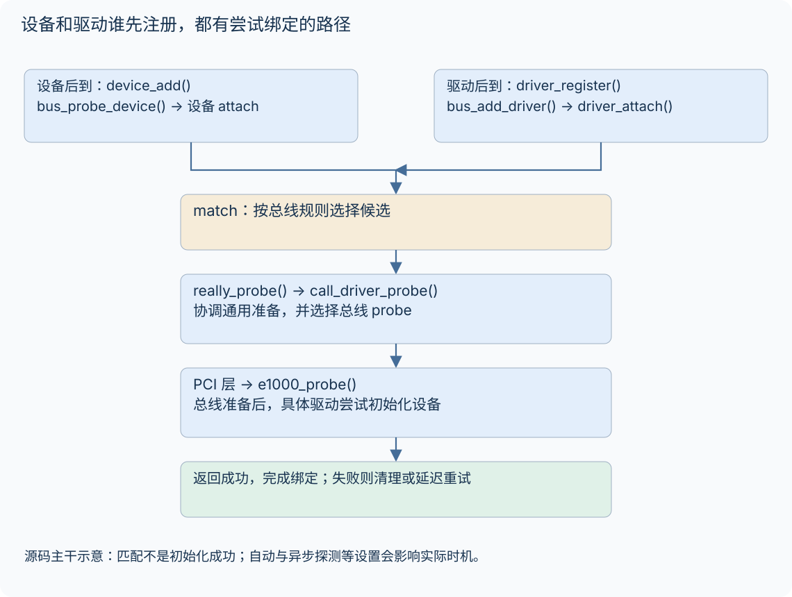
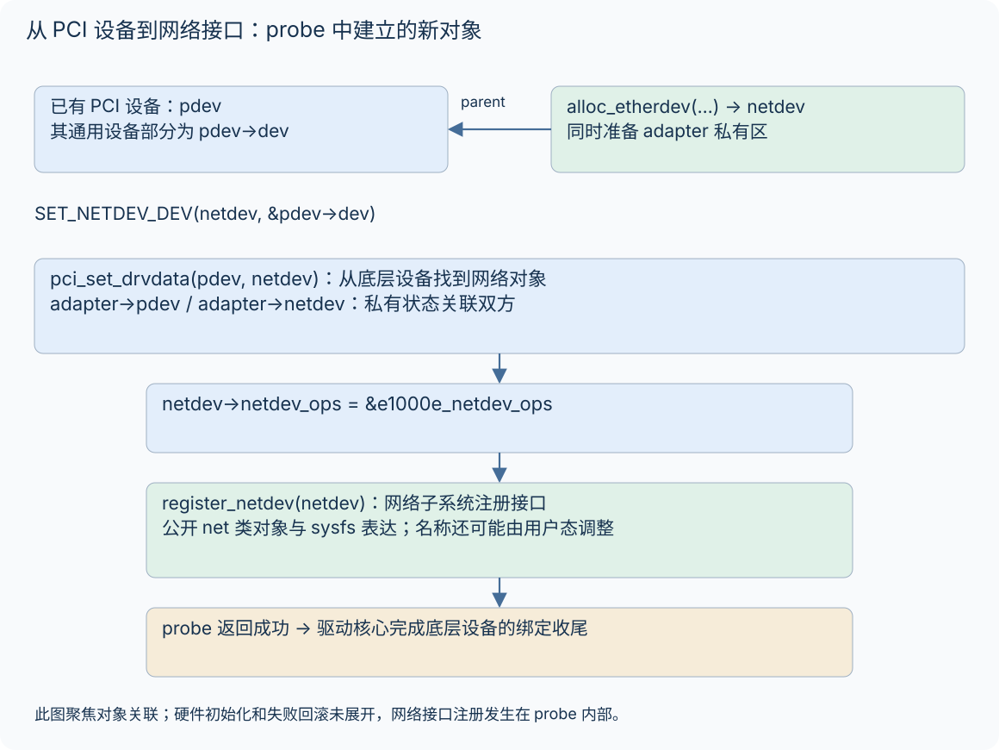
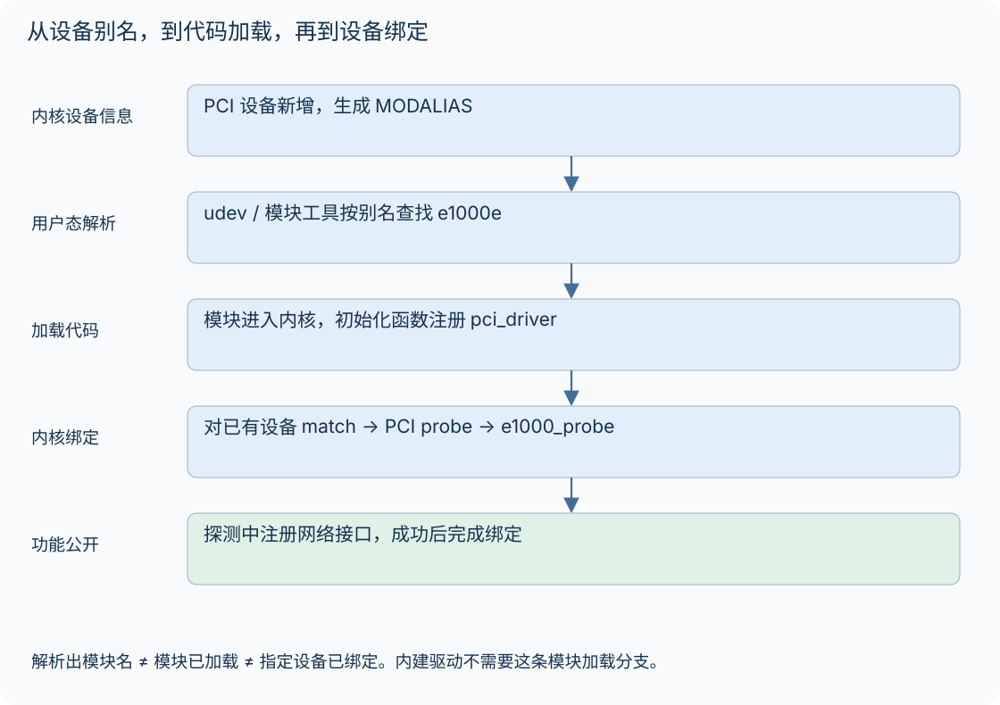

在[第一篇](/p/linux-device-model/)中，网卡 `enp2s0` 关联到 PCI（Peripheral Component Interconnect，外围组件互连）设备 `0000:02:00.0`，底层设备又关联到 e1000e。这个结果背后有三件不同的事：内核发现设备，驱动代码进入内核，设备与驱动成功绑定。

本篇沿同一块网卡把这三件事连起来，重点回答：设备先到或驱动先到分别怎样处理，模块如何成为候选，以及匹配以后为什么还可能无法使用。

实测来自 VMware Fusion 中的 Ubuntu ARM64，内核 `6.8.0-149-generic`；源码参照上游 **Linux v6.8**。本篇读取现有设备和模块信息，不通过解绑网卡制造故障。下文调用路径属于源码解析，不是本机记录的开机调用栈。

系列位置：[一：设备模型](/p/linux-device-model/) · **二：发现与绑定** · [三：设备文件与用户态管理](/p/linux-device-files-udev/)。

## 一、先确认设备与绑定的驱动

### 1.1 设备 ID 不等于驱动名称

只查看这块网卡，避免整个 PCI 列表淹没主线：

```bash
lspci -s 02:00.0 -nnk
```

完整输出：

```text
02:00.0 Ethernet controller [0200]: Intel Corporation 82574L Gigabit Network Connection [8086:10d3]
	Subsystem: VMware Device [15ad:07d0]
	Kernel driver in use: e1000e
	Kernel modules: e1000e
```

| 字段 | 表示什么 | 能否直接证明绑定 |
| --- | --- | --- |
| `02:00.0` | 设备在当前 PCI 拓扑中的位置，完整地址还可包含域号 | 只说明定位 |
| `8086:10d3` | 厂商与设备标识 | 是匹配依据之一，不是 Linux 驱动名称 |
| `15ad:07d0` | 子系统厂商与子系统设备标识 | 可参与更具体的匹配 |
| `Kernel driver in use` | 当前使用的驱动 | 是本次绑定结果的观察入口 |
| `Kernel modules` | 与该设备相关的候选模块信息 | 不保证这些模块都已加载或绑定 |

虚拟机模拟 Intel 设备接口，不代表宿主机里必须有同型号物理网卡。设备提供什么接口，与它由真实硬件还是虚拟机实现，是两个问题。

### 1.2 用 sysfs 核对同一组信息

```bash
cat /sys/bus/pci/devices/0000:02:00.0/vendor
cat /sys/bus/pci/devices/0000:02:00.0/device
readlink -f /sys/bus/pci/devices/0000:02:00.0/driver
```

三条命令的完整输出依次为：

```text
0x8086
0x10d3
/sys/bus/pci/drivers/e1000e
```

到这里，只确认了这次采样时的 ID 和关联关系。下面从设备信息的来源开始解释，不能倒因为果地认为“有了 e1000e，才有这块 PCI 设备”。

先把后面的两条路线分开：

| 驱动此时在哪里 | 设备出现后的主线 | 后文位置 |
| --- | --- | --- |
| 驱动已内建或已经注册 | 设备注册 → 内核匹配 → probe → 完成绑定 | 第三章 |
| 候选驱动还在模块文件中 | 设备通知提供 modalias → 用户态找到并加载模块 → 模块注册驱动 → 内核匹配与 probe | 第四章 |

两条路线最终进入同一套绑定机制。先理解第三章的内核接管过程，再在第四章补上“代码尚未加载”时的前置步骤。下面先说明它们共同的起点：设备信息怎样进入内核。

## 二、device 从哪里来

### 2.1 固件描述与总线枚举可以协同工作

并不是所有设备都能回答“我是谁、我在哪”。不同连接方式采用不同来源：

| 信息来源 | 提供什么 | 怎样进入设备模型 |
| --- | --- | --- |
| PCI 配置空间、通用串行总线（USB，Universal Serial Bus）描述符等 | 可枚举设备的身份和能力 | 总线扫描、识别后建立相应专用设备对象 |
| 设备树（DT，Device Tree） | 固件描述的节点、资源和连接关系 | 内核解析节点，由相关总线和子系统按规则建立设备 |
| 高级配置与电源接口（ACPI，Advanced Configuration and Power Interface） | 固件命名空间、资源和控制方法等 | ACPI 与相关总线、平台代码协作建立和关联设备 |
| 内核或软件主动注册 | 虚拟设备、逻辑设备等 | 由对应组件创建并注册通用设备部分 |

固件节点由相应总线和平台代码解释：例如集成电路间总线（I²C，Inter-Integrated Circuit）的子设备由 I²C 层组织，部分平台设备由 platform 层组织。通用设备可以通过 `of_node`、`fwnode` 等成员关联固件描述。DT 和 ACPI 的选择取决于平台，ARM64 机器也可以采用 ACPI。

本例 PCI 设备的厂商和设备标识来自 PCI 枚举；宿主平台还可以通过 ACPI 描述根桥等资源。固件描述和可枚举总线不是互斥选项。[PCI 初始化与设备访问](https://docs.kernel.org/6.8/PCI/pci.html) · [设备树设备模型用法](https://docs.kernel.org/6.8/devicetree/usage-model.html)

### 2.2 观察固件入口时，要区分“目录存在”和“有效描述存在”

本机运行：

```bash
ls /sys/firmware/acpi/tables
```

完整输出：

```text
APIC
DSDT
FACP
GTDT
MCFG
PPTT
SSDT
data
dynamic
```

这说明本机导出了 ACPI 表。表通常是二进制格式，不能用 `cat ... | head` 把它当普通文本理解。

若机器实际使用设备树并公开相应视图，可以从 `/sys/firmware/devicetree/base` 查看。本机该目录下未导出 `base`；本例直接沿已经观察到的 ACPI 与 PCI 入口继续分析。

设备信息有来源之后，总线层建立例如 `struct pci_dev` 这样的专用对象，并把其中的 `dev` 注册到通用设备模型。**枚举回答“有什么”，注册让它进入统一框架，绑定再回答“由谁接管”。**

## 三、驱动是谁，以及怎样匹配

### 3.1 PCI 驱动包装了通用驱动对象

理解 PCI 驱动所需的结构摘录如下：

```c
struct pci_driver {
    /* … */
    const char *name;
    const struct pci_device_id *id_table;
    int (*probe)(struct pci_dev *dev, const struct pci_device_id *id);
    /* … */
    struct device_driver driver;
    /* … */
};
```

这里有两层：通用框架操作 `device_driver`，PCI 框架操作 `pci_driver`。`id_table` 是 PCI 驱动支持的标识集合，`probe` 接收的也是 PCI 专用设备和匹配项，不是直接照抄通用驱动回调的签名。

本例 e1000e 在驱动对象中登记名称、ID 表、探测和移除等回调；PCI 框架拿设备标识与相应表项匹配，再通过总线探测路径调用具体驱动。[PCI 驱动结构](https://github.com/torvalds/linux/blob/v6.8/include/linux/pci.h) · [e1000e 注册与 ID 表](https://github.com/torvalds/linux/blob/v6.8/drivers/net/ethernet/intel/e1000e/netdev.c)



### 3.2 设备先到、驱动先到，各自有检查路径

| 先后关系 | 后到的一方做什么 | v6.8 的关键路径 |
| --- | --- | --- |
| 驱动已注册，设备新增 | 为新设备尝试已有候选驱动 | `device_add()` → `bus_probe_device()` → 设备 attach 路径 |
| 设备已注册，驱动新增 | 为新驱动检查已有设备 | `driver_register()` → `bus_add_driver()` → `driver_attach()` |

两条路径都会经过匹配和驱动探测组织。具体还受自动探测开关、异步探测和其他状态影响；本表说明默认主线，不把它写成所有路径逐个必经的完整调用栈。

因此设备和驱动不必按唯一顺序注册，但不能进一步推导成“加载顺序和依赖永远不影响结果”。匹配条件、依赖资源、驱动配置与实际初始化都会影响能否绑定。[总线注册与 attach](https://github.com/torvalds/linux/blob/v6.8/drivers/base/bus.c) · [驱动注册](https://github.com/torvalds/linux/blob/v6.8/drivers/base/driver.c)

### 3.3 match 选候选，probe 才尝试接管

`match()` 主要判断是否值得尝试该驱动。`probe()` 则需要真正准备设备：取得资源、建立私有状态、初始化硬件、注册上层接口等，具体顺序由驱动决定。

通用探测路径中的分发在 v6.8 可见以下代码，摘自 `call_driver_probe()`：

```c
if (dev->bus->probe)
    ret = dev->bus->probe(dev);
else if (drv->probe)
    ret = drv->probe(dev);
```

这解释了为什么不能把所有设备都画成直接调用 `drv->probe(dev)`。PCI 总线提供自己的 `probe`，先把通用对象转换成 PCI 对象并完成总线层准备，再调用具体 PCI 驱动的回调。本例可沿下面的主干阅读：

| 阶段 | 关键位置 | 做什么 |
| --- | --- | --- |
| 通用探测组织 | `really_probe()` | 协调资源、关联状态、探测调用与失败收尾 |
| 通用到总线分发 | `call_driver_probe()` | 优先调用总线的 probe |
| PCI 层准备 | `pci_device_probe()`、`__pci_device_probe()` | 取得 PCI 对象、检查和准备，再分发具体驱动 |
| 具体驱动探测 | e1000e 的 `e1000_probe()` | 初始化该设备，并建立网络接口等驱动状态 |
| 成功或失败 | 驱动核心与总线收尾 | 成功推进绑定，失败清理并解除临时关联 |

探测期间通用对象可以先设置候选驱动关联，失败再撤销，所以不能把任意瞬间的内部指针等同于完整初始化成功。用户通常在稳定状态下观察 `driver` 链接和上层接口，实际诊断还要结合日志。[通用探测实现](https://github.com/torvalds/linux/blob/v6.8/drivers/base/dd.c) · [PCI 探测分发](https://github.com/torvalds/linux/blob/v6.8/drivers/pci/pci-driver.c)

### 3.4 PCI 设备怎样产生网络接口

前面确认了谁调用 e1000e 的 probe，现在看它如何建立第一篇观察到的第二个对象。`e1000_probe()` 中与对象关联直接相关的代码如下，按原顺序摘录；硬件准备、错误处理和其他成员设置已省略：

```c
/* … */
netdev = alloc_etherdev(sizeof(struct e1000_adapter));
if (!netdev)
    goto err_alloc_etherdev;

SET_NETDEV_DEV(netdev, &pdev->dev);
/* … */
pci_set_drvdata(pdev, netdev);
adapter = netdev_priv(netdev);
/* … */
adapter->netdev = netdev;
adapter->pdev = pdev;
/* … */
netdev->netdev_ops = &e1000e_netdev_ops;
/* … */
strscpy(netdev->name, "eth%d", sizeof(netdev->name));
err = register_netdev(netdev);
if (err)
    goto err_register;
/* … */
```

| 动作 | 哪个对象发生变化 | 为什么需要它 |
| --- | --- | --- |
| `alloc_etherdev()` | 创建网络接口对象，并为适配器私有状态保留空间 | PCI 对象之外还需要网络子系统使用的对象 |
| `SET_NETDEV_DEV()` | 设置 `netdev->dev.parent` 为 `&pdev->dev` | 第一篇的 `device` 链接与层级关系有了来源 |
| `pci_set_drvdata()` | PCI 设备关联到 netdev | 驱动后续处理可由底层设备找到对应网络接口 |
| `netdev_priv()` | 取得网络接口关联的适配器私有区 | 保存驱动所需状态；本例 adapter 还记录 netdev 与 pdev |
| 设置 `netdev_ops` | 网络接口关联网络操作表 | 网络子系统之后可分发接口启停、发送等操作 |
| `register_netdev()` | 将已准备的网络接口注册给网络子系统 | 在相关初始化和命名流程中公开接口及 sysfs 表达 |

`SET_NETDEV_DEV()` 在 v6.8 中展开后的赋值就是 `(net)->dev.parent = (pdev)`。它设置的是父设备关系，不是在原 PCI 对象中再复制一份硬件。



图把设备管理这一层的对象变化串起来，硬件收发初始化仍留在省略部分。这里的 `netdev_ops` 是网络子系统接口，与字符设备的 `file_operations` 负责不同的分发任务。

源码先以 `eth%d` 请求接口名，用户态网络命名策略还可能将它改为本例的 `enp2s0`。因此驱动代码中不必出现最终观察到的名字；不能仅凭这段模板确定某次启动的最终接口名称。

**网络接口注册发生在 probe 内部，probe 成功返回后核心才完成相应绑定收尾。** 这解释了从 PCI 对象到 net 类对象的关系，也提醒我们把“上层接口的新增”和“底层驱动绑定完成”分开看。[e1000_probe 的对象创建与注册](https://github.com/torvalds/linux/blob/v6.8/drivers/net/ethernet/intel/e1000e/netdev.c) · [SET_NETDEV_DEV 定义](https://github.com/torvalds/linux/blob/v6.8/include/linux/netdevice.h)

## 四、modalias 怎样接到模块加载

### 4.1 模块别名是设备描述与模块之间的桥

若驱动编成模块，代码还没进入内核，设备模型不可能直接调用它的 probe。用户态需要先找到候选模块。

读取这块设备的别名：

```bash
cat /sys/bus/pci/devices/0000:02:00.0/modalias
```

完整输出：

```text
pci:v00008086d000010D3sv000015ADsd000007D0bc02sc00i00
```

这是给匹配机制使用的结构化字符串，不是模块文件名：

| 部分 | 本例含义 |
| --- | --- |
| `pci:` | PCI 类型的别名 |
| `v00008086`、`d000010D3` | 厂商和设备标识 |
| `sv000015AD`、`sd000007D0` | 子系统厂商和设备标识 |
| `bc02`、`sc00`、`i00` | 基类、子类和编程接口等信息 |

只解析别名，不加载或卸载模块：

```bash
modprobe --resolve-alias "$(cat /sys/bus/pci/devices/0000:02:00.0/modalias)"
```

完整输出：

```text
e1000e
```

设备 ID 表可以通过 `MODULE_DEVICE_TABLE()` 等方式参与生成模块别名信息，再由模块工具建立索引、解析匹配。自动加载的常见路径是“设备新增事件携带 MODALIAS → 用户态设备管理处理 → 请求模块加载 → 模块初始化注册驱动”。**别名选模块与内核 match 选驱动是前后两次选择，解析出模块名不代表已绑定成功。**[PCI 模块与 ID 表](https://github.com/torvalds/linux/blob/v6.8/drivers/net/ethernet/intel/e1000e/netdev.c)



### 4.2 模块加载不等于设备绑定

查看模块文件和已加载列表：

```bash
modinfo -F filename e1000e
lsmod | sed -n '1p;/^e1000e /p'
```

完整输出分别是：

```text
/lib/modules/6.8.0-149-generic/kernel/drivers/net/ethernet/intel/e1000e/e1000e.ko.zst
```

```text
Module                  Size  Used by
e1000e                413696  0
```

`modinfo` 能找到文件，不代表模块已加载；`lsmod` 出现模块，不代表某个指定设备的 probe 成功。此处 `Used by` 为 0 也不等于“没有设备使用它”：模块引用计数不是设备绑定数量，最终仍要看具体设备的 `driver` 和运行状态。

| 工具或入口 | 回答的问题 |
| --- | --- |
| `modinfo` | 模块文件里声明了什么、文件在哪里 |
| `modprobe` | 根据模块名或别名以及依赖与配置请求加载 |
| `insmod` | 请求加载指定模块文件，不提供 modprobe 那套依赖解析 |
| `lsmod` | 当前有哪些可见的已加载模块 |
| `modprobe -r`、`rmmod` | 请求移除模块，仍受引用和卸载规则约束 |
| `dmesg` | 查看内核日志中的初始化、探测和失败信息；普通用户可能没有读取权限 |

编进内核的驱动不需要等用户态加载 `.ko`，也不能只靠 `lsmod` 判断它是否存在。本机两块 PCI 网卡都可以由同一个 e1000e 驱动处理，驱动对象与设备实例不是一一对应关系。

## 五、为什么匹配了仍然不能使用

### 5.1 延迟探测是依赖未就绪，不是立即宣判失败

假设一个 platform 设备依赖时钟提供者，探测时却发现时钟资源尚未就绪。驱动可以返回 `-EPROBE_DEFER`，请求之后重试。

下面是说明错误传递的接口片段，`dev` 是 probe 参数对应的设备，省略其余初始化：

```c
clk = devm_clk_get(dev, "core");
if (IS_ERR(clk))
    return dev_err_probe(dev, PTR_ERR(clk), "cannot get core clock\n");
```

`devm_clk_get()` 失败会返回错误指针。`PTR_ERR()` 取得错误码；若错误码是 `-EPROBE_DEFER`，上面的返回会把它传给驱动核心。这段路径保留原始错误码，驱动核心据此区分需要稍后重试还是其他探测错误。

| 探测结果 | 内核如何理解 |
| --- | --- |
| 返回 0 | 驱动报告探测成功，核心继续完成绑定流程 |
| 返回 `-EPROBE_DEFER` | 加入相应延迟探测组织，等待后续重试机会 |
| 返回其他错误 | 按错误处理路径清理，不能当作绑定成功 |

v6.8 延迟探测维护待重试与活动列表，成功探测等时机会推进重试。它不是“每注册一个驱动就立即重跑全部设备”，也不能解决永久缺失的依赖。device link 还可表达供应者与消费者关系，参与依赖与电源管理组织；依赖关系并不总等同于设备父子关系。[延迟探测列表与重试](https://github.com/torvalds/linux/blob/v6.8/drivers/base/dd.c)

### 5.2 根据失败发生在哪一层定位

| 观察结果 | 优先检查 |
| --- | --- |
| 预期设备没有出现在相应总线视图 | 总线枚举、固件描述、虚拟机设备配置 |
| 设备存在，但没有合适的驱动关联 | 候选模块、匹配条件、自动探测设置 |
| 模块已加载，但设备未绑定 | probe 日志、资源冲突、依赖与延迟探测 |
| 已绑定，但没有预期上层接口 | 驱动注册接口的阶段、错误状态和具体子系统规则 |
| 接口存在但功能不可用 | 驱动运行状态以及链路、协议和用户态配置 |

日志可以先按驱动名筛选，例如 `dmesg | grep -i e1000e`；需要权限时使用 `sudo dmesg`。配置并导出 debugfs 的系统还可能提供 `/sys/kernel/debug/devices_deferred`，列出待延迟探测的设备与原因。这里介绍观察入口，不展示本机未采集的失败输出。

解绑设备、移除硬件、卸载模块也是不同动作。解绑让驱动停止接管某个设备，设备本身可能仍然存在；卸载涉及整份模块代码，物理或虚拟设备移除则会推进设备对象退出。驱动必须停止新请求并处理在途活动，然后才能安全释放私有资源，这与[进程篇的内核同步和生命周期](/p/linux-kernel-synchronization/)衔接。

本篇完成的是“发现设备 → 找到模块 → 注册驱动 → 匹配与探测 → 绑定”的链。[下一篇](/p/linux-device-files-udev/)继续看：这个结果怎样变成 `/dev` 中的访问入口，又怎样交给用户态管理。

## 六、命令与接口速查

| 命令或接口 | 用途 |
| --- | --- |
| `lspci -s ADDRESS -nnk` | 选择设备，显示名称与数字 ID、驱动和候选模块 |
| `cat .../vendor`、`device`、`modalias` | 读取设备身份与模块别名 |
| `modprobe --resolve-alias ALIAS` | 解析候选模块名称，不实际加载 |
| `modinfo -F filename MODULE` | 查看模块文件位置 |
| `lsmod` | 查看已加载模块 |
| `dmesg` | 查看内核日志，受系统权限策略约束 |
| `driver_register()`、`device_add()` | 驱动与设备进入通用设备模型的相关入口 |
| `match()` / `probe()` | 候选匹配 / 尝试初始化并接管设备 |
| `dev_err_probe()` | 记录探测错误并返回错误码，支持延迟探测相关处理 |

## 七、名词解释

| 名词 | 本篇含义 |
| --- | --- |
| 枚举 | 按总线或平台规则发现设备、取得身份并建立对象的过程 |
| DT | 固件提供的设备树描述，供内核了解平台设备与资源关系 |
| ACPI | 通过固件表和相关方法描述设备、资源与平台管理的接口体系 |
| match | 判断设备与驱动是否为合适候选的匹配阶段 |
| probe | 驱动尝试准备资源、初始化设备并建立功能接口的阶段 |
| 绑定 | 设备由某个驱动接管的关联及其建立过程 |
| modalias | 用于从设备特征查找候选模块的别名字符串 |
| 模块 | 可加载到内核的代码单元；不必是设备驱动，驱动也可以内建 |
| 延迟探测 | 因依赖等条件尚未满足而请求稍后重新探测的机制 |
| device link | 设备之间的供应者与消费者等依赖关系组织，不等同于父子层级 |
