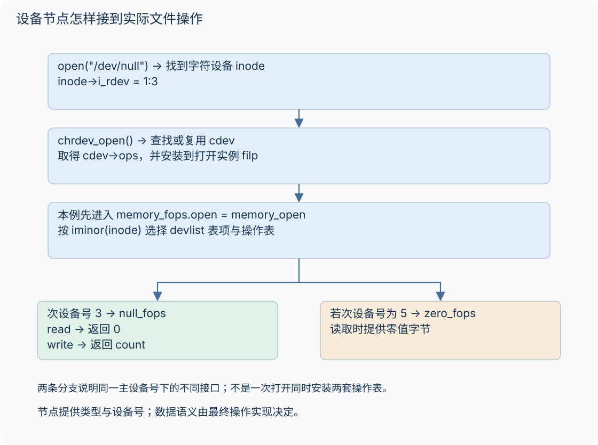
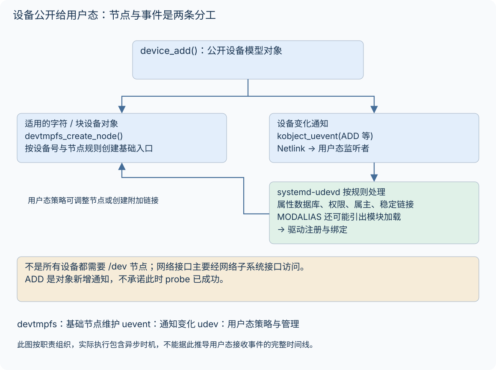
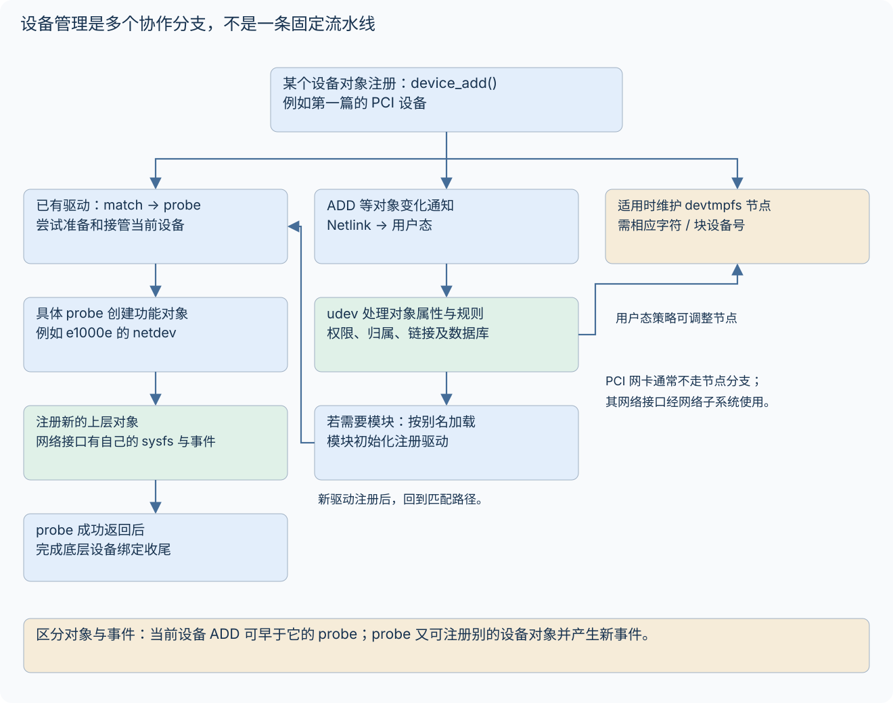

前两篇用网卡说明设备对象怎样进入 sysfs、怎样与驱动绑定。但程序使用设备时，常常打开的是 `/dev` 中的路径。这个文件里保存设备内容吗？它如何找到驱动？节点又是谁创建的？

本篇用 `/dev/null` 和 `/dev/zero` 的真实读写接回虚拟文件系统（VFS，Virtual File System），再解释 devtmpfs、uevent 和 udev。最后与前面的网卡对照：**设备模型统一组织对象，具体访问接口则由子系统决定。**

实测来自 VMware Fusion 中的 Ubuntu ARM64，内核 `6.8.0-149-generic`，`udevadm --version` 为 `259`；内核源码参照上游 **Linux v6.8**。实验包括 null/zero 的读写，以及针对现有 null 对象的一次 change 通知；驱动绑定过程则结合现有状态和固定版本源码解释。

系列位置：[一：设备模型](/p/linux-device-model/) · [二：发现与绑定](/p/linux-device-driver-binding/) · **三：设备文件与用户态管理**。

## 一、设备节点保存的是访问身份

### 1.1 先看类型与设备号

```bash
stat -c '%n type=%F major=%t minor=%T mode=%a owner=%U:%G' /dev/null /dev/zero /dev/nvme0n1
```

完整输出：

```text
/dev/null type=character special file major=1 minor=3 mode=666 owner=root:root
/dev/zero type=character special file major=1 minor=5 mode=666 owner=root:root
/dev/nvme0n1 type=block special file major=103 minor=0 mode=660 owner=root:disk
```

GNU `stat` 的 `%t`、`%T` 输出**十六进制**主、次设备号；所以磁盘的主设备号 `103` 是十六进制，换成十进制为 `259`。不要把它与 sysfs 中的十进制 `259:0` 当成两个不同设备号。

| 节点 | 文件类型 | 十进制主:次设备号 | 表达什么 |
| --- | --- | --- | --- |
| `/dev/null` | 字符设备 | `1:3` | mem 字符设备族中的 null 接口 |
| `/dev/zero` | 字符设备 | `1:5` | 同一主设备号下的另一个接口 |
| `/dev/nvme0n1` | 块设备 | `259:0` | 本机的一块 NVMe 命名空间对应的块设备 |

设备模型中的 `device.devt` 记录适用对象的设备号；字符设备节点的 inode 用 `i_rdev` 保存打开时使用的特殊设备号。前者属于设备对象，后者属于文件系统中的节点，二者通过相同设备号接起来；这里与普通文件自身的 inode 编号、以及文件系统所在设备的标识分别是不同概念。`dev_t` 编码主次号，内核用 `MAJOR()`、`MINOR()` 提取，用 `MKDEV()` 组合，不应手写固定移位假设。

**设备节点不需要把设备全部内容保存在文件数据块里。** 对它的打开与读写转到相应子系统操作。相同类型和相同设备号也可以有多个节点路径，因此“路径名”和“设备访问身份”不是一一对应关系。

### 1.2 从设备号反查设备模型

```bash
readlink -f /sys/dev/char/1:3
readlink -f /sys/dev/block/259:0
```

完整输出：

```text
/sys/devices/virtual/mem/null
/sys/devices/pci0000:00/0000:00:18.0/0000:1a:00.0/nvme/nvme0/nvme0n1
```

`/sys/dev/char`、`/sys/dev/block` 为公开了相应设备号的设备对象提供查找入口。null 位于 virtual 层级，不需要一块实际的“丢弃数据芯片”；磁盘则关联到本机 NVMe 设备路径。

对于磁盘，再读取：

```bash
cat /sys/dev/block/259:0/dev
```

完整输出：

```text
259:0
```

到这里，节点中的设备号、sysfs 的索引与设备对象已经接起来。下一步看程序打开节点后，内核怎样选择操作表。[字符设备注册与打开](https://github.com/torvalds/linux/blob/v6.8/fs/char_dev.c)

## 二、从 open 到驱动的 file_operations

### 2.1 同样调用 read，为什么得到不同结果

保存完整程序 [dev-lab.c](dev-lab.c)。它同时打开 null 和 zero，向 null 写入三个字节，再分别读取四个字节。正文只看关键调用：

```c
int null_fd = open("/dev/null", O_RDWR);
int zero_fd = open("/dev/zero", O_RDONLY);
/* … 检查打开结果 … */
unsigned char buf[4];
ssize_t written = write(null_fd, "abc", 3);
ssize_t from_null = read(null_fd, buf, sizeof(buf));
ssize_t from_zero = read(zero_fd, buf, sizeof(buf));
```

编译运行：

```bash
gcc -std=c11 -O2 -Wall -Wextra -Werror dev-lab.c -o dev-lab
./dev-lab
```

完整输出：

```text
null: write=3 read=0
zero: read=4 bytes=00 00 00 00
```

null 报告写入成功，但不保留供后续读取的数据；读取立即返回 0，表示到达文件结束。zero 则提供零值字节，读取四个字节返回 4。这些语义来自相应操作实现，不是来自文件名的特殊解析。

### 2.2 用 strace 核对接口边界

```bash
strace -qq -y -e trace=openat,read,write -P /dev/null -P /dev/zero -o trace ./dev-lab
cat trace
```

程序输出仍是前面的两行，跟踪文件的完整内容如下。本次执行目录为 `/home/lxj`：

```text
openat(AT_FDCWD</home/lxj>, "/dev/null", O_RDWR) = 3</dev/null>
openat(AT_FDCWD</home/lxj>, "/dev/zero", O_RDONLY) = 4</dev/zero>
write(3</dev/null>, "abc", 3)           = 3
read(3</dev/null>, "", 4)               = 0
read(4</dev/zero>, "\0\0\0\0", 4)       = 4
```

`-P` 限定所选路径，`-y` 解释描述符关联路径。标准输出打印和动态加载器访问不在这个筛选范围内。

跟踪里的 `read(4, "\0\0\0\0", 4)` 是 strace 在调用完成后展示缓冲区内容；真实 C 代码传入的是可写 `buf` 地址，不是字符串常量。

### 2.3 chrdev_open 根据设备号接上操作表



可以沿图分成三层：

| 阶段 | 内核对象与动作 | 与此前文件系统篇的关系 |
| --- | --- | --- |
| 路径与打开实例 | VFS 找到字符设备 inode，并建立 `struct file` | 仍使用 fd、file、inode 这套对象 |
| 字符设备分发 | `chrdev_open()` 用 `inode->i_rdev` 查找或复用 `cdev`，取得它的操作表 | 特殊 inode 的通用字符设备入口接到具体实现 |
| 子系统再次分发 | 本例 `memory_open()` 根据次设备号选 null/zero 操作表 | 同一主设备号还可以组织多个不同接口 |

v6.8 `chrdev_open()` 中的关键动作如下，省略查找、引用管理和错误分支：

```c
/* … p 已指向当前字符设备的 struct cdev … */
fops = fops_get(p->ops);
/* … */
replace_fops(filp, fops);
if (filp->f_op->open) {
    ret = filp->f_op->open(inode, filp);
    /* … */
}
```

`cdev` 关联字符设备号范围与 `file_operations`。inode 可以缓存已关联的 `i_cdev`，因此不能说每次打开都一定重新完成完整的设备号查找。[chrdev_open 与默认字符设备操作表](https://github.com/torvalds/linux/blob/v6.8/fs/char_dev.c)

null 还有一个具体的中间层：mem 主设备号的通用操作表把 `.open` 指向 `memory_open()`。后者用 `iminor(inode)` 选择 `devlist` 项，并设置 `filp->f_op`。相关表项是：

```c
/* devlist[] 中的相关条目 */
[3] = { "null", &null_fops, FMODE_NOWAIT, 0666 },
[5] = { "zero", &zero_fops, FMODE_NOWAIT, 0666 },
```

其中最终的 null 操作包括：

```c
static ssize_t read_null(struct file *file, char __user *buf,
                         size_t count, loff_t *ppos)
{
    return 0;
}

static ssize_t write_null(struct file *file, const char __user *buf,
                          size_t count, loff_t *ppos)
{
    return count;
}
```

这就解释了实验里的两个返回值。`null_fops` 还提供迭代读写等接口，不同调用方式可能走不同回调；本例展示的是普通 `read()`、`write()` 对应的行为。[mem 设备分发与 null 实现](https://github.com/torvalds/linux/blob/v6.8/drivers/char/mem.c)

### 2.4 注册处理器与创建节点不是同一件事

对于一个常见的新字符设备，注册工作可以按职责区分：

| 接口 | 负责什么 | 单独完成后还缺什么 |
| --- | --- | --- |
| `alloc_chrdev_region()` | 分配字符设备号范围 | 没有因此安装业务操作表或自动公开全部设备对象 |
| `cdev_init()`、`cdev_add()` | 初始化操作表关联并注册设备号到 cdev 的映射 | 不等于完整创建 class 设备和用户态管理入口 |
| `device_create()` 等 | 注册面向设备模型的对象，关联 class、parent、devt 等 | 不替代字符设备处理器的注册 |
| devtmpfs / 节点创建 | 提供一个具有设备号的路径入口 | 不会凭空生成支持该设备的驱动 |

本例 mem 设备采用 `register_chrdev()` 一类已有注册方式，不是逐项照搬上表的新驱动模板。这里区分的是职责，不提供省略失败回滚和并发退出的“完整驱动”。

同理，`mknod` 可以创建特殊节点，但不能发现硬件、加载全部所需驱动或完成 probe；节点存在与设备功能可用需要分别检查。[字符设备注册接口](https://github.com/torvalds/linux/blob/v6.8/fs/char_dev.c) · [mem 设备初始化](https://github.com/torvalds/linux/blob/v6.8/drivers/char/mem.c)

## 三、谁把节点放进 /dev

### 3.1 devtmpfs 负责常见的节点基础创建

```bash
findmnt -no FSTYPE /dev
```

完整输出：

```text
devtmpfs
```

这台机器的 `/dev` 挂载为 devtmpfs。设备模型添加一个需要导出字符或块设备节点的对象时，会根据设备号与节点命名等信息，请求 devtmpfs 创建相应节点；设备删除时也有对应维护路径。

v6.8 的 `device_add()` 在公开设备号属性、建立相应 sysfs 入口后调用 `devtmpfs_create_node()`。但并非所有设备都有非零主设备号，也并非所有 `/dev` 内容都由该路径产生，例如还存在目录、链接和其他挂载。[device_add 中的节点创建](https://github.com/torvalds/linux/blob/v6.8/drivers/base/core.c) · [devtmpfs 实现](https://github.com/torvalds/linux/blob/v6.8/drivers/base/devtmpfs.c)

### 3.2 0600 是默认值，不是所有节点的固定初始权限

devtmpfs 的默认设置通常是 root 所有、模式 `0600`，子系统可以通过节点回调提供其他模式和归属。null 正是一个可以直接核对的例子：

```bash
cat /sys/dev/char/1:3/uevent
```

完整输出：

```text
MAJOR=1
MINOR=3
DEVNAME=null
DEVMODE=0666
```

前面 `stat` 观察到 null 的权限是 `666`。源码中，mem 类的节点回调从 `devlist` 取得模式，其中 null 条目就是 `0666`。因此不能看到最终权限不是 `0600`，就断言一定是 udev 改出来的。

对于磁盘最终显示的 `root:disk` 和 `0660`，还要结合本机子系统设置与用户态规则解释；仅凭 `stat` 的最终结果，不能独立还原完整权限变化历史。

## 四、uevent 通知变化，udev 处理策略

### 4.1 新增事件携带什么

设备模型通过 uevent 把新增、移除、变化、绑定等事件通知给用户态。常见传输使用 `NETLINK_KOBJECT_UEVENT`；systemd-udevd 监听事件，再按规则处理。它是设备模型的重要事件通道，不是整个内核唯一的事件机制。



注意图里的两条分支：**节点基础创建与用户态策略处理，不是同一件工作。** udev 可以管理权限、属主、附加链接和属性，也可以根据别名参与模块加载；不应把 `/dev` 的所有节点都说成 udev 独自创建。

典型 ADD 事件可能包含 `ACTION`、`DEVPATH`、`SUBSYSTEM` 等字段，字符或块设备还可能带 `MAJOR`、`MINOR`、`DEVNAME`；PCI 设备则可带 `MODALIAS`。字段取决于对象及子系统，不能期待网络接口事件也都有主次设备号。

查看文件 `.../uevent` 时，读到的是该对象当前可生成的相关属性，不是上一条事件的完整历史记录。它也不必包含实际通知报文中的全部上下文字段。[uevent 实现](https://github.com/torvalds/linux/blob/v6.8/lib/kobject_uevent.c)

### 4.2 ADD 事件不等于驱动已经准备好

Linux v6.8 的 `device_add()` 相关顺序是：

| 顺序 | 动作 |
| --- | --- |
| 1 | 建立对象的 sysfs 表达和相关属性、总线关系 |
| 2 | 对适用设备建立设备号入口，请求 devtmpfs 节点 |
| 3 | `kobject_uevent(&dev->kobj, KOBJ_ADD)` |
| 4 | 处理相关依赖关联后，进入 `bus_probe_device(dev)` |

这是摘出的相关动作顺序，不是完整函数。由此可见，ADD 表示对象新增，不是 probe 已成功的凭据；后续绑定和上层接口新增还可能带来别的事件。用户态处理也有自己的调度时机，不能用“我先收到哪个消息”随意推导全部内核执行顺序。[v6.8 device_add](https://github.com/torvalds/linux/blob/v6.8/drivers/base/core.c)

### 4.3 观察一次 null 设备的 change 事件

这次不切换到陌生设备，继续观察前面已经使用的 `/dev/null`。在一个终端启动监听，只选 mem 子系统：

```bash
udevadm monitor --kernel --udev --property --subsystem-match=mem
```

确认监听头部已经出现后，在另一个终端执行：

```bash
sudo udevadm trigger --action=change /sys/class/mem/null
```

这是**对现有对象主动请求重新触发 change 事件**，不是硬件热插拔，也不创建新的 null 设备。这里只指定一个 sysfs 对象，不向其他设备广播触发请求。完整实测记录如下：

```text
monitor will print the received events for:
UDEV - the event which udev sends out after rule processing
KERNEL - the kernel uevent

KERNEL[702127.308239] change   /devices/virtual/mem/null (mem)
ACTION=change
DEVPATH=/devices/virtual/mem/null
SUBSYSTEM=mem
SYNTH_UUID=1656d2cb-4dec-4506-962f-24344b28e845
DEVNAME=/dev/null
DEVMODE=0666
SEQNUM=4868
MAJOR=1
MINOR=3

UDEV  [702127.396379] change   /devices/virtual/mem/null (mem)
ACTION=change
DEVPATH=/devices/virtual/mem/null
SUBSYSTEM=mem
SYNTH_UUID=1656d2cb-4dec-4506-962f-24344b28e845
DEVNAME=/dev/null
DEVMODE=0666
SEQNUM=4868
USEC_INITIALIZED=702127319406
MAJOR=1
MINOR=3
```

| 对照位置 | 本次观察 | 能说明什么 |
| --- | --- | --- |
| `KERNEL` 与 `UDEV` 两段 | 内核通知先出现，用户态处理后的通知随后出现 | 同一对象的通知经过了两个观察阶段 |
| `ACTION`、`DEVPATH`、`SUBSYSTEM` | 都是 change、null 路径和 mem 子系统 | 对象与动作没有因为处理阶段而变成另一个设备 |
| `SEQNUM=4868` 与 `SYNTH_UUID` | 两段相同 | 可以关联这次请求及相应事件；数值不应在下次复现时照抄 |
| `DEVNAME`、`MAJOR`、`MINOR` | `/dev/null`、1、3 | 与前面的设备节点和 sysfs 索引一致 |
| `USEC_INITIALIZED` | 出现在本次 UDEV 段 | 用户态输出可包含设备处理记录的属性，不能当作 probe 完成时间 |

`KERNEL[...]`、`UDEV[...]` 中的数字是监控输出的时间信息，不能把两者之差直接当成驱动初始化耗时。这里观察的是一个已存在、已初始化设备的重新通知过程。

没有事件时，monitor 会继续等待；观察结束按 Ctrl-C 即可。`uevent` 提供变化通知，`udevadm info` 等提供查询；二者一个看过程、一个看状态。用户态也可以像本例一样通过支持的入口请求重新触发事件，而不是只能被动接收。[udevadm 的 monitor 与 trigger](https://www.freedesktop.org/software/systemd/man/udevadm.html)

### 4.4 用同一个设备理解规则匹配

前面的事件已经携带 `SUBSYSTEM=mem`，对象名称是 `null`。可以用这两项理解一条简短规则；下面是**语法示意，未安装到实验机**：

```text
SUBSYSTEM=="mem", KERNEL=="null", SYMLINK+="lab-null"
```

| 片段 | 含义 |
| --- | --- |
| `SUBSYSTEM=="mem"` | 当前设备属于 mem 子系统才匹配 |
| `KERNEL=="null"` | 当前设备的内核名称为 null |
| `SYMLINK+="lab-null"` | 为匹配设备追加 `/dev/lab-null` 链接 |

`==` 做匹配，`+=` 追加赋值。这条规则只给现有 `/dev/null` 增加别名入口，不增加一份设备，也不改变它的读写实现。它不是解释刚才输出所必需的已生效配置；上面的 change 实测发生时没有安装该规则。

需要匹配底层硬件身份时，还可以沿父设备链使用 `ATTRS` 等条件。比如网络接口的 PCI 标识位于底层设备，而不是把所有属性都平铺在接口对象里；这与第一篇的对象层级对应。

规则不只位于 `/etc/udev/rules.d`，还包括系统和运行时目录。各目录中的规则文件按名称等规则合并处理，同名文件还有覆盖优先级。查询和修改时应先确定生效规则，不把某个目录当成全部配置。[udev 规则语法与目录](https://www.freedesktop.org/software/systemd/man/udev.html)

## 五、回到网卡：有设备对象，却没有专属设备节点

### 5.1 内核属性与 udev 属性分别从哪里看

继续使用同一网络接口，查看 udev 的筛选属性：

```bash
udevadm info --query=property --path=/sys/class/net/enp2s0 | sed -n '/^DEVPATH=/p;/^INTERFACE=/p;/^IFINDEX=/p;/^SUBSYSTEM=/p;/^ID_NET_DRIVER=/p;/^ID_BUS=/p;/^ID_NET_NAME_PATH=/p'
```

完整筛选输出：

```text
DEVPATH=/devices/pci0000:00/0000:00:15.0/0000:02:00.0/net/enp2s0
INTERFACE=enp2s0
IFINDEX=2
SUBSYSTEM=net
ID_NET_DRIVER=e1000e
ID_BUS=pci
ID_NET_NAME_PATH=enp2s0
```

`DEVPATH` 等信息关联内核设备对象，`ID_*` 属性体现用户态设备处理获取、推导或记录的信息。`udevadm info` 是查询入口，不是“刚才的实时事件”；`--attribute-walk` 则可以沿对象和父设备列出规则可匹配的属性。

```bash
udevadm info --attribute-walk --path=/sys/class/net/enp2s0
```

这个命令的输出较长，此处不把它与属性数据库查询混在一起。实际使用时，沿输出中的父设备观察 PCI 标识，就能接回第一篇的层级关系。[udevadm 查询与监控](https://www.freedesktop.org/software/systemd/man/udevadm.html)

### 5.2 字符、块、网络是访问方式上的分工

| 类型 | 常见核心对象 | 常见用户接口 | 与设备模型的关系 |
| --- | --- | --- | --- |
| 字符设备 | `cdev`、`file_operations` | 对设备节点执行 open/read/write/ioctl 等 | 可公开带字符设备号的设备对象 |
| 块设备 | `gendisk`、`block_device_operations` 等 | 文件系统访问、块设备节点、相关管理接口 | 可公开磁盘和分区等对象，块层组织实际 I/O |
| 网络接口 | `net_device` | 套接字、rtnetlink、网络管理工具等 | 公开 net 类设备，关联相应底层设备 |

网络接口通常以接口名和接口索引 `ifindex` 标识，这些标识还受网络命名空间等范围约束；不会因为有一块网卡，就必须建立一个 `/dev/enp2s0` 节点。套接字本身仍使用文件描述符，某些网络功能也会涉及字符设备节点，例如 TUN/TAP，所以不能说“网络与文件接口完全无关”。

块设备也不能简单描述为所有操作都经过页缓存和某个 I/O 调度器：缓冲与直接 I/O、设备类型和队列配置都会影响具体路径。本系列在这里确定对象和访问入口，页缓存与块 I/O 的细节交给相应专题。

### 5.3 用分支关系回看三篇

三篇共同说明一组相互协作的过程，而不是所有设备都必须串行经过的固定流水线：



读图时先定位蓝色的设备注册，再选择与问题相关的分支：

- **看驱动**：已有驱动可以直接参与匹配；没有加载的候选模块，则可能经事件和用户态模块处理注册后再匹配。
- **看节点**：字符或块子系统公开了相应设备号的对象，才进入适用的 devtmpfs 节点维护路径；PCI 网卡本身不因此需要 `/dev` 节点。
- **看上层接口**：具体 probe 可创建并注册网络接口等新对象，新对象又有自己的注册、属性与事件。网络接口注册与底层驱动绑定完成是不同阶段。
- **看用户态**：udev 消费设备变化通知，维护相应属性、权限、链接等策略；实时通知与之后查询到的状态需要分别理解。

这样可以同时解释两个观察：设备 ADD 通知可以早于该设备的驱动探测，而某个网络接口对象又可以由底层驱动在 probe 中注册出来。讨论先后顺序时，必须指出是**哪个对象的哪次事件**。

## 六、命令与接口速查

| 命令或接口 | 用途 |
| --- | --- |
| `stat -c ...` | 观察节点类型、设备号、权限与归属；`%t/%T` 是十六进制 |
| `/sys/dev/char/MAJOR:MINOR` | 从字符设备号定位已公开的设备对象 |
| `/sys/dev/block/MAJOR:MINOR` | 从块设备号定位已公开的设备对象 |
| `strace -qq -y -e trace=... -P PATH` | 筛选指定路径相关调用并解释描述符路径 |
| `findmnt -no FSTYPE /dev` | 检查当前 `/dev` 的文件系统类型 |
| `udevadm info --query=property` | 查询设备属性数据库等信息 |
| `udevadm info --attribute-walk` | 查看当前对象和父设备链上的匹配属性 |
| `udevadm monitor --kernel --udev --property` | 同时观察内核和 udev 处理后的实时事件 |
| `udevadm trigger --action=change SYSPATH` | 请求指定现有对象重新产生 change 通知，本例需要 sudo |
| `alloc_chrdev_region()`、`cdev_add()` | 分配字符设备号、注册字符设备处理关系 |
| `device_create()` | 注册与 class、设备号等关联的设备模型对象 |
| `MAJOR()`、`MINOR()`、`MKDEV()` | 提取、组合内核设备号 |

## 七、名词解释

| 名词 | 本篇含义 |
| --- | --- |
| 设备节点 | 带字符或块设备类型和设备号的特殊文件，作为相应访问入口 |
| 主次设备号 | 用于组织和区分字符或块设备处理对象的设备号组成部分 |
| cdev | 将字符设备号范围与文件操作等关联的内核对象 |
| f_op | 打开实例中指向实际文件操作表的成员，打开过程中可以被适当替换 |
| devtmpfs | 由内核维护相应设备节点基础创建和移除的文件系统 |
| uevent | 设备模型向用户态通知对象变化的事件机制 |
| udev | 用户态设备管理机制，处理事件、规则、权限、链接和相关属性 |
| Netlink | 内核与用户态等通信所使用的套接字机制，uevent 使用其中一种协议 |
| ifindex | 网络接口在相应命名空间中的索引标识 |
| NVMe | Non-Volatile Memory Express，非易失性存储器高速接口规范；本例磁盘由虚拟机提供 |
| ioctl | Input/Output Control，针对相应文件或设备接口执行专用控制请求的系统调用 |
