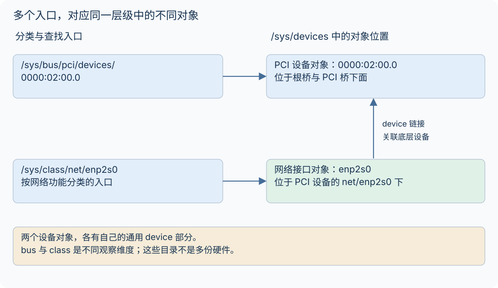
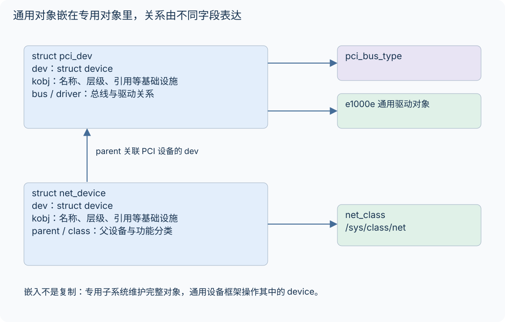
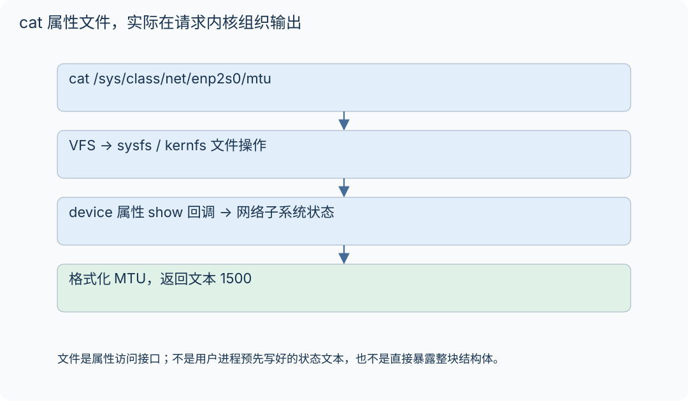

同一块网卡，为什么既能在 `/sys/class/net` 找到，又能在 `/sys/bus/pci/devices` 找到？这些目录里保存了多份设备，还是从不同位置看同一组对象？

本篇从虚拟机中的网卡 `enp2s0` 出发，先沿路径看清对象关系，再对应 `struct device`、总线、驱动与 class。设备管理要解决的是设备怎样被统一描述、关联和观察；具体驱动如何收发数据，暂不展开。

实测环境是 VMware Fusion 中的 Ubuntu ARM64，运行内核 `6.8.0-149-generic`。源码固定参照上游 **Linux v6.8**，发行版可能带有额外补丁。输出中的网卡名、PCI 地址和路径来自这台虚拟机，其他机器需要替换成实际设备。

系列位置：**一：设备模型** · [二：发现与绑定](/p/linux-device-driver-binding/) · [三：设备文件与用户态管理](/p/linux-device-files-udev/)。

## 一、同一块网卡，为什么有不同路径

### 1.1 先沿网络接口找到设备

从网络接口出发，解析符号链接：

```bash
readlink -f /sys/class/net/enp2s0
readlink -f /sys/class/net/enp2s0/device
```

两条命令的完整输出依次是：

```text
/sys/devices/pci0000:00/0000:00:15.0/0000:02:00.0/net/enp2s0
/sys/devices/pci0000:00/0000:00:15.0/0000:02:00.0
```

第一条找到网络接口对象所在的位置，第二条找到它关联的底层设备。本例底层是一块 PCI（Peripheral Component Interconnect，外围组件互连）设备，地址为 `0000:02:00.0`。

**网络接口对象与 PCI 设备对象不是同一个对象。** 它们属于同一块网卡的不同层次：PCI 层描述这块设备怎样连接、怎样匹配驱动；网络子系统描述接口的 MTU、地址和收发状态。一个底层设备也不保证只产生一个上层接口。



沿图从 `/sys/class/net/enp2s0` 开始，先到网络接口对象，再沿 `device` 链接到 PCI 设备。另一侧的 `/sys/bus/pci/devices/0000:02:00.0` 直接定位这块 PCI 设备。图中是两个设备对象、多个观察入口，不能简化成“所有路径都是同一个对象”。

### 1.2 总线与 class 是两个分类维度

再分别查看上下两层的 `subsystem`：

```bash
readlink -f /sys/class/net/enp2s0/subsystem
readlink -f /sys/class/net/enp2s0/device/subsystem
```

完整输出：

```text
/sys/class/net
/sys/bus/pci
```

| 问题 | 对应关系 | 本例 |
| --- | --- | --- |
| 设备处于什么层级 | 设备父子关系 | PCI 设备下面出现网络接口对象 |
| 底层设备按什么规则组织和匹配驱动 | bus | PCI 总线类型 |
| 上层接口提供哪类功能 | class | net 类 |
| 当前是谁接管底层设备 | driver 绑定 | 后面看到的 e1000e |

因此“网卡属于 PCI，还是属于 net”并不是二选一。本例中 PCI 设备与网络接口各有自己的通用设备对象，分别表达总线和功能层次。

`/sys/devices` 展示设备模型的层级，`/sys/bus` 和 `/sys/class` 提供按总线、功能查找的视图。层级中也有虚拟、逻辑设备，不是物理接线图的原样复制；例如 `/sys/devices/virtual` 就组织了没有相应硬件父设备的对象。[设备模型概览](https://docs.kernel.org/6.8/driver-api/driver-model/overview.html)

## 二、内核用什么对象记录这些关系

### 2.1 先用四个字段回答四个问题

内核用 `struct device` 表达设备的通用部分。先只看前面已经观察到的四种关系，下面按 v6.8 源码顺序摘录，其他成员用注释省略：

```c
struct device {
    /* … */
    struct device *parent;
    /* … */
    const struct bus_type *bus;
    struct device_driver *driver;
    /* … */
    const struct class *class;
    /* … */
};
```

| 读者的问题 | 字段 | 放回本例怎样理解 |
| --- | --- | --- |
| 它的父设备是谁？ | `parent` | 网络接口的通用设备部分关联到 PCI 设备 |
| 用哪一类总线规则组织它？ | `bus` | PCI 设备归属 PCI 总线类型 |
| 哪个驱动正在接管它？ | `driver` | 在本次稳定状态下，PCI 设备关联到 e1000e |
| 作为哪一种功能提供给用户？ | `class` | 网络接口归入 net 类 |

表中的“网络接口”和“PCI 设备”分别有自己的 `struct device`。并不是在一个对象上把四个字段都填成同样的值；比如本例网络接口通过父设备关联到 PCI，而不是自己再作为一块 PCI 设备注册。

这样看路径时就有了对应关系：父设备解释层级，总线解释匹配规则，驱动解释接管者，class 解释功能分类。固件信息、设备号和对象释放等字段，在后面相应问题出现时再展开。[v6.8 device 定义](https://github.com/torvalds/linux/blob/v6.8/include/linux/device.h)

### 2.2 专用设备对象把通用部分嵌进去

PCI 层还需要保存厂商号、设备号、资源和中断等信息，不能只靠通用的 `struct device`。它使用 `struct pci_dev`，其中嵌入通用成员：

```c
struct pci_dev {
    /* … */
    struct device dev;
    /* … */
};
```

网络层的 `struct net_device` 也包含用于设备模型的通用设备成员，但它另外组织接口和收发相关状态。两者的专用字段不同，驱动把它们关联起来。



这与前面[内核数据结构篇](/p/linux-kernel-data-structures/)介绍的嵌入式对象设计一致：通用框架操作内嵌成员，专用子系统保留自己的完整对象；需要恢复外层对象时用相应转换辅助函数，而不是随意强制转换地址。[PCI 定义](https://github.com/torvalds/linux/blob/v6.8/include/linux/pci.h) · [网络设备定义](https://github.com/torvalds/linux/blob/v6.8/include/linux/netdevice.h)

### 2.3 bus、driver 和 class 各自负责一件事

下面只摘出理解匹配与分类所需的成员：

```c
struct bus_type {
    const char *name;
    /* … */
    int (*match)(struct device *dev, struct device_driver *drv);
    /* … */
    int (*probe)(struct device *dev);
    /* … */
};

struct device_driver {
    const char *name;
    const struct bus_type *bus;
    /* … */
    int (*probe)(struct device *dev);
    /* … */
};

struct class {
    const char *name;
    /* … */
    const struct attribute_group **dev_groups;
    /* … */
};
```

- **总线**提供设备和驱动之间的匹配、探测等规则。PCI 有厂商与设备标识，其他总线可以用不同依据。
- **驱动对象**登记接管设备所需的回调与归属。一个驱动可以绑定多个匹配设备，而不是每块设备都加载一份独立代码。
- **class**把设备按功能组织起来，例如网络接口、终端和块设备；不是另一套硬件总线。

PCI 的支持列表 `id_table` 位于专用的 `struct pci_driver`，它再内嵌通用驱动对象；总线上的设备与驱动集合则由驱动核心的相关私有结构维护。下一篇会沿这层关系跟踪匹配和探测。[bus 定义](https://github.com/torvalds/linux/blob/v6.8/include/linux/device/bus.h) · [driver 定义](https://github.com/torvalds/linux/blob/v6.8/include/linux/device/driver.h) · [class 定义](https://github.com/torvalds/linux/blob/v6.8/include/linux/device/class.h)

## 三、sysfs 属性是怎样读出来的

### 3.1 cat 的目标是一个属性接口

读取网络接口的最大传输单元（MTU，Maximum Transmission Unit）：

```bash
cat /sys/class/net/enp2s0/mtu
```

完整输出：

```text
1500
```

这个文本由读取动作触发生成：sysfs 把读操作交给内核属性接口，网络子系统从对应对象取得 MTU，再格式化到输出缓冲区。

通用设备属性类型包括：

```c
struct device_attribute {
    struct attribute attr;
    ssize_t (*show)(struct device *dev, struct device_attribute *attr,
                    char *buf);
    ssize_t (*store)(struct device *dev, struct device_attribute *attr,
                     const char *buf, size_t count);
};
```



`attr` 记录名称、权限等元数据，`show` 组织读取结果，`store` 解析写入请求。对于普通文本属性，可按“用户读取 → 虚拟文件系统（VFS，Virtual File System）与 sysfs/kernfs 的文件操作 → 属性回调 → 对象状态”理解；不是把 C 结构体整块映射给用户直接读写。MTU 的具体回调组织位于 `net/core/net-sysfs.c`。[设备属性定义](https://github.com/torvalds/linux/blob/v6.8/include/linux/device.h) · [网络属性实现](https://github.com/torvalds/linux/blob/v6.8/net/core/net-sysfs.c)

### 3.2 能读写属性，不等于能自行创建属性

| 操作 | 含义 |
| --- | --- |
| `cat` 一个可读属性 | 请求内核导出对应状态 |
| 写入一个可写属性 | 按该属性的协议请求修改，可能被校验、拒绝或触发实际操作 |
| 在 sysfs 随意创建文件 | 不能像普通目录那样自行定义内核属性，属性由内核注册 |

因此 sysfs 不是“完全只读”，也不是一个可任意存文件的配置目录。修改 MTU 可以通过网络管理接口完成，本篇只读取，不改变当前实验网络。

属性通常采用简洁文本，一个文件优先表达一个值，同类型数组也是文档允许的形式。不同文件不保证来自同一瞬间的原子快照；多个属性合起来分析状态时，还要考虑设备可能正在变化。[sysfs 属性规则](https://docs.kernel.org/6.8/filesystems/sysfs.html)

### 3.3 kobject 管对象基础设施，不代替驱动

`struct device` 内嵌 `kobject`，使设备模型可以复用名称、父子层级、引用计数和 sysfs 接入。它不负责解释 PCI ID，也不负责发送网络包。

与这部分相关的成员可以集中看成：

```c
struct device {
    struct kobject kobj;
    /* … */
    void (*release)(struct device *dev);
    /* … */
};
```

名称与层级使对象可以出现在 sysfs，引用管理则决定它何时可以最终释放。例如 `get_device()`、`put_device()` 管理设备对象引用，最后的释放由相应 release 路径完成。sysfs 目录删除表示不再从那里公开对象，不等于所有仍在使用它的内核路径都已结束。这件事与进程篇中“退出和最终回收分开”的思路相似：**可见入口、正在使用的引用、实际内存释放是不同阶段。**

设备解绑、停止新请求、处理在途工作和释放私有资源还需要具体子系统与驱动协议，不能只凭一个 kobject 引用计数就解决全部并发问题。[kobject 与生命周期](https://docs.kernel.org/6.8/core-api/kobject.html)

## 四、从目录观察走向驱动绑定

现在再查看 PCI 设备的驱动：

```bash
readlink -f /sys/bus/pci/devices/0000:02:00.0/driver
```

完整输出：

```text
/sys/bus/pci/drivers/e1000e
```

这说明本次观察时，该 PCI 设备关联到 e1000e。前面的网络接口对象由网络子系统公开，底层 PCI 设备由总线框架组织，驱动让两层接起来。

如果另一个对象没有 `driver` 链接，先确认它是否本来就是按总线驱动绑定的对象；对于确实需要绑定的设备，再判断没有匹配驱动、探测失败、延迟探测或尚未加载模块等原因。不能一概称为“坏设备”或“孤儿设备”。

[下一篇](/p/linux-device-driver-binding/)从这个已经存在的绑定关系倒推：设备怎样被发现，驱动怎样注册，模块又怎样知道自己应该加载。

## 五、命令与接口速查

| 命令或接口 | 用途 |
| --- | --- |
| `readlink -f PATH` | 解析链接到最终路径，区分分类入口与对象位置 |
| `/sys/class/net/IFACE/device` | 本例中从网络接口追到底层 PCI 设备 |
| `subsystem`、`driver` 链接 | 观察当前对象的子系统归属和绑定关系 |
| `cat /sys/class/net/IFACE/mtu` | 读取网络接口的 MTU 属性 |
| `dev_set_drvdata()` / `dev_get_drvdata()` | 设置和取得驱动私有状态关联 |
| `get_device()` / `put_device()` | 取得、释放设备对象引用 |
| `show()` / `store()` | 文本属性的读取与写入处理回调 |

## 六、名词解释

| 名词 | 本篇含义 |
| --- | --- |
| 设备模型 | 用通用对象及接口组织设备、总线、驱动、分类与生命周期的框架 |
| sysfs | 将内核对象的属性和关系提供给用户态观察、管理的文件系统 |
| bus | 组织一类设备及其驱动匹配、探测等规则的总线类型 |
| class | 面向用途对设备进行功能分类的对象 |
| kobject | 为嵌入它的内核对象提供名称、层级、引用计数等基础设施 |
| PCI 地址 | 域、总线、设备和功能的定位信息，如 `0000:02:00.0` |
| MTU | 接口在相应链路层约束下使用的最大传输单元 |
| 属性回调 | 访问属性文件时，由内核执行以读取状态或处理写入的函数 |
