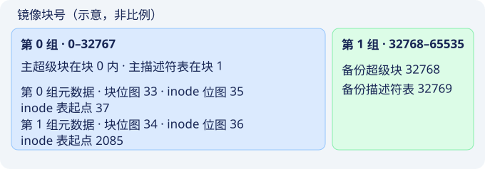
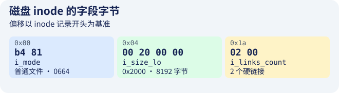
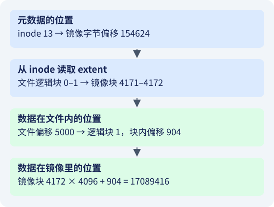

[上一篇](/p/linux-ext4-vfs-objects/)用两个硬链接说明了不同的 `dentry` 如何关联到同一个内存 inode。本篇把视角移到磁盘镜像里。给定一个文件的 inode 编号和一个文件内偏移，能不能算出这个字节在镜像里的位置，并直接读出来？

## 一、在镜像里找出文件的 inode 编号

### 1.1 准备一张可以反复检查的 ext4 镜像

先准备两个硬链接名 `original` 和 `alias`。文件有 8192 字节，内容用空格填充，再把从 0 开始计数的第 5000 字节写成 `X`。实验选用 4096 字节的块，后面就可以验证这个字节如何落到文件的第二个逻辑块。

```bash
lab=$(mktemp -d "$PWD/.ext4-layout.XXXXXX")
mkdir "$lab/tree"

printf '%8192s' '' > "$lab/tree/original"
printf 'X' | dd of="$lab/tree/original" bs=1 seek=5000 conv=notrunc status=none
ln "$lab/tree/original" "$lab/tree/alias"

truncate -s 256M "$lab/ext4.img"
mke2fs -q -t ext4 -b 4096 -d "$lab/tree" "$lab/ext4.img"
```

`dd` 中的 `bs=1` 让 `seek=5000` 以字节为单位，`conv=notrunc` 保留文件其余部分。最后一条命令在普通文件 `ext4.img` 上创建文件系统，并通过 `-d` 将 `tree` 中的内容导入镜像。后续各节都使用这张镜像，检查时可以保持它处于未挂载状态。建议在同一个 shell 里顺序执行，后面的命令会沿用 `$lab`。如果你的 inode 编号或块号和实测不同，按自己的输出重新计算偏移。

**为什么用空格填充？** `printf '%8192s' ''` 输出 8192 个空格。按每块 4096 字节计算，文件的两个逻辑块里都有非零数据，便于后面观察它们在镜像中的映射。

换成 `dd if=/dev/zero of=original bs=4096 count=2`，也能创建一个 8192 字节的文件。接着在偏移 5000 处写入 `X`，只会改动第二个块，第一个块仍全是零。实测中，`mke2fs -d` 导入时跳过了这个全零块，使它在镜像里成为一个空洞。文件长度保持为 8192 字节，读取空洞时仍会得到零。

**这个空洞对实验有什么影响？** 用 `debugfs -R 'stat /original'` 对照，空格版的一个 extent 覆盖逻辑块 `0–1`，零填充版的 extent 只覆盖逻辑块 `1`。偏移 5000 处的 `X` 在逻辑块 1，所以两种镜像都能算出它的位置并直接读到它。

差别出现在逻辑块 0。零填充版从文件开头读仍会得到零，但镜像中没有分配给这个逻辑块的数据块，也就没有可以按 extent 算出来并读取的镜像地址。选空格填充，是为了让后面用同一条 extent 观察两个连续逻辑块如何映射到两个连续的文件系统块。

实验在 Ubuntu 虚拟机上运行，内核为 `6.8.0-149-generic`，`mke2fs` 和 `debugfs` 来自 e2fsprogs 1.47.2。后文对照上游 Linux v6.8 源码。

### 1.2 两个目录项怎样指向同一个 inode？

用 `debugfs` 查看镜像的根目录，再查看 `original` 的 inode 信息。`-R` 让它执行一次指定命令并退出，这里以默认的只读方式打开镜像。

```bash
debugfs -R 'ls -l /' "$lab/ext4.img"
debugfs -R 'stat /original' "$lab/ext4.img"
```

根目录列表节选如下。最左一列是 inode 编号。

```text
     11   40700 (2)      0      0   16384 16-Nov-2026 04:11 lost+found
     13  100664 (1)   1000   1000    8192 16-Nov-2026 04:11 alias
     13  100664 (1)   1000   1000    8192 16-Nov-2026 04:11 original
```

这里的 `lost+found` 由 `mke2fs` 创建。文件系统检查工具 `e2fsck` 修复时，可以把失去原目录项、但还能重新接入目录树的文件放在这里。实测的 `11` 是目录的 inode 编号，`40700` 表示目录及其 `0700` 权限，括号里的 `(2)` 是 ext4 的目录类型编码。`16384` 是目录本身的大小，对应四个 4096 字节块。预先留出目录空间，可以减少修复时为接入文件临时分配目录块的需要。[e2fsprogs 的 lost+found 手册](https://kernel.googlesource.com/pub/scm/fs/ext2/e2fsprogs/+/refs/heads/debian/backports/misc/mklost%2Bfound.8.in)

`original` 和 `alias` 旁边都是 `13`。`debugfs stat` 也报告 `Inode: 13`、`Size: 8192` 和 `Links: 2`。复刻时分配到的编号以自己的输出为准。

从磁盘格式看，目录的数据块里存着目录项。对本例使用的 `ext4_dir_entry_2`，目录项的 `name` 字段记录名字，`inode` 字段记录它指向的 inode 编号。于是 `original` 和 `alias` 在目录中各有一条记录，两条记录都指向同一条磁盘 inode 记录。VFS 查找名字时，可以在内存中用不同的 `dentry` 表达这两个查找结果。[ext4 磁盘目录项格式](https://docs.kernel.org/filesystems/ext4/directory.html)

现在有了编号 `13`，下一步要找的是它在镜像中的记录位置。为此，需要先从超级块读出每组 inode 数和 inode 大小，再从块组描述符找到那一组的 inode 表。

## 二、从超级块和块组描述符找到 inode 表

### 2.1 超级块给出计算所需的尺寸

上一节拿到了 inode 编号 `13`。要定位它，先得知道每组有多少条 inode 记录、每条记录有多少字节。用 `dumpe2fs -h` 读取镜像的超级块信息。

```bash
LC_ALL=C dumpe2fs -h "$lab/ext4.img" |
    grep -E '^(Inode count|Block count|Reserved block count|Free blocks|Block size|Group descriptor size|Reserved GDT blocks|Blocks per group|Inodes per group|Inode size):'
```

虚拟机上的实测输出如下。

```text
Inode count:              65536
Block count:              65536
Reserved block count:     3276
Free blocks:              57234
Block size:               4096
Group descriptor size:    64
Reserved GDT blocks:      31
Blocks per group:         32768
Inodes per group:         32768
Inode size:               256
```

这里读到的是磁盘上的 `struct ext4_super_block`。上一篇的 `struct super_block` 则是挂载后 VFS 使用的内存对象。对于这张从文件系统起点开始的镜像，主超级块位于字节偏移 `1024`，落在文件系统块 `0` 内。下面几个字段为后续计算提供参数。[ext4 超级块格式](https://docs.kernel.org/filesystems/ext4/super.html) · [块组布局](https://docs.kernel.org/6.15/filesystems/ext4/overview.html#layout)

| 磁盘字段 | 本例的值 | 用在哪里 |
| --- | --- | --- |
| `s_log_block_size` | `2` | 按 `2^(10 + 2)` 得到每块 4096 字节，用于把块号换算成镜像偏移。 |
| `s_blocks_per_group` | `32768` | 每个完整块组占 128 MiB，本镜像有两个组。 |
| `s_inodes_per_group` | `32768` | 将 inode 编号换算为块组编号和组内下标。 |
| `s_inode_size` | `256` | 将组内下标换算成 inode 表里的字节偏移。 |

把这些值放在一起，就能算出这张镜像的布局规模。

| 要算什么 | 换算 | 本镜像的结果 |
| --- | --- | --- |
| 每个位图能记录多少项 | `4096 × 8` | 一个块能存 32768 位。本镜像未启用 `bigalloc`，每组的块位图按块记录，inode 位图按 inode 槽位记录，各占恰好一个块。 |
| 块组数 | `65536 ÷ 32768` | 2 个完整块组。 |
| inode 总数 | `2 × 32768` | 65536 个 inode 槽位，与 `Inode count` 一致。 |
| 每组 inode 表大小 | `32768 × 256 B` | 8 MiB，也就是 2048 个块。 |
| 两组 inode 表的占比 | `16 MiB ÷ 256 MiB` | 6.25% 的镜像容量用于 inode 表。 |
| 主描述符表大小 | `2 × 64 B` | 两条描述符占 128 字节，当前用一个块存放。一个 4 KiB 块最多装 64 条这样的描述符。 |

[块位图和 inode 位图](https://docs.kernel.org/filesystems/ext4/bitmaps.html) · [块组描述符格式](https://docs.kernel.org/filesystems/ext4/group_descr.html)

**每个 inode 对应 4 KiB 是配置密度。** 用总容量除以 inode 槽位数，`256 MiB ÷ 65536 = 4 KiB`。它表示按文件系统总容量平均预留了多少 inode，文件可以占多个数据块。这个值符合实验虚拟机 `/etc/mke2fs.conf` 中的 `small` 档位，而该文件的全局默认值为 16 KiB。建文件系统时可用 `-i` 指定每个 inode 对应的容量，或用 `-N` 指定目标 inode 数量，最终数量以工具输出为准。[mke2fs 参数说明](https://manpages.ubuntu.com/manpages/noble/man8/mke2fs.8.html)

**剩余空间看 `Free blocks`。** 两组 inode 表已经占去 4096 块，超级块、描述符及其备份、位图、日志和已写入的内容也占块。镜像实测还有 57234 个空闲块，约 223.6 MiB。另有 3276 个保留块计入这些空闲块的总数，普通用户可分配的空间还要再扣去这部分。描述符表预留的 31 个扩容块则由 `Reserved GDT blocks` 单独报告。[mke2fs 的保留空间参数](https://manpages.ubuntu.com/manpages/noble/man8/mke2fs.8.html)

### 2.2 块组描述符告诉我们表放在哪里

知道 inode 所属块组后，需要查该组的描述符来找到 inode 表。用 `dumpe2fs -g` 查看每组的布局。

```bash
LC_ALL=C dumpe2fs -g "$lab/ext4.img"
```

```text
group:block:super:gdt:bbitmap:ibitmap:itable
0:0:0:1-1:33:35:37
1:32768:32768:32769-32769:34:36:2085
```

`block` 是该组的起始块号，`super` 和 `gdt` 分别标记超级块和块组描述符表所在的块。最后三列是块位图、inode 位图和 inode 表的位置。对第 0 组，`itable=37` 表示 inode 表从文件系统块 `37` 开始。磁盘描述符用 `bg_inode_table_lo` 及适用时的 `bg_inode_table_hi` 记录这个块号。[块组描述符字段](https://docs.kernel.org/filesystems/ext4/group_descr.html)



本镜像启用了 `resize_inode`。主描述符表之后的块 `2–32` 是为将来扩展描述符表预留的。镜像也启用了 `sparse_super`，第 0 组存主副本，第 1 组存备份。规模更大时，备份还会出现在编号为 3、5 或 7 的幂的组中。[超级块与备份布局](https://docs.kernel.org/filesystems/ext4/super.html)

第 1 组从块 `32768` 开始，但它的 inode 表从块 `2085` 开始，仍落在第 0 组的范围内。这张镜像启用了 `flex_bg`，允许把若干块组的位图和 inode 表集中起来。定位某组的 inode 表时，**直接查该组描述符里的块号**。[flex_bg 与可变的元数据位置](https://docs.kernel.org/filesystems/ext4/group_descr.html)

现在手里有每组 inode 数、每条记录的字节数，以及两组 inode 表的起始块号。下一节把这些数字代入，算出 inode `13` 在镜像里的确切位置。

## 三、把 inode 编号换成镜像里的字节偏移

### 3.1 先找哪一张表，再找表里的哪一项

目录项给出的 inode 编号是 `13`。ext4 的 inode 编号从 1 开始，表内下标从 0 开始。先减 1，再用每组的 inode 数做整数除法：商选块组，余数选组内槽位。[ext4 inode 表索引规则](https://docs.kernel.org/filesystems/ext4/inodes.html)

| 要找的量 | 本例的计算 | 结果 |
| --- | --- | --- |
| 块组编号 | `(13 - 1) / 32768`，取整数商 | 第 `0` 组 |
| 组内下标 | `(13 - 1) % 32768` | 下标 `12`，也就是第 13 条记录 |
| inode 表起始块 | 查第 0 组描述符的 `itable` | 块 `37` |
| 记录在表内的字节偏移 | `12 × 256` | `3072` 字节，即 `0x0c00` |
| 记录在镜像里的字节偏移 | `37 × 4096 + 3072` | `154624` 字节，即 `0x25c00` |

Linux v6.8 的 `__ext4_get_inode_loc` 用的是同一套算法，只是把表内偏移拆成**块号和块内偏移**。每个 4096 字节块能装 16 条 inode 记录。本例的下标 12 落在表的第一个块，所以块号仍为 37，块内偏移是 3072。如果下标是 16，就要进入表的下一块，块内偏移回到 0。[Linux v6.8 的 inode 定位实现](https://github.com/torvalds/linux/blob/v6.8/fs/ext4/inode.c#L4057)

### 3.2 用 debugfs 核对位置

```bash
debugfs -R 'imap /original' "$lab/ext4.img"
```

实测结果与手算一致。

```text
debugfs 1.47.2 (1-Jan-2025)
Inode 13 is part of block group 0
        located at block 37, offset 0x0c00
```

这里的 `0x0c00` 是**块 37 内部**的偏移。从镜像开头读，仍要先跳过前面的 37 个块。

### 3.3 直接读出磁盘 inode 的字段

用 `od` 从镜像偏移 `154624` 开始读取 32 字节，并按单字节十六进制显示。重新创建镜像后，时间戳等字节会随环境变化。若你的 `imap` 给出了不同的块号或块内偏移，就先用「块号 × 块大小 + 块内偏移」重算 `inode_offset`，后面读取 `i_block` 时也会用到它。

```bash
inode_offset=$((37 * 4096 + 12 * 256))
od -An -v -tx1 -j "$inode_offset" -N 32 "$lab/ext4.img"
```

```text
 b4 81 e8 03 00 20 00 00 a4 c5 fa 6a a4 c5 fa 6a
 a4 c5 fa 6a 00 00 00 00 e8 03 02 00 10 00 00 00
```



下面的字段偏移都从**这条 inode 记录的开头**计数。ext4 的这些字段按小端序存储，即最低有效字节先出现。[磁盘 inode 字段定义](https://docs.kernel.org/filesystems/ext4/inodes.html)

| 记录内偏移 | 磁盘字段 | 实测字节 | 解读 |
| --- | --- | --- | --- |
| `0x00` | `i_mode` | `b4 81` | `0x81b4`，普通文件，权限 `0664`。 |
| `0x04` | `i_size_lo` | `00 20 00 00` | 大小的低 32 位为 `0x2000`。本例文件大小为 8192 字节。 |
| `0x1a` | `i_links_count` | `02 00` | 硬链接数为 2，与 `original`、`alias` 对应。 |

到这里，我们用目录项里的编号找到了磁盘上的 inode 记录，也从原始字节核对了它的元数据。要找偏移 5000 处的 `X`，下一节再往记录里的 `i_block` 看，找到负责映射文件数据的 extent。

## 四、沿 extent 找到偏移 5000 处的字节

### 4.1 一条 extent 怎样表示两个块？

前面算出的 `154624` 是 inode 记录的位置。文件内容的位置还要从这条记录里的 `i_block` 继续找。对实验里启用了 extent 的普通文件，`i_block` 保存 extent 树的根。用 `debugfs` 先看解码结果。[ext4 的 i_block 与 extent 树](https://docs.kernel.org/filesystems/ext4/ifork.html)

```bash
debugfs -R 'stat /original' "$lab/ext4.img" | sed -n '/EXTENTS:/,$p'
```

```text
debugfs 1.47.2 (1-Jan-2025)
EXTENTS:
(0-1):4171-4172
```

冒号左边是**从文件开头数的逻辑块号**，右边是**从文件系统开头数的块号**。逻辑块 0 对应镜像里的块 4171，逻辑块 1 对应 4172。一条 extent 只需记录逻辑起点、块数和文件系统块的起点，就能表示这段连续映射。

### 4.2 从 inode 的原始字节验证 extent

`i_block` 从磁盘 inode 记录内的 `0x28` 开始。这个例子只需要读取头部和紧随其后的第一条记录，各占 12 字节。

```bash
od -An -v -tx1 -j "$((inode_offset + 0x28))" -N 24 "$lab/ext4.img"
```

```text
 0a f3 01 00 04 00 00 00 00 00 00 00 00 00 00 00
 02 00 00 00 4b 10 00 00
```


按小端序解读，前 12 字节是 `ext4_extent_header`，后 12 字节是 `ext4_extent`。[extent 头部和叶子记录格式](https://docs.kernel.org/filesystems/ext4/ifork.html#extent-tree)

| 所在结构 | 字段 | 实测值 | 含义 |
| --- | --- | --- | --- |
| 头部 | `eh_magic` | `0xf30a` | extent 树节点的标记。 |
| 头部 | `eh_entries`、`eh_max` | 1、4 | 当前有 1 条记录，这个节点最多容纳 4 条。 |
| 头部 | `eh_depth` | 0 | 树根本身就是叶子，紧接头部的记录直接描述文件数据。 |
| 记录 | `ee_block` | 0 | 从文件逻辑块 0 开始。 |
| 记录 | `ee_len` | 2 | 映射两个连续的已初始化块。 |
| 记录 | `ee_start_hi`、`ee_start_lo` | `0x0000`、`0x0000104b` | 合成文件系统起始块号 4171。 |

映射更多时，树根可以存放指向下一层节点的索引。本例深度为 0，整个映射直接存于 inode 中。

### 4.3 把文件内偏移换成镜像偏移



| 要找的量 | 计算 | 结果 |
| --- | --- | --- |
| 文件逻辑块号 | `5000 / 4096`，取整数商 | 1 |
| 块内偏移 | `5000 % 4096` | 904 |
| 文件系统块号 | `4171 + (1 - 0)` | 4172 |
| 镜像字节偏移 | `4172 × 4096 + 904` | 17089416 |

第三步加的是目标块相对于 **extent 逻辑起点** 的距离。Linux v6.8 在 `ext4_ext_map_blocks` 查到覆盖目标的 extent 后，也按这个关系计算文件系统块号。[Linux v6.8 的 extent 查找与映射](https://github.com/torvalds/linux/blob/v6.8/fs/ext4/extents.c#L3914)

从镜像和导入前的源文件分别读取一个字节。复现实验时，如果 `debugfs` 输出的块号不同，先按自己的映射重新计算。

```bash
image_offset=$((4172 * 4096 + 904))
od -An -tc -j "$image_offset" -N 1 "$lab/ext4.img"
od -An -tc -j 5000 -N 1 "$lab/tree/original"
```

两条命令的实测输出依次如下。

```text
   X
   X
```

从目录项里的 inode 编号出发，我们找到了 inode 记录，读出了 extent，并在镜像里找到了偏移 5000 处的 `X`。同一个文件偏移也可以拿来对照页缓存的寻址单位。

### 4.4 为什么实验选 4 KiB 块？

ext4 在创建文件系统时确定块大小，本实验通过 `mke2fs -b 4096` 显式选定。对于按块分配的普通文件，块越大，文件尾部未用满时可能留下越多空间。块越小，同样容量就要用更多块来编号和跟踪。4 KiB 是 ext4 的常见选择，也恰好与这台虚拟机的基础页大小一致。[ext4 块大小](https://docs.kernel.org/6.15/filesystems/ext4/overview.html#blocks)

```bash
getconf PAGE_SIZE
```

```text
4096
```

| 两个 4096 各管什么 | 偏移 `5000` 落在哪里 |
| --- | --- |
| ext4 文件系统块大小 | 文件逻辑块 `1`，块内偏移 `904`。前面用 extent 找到了镜像中的块 4172。 |
| Linux 基础页大小 | 落在第二个基础页大小的区间（从 0 编号为 `1`），区间内偏移同样是 `904`。缓冲读可以通过页缓存取得这段数据。 |

两个数字在本机相等，各自来自文件系统格式和内核配置。页缓存也可以用包含多个基础页的 folio 管理数据。内存紧张时，干净的文件缓存可以被回收，之后再读时可以从文件重新装入。脏的文件缓存通常需要先完成回写。回收的是缓存占用的内存，镜像中的块分配仍由 ext4 管理。后面的读取篇会接着追缓存未命中，内存管理篇再看内核如何选择回收对象。[VFS 页缓存与回写接口](https://docs.kernel.org/filesystems/vfs.html)

## 五、位图怎样记录 inode 和块的占用状态？

前面从目录项找到了 inode `13`，又从它的 extent 找到了数据块 `4171–4172`。现在换个角度。ext4 以后需要给另一个文件分配空间时，怎么知道这三个位置已经被占用？

第 0 组的描述符给出了两张位图的位置。inode 位图在块 `35`，块位图在块 `33`。在这张未启用 `bigalloc` 的镜像里，inode 位图每一位对应一个 inode 槽位，块位图每一位对应一个文件系统块。位为 1 表示已占用，位为 0 表示空闲。[ext4 位图格式](https://docs.kernel.org/filesystems/ext4/bitmaps.html)

### 5.1 先算出要读哪个字节

两张位图都从**组内下标 0**开始。一字节有 8 位，组内下标除以 8 的整数商是字节偏移，余数是该字节里从最低有效位起算的位号。

| 检查对象 | 组内下标 | 位图块号 | 位图内字节偏移 | 字节内位号 |
| --- | --- | --- | --- | --- |
| inode 13 | `13 - 1 = 12` | 35 | `12 / 8 = 1` | `12 % 8 = 4` |
| inode 14 | `14 - 1 = 13` | 35 | `13 / 8 = 1` | `13 % 8 = 5` |
| 块 4171 | `4171 - 0 = 4171` | 33 | `4171 / 8 = 521` | `4171 % 8 = 3` |
| 块 4172 | `4172 - 0 = 4172` | 33 | `4172 / 8 = 521` | `4172 % 8 = 4` |

这里检查的对象都在第 0 组。inode 编号从 1 开始，所以先减 1。对于文件系统块号，则减去它所在组的起始块号。本例第 0 组从块 0 开始。[Linux v6.8 的块组与组内下标换算](https://github.com/torvalds/linux/blob/v6.8/fs/ext4/balloc.c#L50)

### 5.2 直接读位图，再用 debugfs 核对

```bash
od -An -tx1 -j "$((35 * 4096 + 1))" -N 1 "$lab/ext4.img"
od -An -tx1 -j "$((33 * 4096 + 521))" -N 1 "$lab/ext4.img"
```

虚拟机实测，两条命令都输出 `1f`，即二进制的 `00011111`。从右往左数，最低位是第 0 位。inode 位图的第 4 位为 1、第 5 位为 0，因此 inode 13 已占用，inode 14 空闲。块位图的第 3、4 位都为 1，因此块 4171 和 4172 都已占用。两张位图碰巧读到了相同的字节值，每一位在各自的位图中仍对应不同对象。

```bash
debugfs -R 'testi <13>' "$lab/ext4.img"
debugfs -R 'testi <14>' "$lab/ext4.img"
debugfs -R 'testb 4171' "$lab/ext4.img"
debugfs -R 'testb 4172' "$lab/ext4.img"
```

实测结果如下，节选了每条命令的检查结果。

```text
Inode 13 is marked in use
Inode 14 is not in use
Block 4171 marked in use
Block 4172 marked in use
```

extent 告诉我们**这个文件的逻辑块映射到哪里**，块位图告诉分配器**哪些块已经有人占用**。inode 表和 inode 位图也是这个分工：表里放记录，位图标出哪些槽位已经分配。以后读到页缓存未命中，还会用到文件偏移与文件系统块号之间的映射。

## 六、命令与参数速查

| 命令或参数 | 本篇用来做什么 |
| --- | --- |
| `truncate -s 256M "$lab/ext4.img"` | 把镜像文件的逻辑长度设为 256 MiB。 |
| `mke2fs -t ext4 -b 4096 -d "$lab/tree" "$lab/ext4.img"` | 创建 4 KiB 块的 ext4 文件系统，并导入实验目录。 |
| `dumpe2fs -h`、`dumpe2fs -g` | 分别查看超级块概要和各块组的元数据位置。 |
| `getconf PAGE_SIZE` | 查看运行实验的系统使用的基础页大小。 |
| `debugfs -R 'ls -l /'`、`debugfs -R 'stat /original'` | 查看镜像中的目录项、inode 元数据和 extent。 |
| `debugfs -R 'imap /original'` | 核对 inode 记录所在的文件系统块号和块内偏移。 |
| `debugfs -R 'testi <13>'`、`debugfs -R 'testb 4171'` | 分别核对指定 inode 槽位和文件系统块的占用状态。 |
| `dd bs=1 seek=5000 conv=notrunc` | 在生成实验文件时，从输出偏移 5000 写入标记字节，同时保留其余内容。 |
| `od -An -v -tx1 -j 偏移 -N 字节数` | 从指定字节偏移开始，以十六进制逐字节查看镜像。要直接看字符时可用 `-tc`。 |

前三类位置可以分别核对。目录项给出 **inode 编号**，块组描述符和 inode 表尺寸把它换成 **inode 记录的镜像偏移**，extent 再把 **文件内偏移**换成目标数据的镜像偏移。本例最终读出的 `X`，就是这条查找链的验证结果。
