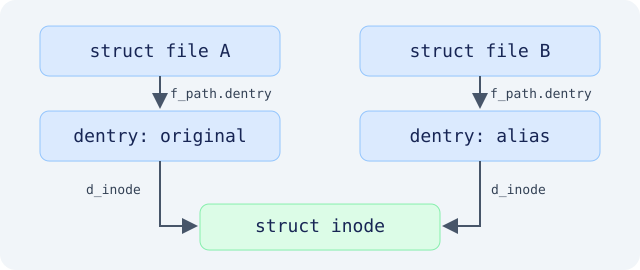
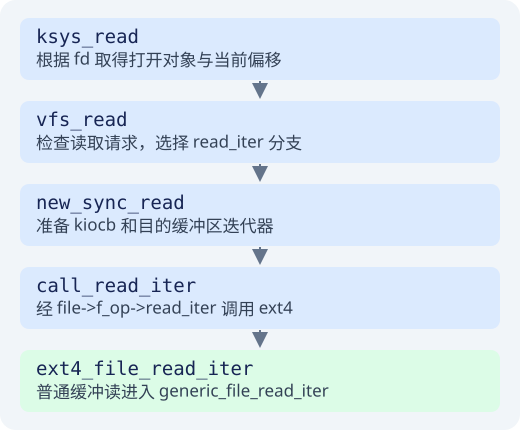

[上一篇](/p/linux-file-object-model/)从 fd 表追到了 `struct file`。这次从打开对象继续往下看。分别通过两个硬链接打开同一个 ext4 文件，会得到两个 `struct file`。它们各自的 `f_path.dentry` 对应打开时用到的名字，最终都关联到同一个 inode。本篇追到 VFS 把读请求交给 ext4 为止，磁盘布局留到下一篇，页缓存再往后。

## 一、从 f_path 看两个名字如何指向同一个 inode

### 1.1 两个名字指向哪个文件？

在 Ubuntu 虚拟机的 ext4 目录中，新建一个普通文件，再用 `ln` 给它增加一个名字。实验内核是 `6.8.0-149-generic`，下文的源码摘录以上游 Linux v6.8 为基线。

```bash
lab=$(mktemp -d "$PWD/.vfs-links.XXXXXX")
cd "$lab"
findmnt -n -T . -o FSTYPE
printf ABCD > original
ln original alias
stat -c '%n inode=%i links=%h' original alias
```

一次实测结果如下。inode 编号会因环境而异。

```text
ext4
original inode=524325 links=2
alias inode=524325 links=2
```

两个名字在同一个文件系统中得到相同的 inode 编号。链接数 2 表明有两个硬链接。现在分别用这两个名字打开文件，内核分别从哪个对象记住路径，又从哪个对象取得文件本身的信息？

### 1.2 struct path 同时记录挂载和 dentry

`struct file` 里的 `f_path` 是一个 `struct path`。Linux v6.8 中，这个结构包含两个指针。[struct path 定义](https://github.com/torvalds/linux/blob/v6.8/include/linux/path.h#L8)

```c
struct path {
    struct vfsmount *mnt;
    struct dentry *dentry;
} __randomize_layout;
```

`mnt` 给出路径所在的挂载，`dentry` 给出查找命中的内存目录项。两个名字在同一目录下，两次打开因而经过同一个挂载。沿着图中的 `f_path.dentry` 往下看，两条路径分别命中自己的 dentry，最后汇到同一个 inode。



### 1.3 dentry 保存名字与 inode 的关联

下面摘出和本例有关的字段。对这两个已经成功解析的名字，`d_parent` 指向父目录的 dentry，`d_name` 保存当前名字，`d_inode` 指向对应的内存 inode。`d_sb` 则指向这个 dentry 所属的文件系统实例。[struct dentry 定义](https://github.com/torvalds/linux/blob/v6.8/include/linux/dcache.h)

```c
struct dentry {
    /* … */
    struct dentry *d_parent;
    struct qstr d_name;
    struct inode *d_inode;
    /* … */
    struct super_block *d_sb;
    /* … */
};
```

在上一篇跟过的普通文件打开路径里，`vfs_open` 先把解析得到的 `struct path` 写进 `file->f_path`，再从 dentry 取得用于打开的 inode，交给 `do_dentry_open` 保存到 `file->f_inode`。对于本例的 ext4 普通文件，两个 dentry 的 `d_inode` 指向同一个 inode，因此两次打开得到的 `f_inode` 相同，`f_path.dentry` 各自指向实际用到的名字。[虚拟文件系统的打开入口](https://github.com/torvalds/linux/blob/v6.8/fs/open.c#L1084) · [d_backing_inode](https://github.com/torvalds/linux/blob/v6.8/include/linux/dcache.h#L500)

`stat` 的输出展示的是 inode 编号和链接数。图中的指针关系则来自源码。沿共享的 inode 继续往下，还可以通过 `i_sb` 找到它所属的文件系统实例。

## 二、从 inode 找到 ext4 文件系统实例

### 2.1 inode 编号在哪个范围内有意义？

第一节中，`original` 和 `alias` 在同一个 ext4 文件系统里报告了相同的 inode 编号。这个条件很重要。另一块磁盘上的 ext4 文件系统也可以有编号 524325 的 inode。判断两个路径是否指向同一个文件，可以对照 `stat` 返回的设备号与 inode 编号，也就是 `st_dev` 和 `st_ino`。

内核中也有类似的范围。ext4 按 superblock 和 inode 编号查找内存中的 inode，`ext4_iget` 的实现会用到 `iget_locked(sb, ino)`。两个硬链接查到同一个文件系统实例里的同一个编号，就能关联到同一个内存 inode。[ext4 的 inode 获取实现](https://github.com/torvalds/linux/blob/v6.8/fs/ext4/inode.c) · [VFS 的 iget_locked](https://github.com/torvalds/linux/blob/v6.8/fs/inode.c)

对这个普通文件，`struct inode` 中值得先认识的字段如下。[Linux v6.8 的 inode 定义](https://github.com/torvalds/linux/blob/v6.8/include/linux/fs.h)

| 字段 | 它回答的问题 |
| --- | --- |
| `i_ino` | 在这个文件系统里，文件编号是多少？对应实验中的 inode 编号。 |
| `i_nlink` | 还有几个硬链接指向它？创建 `alias` 后，两次查询都得到 2。 |
| `i_mode`、`i_size` | 文件是什么类型、权限是什么、逻辑长度是多少？ |
| `i_sb` | 这个 inode 属于哪个文件系统实例？它指向内存中的 `struct super_block`。 |

ext4 把通用的 `struct inode` 嵌在 `struct ext4_inode_info` 的 `vfs_inode` 成员里。VFS 可以通过通用字段访问文件信息，ext4 则能通过 `EXT4_I(inode)` 从成员地址取回外层结构，使用自己的状态，例如 extent 状态树。这两层属于同一个内存对象的布局。[ext4_inode_info 与 EXT4_I](https://github.com/torvalds/linux/blob/v6.8/fs/ext4/ext4.h)

### 2.2 挂载和 super_block 各回答什么？

在第一节的实验目录里，可以用两条命令分别观察挂载和文件系统信息。

```bash
findmnt -rn -T . -o TARGET,SOURCE,FSTYPE,MAJ:MIN
stat -f -c 'magic=%t fundamental_block_size=%S' .
```

同一台虚拟机上的输出如下。

```text
/ /dev/mapper/ubuntu--vg-ubuntu--lv ext4 252:0
magic=ef53 fundamental_block_size=4096
```

第一行显示实验目录经由 `/` 这个挂载访问 ext4，底层块设备的主次设备号为 `252:0`。第二行显示文件系统报告的魔数和基本块大小。`ef53` 也是 ext2 和 ext3 使用的魔数，具体类型这里以 `findmnt` 的 `ext4` 为准。[ext4 的 statfs 实现](https://github.com/torvalds/linux/blob/v6.8/fs/ext4/super.c)

回到内核对象。手里拿到的对象不同，查找文件系统实例的入口也不同。

| 想知道什么 | 从哪个字段取 | 典型用途 |
| --- | --- | --- |
| 这个 inode 属于哪个文件系统实例？ | `inode->i_sb` | ext4 已经拿到 inode，要访问该实例的私有状态。 |
| 这个 dentry 归哪个文件系统实例管理？ | `dentry->d_sb` | VFS 管理某个文件系统的 dentry 缓存。查找未命中时，负 dentry 的 `d_inode` 为 `NULL`，仍可通过 `d_sb` 找到所属实例。 |
| 这次打开经过哪个挂载？ | `file->f_path.mnt` | 要区分原挂载和 bind mount，或判断本次访问使用的挂载根和挂载标志。已有挂载时，可以再用 `mnt->mnt_sb` 找它引用的文件系统实例。 |

Linux v6.8 分配 dentry 时就会设置 `d_sb`。例如，`d_alloc(parent, name)` 用父目录的 `d_sb` 给子 dentry 指定归属，此时新 dentry 还可以没有 inode。内核也用 `d_sb->s_dentry_lru` 将不用的目录项放到各个文件系统实例自己的回收列表中。[dentry 初始化](https://github.com/torvalds/linux/blob/v6.8/fs/dcache.c#L1563) · [目录项回收列表](https://github.com/torvalds/linux/blob/v6.8/fs/dcache.c#L395)

在本例中，`i_sb`、`d_sb` 和 `mnt_sb` 都指向同一个 `struct super_block`。可以从它查看实例级的信息。[vfsmount 定义](https://github.com/torvalds/linux/blob/v6.8/include/linux/mount.h#L64) · [super_block 定义](https://github.com/torvalds/linux/blob/v6.8/include/linux/fs.h)

| 字段 | 对应什么 |
| --- | --- |
| `s_root` | 文件系统实例的根 dentry。 |
| `s_type` | 文件系统类型，本例为 ext4。 |
| `s_op` | 实例级操作表。 |
| `s_fs_info` | 文件系统私有状态，ext4 用它关联 `struct ext4_sb_info`。 |

### 2.3 同一个文件，能从两个挂载访问吗？

上一节说，`inode->i_sb` 能找到文件所属的 ext4 实例。那它能告诉我们，这次打开经过哪个挂载吗？把 `source` 目录 bind mount 到 `view`，再从两个入口访问同一个 `data.txt`，就能把这两个问题分开来看。

| 实测项 | `source/data.txt` | `view/data.txt` |
| --- | --- | --- |
| 挂载 ID | 33 | 72 |
| 设备号与 inode 编号 | `64512`、`524331` | `64512`、`524331` |

两个入口的挂载 ID 不同，设备号和 inode 编号相同。访问 `view/data.txt` 时，路径查找从 `view` 进入新挂载，再从这个挂载的 `mnt_root`，也就是原来的 `source` 目录，继续找 `data.txt`。两个挂载共用原有的 ext4 superblock。**实例的根和挂载的根各有用途。** 同一个 `super_block` 的 `s_root` 仍指向该 ext4 文件系统的根，在本例中通过 `/` 可达。新挂载的 `mnt_root` 则指向其中的 `source` 子目录。

回到打开对象，**`f_path.mnt` 记录这次打开经过的挂载**，可以区分实测里的 33 和 72。[bind mount 实现](https://github.com/torvalds/linux/blob/v6.8/fs/namespace.c)

把这个例子和第一节的硬链接放在一起，更容易看清 `f_path` 的两个成员分别记录了什么。

| 怎样打开同一个文件 | `f_path.dentry` | `f_path.mnt` | inode |
| --- | --- | --- | --- |
| 在同一个目录下，用两个硬链接名打开 | 不同 | 相同 | 相同 |
| 从原路径和 bind mount 入口打开 | 相同 | 不同 | 相同 |

在 ext4 目录里运行，需要能执行 `sudo mount`。脚本退出时会卸载临时挂载并清理实验目录。

```bash
(
    set -eu
    lab=$(mktemp -d "$PWD/.vfs-bind.XXXXXX")
    cleanup() {
        if mountpoint -q "$lab/view"; then
            sudo umount "$lab/view" || return
        fi
        rm -f -- "$lab/source/data.txt"
        rmdir -- "$lab/view" "$lab/source" "$lab"
    }
    mkdir "$lab/source" "$lab/view"
    trap cleanup EXIT

    printf 'hello\n' > "$lab/source/data.txt"
    sudo mount --bind "$lab/source" "$lab/view"

    for entry in source view; do
        file="$lab/$entry/data.txt"
        printf '%s\n' "$entry"
        findmnt -rn -T "$file" -o ID,MAJ:MIN,FSROOT,TARGET
        stat -c 'dev=%d inode=%i links=%h' "$file"
    done
)
```

Ubuntu 虚拟机上的实测输出如下。设备号、挂载 ID 和 inode 编号会随实验环境变化。

```text
source
33 252:0 / /
dev=64512 inode=524331 links=1
view
72 252:0 /home/lxj/.vfs-bind.Lat1Md/source /home/lxj/.vfs-bind.Lat1Md/view
dev=64512 inode=524331 links=1
```

输出中，`FSROOT` 是挂载根在 ext4 内部的位置，`TARGET` 是当前目录树中进入这个挂载的位置。新挂载的根是 `source`，入口是 `view`。两条路径看到的硬链接数均为 1。[mountinfo 字段的生成](https://github.com/torvalds/linux/blob/v6.8/fs/proc_namespace.c#L126)

这里的 `view` 正是[第三篇路径解析图](/p/linux-file-object-model/#32-openat-path-walk)里切换挂载的那一步。跨进去以后，当前的 `struct path` 已换成新挂载和 `source` 对应的根 dentry。接下来查找的 `data.txt` 与原路径查到的是同一个文件。

挂载也可能仍被进程引用。我在虚拟机上另建了一个临时 bind mount，在子 shell 中 `cd` 进入挂载后尝试普通卸载，`umount` 报告 `target is busy`。子 shell 退出后再次执行卸载，操作成功。工作目录持有的路径引用会让挂载保持忙碌，打开文件也可能持有这类引用。[Linux v6.8 的普通卸载检查](https://github.com/torvalds/linux/blob/v6.8/fs/namespace.c#L1686)

这里的 `struct super_block` 是 VFS 在内存中使用的实例对象。ext4 磁盘上还有自己的 `struct ext4_super_block`，描述磁盘格式和文件系统参数。两者如何关联，等到磁盘布局篇再看。这一篇接下来沿 inode 上的 `i_fop` 找到打开对象的 `f_op`。

## 三、ext4 的操作表怎样绑定到打开对象？

### 3.1 ext4 在准备 inode 时选定 i_fop

分别以只读方式打开 `original` 和 `alias`，会得到两个 `struct file`。它们经过不同的 dentry，到达同一个 ext4 普通文件 inode。接下来的问题是，VFS 如何知道应该用 ext4 的实现来操作这两个打开对象？

**创建文件时**，第一节的重定向走到 ext4 的普通文件创建路径 `ext4_create`，由它设置 `i_fop`。[创建文件时设置操作表](https://github.com/torvalds/linux/blob/v6.8/fs/ext4/namei.c#L2664)

**加载已有 inode 时**，内存中找不到对应对象，`__ext4_iget` 会从磁盘读取 inode 信息，再根据 `i_mode` 选择操作表。[加载 inode 时按类型选择操作表](https://github.com/torvalds/linux/blob/v6.8/fs/ext4/inode.c#L4606)

| 文件类型 | `inode->i_fop` | 这张表提供什么 |
| --- | --- | --- |
| ext4 普通文件 | `ext4_file_operations` | 普通文件的打开、读取、写入等操作。 |
| ext4 目录 | `ext4_dir_operations` | 目录打开后使用的操作，例如遍历目录项。 |

沿着打开 `alias` 的过程，可以把源码中经常相邻的两个字段分开看。

| 要做什么 | 从哪里取回调 |
| --- | --- |
| 查找 `alias` 这个名字 | VFS 可以用**父目录 inode** 的 `i_op->lookup`。 |
| 打开已找到的文件 | VFS 从**目标 inode** 的 `i_fop` 取得操作表，再绑定到打开对象。 |

[ext4 的目录 inode 操作](https://github.com/torvalds/linux/blob/v6.8/fs/ext4/namei.c) · [ext4 普通文件的操作表](https://github.com/torvalds/linux/blob/v6.8/fs/ext4/file.c)

### 3.2 VFS 打开文件时把 i_fop 绑定到 f_op

路径解析已经取得 inode 后，上一篇出现过的 `do_dentry_open` 在普通打开路径上执行这行代码。[VFS 绑定操作表](https://github.com/torvalds/linux/blob/v6.8/fs/open.c#L934)

```c
f->f_op = fops_get(inode->i_fop);
```

`fops_get` 取得同一张操作表的指针，并按需要持有提供者模块的引用。对本例，两个打开对象各有自己的 `f_op` 字段，都指向同一张 `ext4_file_operations` 表。它们也各有自己的 `f_pos`，所以共用操作表并不会让两次独立打开共享偏移。

绑定好操作表之后，`do_dentry_open` 会执行适用的打开回调。对本例，表中的 `.open` 指向 `ext4_file_open`。后续 `read` 仍从同一个打开对象取 `f_op`，再选择读回调。到这里已经能看出 VFS 与 ext4 的分工。VFS 处理打开的通用步骤和回调分发，ext4 通过操作表提供自己的实现。[VFS 调用打开回调](https://github.com/torvalds/linux/blob/v6.8/fs/open.c#L950) · [ext4 的回调定义](https://github.com/torvalds/linux/blob/v6.8/fs/ext4/file.c)

## 四、一次 read 怎样从 VFS 走到 ext4？

### 4.1 VFS 如何选中 ext4 的读回调？

在第一节的实验目录里，用 `dd` 从 `alias` 读取一个字节，再用 `strace` 查看它打开了哪个文件、读到了什么。`-P` 按绝对路径筛选跟踪记录，结果直接显示在终端。`>/dev/null` 只丢弃 `dd` 读到的文件内容。

```bash
strace -qq -y -e trace=openat,read -P "$PWD/alias" dd if="$PWD/alias" bs=1 count=1 status=none >/dev/null
```

虚拟机上的实测输出如下。调用末尾的 `= 1` 表示实际读取了一个字节，`"A"` 是返回后缓冲区中的内容。

```text
openat(AT_FDCWD</home/lxj/.vfs-links.4GsILU>, "/home/lxj/.vfs-links.4GsILU/alias", O_RDONLY|O_CLOEXEC) = 3</home/lxj/.vfs-links.4GsILU/alias>
read(3</home/lxj/.vfs-links.4GsILU/alias>, "A", 1) = 1
```

这两行能观察到系统调用及返回结果。至于进入内核后怎样选中 ext4 的读回调，就要回到前一节绑定的 `ext4_file_operations`，沿 Linux v6.8 源码追下去。



`vfs_read` 检查打开模式、用户地址范围和读取范围，然后优先检查 `f_op->read`。ext4 普通文件表提供的是 `.read_iter`，因此本例经 `new_sync_read` 和 `call_read_iter` 到达 `ext4_file_read_iter`。[VFS 读分支](https://github.com/torvalds/linux/blob/v6.8/fs/read_write.c#L428) · [ext4 普通文件操作表](https://github.com/torvalds/linux/blob/v6.8/fs/ext4/file.c)

### 4.2 read 的缓冲区和偏移怎样传下去？

在调用 ext4 之前，`new_sync_read` 把这次读请求包装成两个结构。[new_sync_read 的参数转换](https://github.com/torvalds/linux/blob/v6.8/fs/read_write.c#L364)

| 结构 | 这次读一个字节时携带什么 |
| --- | --- |
| `kiocb` | `ki_filp` 指向打开对象，`ki_pos` 从当前文件偏移 0 开始。 |
| `iov_iter` | 目的地址 `&byte` 和长度 1。`ITER_DEST` 表示数据要写入这里。 |

`ext4_file_read_iter` 通过 `ki_filp` 找回 inode，再用 `i_sb` 检查这个文件系统实例是否已被强制关闭（`ext4_forced_shutdown()`）。普通缓冲读随后进入 `generic_file_read_iter`，DAX 和 Direct I/O 各有自己的分支。[ext4 读回调](https://github.com/torvalds/linux/blob/v6.8/fs/ext4/file.c)

**读完再写回偏移。** 成功读到 `A` 后，`ki_pos` 推进到 1，最终由 `ksys_read` 将新位置写回 `file->f_pos`。具体过程见[上一篇 3.4 节](/p/linux-file-object-model/#34-read-在哪里更新偏移)。

到 `generic_file_read_iter` 时，文件系统已经选定了普通缓冲读路径。接下来数据来自页缓存还是需要访问设备，要结合 ext4 的块映射和页缓存来看。先在下一篇看 inode 和数据块在 ext4 上怎样组织，再回到这条读取路径。

## 五、命令与系统调用速查

| 命令或接口 | 本篇用来查看什么 |
| --- | --- |
| `ln original alias` | 给现有文件增加一个硬链接。 |
| `stat -c '%n inode=%i links=%h' original alias` | 显示文件名、inode 编号和硬链接数。比较文件身份时也可以用 `%d` 加上设备号。 |
| `stat -f -c 'magic=%t fundamental_block_size=%S' .` | 查询路径所在文件系统的信息。这里的 `-f` 切换到文件系统视角。 |
| `findmnt -rn -T 路径 -o ID,MAJ:MIN,FSROOT,TARGET` | 找到路径所在的挂载。`-r` 使用原始输出格式，`-n` 省略表头，`-o` 指定列。 |
| `mount --bind source view` / `umount view` | 给已有目录增加一个挂载入口，再卸载该入口。 |
| `strace -qq -y -e trace=openat,read -P "$PWD/alias" …` | 跟踪指定文件的打开和读取。`-y` 为 fd 标注路径，`-P` 按路径筛选。 |
| `read(fd, &byte, 1)` | 从打开对象当前的偏移请求一个字节，写入 `byte`，返回实际字节数。 |

## 六、名词解释

| 术语 | 含义 |
| --- | --- |
| `VFS` | Linux 在系统调用与具体文件系统实现之间提供的通用接口。 |
| `struct path` | 用挂载与 dentry 共同表示路径查找结果。 |
| `i_sb / d_sb / mnt_sb` | 分别从 inode、dentry、挂载找到各自关联的文件系统实例。 |
| `s_root / mnt_root` | 分别表示文件系统实例的根与本次挂载使用的根。 |
| `bind mount` | 为已有文件或目录增加一个挂载入口。 |
| `i_fop / f_op` | inode 提供的文件操作表，以及打开对象实际关联的文件操作表。 |
