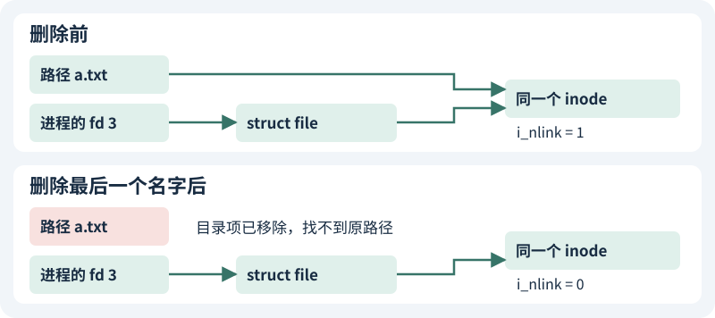

[上一篇](/p/linux-root-filesystem/)从根目录出发，介绍了不同文件系统怎样通过挂载接入同一棵目录树。本篇把视角移到目录内部：一个名字是怎样指向文件的？为什么删除一个名字之后，文件还可能通过另一个名字访问？

硬链接揭示了文件名和文件对象之间的关系：**多个目录项可以指向同一个 inode。** 新增一个硬链接，就多了一个访问同一对象的名字；删除其中一个名字，其他硬链接仍可访问该对象。理解这一点，才能看清文件名、inode 编号和链接计数各自在描述什么。

全文沿着三个操作展开：先查询一个名字对应的 inode，再给同一个 inode 增删名字，最后删掉唯一的名字，看看已经打开的文件还能不能读。命令和输出来自 Ubuntu 虚拟机；内核实现以上游 Linux v6.8 为阅读基线。

## 1. 查询：文件名如何关联到 inode？

先看一个已有文件。下面的命令只读取属性，不会修改 `/etc/hosts`：

```bash
findmnt -n -T /etc/hosts -o FSTYPE
LC_ALL=C ls -li /etc/hosts
stat -c '%n: dev=%d inode=%i links=%h' /etc/hosts
```

在本文使用的 Ubuntu 虚拟机上，`/etc/hosts` 位于 ext4。运行 `ls -li` 时，最左边的 `393555` 是 inode 编号，权限后面的 `1` 是硬链接数。用 `stat` 可以只取这几个字段：

```text
/etc/hosts: dev=64512 inode=393555 links=1
```

文件名是 `hosts`，inode 编号是 `393555`。两者能对应上，是因为父目录里记录了这个名字指向哪个 inode。比较文件是否为同一对象时，不能只比 inode 编号，还要看设备号；不同文件系统可以使用相同的编号。

### 磁盘目录项、dentry 与 inode 各存什么？

下面只摘出与这条路径有关的字段，不展开完整结构体。

| 所在层 | 数据结构 | 与这次查询有关的字段 |
| --- | --- | --- |
| ext4 磁盘格式 | `struct ext4_dir_entry_2` | `name` 存文件名，`inode` 存它指向的 inode 编号，`file_type` 还可记录文件类型。 |
| 内核路径查找 | `struct dentry` | `d_parent` 指向父目录的 dentry，`d_name` 表示这一段名字，`d_inode` 指向关联的内核 inode。 |
| 内核文件对象 | `struct inode` | `i_ino` 是对象编号，`i_nlink` 表示硬链接数。 |

ext4 目录项是文件系统自己的记录格式，里面存的是 **编号**；`dentry` 是内核中的对象，关联的是 **指针**。内核还可以缓存一次找不到名字的结果：这种 dentry 的 `d_inode` 为空，称为负 dentry。因此，不能把内存里的每个 dentry 都理解为一条磁盘目录项的副本。[ext4 目录项格式](https://docs.kernel.org/filesystems/ext4/directory.html) · [Linux v6.8 的 dentry 定义](https://github.com/torvalds/linux/blob/v6.8/include/linux/dcache.h) · [inode 定义](https://github.com/torvalds/linux/blob/v6.8/include/linux/fs.h)

查找某个名字时，dcache 用**父目录的 dentry 和子名字**查缓存。例如，VFS 以目录 `demo` 的 dentry 和名字 `note` 查找 `demo/note`。有效的正 dentry 可以直接提供 inode，有效的负 dentry 则可以直接回答这个名字不存在。若缓存没有可用结果，慢路径会在适当的锁下重新检查，必要时调用父目录 inode 的 `i_op->lookup`，由 ext4 查目录项。缓存一旦填好，后续查找就可能省掉这次文件系统回调。[Linux v6.8 路径查找文档](https://docs.kernel.org/6.8/filesystems/path-lookup.html) · [第三篇的完整调用链](/p/linux-file-object-model/#32-openat-path-walk)

### 从 stat 命令追到内核

命令叫 `stat`，并不意味着底层必然调用同名的系统调用。在本机的 GNU Coreutils 9.4 和 Ubuntu 内核 `6.8.0-149-generic` 上，用下面的命令跟踪实际调用：

```bash
LC_ALL=C strace -qq -e trace=statx,newfstatat \
  stat -c 'dev=%d inode=%i links=%h' /etc/hosts
```

只看目标路径这一行，实测是 `statx(AT_FDCWD, "/etc/hosts", ...)`，返回值为 `0`。这说明命令确实向内核查询了该路径的属性；`strace` 到这里看到的是系统调用边界，内核怎么找对象还要看源码。

以接近本机内核版本的**上游 Linux v6.8** 为阅读基线，在 [`fs/stat.c`](https://github.com/torvalds/linux/blob/v6.8/fs/stat.c) 中可以沿着这样一条路径读：

```text
statx 系统调用 → do_statx → vfs_statx
                               ├─ filename_lookup：解析路径
                               └─ vfs_getattr：查询找到的对象的属性
```

路径解析和查询属性是两件事。若某一段名字需要到 ext4 查询，可在 [`fs/ext4/namei.c`](https://github.com/torvalds/linux/blob/v6.8/fs/ext4/namei.c) 中看 `ext4_lookup` 如何查目录项，再根据编号取得 inode；如果已有可用的 dentry 缓存，则不必每次都重新读磁盘目录。找到对象之后，VFS 才查询属性，填入内核的 `kstat`，再转换成用户态的 `statx` 结果。

这也解释了为什么 `stat` 能显示链接数：**链接数是找到对象后读取的属性，并不是每次查询时临时遍历目录再数一遍。** 至于新建或删除一个名字时谁负责改这个数，下一块再追。

## 2. 增删名字：硬链接如何改变计数？

前面用 `statx` 读出了链接数。这一节反过来观察：**新增一个名字之后，以及删掉其中一个名字之后，同一个 inode 的链接数分别是多少？**

在 Ubuntu 上运行下面的命令。实验放在家目录下新建的临时目录中，不修改已有文件；最后会清理本次创建的两个名字和目录。

```bash
(
  set -eu
  demo=$(mktemp -d "$HOME/inode-demo.XXXXXX")
  cd "$demo"
  trap 'rm -f -- a.txt b.txt; cd /; rmdir -- "$demo"' EXIT

  findmnt -n -T . -o FSTYPE
  printf 'hello\n' > a.txt
  stat -c '%n dev=%d inode=%i links=%h' a.txt

  strace -qq -e trace=link,linkat ln a.txt b.txt
  stat -c '%n dev=%d inode=%i links=%h' a.txt b.txt

  strace -qq -e trace=unlink,unlinkat rm -- a.txt
  stat -c '%n dev=%d inode=%i links=%h' b.txt
  cat b.txt
)
```

本机实测输出如下。设备号和 inode 编号是这一次运行的值，复现时看它们之间的关系即可。

```text
ext4
a.txt dev=64512 inode=524319 links=1
linkat(AT_FDCWD, "a.txt", AT_FDCWD, "b.txt", 0) = 0
a.txt dev=64512 inode=524319 links=2
b.txt dev=64512 inode=524319 links=2
unlinkat(AT_FDCWD, "a.txt", 0)          = 0
b.txt dev=64512 inode=524319 links=1
hello
```

创建 `b.txt` 后，两个名字查到的设备号和 inode 编号相同，读出来的链接数也都是 2。删掉 `a.txt` 后，`b.txt` 的 inode 没变，链接数降回 1，内容仍可读。这里没有两份文件内容，也没有“原件”和“副本”：**两个名字各有一条目录项，关联的是同一个文件对象。**

### 系统调用如何交给 ext4？

`strace` 确认了本机实际使用的是 `linkat` 和 `unlinkat`。其中的 `AT_FDCWD` 表示这些相对路径以进程当前工作目录为起点。以下以上游 Linux v6.8 为阅读基线，省略了错误处理和锁等细节。

| 操作 | 通用路径 | ext4 入口 |
| --- | --- | --- |
| 为已有文件增加名字 | `linkat` → `do_linkat` → `vfs_link` | `ext4_link` |
| 删除一个名字 | `unlinkat` → `do_unlinkat` → `vfs_unlink` | `ext4_unlink` |

在 [`fs/namei.c`](https://github.com/torvalds/linux/blob/v6.8/fs/namei.c) 中，可以看到通用层怎样解析路径并执行检查，再通过**目标父目录 inode 的操作表**调用具体文件系统的 `link` 或 `unlink` 方法。此处之所以从父目录分发，是因为增删名字都会改变父目录里的记录。

再读 [ext4 的 `fs/ext4/namei.c`](https://github.com/torvalds/linux/blob/v6.8/fs/ext4/namei.c)：

- **创建硬链接**：沿 `ext4_link` 看它如何复用旧名字对应的 inode、增加链接计数，并用 `ext4_add_entry` 把新名字加入目标目录。成功添加目录项后，新名字对应的 dentry 也会与该 inode 关联；添加目录项失败时，相关分支会回退计数。
- **删除硬链接**：沿 `ext4_unlink` 看它如何定位并删除对应的 ext4 目录项，再用 `drop_nlink` 递减 inode 的链接计数。在这次实验里，计数从 2 变成 1，`b.txt` 的目录项还在，所以它照常可用。

**文件系统在增删名字时维护链接计数，所以查询属性时不用遍历目录重新计数。** 接下来看看这个数降到 0 时，已经打开的文件会怎样。

## 3. 删除最后一个名字：为什么 fd 仍能读？

上一节删掉了两个名字中的一个，还能通过剩下的名字访问文件。如果只剩一个名字，并且在删除之前就打开了文件，结果又会怎样？

下面用 Bash 把文件打开为 fd 3，再删除唯一的名字。命令在子 Shell 和新建的临时目录中运行，不影响当前终端的文件描述符或已有文件。

```bash
(
  set -eu
  demo=$(mktemp -d "$HOME/inode-open.XXXXXX")
  cd "$demo"
  trap 'rm -f -- a.txt; cd /; rmdir -- "$demo"' EXIT

  printf 'hello\n' > a.txt
  exec 3<a.txt
  stat -c 'inode=%i links=%h' a.txt

  rm -- a.txt
  test ! -e a.txt && echo 'a.txt is gone'
  stat -L -c 'inode=%i links=%h' "/proc/${BASHPID}/fd/3"
  cat <&3
  exec 3<&-
)
```

实测结果：

```text
inode=524319 links=1
a.txt is gone
inode=524319 links=0
hello
```

删除之后，原路径找不到了，链接数也变成了 0，但 inode 编号没变，`cat` 仍读出了 `hello`。这里有两种观察方式：`stat -L` 跟随 procfs 提供的 fd 入口查看原对象；`cat <&3` 则把已经打开的 fd 接到标准输入，不会重新按 `a.txt` 这个名字打开文件。Bash 的 `BASHPID` 指向当前子 Shell，避免用 `$$` 时误查外层 Shell。

下图对比最后一个名字删除前后的两条访问路径。上面从名字查找，下面从进程已经持有的 fd 访问。图省略了中间的内核对象和查找细节，箭头表示访问关系。



### 名字、打开状态与回收是三个阶段

打开文件时，进程的 fd 表记录了对内核 `struct file` 的引用。这个对象表示一次打开状态，并持有路径引用，可以继续访问关联的 inode。删除目录项会让原名字无法再次查找到文件，但不会撤销此前已经获得的打开引用。**`i_nlink` 数的是硬链接，它不会因为打开一个 fd 而增加。** [Linux 内核 VFS 文档](https://docs.kernel.org/filesystems/vfs.html)

回到上游 Linux v6.8 的源码，沿两个入口看生命周期：

- **删除名字**：ext4 的 `unlink` 路径移除目录项并递减链接数。这个阶段改变的是目录中的关联，以及 inode 的链接计数。[ext4 的 `fs/ext4/namei.c`](https://github.com/torvalds/linux/blob/v6.8/fs/ext4/namei.c)
- **释放打开引用**：`fput` 在 `struct file` 的最后一个引用放掉后安排清理，`__fput` 会释放其持有的 dentry 和挂载引用。等 inode 到达可回收阶段，ext4 的 `ext4_evict_inode` 才在无硬链接的情况下走删除路径，处理数据块和 inode 的回收。[文件引用释放](https://github.com/torvalds/linux/blob/v6.8/fs/file_table.c) · [ext4 inode 回收](https://github.com/torvalds/linux/blob/v6.8/fs/ext4/inode.c)

因此，`rm` 成功表示**名字已移除**，并不保证磁盘空间立即归还。这也是为什么服务一直打开某个已删除的日志文件时，目录里虽然找不到日志，磁盘用量却可能没有下降。排查时既要看目录里还有没有名字，也要看是否仍存在打开引用。

## 回到开头：什么变了，什么没变？

| 操作 | 目录里的名字 | 同一个 inode 的链接数 | 还能怎样访问 |
| --- | --- | --- | --- |
| 创建 `b.txt` 硬链接 | `a.txt`、`b.txt` 都在 | 1 → 2 | 两个名字都可用 |
| 删除 `a.txt`，保留 `b.txt` | 只剩 `b.txt` | 2 → 1 | 通过 `b.txt` |
| 另一次实验中，打开后删除唯一的 `a.txt` | 原名字消失 | 1 → 0 | 通过已经打开的 fd |

目录项记录**名字指向哪个对象**；链接计数记录**还有多少个硬链接**；打开引用决定**已有的访问能否继续**。所以看到 `links=0` 时，可以确定文件已没有硬链接，却不能据此判断打开引用已经释放或磁盘空间已经归还。
