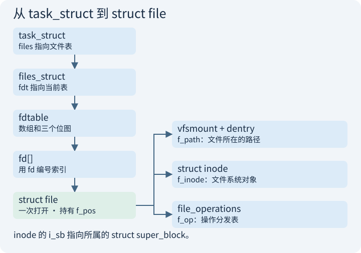
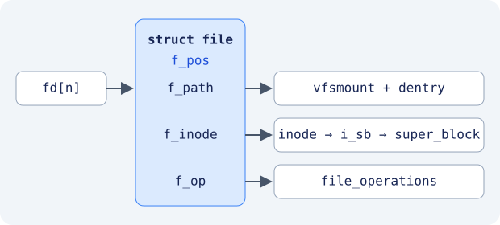
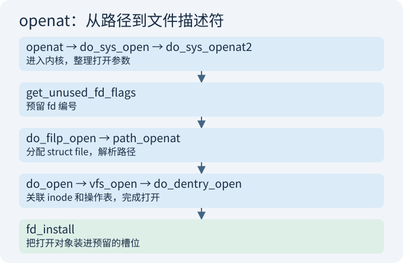
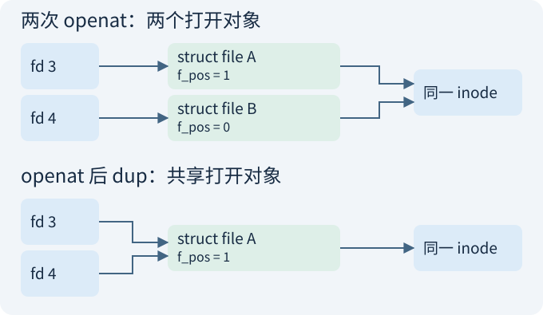

[上一篇](/p/linux-file-inode/)里，文件的最后一个硬链接被删除后，已经打开的文件描述符仍能读到原来的内容。本篇文章接着讨论：**文件描述符引用的是什么，为什么它还能继续操作文件？**

可以把两种情况放在一起看。第一种，对同一个普通文件分别调用两次 `open`；第二种，只调用一次 `open`，再用 `dup` 得到另一个描述符。两种情况都有两个 fd，也都访问同一个文件。如果先用第一个 fd 读走一段内容，再用第二个 fd 读取，它会从文件开头读，还是从刚才停下的位置接着读？

这个差异是理解内核对象模型的入口。本文先观察两种情况下的文件偏移，再对照源码，区分进程用来引用打开状态的 **fd**、保存这次打开状态的 **`struct file`**，以及描述文件对象的 **`struct inode`**。随后再把路径查找中的 `dentry` 和表示文件系统实例的 `super_block` 放进同一张关系图，说明这几个对象怎样连在一起。

## 一、两组读取实验：偏移是独立的，还是共享的？

实验在 Ubuntu 虚拟机上运行，内核版本为 `6.8.0-149-generic`，实验目录位于 ext4。两组都读取内容为 `ABCD` 的同一个普通文件，每次只读一个字节。唯一的区别是第二个 fd 的来源：

- **两次打开**：用两次 `openat()` 分别取得 `a` 和 `b`。
- **打开后复制**：先用 `openat()` 取得 `a`，再用 `dup(a)` 得到 `b`。

用 C 直接操作文件描述符：`read()` 每次读取一个字节，`lseek(fd, 0, SEEK_CUR)` 查询当前偏移。将下面的代码保存为 `open-offset.c`。

```c
#define _POSIX_C_SOURCE 200809L
#include <fcntl.h>
#include <stdio.h>
#include <stdlib.h>
#include <unistd.h>

static int checked(int result, const char *what) {
    if (result < 0) { perror(what); exit(EXIT_FAILURE); }
    return result;
}

static void step(int a, int b, int fd, const char *name) {
    char c;
    ssize_t n = read(fd, &c, 1);
    if (n != 1) {
        if (n < 0) perror("read");
        else fputs("unexpected EOF\n", stderr);
        exit(EXIT_FAILURE);
    }
    off_t x = lseek(a, 0, SEEK_CUR), y = lseek(b, 0, SEEK_CUR);
    if (x == (off_t)-1 || y == (off_t)-1) {
        perror("lseek");
        exit(EXIT_FAILURE);
    }
    printf("read(%s) = %c; offsets: a=%lld b=%lld\n",
           name, c, (long long)x, (long long)y);
}

int main(void) {
    int a = checked(openat(AT_FDCWD, "data.txt", O_RDONLY), "openat");
    int b = checked(openat(AT_FDCWD, "data.txt", O_RDONLY), "openat");
    puts("open twice");
    step(a, b, a, "a");
    step(a, b, b, "b");
    checked(close(b), "close");
    checked(close(a), "close");

    a = checked(openat(AT_FDCWD, "data.txt", O_RDONLY), "openat");
    b = checked(dup(a), "dup");
    puts("open + dup");
    step(a, b, a, "a");
    step(a, b, b, "b");
    checked(close(b), "close");
    checked(close(a), "close");
}
```

在一个新的实验目录中编译并运行：

```bash
gcc -std=c11 -Wall -Wextra -Werror open-offset.c -o open-offset
printf ABCD > data.txt
./open-offset
```

虚拟机实测输出：

```text
open twice
read(a) = A; offsets: a=1 b=0
read(b) = A; offsets: a=1 b=1
open + dup
read(a) = A; offsets: a=1 b=1
read(b) = B; offsets: a=2 b=2
```

| 第二个 fd 的来源 | 用 `a` 读后 | 再用 `b` 读后 |
| --- | --- | --- |
| 再调用一次 `open` | 读到 `A`；`a=1, b=0` | 读到 `A`；`a=1, b=1` |
| 调用 `dup(a)` | 读到 `A`；`a=1, b=1` | 读到 `B`；`a=2, b=2` |

第一组的两个偏移最后都等于 1，是因为两个 fd **各自**从开头读了一次；第二组在读取 `b` 之前，它的偏移就已经随着 `a` 变成了 1。**关键证据是第一次读取之后的状态，而不是最后两个偏移是否相等。**

这个结果留给下一节一个具体问题：同一个文件没有变，两个 fd 也都能读它，那么「各有一个偏移」和「共享一个偏移」在内核中分别对应什么关系？

## 二、从 task 到 fd：文件描述符表如何组织

实验里的 3 和 4 只是编号。要知道它们是否共享偏移，不能只看编号，也不能只看它们是否指向同一个 inode：**要看两个编号对应的表项，保存的是不是同一个 `struct file *`。**



图中 `task_struct.files` 指向 `files_struct`，后者的 `fdt` 指向当前使用的 `fdtable`。fd 是 `fdtable.fd[]` 的下标，不是内核地址，也不是 inode 编号。图右侧先标出打开对象与文件系统的连接；这一节先看表怎样存放及分配这些编号。

### 2.1 files_struct：描述符表的持有与扩容

下面是基于 [Linux v6.8 的 `include/linux/fdtable.h`](https://github.com/torvalds/linux/blob/v6.8/include/linux/fdtable.h) 的简化摘录，省略了锁和扩容协调字段：

```c
struct files_struct {
    atomic_t count;
    struct fdtable __rcu *fdt;
    struct fdtable fdtab;
    unsigned int next_fd;
    unsigned long close_on_exec_init[1];
    unsigned long open_fds_init[1];
    unsigned long full_fds_bits_init[1];
    struct file __rcu *fd_array[NR_OPEN_DEFAULT];
};
```

初始容量 `NR_OPEN_DEFAULT` 等于 `BITS_PER_LONG`，在本文的 ARM64 环境里是 64 项。下面按 v6.8 的 `init_files` 初始化器列出指针的去向，便于分清当前表的入口、实际存储和槽位里的对象。[初始表的源码](https://github.com/torvalds/linux/blob/v6.8/fs/file.c#L436)

| 初始指针 | 指向的内嵌存储 |
| --- | --- |
| `fdt` | `&fdtab`，即当前使用的 `struct fdtable`，其 `max_fds` 为 64。 |
| `fdtab.fd` | `&fd_array[0]`，即 64 个 `struct file *` 槽位的首地址。 |
| `fdtab.open_fds` | `open_fds_init`，占用位图。 |
| `fdtab.close_on_exec` | `close_on_exec_init`，执行新程序时要关闭的描述符位图。 |
| `fdtab.full_fds_bits` | `full_fds_bits_init`，记录占用位图中哪些机器字已经全满。 |

在 ARM64 上，三组初始位图各占一个 64 位的 `unsigned long`，但位的含义不同。前两张按 fd 编号索引，第三张汇总占用位图，初始表只需要其中一位来标记唯一的机器字是否全满。

以 fd 3 为例，内核用整数 3 索引当前表的 `fd[3]`。在初始表中，这个槽位就是 `fd_array[3]`，存的是一个指针。指针所指的 `struct file` 由 `alloc_empty_file()` 从内核的 `filp_cachep` slab 缓存单独分配，其中才有 `f_pos`。这也解释了 `dup` 的两个动作：取得同一对象的引用，再把同一个指针写入新槽位。若新编号超出当前容量，描述符表仍可能扩容。[打开对象的分配](https://github.com/torvalds/linux/blob/v6.8/fs/file_table.c#L189) · [dup 的实现](https://github.com/torvalds/linux/blob/v6.8/fs/file.c#L1328)

把数组入口做成指针，使内嵌表和动态表可以共用 `fd[n]` 这套访问方式。容量不足时，内核分配更大的 `fdtable`、指针数组和位图，复制旧表的内容，再切换 `fdt`。原来的内嵌数组和位图仍随 `files_struct` 保留，已打开的 `struct file` 也留在原处。小表由此省下为表和这些数组单独分配内存的开销，代价是每个 `files_struct` 都要预留这部分空间。提高 `ulimit -n` 只会提高可用上限，实际用到更大的编号才会触发表扩容。[动态表分配与切换](https://github.com/torvalds/linux/blob/v6.8/fs/file.c#L121)

**多个任务可以引用同一张表。** `count` 跟踪 `files_struct` 的引用，共享则由 `CLONE_FILES` 决定。共享表的线程使用的是同一个槽位，一个线程关闭该 fd，其他线程以后就不能通过原槽位取得那个对象；这个编号还可能被复用。普通 `fork` 则复制表，父子各有自己的槽位，但复制后的表项仍可引用同一个打开对象，所以关闭槽位与共享偏移是两回事。[v6.8 的 `copy_files`](https://github.com/torvalds/linux/blob/v6.8/kernel/fork.c)

### 2.2 fdtable：指针数组与三个位图

```c
struct fdtable {
    unsigned int max_fds;
    struct file __rcu **fd;
    unsigned long *close_on_exec;
    unsigned long *open_fds;
    unsigned long *full_fds_bits;
    /* 省略 RCU 回收字段 */
};
```

`max_fds` 是当前容量，`fd[n]` 保存编号 `n` 对应的打开对象指针。位图则是用一串 0 和 1 记录状态。理解这三张位图，可以跟着一次打开文件和一次执行新程序来看。

1. **`open_fds` 回答「这个编号还能分配吗？」** 假设 fd 0 到 2 已被占用，fd 3 空闲。分配器找到 `open_fds` 的第 3 位为 0，就可以选中它，并立刻把这一位置为 1。此时编号已经被预留，`fd[3]` 可能还没有写入指针。
2. **`full_fds_bits` 回答「哪一整组编号可以直接跳过？」** 假设表已经扩容，在 ARM64 上每 64 个 fd 对应 `open_fds` 中的一个机器字。如果 fd 0 到 63 全被占用，`full_fds_bits` 的第 0 位就是 1。查找时可以直接跳到下一组，再去 `open_fds` 找具体哪个编号空闲。例如下一组的 fd 64 空闲，就能选中 64。若后来关闭 fd 3，第 0 组就有了空位，对应的汇总位也会清零。
3. **`close_on_exec` 回答「换成新程序后，这个 fd 要关闭吗？」** 回到 fd 3 的例子。若打开时带了 `O_CLOEXEC`，内核会把 `close_on_exec` 的第 3 位置为 1。当前程序仍可以读取 fd 3。当这个进程成功执行 `execve`、用新程序替换当前程序时，内核才依据这个标记关闭 fd 3。这样，当前程序临时打开的文件就可以在切换时自动关闭。

前两张一起服务于分配。先跳过全满的组，再在候选组里找空位。第三张记录每个描述符在 `execve` 时的处理方式。因此，一个 fd 可以同时在 `open_fds` 和 `close_on_exec` 中被标为 1，表示它**现在已占用，执行新程序时关闭**。[查找空位](https://github.com/torvalds/linux/blob/v6.8/fs/file.c#L449) · [执行新程序时关闭描述符](https://github.com/torvalds/linux/blob/v6.8/fs/file.c#L769)

### 2.3 预留编号与安装指针是两步

`openat` 返回最低可用编号；分配时，内核利用 `next_fd` 和占用位图查找空位。找到之后，先把编号标记为已预留，避免同一张表中的其他任务抢到这个号码。**这个时候，占用位可以已经置位，但数组里还没有有效指针。** 打开成功才用 `fd_install` 安装指针；失败就用 `put_unused_fd` 归还编号。[v6.8 的 fd 分配与安装](https://github.com/torvalds/linux/blob/v6.8/fs/file.c) · [打开路径中的成功和失败分支](https://github.com/torvalds/linux/blob/v6.8/fs/open.c)

这也是为什么理解 `EBADF` 时要看能否查到有效的打开对象：编号越界或槽位没有可用的 `struct file`，都不能用于读取；只看 `open_fds` 的占用位并不够。

## 三、从系统调用看 open 和 dup 改了什么

先区分程序调用的 API 和真正进入内核的系统调用。使用 `strace` 跟踪第一节编译出来的程序：

```bash
strace -qq -e trace=openat,dup,read,lseek,close ./open-offset
```

下面是本机跟踪结果的节选，省略动态装载及偏移查询等调用：

```text
# 两次 openat
openat(AT_FDCWD, "data.txt", O_RDONLY) = 3
openat(AT_FDCWD, "data.txt", O_RDONLY) = 4
read(3, "A", 1) = 1
read(4, "A", 1) = 1

# 一次 openat，再 dup
openat(AT_FDCWD, "data.txt", O_RDONLY) = 3
dup(3) = 4
read(3, "A", 1) = 1
read(4, "B", 1) = 1
```

在跟踪输出中，`read(3, "A", 1) = 1` 的 `"A"` 是调用返回后缓冲区中的内容；C 代码传入的是地址 `&c`，末尾的 `= 1` 表示实际读到 1 个字节。

本机的 C 库调用实际进入了 `openat` 和 `dup` 系统调用。下面从这两个入口读源码。这里的 `AT_FDCWD` 使相对路径 `data.txt` 从当前工作目录开始解析。

### 3.1 struct file 保存了什么？

两次打开 `data.txt` 时，两个 fd 最终可以找到同一个 inode。第一次读取却只推进了其中一个 fd 的偏移。要解释这个结果，需要看 fd 与 inode 之间的那一层。fd 表项指向 `struct file`，它代表一次打开，在用户态接口的文档中称为 *open file description*（打开文件描述）。



下面摘出上游 Linux v6.8 中与这次实验相关的字段。[struct file 的完整定义](https://github.com/torvalds/linux/blob/v6.8/include/linux/fs.h#L935)

```c
struct file {
    /* … */
    atomic_long_t f_count;
    struct mutex f_pos_lock;
    loff_t f_pos;
    unsigned int f_flags;
    /* … */
    struct path f_path;
    struct inode *f_inode;
    const struct file_operations *f_op;
    /* … */
};
```

| 字段 | 在这次打开中保存什么 |
| --- | --- |
| `f_pos` / `f_pos_lock` | `f_pos` 保存当前字节偏移。内核在需要串行化共享位置的访问时使用 `f_pos_lock`。 |
| `f_flags` | 保存打开实例的标志，例如 `O_APPEND`。`dup` 后两个 fd 使用同一份标志。描述符自身的 `FD_CLOEXEC` 由上一节的 `close_on_exec` 位图单独记录。 |
| `f_count` | 记录打开实例的引用，fd 表项持有的引用只是其中一种。关闭一个 fd 后，其他引用仍然可以让打开实例继续存活。 |
| `f_path` / `f_inode` | `f_path` 保存挂载与 dentry 的组合，表示路径解析得到的位置。`f_inode` 缓存指向目标 inode 的指针，inode 再通过 `i_sb` 关联到内核中的文件系统实例。 |
| `f_op` | 指向 `file_operations`。VFS 可以从这张表取得打开、读取等操作的回调。 |

以实验中的普通文件为例，`do_dentry_open` 从 `inode->i_fop` 取得操作表并放入 `file->f_op`。后续 `vfs_read` 优先调用表中的 `.read`，只有 `.read_iter` 时则通过 `new_sync_read` 调用它。这样，fd 查找和读请求的通用检查由内核公共代码处理，具体读取交给操作表选出的实现。[打开时绑定操作表](https://github.com/torvalds/linux/blob/v6.8/fs/open.c) · [VFS 的读分发](https://github.com/torvalds/linux/blob/v6.8/fs/read_write.c)

回到实验。两次打开各有一个 `struct file`，第一次读取只把其中一个 `f_pos` 从 0 推到 1，另一个仍从 0 开始，因此得到 `A/A`。`dup` 后两个 fd 指向同一个 `struct file`，第二次读取从已经更新的偏移 1 开始，因此得到 `A/B`。

### 3.2 openat 如何把打开对象装进 fd 表？

实验中的 `openat(AT_FDCWD, "data.txt", O_RDONLY) = 3` 把一个路径变成了后续可以传给 `read` 的编号。沿 Linux v6.8 中打开已存在普通文件的路径看，`fd[3]` 要到最后一步才会指向上一节的 `struct file`。



1. **预留 fd。** `openat` 经 `do_sys_open` 进入内部函数 `do_sys_openat2`。它先整理打开参数，并用 `getname` 取得路径名，再调用 `get_unused_fd_flags` 预留编号。这时占用位已经置位，`fd[3]` 里还没有文件指针。[v6.8 的系统调用入口](https://github.com/torvalds/linux/blob/v6.8/fs/open.c#L1388)
2. **分配打开对象，再查找路径。** `do_filp_open` 调用 `path_openat`。后者先用 `alloc_empty_file` 分配 `struct file`，再用 `link_path_walk` 和 `open_last_lookups` 查找路径。对实验里的相对路径，`AT_FDCWD` 指定从当前工作目录开始。[v6.8 的对象分配与路径查找](https://github.com/torvalds/linux/blob/v6.8/fs/namei.c#L3782)
3. **把路径和操作绑定到对象。** 在这条普通文件路径上，`do_open` 通过 `may_open` 检查后调用 `vfs_open`，将查找到的挂载和 dentry 写入 `f_path`。`do_dentry_open` 随后设置 `f_inode`、关联 `f_op`，并在有打开回调时调用它。到这里，VFS 已把路径查找的结果变成可以执行文件操作的打开对象。[打开前的检查](https://github.com/torvalds/linux/blob/v6.8/fs/namei.c#L3643) · [VFS 绑定路径](https://github.com/torvalds/linux/blob/v6.8/fs/open.c#L1084)
4. **把指针装进 fd 表。** `do_filp_open` 成功返回后，`fd_install(fd, f)` 把这个对象的指针写入预留的槽位。系统调用这时才把编号 3 返回给程序，后续的 `read(3, …)` 就能根据这个编号找到对象。[成功与失败的分支](https://github.com/torvalds/linux/blob/v6.8/fs/open.c#L1402)

如果把 `data.txt` 换成一个确定不存在的名字，仍以 `O_RDONLY` 打开，路径查找会返回 `ENOENT`。这时要收回两样东西。`path_openat` 用 `fput(file)` 放掉已经分配的打开对象的引用，`do_sys_openat2` 收到错误后用 `put_unused_fd(fd)` 归还编号。原来预留的槽位可以再用，程序收到的则是打开失败。[对象引用的清理](https://github.com/torvalds/linux/blob/v6.8/fs/namei.c#L3805) · [预留编号的归还](https://github.com/torvalds/linux/blob/v6.8/fs/open.c#L1402)

### 3.3 dup 如何让两个 fd 指向同一个打开对象？

`dup(3) = 4` 之后，原来的 `fd[3]` 仍然有效，`fd[4]` 多了一条通往同一个 `struct file` 的引用。Linux v6.8 的实现可以分成三步。[dup 的系统调用实现](https://github.com/torvalds/linux/blob/v6.8/fs/file.c#L1328)

1. `fget_raw(3)` 从当前 fd 表查找原来的对象，并取得一个引用。找不到有效表项时返回 `EBADF`。
2. `get_unused_fd_flags(0)` 预留最低可用编号。参数 0 使新描述符的 `FD_CLOEXEC` 初始为未设置。若这一步失败，例如已达到描述符上限，`fput(file)` 会放掉刚取得的引用。
3. `fd_install(4, file)` 把同一个指针安装进新槽位，新槽位接手这次引用。路径、操作表和偏移都留在原来的对象里。



图中是 fd 3 刚读完 `A`、fd 4 还没开始读的时刻。两次独立打开时，fd 4 对应的 `f_pos` 仍是 0。复制 fd 的那组只有一个 `f_pos`，此时已经是 1。

### 3.4 read 在哪里更新偏移？

对实验中的普通文件，`ksys_read` 用 `fdget_pos` 从 fd 找到打开对象，在需要时锁住共享位置。它把当前位置复制到局部变量，再将变量的地址交给 `vfs_read`。读操作返回非负值后，`ksys_read` 把局部变量中的位置写回 `f_pos`，最后由 `fdput_pos` 收尾。这样，第二组的 fd 4 一开始读取，便能看到 fd 3 已推进的位置。[v6.8 的读路径](https://github.com/torvalds/linux/blob/v6.8/fs/read_write.c) · [位置锁的获取](https://github.com/torvalds/linux/blob/v6.8/fs/file.c#L1110)

### 3.5 close 关闭了哪一层？

在 Linux v6.8 的 `close` 系统调用中，`file_close_fd` 先从表中摘除指针并归还编号。没有有效指针时，系统调用返回 `EBADF`。随后 `filp_flush` 执行关闭时的处理，包括操作表中可选的 `.flush` 回调，最后 `__fput_sync` 减少这次打开实例的引用计数。只有引用计数降到零，才会进入该实例的最终清理 `__fput`。[close 系统调用](https://github.com/torvalds/linux/blob/v6.8/fs/open.c#L1451) · [最终引用的处理](https://github.com/torvalds/linux/blob/v6.8/fs/file_table.c#L425)

所以，`close(3)` 之后，`fd[4]` 持有的引用仍有效。它可以接着用原来的偏移读取。这里的 `f_count` 计算打开实例的引用，上一篇的 `i_nlink` 计算 inode 的硬链接数。最后一个文件名被删除后，已打开的实例仍能通过它持有的对象访问文件，这就是开头那个现象的另一半。

## 四、用 fdinfo 观察共享偏移

在同一台 Ubuntu 虚拟机上，可以在 Bash 中把 fd 保持打开，方便从 `/proc` 读取状态。下面把 fd 3 打开到文件，再将它复制到 fd 4。第一次用 fd 3 读，查看两个偏移后关闭 fd 3，再从 fd 4 读一个字节。

```bash
bash <<'BASH'
set -eu
lab=$(mktemp -d)
trap 'rm -rf "$lab"' EXIT
printf ABCD > "$lab/data.txt"
exec 3< "$lab/data.txt"
exec 4<&3

dd bs=1 count=1 status=none <&3
printf '\n'
for fd in 3 4; do
    printf 'fd %s\n' "$fd"
    cat "/proc/$$/fdinfo/$fd"
done

exec 3<&-
dd bs=1 count=1 status=none <&4
printf '\n'
exec 4<&-
BASH
```

一次实测输出如下。这里的 `$$` 指向持有这两个 fd 的 Bash 进程。

```text
A
fd 3
pos:	1
flags:	0400000
mnt_id:	33
ino:	463
fd 4
pos:	1
flags:	0400000
mnt_id:	33
ino:	463
B
```

| 字段 | 从哪里取值 |
| --- | --- |
| `pos` | 打开对象的 `f_pos`。只读过一次 fd 3 后，两边都显示 1。 |
| `flags` | 将打开对象的 `f_flags` 和当前描述符的 close-on-exec 状态合成后，以八进制显示。 |
| `mnt_id` | 从 `f_path.mnt` 找到对应的挂载 ID，可与该进程的 `/proc/<pid>/mountinfo` 对照。 |
| `ino` | 内核 inode 的 `i_ino`。挂载 ID 和 inode 编号随实验环境变化。 |

两个 fd 同时显示偏移 1，关闭 fd 3 后还能从 fd 4 读到 `B`，这两处输出分别对应共享偏移和引用仍有效。相同的 `mnt_id` 与 `ino` 也会出现在对同一路径打开两次的实验里，因此判断是否共享打开实例，还要观察一次读取有没有改变另一个 fd 看到的位置。[v6.8 的 fdinfo 实现](https://github.com/torvalds/linux/blob/v6.8/fs/proc/fd.c#L29)

这篇追踪到 VFS 通过 `f_op` 分发请求为止。下一篇从 ext4 的磁盘布局入手，解释 inode 编号如何定位磁盘上的 inode，再看 extent 如何把文件偏移对应到数据块。

## 五、命令与系统调用速查

| 用法 | 本篇用来做什么 |
| --- | --- |
| `gcc -std=c11 -Wall -Wextra -Werror open-offset.c -o open-offset` | 按 C11 编译实验，启用常见警告并将警告视为错误。 |
| `strace -qq -e trace=openat,dup,read,lseek,close ./open-offset` | 观察选定的系统调用，减少跟踪器的附加提示。 |
| `openat(AT_FDCWD, path, O_RDONLY)` | 从当前工作目录解析相对路径并以只读方式打开。成功返回 fd。 |
| `dup(fd)` | 返回最低可用的新 fd，引用同一个打开对象。 |
| `read(fd, &c, 1)` | 向可写缓冲区读取最多一个字节。返回实际读取的字节数，普通文件到达末尾时可返回 0。 |
| `lseek(fd, 0, SEEK_CUR)` | 对可寻址文件查询当前偏移。相对于当前位置移动 0 字节。 |
| `close(fd)` | 关闭描述符。成功返回 0。 |
| `exec 3< file`、`exec 4<&3`、`exec 3<&-` | 在当前 Bash 中打开、复制或关闭描述符。 |
| `dd bs=1 count=1 status=none <&3` | 从 fd 3 读取一个 1 字节块并输出，省略统计信息。 |
| `cat /proc/<pid>/fdinfo/<fd>` | 查看目标进程中某个仍打开的描述符。 |

表中列出的 C 接口失败时返回 `-1`，具体原因通过 `errno` 查看。
