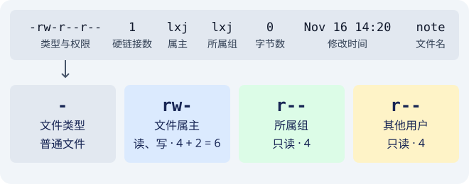
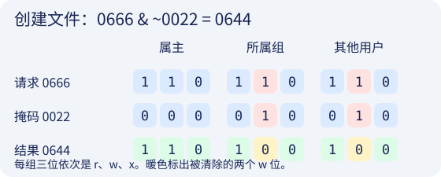
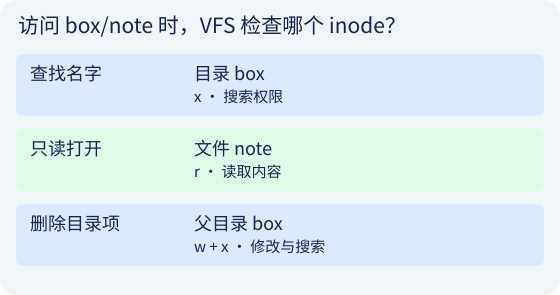

[上一篇](/p/linux-ext4-disk-layout/)从 ext4 镜像里的 inode 读到 `i_mode = 0x81b4`，解码后是普通文件，权限为 `0664`。这些权限位是怎么来的？为什么新建文件往往是 `0644`，同一个 shell 里创建的目录却可能是 `0755`？本篇先看权限如何设置，再沿内核源码看它们在什么地方被检查。

## 一、文件权限怎样设置？

### 1.1 从 ls -l 读懂文件权限

`ls -l` 的 `-l` 会以长格式列出文件。以 Ubuntu 虚拟机上新建的空文件 `note` 为例，运行 `LC_ALL=C ls -l -- note` 得到下面这行。`LC_ALL=C` 固定输出语言，`--` 结束选项解析。

```text
-rw-r--r-- 1 lxj lxj 0 Nov 16 14:20 note
```



权限串开头的 `-` 表示普通文件，目录会显示 `d`。后面三个权限组里，`-` 表示对应的权限位未设置。紧跟权限串的 `1` 是硬链接数，两个 `lxj` 分别是属主和所属组，`0` 是文件字节数。

要把符号权限和八进制写法并排看，可以用 `stat -c '%a %A %n' note`。本例的九个权限位对应 `0644`。

| 谁访问 | `0644` 中对应的数字 | 对应权限 |
| --- | --- | --- |
| 文件属主 | `6 = 4 + 2` | `rw-`，可读、可写 |
| 文件所属组对应的访问者 | `4` | `r--`，可读 |
| 其他访问者 | `4` | `r--`，可读 |

每组里 `r`、`w`、`x` 分别对应 `4`、`2`、`1`。**读目录和按名字查找是两种操作。** 在目录上，`x` 叫**搜索权限**，控制能否通过目录去找一个已知名字，也影响能否用 `cd` 进入该目录。

| 权限 | 普通文件 | 目录 |
| --- | --- | --- |
| `r` | 读取文件内容 | 枚举目录里的名字 |
| `w` | 修改文件内容 | 修改目录项，例如创建、删除或改名。这些操作通常也需要目录的 `x`。 |
| `x` | 允许把文件当作程序执行 | 按名字查找目录项，或进入该目录 |

例如，普通用户拥有目录 `box` 和里面可读的文件 `note`。虚拟机实测，`box` 为 `0400` 时，`ls -1 --color=never -- box` 能列出名字 `note`，但 `cat box/note` 会因路径查找失败而报错。`box` 为 `0100` 时，列目录失败，已知文件名的 `cat box/note` 却能成功。第三节会再对照 `stat` 和 `openat`，看看缺少目录搜索权限时内核在哪一步返回错误。[Linux inode 的类型与权限位](https://man7.org/linux/man-pages/man7/inode.7.html) · [Linux 路径查找中的权限](https://man7.org/linux/man-pages/man7/path_resolution.7.html)

下文先讨论这九位基本权限。实验以普通用户运行，父目录没有默认 ACL。

### 1.2 chmod 修改现有文件的权限

在 Ubuntu 虚拟机中运行下面的实验。括号中的命令在子 shell 中执行，便于让后面的掩码设置只影响本次实验。

```bash
(
    set -eu
    lab=$(mktemp -d "$PWD/.mode-lab.XXXXXX")
    trap 'rm -f -- "$lab/note" "$lab/private-note"; rmdir -- "$lab/docs" "$lab/private-docs" "$lab" 2>/dev/null || true' EXIT
    cd "$lab"

    umask 022
    touch note
    mkdir docs
    stat -c '%a %A %n' note docs

    chmod 640 note
    chmod u+x,g+w note
    stat -c '%a %A %n' note

    umask 077
    touch private-note
    mkdir private-docs
    stat -c '%a %A %n' note private-note private-docs
)
```

实测输出如下。

```text
644 -rw-r--r-- note
755 drwxr-xr-x docs
760 -rwxrw---- note
760 -rwxrw---- note
600 -rw------- private-note
700 drwx------ private-docs
```

`chmod 640 note` 将基本权限设置为 `rw-r-----`。接下来的 `chmod u+x,g+w note` 只改指定的位：`u+x` 给属主加执行位，`g+w` 给所属组加写入位，因此结果是 `0760`。命令行的 `chmod` 负责解析数字或符号模式，向内核提交权限变更的接口包括 `chmod(2)`、`fchmod(2)` 和 `fchmodat(2)`。[chmod 系统调用接口](https://man7.org/linux/man-pages/man2/chmod.2.html)

### 1.3 umask 在创建时清除权限位

`umask` 是进程的文件创建掩码。**它只在创建新文件、目录等对象时参与权限计算，已经存在的对象保留原来的权限。**

这个机制让创建程序和运行环境各自表达一层要求。程序用 `mode` 给出希望设置的权限，用户可以通过 shell 的 `umask`，为之后启动的程序统一收紧新建对象的默认权限。例如，处理私密资料时设为 `0077`，常见的 `touch` 和 `mkdir` 就会分别创建权限为 `0600` 和 `0700` 的对象，属组和其他用户的权限在创建时就被清除。掩码只能清除程序请求的权限位。

在本例没有默认 ACL 的目录中，新建对象的基本权限可以按 `请求的 mode & ~umask` 计算。创建程序先给出它想要的权限，掩码里为 1 的位会从这个请求中清除。[umask 系统调用及默认 ACL 规则](https://man7.org/linux/man-pages/man2/umask.2.html)

| 本例的操作 | 请求的基本权限 | 掩码 | 实测权限 |
| --- | --- | --- | --- |
| `touch note` | `0666` | `0022` | `0644` |
| `mkdir docs` | `0777` | `0022` | `0755` |
| `touch private-note` | `0666` | `0077` | `0600` |
| `mkdir private-docs` | `0777` | `0077` | `0700` |



以 `0022` 为例，它清掉所属组和其他访问者的写入位。目录请求的 `0777` 里有搜索位，掩码保留了这些位。普通文件创建时请求的 `0666` 本来就没有执行位，所以结果是 `0644`。

把掩码改成 `0077` 后，已有的 `note` 仍然是 `0760`。这两种操作分别作用在不同的地方。实验中的 `chmod` 修改目标文件的权限位，shell 内建的 `umask` 则改进程后续创建文件时使用的掩码。C 接口 `umask(2)` 设置新值并返回旧值，子进程会继承掩码。[umask 的返回值和继承语义](https://man7.org/linux/man-pages/man2/umask.2.html)

## 二、内核怎样生成和修改权限位？

### 2.1 从 strace 看程序交给内核的 mode

在一个新的空目录里跟踪第一节的几条命令。`-f` 跟踪 Bash 启动的子进程，这样才能看到 `touch` 和 `mkdir` 发出的系统调用。`bash -c` 中的 `umask 022` 由新启动的 Bash 执行，随后由它的子进程继承。运行这条命令的交互 shell 保留自己的掩码。

```bash
strace -f -qq -e trace=umask,openat,mkdir,mkdirat,fchmodat,fchmodat2 -o trace \
    bash -c 'umask 022; touch note; mkdir docs; chmod 640 note'
grep -E '"note"|"docs"' trace
```

Ubuntu 虚拟机上的实测输出如下，左侧数字是发出调用的进程 ID。

```text
1527997 openat(AT_FDCWD, "note", O_WRONLY|O_CREAT|O_CLOEXEC, 0666) = 3
1527998 mkdirat(AT_FDCWD, "docs", 0777) = 0
1527996 fchmodat(AT_FDCWD, "note", 0640) = 0
```

第一节看到的新建权限是 `0644` 和 `0755`，这里传给内核的是 `0666` 和 `0777`。两组数字之间的差异，正好可以沿创建路径找到。最后一行是这台虚拟机上 `chmod` 实际使用的接口。

### 2.2 umask 存在进程哪里？

[第三篇](/p/linux-file-object-model/)从 `task_struct` 的 `files` 成员找到了 fd 表。这次要找创建掩码，沿的是同一个任务结构里的 `fs` 成员。源码用 `current` 取得当前任务。

| 从当前任务出发 | 指向 | 保存什么 |
| --- | --- | --- |
| `current->files` | `struct files_struct` | 文件描述符表，用 fd 找到打开对象。 |
| `current->fs` | `struct fs_struct` | 当前工作目录 `pwd`、进程根目录 `root`、创建掩码 `umask`。 |

第一篇用过的 `cd` 会改变当前工作目录。像本例 `openat(AT_FDCWD, "note", …)` 这样的相对路径查找会从 `pwd` 开始，普通绝对路径查找会从进程的 `root` 开始。

Linux v6.8 从 `current->fs->umask` 取得当前任务使用的创建掩码。调用 `umask(2)` 时，内核先用 `S_IRWXUGO`（`0777`）保留九个权限位，再用 `xchg` 换入新值并返回旧值。用 `CLONE_FS` 共享这份结构的任务也会共享掩码。[umask 系统调用](https://github.com/torvalds/linux/blob/v6.8/kernel/sys.c#L1795) · [fs_struct 定义](https://github.com/torvalds/linux/blob/v6.8/include/linux/fs_struct.h)

掩码在**创建新 inode** 时参与计算。在 `openat` 的创建路径中，VFS 用 `vfs_prepare_mode` 准备传给文件系统的 mode。掩码具体应用在哪一层，取决于父目录所在文件系统是否支持 POSIX ACL。[VFS 准备创建模式](https://github.com/torvalds/linux/blob/v6.8/fs/namei.c#L3131)

| 创建时的情况 | 怎么处理权限 |
| --- | --- |
| 父目录所在文件系统未启用 POSIX ACL | VFS 的 `mode_strip_umask` 直接清除掩码指定的位。 |
| ACL 已启用，但父目录没有默认 ACL | 由文件系统的 ACL 初始化路径应用掩码。ext4 通过 `ext4_init_acl` 调用 `posix_acl_create`，本例就会得到 `0666 & ~0022 = 0644`。 |
| 父目录有默认 ACL | 从默认 ACL 派生新文件的权限，并按创建请求中的 mode 限制权限。 |

这样，是否清除掩码位就能等到知道父目录有没有默认 ACL 再决定。已存在的 inode 沿用自己的权限位，用 `O_CREAT` 打开一个已存在的普通文件也不会因此重新计算它的权限。[ext4 初始化 ACL](https://github.com/torvalds/linux/blob/v6.8/fs/ext4/acl.c#L264) · [通用 ACL 创建逻辑](https://github.com/torvalds/linux/blob/v6.8/fs/posix_acl.c) · [默认 ACL 规则](https://man7.org/linux/man-pages/man2/umask.2.html)

### 2.3 chmod 怎样修改 inode 的 i_mode？

`fchmodat` 解析 `note` 后取得目标路径，再进入 `chmod_common`。VFS 从请求中取出允许修改的模式位，与旧 `i_mode` 中的其他位合并。因此普通文件的类型位会保留，`0640` 只改变相应的权限状态。[chmod_common](https://github.com/torvalds/linux/blob/v6.8/fs/open.c#L631)

| 到哪一步 | 做什么 |
| --- | --- |
| `chmod_common` | 以 `ATTR_MODE \| ATTR_CTIME` 标记要修改模式和状态变更时间，并调用 `notify_change`。 |
| `notify_change` | 做通用属性变更检查，再通过目标 inode 的 `i_op->setattr` 分发。 |
| `ext4_setattr` | 检查调用者是否有权改属性，通过 `setattr_copy` 更新内存 inode 的 `i_mode`，并将 inode 元数据标记为脏。 |

对这个普通文件，`fchmodat(AT_FDCWD, "note", 0640)` 提交的就是要更新的权限。当前 shell 的 `umask 022` 属于创建路径，`chmod` 的这条属性变更路径直接处理传入的模式。[VFS 属性变更与 i_mode 更新](https://github.com/torvalds/linux/blob/v6.8/fs/attr.c) · [ext4_setattr](https://github.com/torvalds/linux/blob/v6.8/fs/ext4/inode.c)

## 三、路径能找到，文件就能打开吗？

### 3.1 在同一个文件上对照两种 EACCES

以普通用户运行。我们先让文件可读，但去掉父目录的搜索权限，再恢复父目录的搜索权限，改为去掉文件的读权限。用一个小程序分别请求文件属性、以只读方式打开文件，这样可以单独观察两个接口的结果。

将下面的代码保存为 `check-access.c`。

```c
#define _POSIX_C_SOURCE 200809L
#include <errno.h>
#include <fcntl.h>
#include <stdio.h>
#include <string.h>
#include <sys/stat.h>
#include <unistd.h>

int main(void)
{
    const char *path = "box/note";
    struct stat info;

    if (stat(path, &info) == 0)
        printf("stat: mode=%03o\n", (unsigned)(info.st_mode & 0777));
    else
        printf("stat: %s\n", strerror(errno));

    int fd = openat(AT_FDCWD, path, O_RDONLY);
    if (fd < 0)
        printf("openat: %s\n", strerror(errno));
    else {
        puts("openat: OK");
        close(fd);
    }
    return 0;
}
```

在一个空的实验目录中编译并运行：

```bash
export LC_ALL=C
cc -std=c11 -Wall -Wextra -Werror check-access.c -o check-access
mkdir box
printf 'A\n' > box/note

chmod 600 box/note
chmod 600 box
./check-access

chmod 700 box
chmod 200 box/note
./check-access

chmod 600 box/note
./check-access
```

| 父目录 `box` | 文件 `note` | `stat` | `openat(O_RDONLY)` |
| --- | --- | --- | --- |
| `0600`，没有搜索位 | `0600`，属主可读 | `EACCES` | `EACCES` |
| `0700`，属主可搜索 | `0200`，属主只能写 | 成功，显示 `200` | `EACCES` |
| `0700`，属主可搜索 | `0600`，属主可读 | 成功，显示 `600` | 成功 |

第一组里，`box` 缺少目录的搜索权限。即使 `note` 本身可读，两个调用也会在按名字查找 `note` 时失败。

第二组恢复了 `box` 的搜索权限，两个调用都能找到 `note`。**`stat` 查询的是文件元数据，例如权限、大小和 inode 编号。它不会读取文件内容，因此无需目标文件的 `r` 权限。** 本例中，`stat` 成功报告 `0200`。而 `openat(O_RDONLY)` 请求打开文件以读取内容，目标文件缺少 `r`，所以返回 `EACCES`。

### 3.2 VFS 分别检查哪个 inode？

沿用第三篇的普通文件打开路径。对 `box/note`，这两处检查分别使用了路径上的目录 inode 和最终的文件 inode。[Linux v6.8 路径查找文档](https://docs.kernel.org/6.8/filesystems/path-lookup.html)

| 检查发生在 | 内核拿什么检查 | 本例 |
| --- | --- | --- |
| 在目录中查找下一个名字 | `may_lookup` 对当前目录请求 `MAY_EXEC`。对目录，这表示搜索许可。 | 要找 `note`，就得先能搜索 `box`。 |
| 打开已经找到的普通文件 | `may_open` 对目标 inode 请求 `MAY_OPEN \| acc_mode`。只读打开时，`acc_mode` 包含 `MAY_READ`。 | `note` 为 `0200` 时，读权限检查失败。 |

在本例的基本权限检查中，访问者是两个 inode 的属主，VFS 按属主那组权限位判断。路径形式的 `stat` 同样要经过目录搜索检查。它取得目标 inode 的属性后，就能报告 `0200`，这次操作并没有请求读文件内容的权限。[目录搜索检查](https://github.com/torvalds/linux/blob/v6.8/fs/namei.c#L1715) · [普通文件打开前的检查](https://github.com/torvalds/linux/blob/v6.8/fs/namei.c#L3236) · [获取文件属性的接口](https://man7.org/linux/man-pages/man2/stat.2.html)

## 四、为什么只读文件也能被删除？

### 4.1 文件权限固定，只改变父目录

把 `box/note` 设为 `0400`，再分别将父目录设为 `0500` 和 `0700`。两次都可以搜索目录，只有第二次允许写目录。

```bash
(
    set -eu
    export LC_ALL=C
    lab=$(mktemp -d)
    trap 'chmod 700 "$lab/box"; rm -rf -- "$lab"' EXIT
    cd "$lab" || exit
    mkdir box
    printf A > box/note
    chmod 400 box/note

    chmod 500 box
    if strace -qq -e trace=rename,renameat,renameat2 mv -- box/note box/renamed; then
        exit 1
    fi
    if strace -qq -e trace=unlink,unlinkat rm -f -- box/note; then
        exit 1
    fi

    chmod 700 box
    strace -qq -e trace=rename,renameat,renameat2 mv -- box/note box/renamed
    strace -qq -e trace=unlink,unlinkat rm -f -- box/renamed
)
```

虚拟机上的实测结果如下，节选系统调用行。`RENAME_NOREPLACE` 表示此次改名请求不覆盖已有目标。

```text
renameat2(AT_FDCWD, "box/note", AT_FDCWD, "box/renamed", RENAME_NOREPLACE) = -1 EACCES (Permission denied)
unlinkat(AT_FDCWD, "box/note", 0)       = -1 EACCES (Permission denied)
renameat2(AT_FDCWD, "box/note", AT_FDCWD, "box/renamed", RENAME_NOREPLACE) = 0
unlinkat(AT_FDCWD, "box/renamed", 0)    = 0
```

被修改的是 `box` 里的目录项。改名让同一个 inode 关联到新名字，`unlinkat` 则移除这个名字对应的硬链接。因此实验里能否执行这两个操作，取决于给 `box` 加没加写权限。`rm -f` 跳过交互确认，内核权限检查照常执行。

### 4.2 VFS 检查哪些目录？

`vfs_unlink` 会调用 `may_delete`。它对父目录 inode 请求 `MAY_WRITE` 和 `MAY_EXEC`，分别对应修改目录项和搜索目录的权限。`vfs_rename` 对普通文件改名时，也用这套检查处理旧名字，再根据目标是否已存在检查新名字所在的目录。[删除检查](https://github.com/torvalds/linux/blob/v6.8/fs/namei.c#L2964) · [改名检查](https://github.com/torvalds/linux/blob/v6.8/fs/namei.c#L4762)

| 操作 | 要修改的目录项 | VFS 检查 |
| --- | --- | --- |
| 删除文件 | 从父目录移除旧名字 | 对父目录和旧目录项执行 `may_delete`。 |
| 改名到空闲名字 | 移除旧名字，添加新名字 | 源目录走 `may_delete`，目标目录走 `may_create`。 |
| 改名并覆盖已有普通文件 | 移除旧名字，替换目标目录项 | 对源和目标分别执行 `may_delete`。 |



### 4.3 sticky bit 给共享目录加一道限制

设想多个用户都能写同一个目录，例如权限为 `1777` 的共享目录。前导的 `1` 是 sticky bit，`ls -ld` 通常显示为 `drwxrwxrwt`。即使通过了父目录的写入和搜索检查，删除目录项或改名时，`may_delete` 还会检查调用者是否拥有该文件、拥有该目录，或具备适用的 `CAP_FOWNER`。这就是共享目录能让多个人创建自己的文件，同时限制他们删除彼此文件的原因。[Linux v6.8 的 sticky bit 检查](https://github.com/torvalds/linux/blob/v6.8/fs/namei.c#L2931)

在 Ubuntu 虚拟机里，可以让当前普通用户拥有共享目录和 `owner-note`，再用 `sudo -u nobody` 模拟另一个普通用户。下面只用 `sudo` 切换实验身份，删除操作以 `nobody` 的权限执行。

```bash
(
    set -eu
    export LC_ALL=C
    lab=$(mktemp -d /tmp/sticky-lab.XXXXXX)
    trap 'rm -rf -- "$lab"' EXIT
    chmod 755 "$lab"
    mkdir "$lab/shared"
    chmod 1777 "$lab/shared"

    touch "$lab/shared/owner-note"
    sudo -u nobody touch "$lab/shared/guest-note"
    ls -ld "$lab/shared"
    sudo -u nobody rm -- "$lab/shared/guest-note"

    if sudo -u nobody rm -- "$lab/shared/owner-note"; then
        exit 1
    fi
    test -f "$lab/shared/owner-note"

    chmod 0777 "$lab/shared"
    sudo -u nobody rm -- "$lab/shared/owner-note"
    test ! -e "$lab/shared/owner-note"
    printf '%s\n' '0777: owner-note removed'
)
```

虚拟机实测输出如下。

```text
drwxrwxrwt 2 lxj lxj 4096 Nov 16 15:32 /tmp/sticky-lab.W73Ip5/shared
rm: cannot remove '/tmp/sticky-lab.W73Ip5/shared/owner-note': Operation not permitted
0777: owner-note removed
```

| 共享目录权限 | `nobody` 可以做什么 |
| --- | --- |
| `1777` | 创建自己的 `guest-note`，也能删除它。删除 `owner-note` 时返回 `EPERM`。 |
| `0777` | 去掉 sticky bit 后，可以删除原来同一个 `owner-note`。 |

两轮的目录写入和搜索权限都相同。改变结果的是 sticky bit 对**被删除目录项所对应文件的属主**做的额外检查。

## 五、命令与系统调用速查

| 命令或接口 | 本篇用来做什么 |
| --- | --- |
| `ls -l`、`ls -ld 目录` | 以长格式查看条目。加 `-d` 时查看目录自身。 |
| `stat -c '%a %A %n' 路径` | 并排显示八进制权限、符号形式和名称。 |
| `chmod 640 note`、`chmod u+x,g+w note` | 以数字模式设置权限，或只修改符号模式指定的位。 |
| `umask 022` | 设置后续创建时要清除的权限位。无参数的 shell 命令显示当前掩码。 |
| `openat(AT_FDCWD, path, O_RDONLY)` | 从当前工作目录解析相对路径，请求以只读方式打开已有文件。 |
| `openat` 带 `O_CREAT`、`mkdirat` | 创建新对象时，程序提供请求的 mode。 |
| `fchmodat` | 按路径请求变更现有文件的模式。 |
| `unlinkat`、`renameat2` | 移除目录项，或改名、移动、替换目录项。 |
| `strace -f -qq -e trace=… -o trace` | 跟踪子进程、筛选系统调用并写入文件。 |
| `chmod 1777 目录`、`sudo -u nobody 命令` | 设置共享目录的 sticky bit，并用另一个普通用户身份验证其效果。 |

至此，文件管理系列从目录树与挂载走到这里：路径查找要检查沿途目录的搜索权限，打开已有文件要按操作检查目标 inode，删除或改名要检查被修改的目录。遇到权限错误时，可以先问**这一步正在查找、打开，还是修改目录项？** 回答这个问题，就知道该去看哪个对象的权限。
