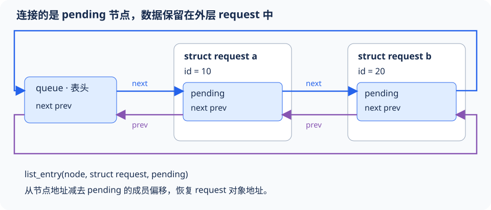
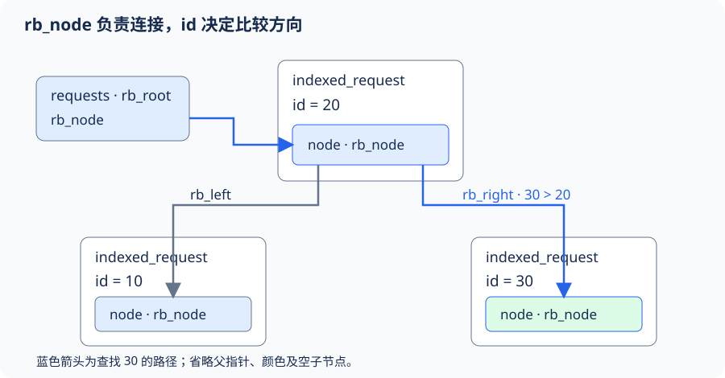
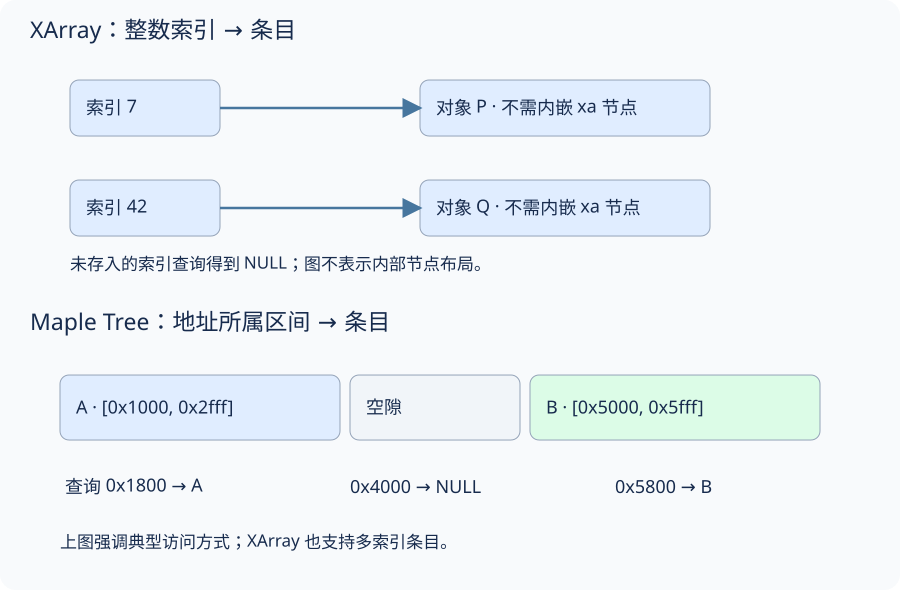
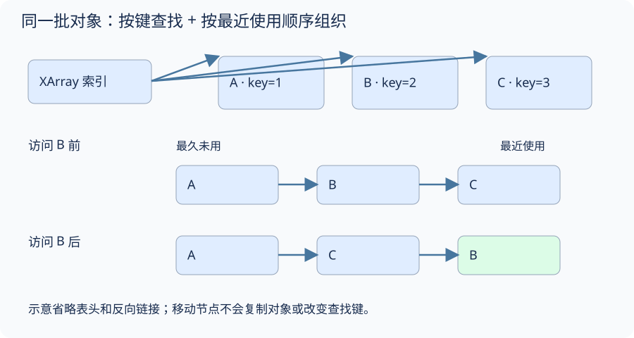
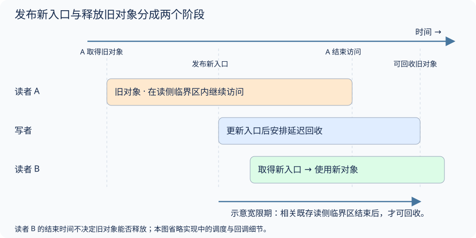

前面的文件系统与内存管理文章介绍了不少内核对象。文件有 inode，进程有地址空间，物理内存有页描述符。对象创建以后，内核还需要把它们组织起来，才能遍历、查找、调整顺序和回收。

本篇文章介绍链表、红黑树、XArray、Maple Tree、最近最少使用（LRU，Least Recently Used）组织方式，以及读、复制、更新（RCU，Read-Copy-Update）同步机制。前四项侧重对象的组织与查找，LRU 侧重使用顺序与回收选择，RCU 则处理并发访问中的发布和延迟回收。它们可以配合使用。

源码对照 Linux **v6.8**。红黑树与 LRU 以用途和接口为主，不展开平衡旋转或完整页面回收算法。下文 C 片段使用内核接口，供对照源码阅读，需要放在相应内核上下文中使用，不能直接当作用户态程序编译运行。

## 一、链表：把连接关系嵌入对象

### 1.1 `list_head` 保存相邻节点的地址

假设内核需要维护一组等待处理的请求。每个请求有编号，也有与前后请求的连接关系，可以写成：

```c
struct request {
    unsigned long id;
    struct list_head pending;
};
```

这里的 `request` 是本篇的示例类型，与块层同名结构无关。`pending` 是嵌在请求对象内部的链表节点。Linux 中 `list_head` 的定义很短：

```c
struct list_head {
    struct list_head *next, *prev;
};
```

`next` 和 `prev` 指向相邻对象中的 **`list_head` 成员**。请求编号等业务字段仍由外层对象保存。通用链表代码只修改这两个指针，就能把不同类型的对象串起来。[Linux v6.8 的节点定义](https://github.com/torvalds/linux/blob/v6.8/include/linux/types.h)



沿蓝色箭头从表头出发，依次经过 `a.pending`、`b.pending`，最后回到表头。反向链接沿相反顺序返回，因此这是一条**带表头的循环双向链表**。表头也是一个 `list_head`，用来标识起点与终点，本身不包含请求编号。

这种把节点嵌进业务对象的方式称为**侵入式链表**。对象需要预留节点成员，加入链表时就不必另外分配一个包装节点。它也带来一个约束：同一个节点成员同一时刻只能属于一条链表。

### 1.2 `container_of` 如何从成员找到对象

遍历链表得到的是 `pending` 的地址，处理请求时却需要 `request` 的起始地址。两者之间的距离由结构体布局决定，可以用 `offsetof(struct request, pending)` 表示。

| 已知信息 | 含义 |
| --- | --- |
| `&a.pending` | 节点成员的地址 |
| `offsetof(struct request, pending)` | 该成员相对结构体起点的字节偏移，包含编译器布局产生的填充 |
| 成员地址减去成员偏移 | 外层对象 `a` 的起始地址 |

内核提供 `container_of()` 完成这个转换：

```c
struct request *req;

req = container_of(node, struct request, pending);
```

其中 `node` 必须指向一个有效 `struct request` 对象的 `pending` 成员。宏根据调用者提供的类型与成员名计算偏移，无法凭空识别这个地址实际属于哪种对象。把表头地址当成请求节点传入，也不能得到有效请求。[Linux v6.8 的 container_of 实现](https://github.com/torvalds/linux/blob/v6.8/include/linux/container_of.h)

链表还提供更直接的写法：

```c
req = list_entry(node, struct request, pending);
```

`list_entry()` 在这里通过 `container_of()` 从节点恢复外层对象。节点中不需要额外保存一个指向请求的反向指针。

Linux v6.8 的 `container_of()` 实现如下，仅调整排版：

```c
#define container_of(ptr, type, member) ({                         \
    void *__mptr = (void *)(ptr);                                  \
    static_assert(__same_type(*(ptr), ((type *)0)->member) ||       \
                  __same_type(*(ptr), void),                       \
                  "pointer type mismatch in container_of()");     \
    ((type *)(__mptr - offsetof(type, member)));                    \
})
```

可以分成三步理解：

| 代码 | 作用 |
| --- | --- |
| `void *__mptr = (void *)(ptr)` | 保存传入的成员地址 |
| `static_assert(...)` | 在编译期检查指针所指类型是否与成员类型相符，也允许 `void *` |
| `__mptr - offsetof(type, member)` | 从成员地址退回外层对象起点，再转换为外层类型指针 |

这里利用了 GNU C 对 `void *` 算术的扩展，减法按字节计算。`({ ... })` 是 GNU C 的语句表达式，允许宏内声明临时变量，并将最后一个表达式作为结果。`((type *)0)->member` 出现在类型检查中，不会在运行时解引用空指针。

例如，**假设**某个布局中对象起点为 `0x1000`，`pending` 的偏移为 `8` 字节，那么 `node` 为 `0x1008`，减去 `8` 就得到 `0x1000`。实际偏移交给 `offsetof()` 按编译器布局计算，无须手写，也无须在节点里额外保存外层对象地址。

这就是内嵌节点与 `container_of()` 配合的关键：**通用代码沿节点建立连接，业务代码从节点恢复自己的对象。** 编译期检查能够发现一部分类型误用，对象的实际归属与存活时间仍由调用者保证。

### 1.3 将内嵌节点用起来

下面片段在单个函数内操作局部对象，没有并发访问。`LIST_HEAD()` 初始化表头，`INIT_LIST_HEAD()` 初始化对象里的节点：

```c
#include <linux/list.h>
#include <linux/printk.h>

static void list_example(void)
{
    LIST_HEAD(queue);
    struct request a = { .id = 10 };
    struct request b = { .id = 20 };
    struct request *req;

    INIT_LIST_HEAD(&a.pending);
    INIT_LIST_HEAD(&b.pending);

    list_add_tail(&a.pending, &queue);
    list_add_tail(&b.pending, &queue);

    list_for_each_entry(req, &queue, pending)
        pr_info("request id=%lu\n", req->id);

    list_del_init(&a.pending);
    list_del_init(&b.pending);
}
```

这段代码按链表接口语义推导，遍历时依次传给 `pr_info()` 的消息是下面两行。这里展示的是**预期消息正文**，未将片段加载到内核运行，实际内核日志还可能带时间戳等前缀：

```text
request id=10
request id=20
```

`list_for_each_entry()` 隐藏了“沿节点走一步，再恢复外层对象”的过程。第三个参数 `pending` 指定这次沿哪个成员遍历。宏还负责识别表头，循环体只处理实际请求。

这段用法只需要区分三个地址：`&queue` 是表头，`&a.pending` 是加入链表的节点地址，遍历得到的 `req` 则是外层请求对象的地址。加入链表不会复制 `a`，读取 `req->id` 访问的仍是原对象中的字段。[Linux v6.8 的链表接口](https://github.com/torvalds/linux/blob/v6.8/include/linux/list.h)

示例最后用 `list_del_init()` 将节点摘下。这不会释放外层对象，因此这里的局部对象在函数返回前仍然有效。实际共享链表还需要调用者安排同步，并保证对象在使用期间存活。

### 1.4 一个对象可以参与多种组织关系

如果一个请求既需要进入等待队列，又需要进入超时管理链表，可以给它两个节点：

```c
struct request {
    unsigned long id;
    struct list_head pending;
    struct list_head timeout;
};
```

两条链分别连接 `pending` 与 `timeout`，因此同一个对象能够同时参与两种组织关系。释放对象前，两种关系都需要正确处理，还要保证没有其他使用者继续持有对象。

这种内嵌成员的组织方式也会在后面的红黑树中出现。阅读内核结构体时，可以先认出其中的节点成员，再沿使用该成员的接口，找到对象加入了哪种集合。

## 二、红黑树：按业务键组织对象

### 2.1 节点仍然嵌在对象中

链表适合按既定顺序遍历对象。若还需要按请求编号查找，或者不断取出到期时间最早的定时器，就需要考虑支持有序查找的结构。

红黑树是一种自平衡二叉搜索树。查找、插入与删除的最坏时间复杂度为 O(log n)，并支持按键顺序遍历。本节关注内核怎样使用它。

与链表类似，Linux 红黑树将通用节点嵌进业务对象。下面是本篇示例中的请求类型：

```c
struct indexed_request {
    unsigned long id;
    struct rb_node node;
};

struct rb_root requests = RB_ROOT;
```

`requests` 是整棵树的入口，`node` 是每个请求参与树结构的连接成员。节点保存树的连接与平衡信息，编号仍保存在外层对象。Linux v6.8 的定义如下：

```c
struct rb_node {
    unsigned long __rb_parent_color;
    struct rb_node *rb_right;
    struct rb_node *rb_left;
} __attribute__((aligned(sizeof(long))));

struct rb_root {
    struct rb_node *rb_node;
};
```

`rb_left`、`rb_right` 指向左右子节点。`__rb_parent_color` 将父节点地址与颜色信息编码在同一个字段中，使用节点对齐后空出的低位保存标记，由红黑树辅助接口负责读写。外层对象通过 `rb_entry()` 恢复，它与链表的 `list_entry()` 一样，基于 `container_of()`。[Linux v6.8 的红黑树类型定义](https://github.com/torvalds/linux/blob/v6.8/include/linux/rbtree_types.h)



图中按 `id` 排序，左侧键较小、右侧键较大。查找编号 `30` 时，先从根节点恢复编号为 `20` 的请求，比较后走右侧，再恢复目标对象。图只展示排序和内嵌关系，省略颜色信息。

### 2.2 比较规则由业务代码决定

红黑树的通用节点没有 `id` 字段，因此使用者需要规定比较哪个字段、相等时如何处理。以下是本篇示例的查找函数，假设树已按唯一的 `id` 建立，访问期间没有并发修改：

```c
#include <linux/rbtree.h>

static struct indexed_request *request_find(struct rb_root *root,
                                            unsigned long id)
{
    struct rb_node *node = root->rb_node;

    while (node) {
        struct indexed_request *req;

        req = rb_entry(node, struct indexed_request, node);
        if (id < req->id)
            node = node->rb_left;
        else if (id > req->id)
            node = node->rb_right;
        else
            return req;
    }
    return NULL;
}
```

这段代码连接了两个层次。`rb_entry()` 将通用节点转换为请求对象，随后 `req->id` 决定往左还是往右。内核也提供接收比较函数的辅助接口，使用哪一种形式取决于调用者。[红黑树接口说明](https://docs.kernel.org/6.8/core-api/rbtree.html)

加入对象时，同样先按比较规则找到插入位置，再交给红黑树接口连接和平衡。读源码时可以按下面的分工识别，不必追进旋转实现：

| 接口或步骤 | 负责什么 |
| --- | --- |
| 业务比较与查找 | 选择键、比较大小、决定重复键的处理方式 |
| `rb_link_node()` | 在已找到的位置接入新节点 |
| `rb_insert_color()` | 插入后维护红黑树的平衡约束 |
| `rb_first()` / `rb_next()` | 取得最小节点，以及按键顺序的后继节点 |
| `rb_erase()` | 从树中摘除节点，并维护平衡；对象释放由调用者安排 |

对象仍在树上时，不能直接修改用于排序的键，否则节点位置与比较规则可能不再一致。需要改变键时，应在合适的同步保护下摘除、修改并重新插入。

### 2.3 内核用途：不断取出最早到期的定时器

Linux v6.8 的通用定时器队列 `timerqueue` 按到期时间 `expires` 组织节点。下面是其比较函数，保留实现，只调整排版：

```c
static inline bool __timerqueue_less(struct rb_node *a,
                                    const struct rb_node *b)
{
    return __node_2_tq(a)->expires < __node_2_tq(b)->expires;
}
```

其中 `__node_2_tq()` 通过 `rb_entry()` 得到外层 `timerqueue_node`，再比较到期时间。`timerqueue_add()` 调用 `rb_add_cached()`，将连接、平衡以及最左节点缓存维护组合起来。这样使用者可以方便地取得最早到期的节点。[Linux v6.8 的 timerqueue 实现](https://github.com/torvalds/linux/blob/v6.8/lib/timerqueue.c)

缓存使用的类型是 `struct rb_root_cached`，在普通树根之外再保存一个 `rb_leftmost` 指针。频繁取得最小节点时，`rb_first_cached()` 可以直接读取缓存，避免每次从根一路走到最左边。增加和删除时需要使用配套的 cached 接口维护它。

这个例子体现了红黑树的用途：**对象按某个业务键排序，使用者既能查找，也能按顺序取出对象。** 树负责组织节点，调用者负责比较规则、并发保护与对象生命周期。

## 三、XArray：通过整数索引找到对象

### 3.1 索引不是对象中的连接成员

假设已经知道页索引 `7`，希望直接找到对应缓存对象。用链表需要逐个比较，使用 XArray 则可以把“索引 → 对象”的关系交给通用容器管理。

XArray 对外像一个以 `unsigned long` 为下标的稀疏数组。这里的“稀疏”表示没有存入对象的位置不必各自占一个指针槽位，它也不要求扩展时把从零到最大下标的数组整体复制一遍。内部按索引分层定位，本篇不展开节点布局。

与 `list_head`、`rb_node` 的内嵌方式相比，业务对象不需要为了加入 XArray 而增加专用连接成员。容器保存索引与条目的关系，条目可以是满足要求的对象指针。



上半部分中的 `7` 和 `42` 是两个索引，对应两个对象，其间未存入条目的位置查询得到 `NULL`。这是对接口语义的示意，图中的空白不代表实际分配了一长排空槽位。

### 3.2 存入、读取和移除

下面演示一张局部 XArray 的完整用法。对象通过 `kmalloc()` 分配，满足普通指针条目至少 4 字节对齐的要求。函数执行期间没有并发访问，示例只存普通对象指针：

```c
#include <linux/errno.h>
#include <linux/printk.h>
#include <linux/slab.h>
#include <linux/xarray.h>

struct cached_item {
    unsigned long value;
};

static int xarray_example(void)
{
    DEFINE_XARRAY(items);
    struct cached_item *item, *found;
    void *old;
    int ret;

    item = kmalloc(sizeof(*item), GFP_KERNEL);
    if (!item)
        return -ENOMEM;
    item->value = 70;

    old = xa_store(&items, 7, item, GFP_KERNEL);
    ret = xa_err(old);
    if (ret) {
        kfree(item);
        xa_destroy(&items);
        return ret;
    }

    found = xa_load(&items, 7);
    if (found)
        pr_info("index=7 value=%lu\n", found->value);

    found = xa_erase(&items, 7);
    kfree(found);
    xa_destroy(&items);
    return 0;
}
```

成功路径的**预期消息正文**是 `index=7 value=70`。这里没有将片段加载到内核运行。`xa_store()` 返回此前的条目，失败则返回可以用 `xa_err()` 解码的错误条目。本例从空表开始，成功时旧条目为 `NULL`。如果不允许覆盖已有条目，可以使用 `xa_insert()`，位置被占用时返回 `-EBUSY`。

`xa_erase()` 移除条目并返回旧值，`xa_destroy()` 释放容器内部节点。业务对象的内存由调用者管理。示例明确先移除对象并释放，再销毁容器。[Linux v6.8 的 XArray 接口](https://docs.kernel.org/6.8/core-api/xarray.html)

### 3.3 页缓存中的实际入口

文件的页缓存索引保存在 `struct address_space` 的 `i_pages` 中。下面只摘出该成员，其余字段省略：

```c
struct address_space {
    /* … */
    struct xarray i_pages;
    /* … */
};
```

假设基本页大小是 `4096` 字节，文件内字节偏移 `28672` 对应页索引 `28672 / 4096 = 7`。页缓存便可以按这个索引查找条目。较大的 folio 可以覆盖多个基本页索引，实际条目还可能是表示回收信息等状态的值条目，不能把页缓存里的每个返回值都直接当作普通指针解引用。[Linux v6.8 的 address_space 定义](https://github.com/torvalds/linux/blob/v6.8/include/linux/fs.h)

这里还要区分**容器访问安全与对象存活**。XArray 的普通查找接口内部使用 RCU，修改接口也有相应锁保护，但 `xa_load()` 返回后，业务对象不会因此自动多一个引用。若其他执行者可能同时移除并释放对象，调用者仍需使用外部锁、正确的 RCU 生命周期协议或引用计数等方案，才能安全地使用返回对象。

## 四、Maple Tree：通过地址找到所属区间

### 4.1 虚拟地址空间需要查找区间

进程地址空间中存在多个虚拟内存区域（VMA，Virtual Memory Area）。假设一个区域覆盖 `[0x1000, 0x3000)`，查询 `0x1800` 和 `0x2800` 都应得到同一个区域对象。

这里需要描述整段地址的归属。Maple Tree 针对不重叠区间的存储和查找进行优化，内部属于多路树结构，还支持相邻条目遍历，并能在特定配置下查找指定长度的空闲区间。

在前图下半部分，区间 A 覆盖 `0x1000` 到 `0x2fff`，区间 B 覆盖 `0x5000` 到 `0x5fff`。查询落在 A 中的任意位置，都得到 A 对象；查询中间空隙则得到 `NULL`。XArray 也支持多索引条目，二者并非“能否表达范围”的绝对划分，这里强调的是它们在页缓存与地址空间中的典型用途。

### 4.2 区间端点与基本用法

Maple Tree 的 `mtree_store_range()` 接收**包含首尾的闭区间**。VMA 的 `vm_end` 则是开区间末端，所以 `[vm_start, vm_end)` 存入树时，对应 `[vm_start, vm_end - 1]`。

下面使用自定义区域对象演示。它不是实际 VMA，整个容器也不与进程地址空间关联：

```c
#include <linux/maple_tree.h>
#include <linux/printk.h>

struct range_object {
    unsigned long id;
};

static int maple_example(void)
{
    DEFINE_MTREE(regions);
    struct range_object region = { .id = 1 };
    struct range_object *found;
    int ret;

    ret = mtree_store_range(&regions, 0x1000, 0x2fff,
                           &region, GFP_KERNEL);
    if (ret) {
        mtree_destroy(&regions);
        return ret;
    }

    found = mtree_load(&regions, 0x1800);
    if (found)
        pr_info("address=0x1800 region=%lu\n", found->id);

    mtree_erase(&regions, 0x1800);
    mtree_destroy(&regions);
    return 0;
}
```

成功路径的**预期消息正文**是 `address=0x1800 region=1`，未将片段加载运行。局部对象 `region` 在函数返回前有效，退出前已经销毁其索引关系。

这里有两个容易误读的接口语义：

| 接口 | 需要留意的行为 |
| --- | --- |
| `mtree_store_range()` | 可以覆盖指定范围内的已有条目。要求范围原本为空时，用 `mtree_insert_range()` |
| `mtree_erase()` | 删除包含指定索引的整个已存区间。本例会移除 `[0x1000, 0x2fff]`，并非只移除 `0x1800` 这一个位置 |

对象释放仍由调用者安排，销毁树不会自动释放业务对象。[Linux v6.8 的 Maple Tree 接口](https://docs.kernel.org/6.8/core-api/maple_tree.html)

### 4.3 与进程地址空间的对应关系

Linux v6.8 的 `struct mm_struct` 内含下面这个成员，其余字段省略：

```c
struct mm_struct {
    /* … */
    struct maple_tree mm_mt;
    /* … */
};
```

`mm_mt` 管理地址区间到 VMA 对象的索引关系。页表负责虚拟地址到物理映射的翻译，VMA 索引则用于查找地址所属区域及其属性，两者承担不同工作。这与[前面的地址翻译文章](/p/linux-virtual-address-translation/)中“先检查区域，再处理映射”的关系相对应。[Linux v6.8 的 mm_struct 定义](https://github.com/torvalds/linux/blob/v6.8/include/linux/mm_types.h)

实际 VMA 管理还要遵守地址空间锁和 VMA 生命周期规则，不能直接照搬局部树的示例。Maple Tree 支持内部锁及外部锁等配置，进程地址空间使用它时，还需要与 `mmap_lock` 等机制配合。

## 五、LRU：在查找之外维护使用顺序

### 5.1 同一批对象可以有两种入口

索引回答“编号为 7 的对象在哪里”，回收还需要回答“容量不够时，先考虑哪个对象”。LRU 按最近使用情况组织对象，是缓存策略及其相关组织方式，可以用双向链表表达。

在一个简单缓存中，可以同时维护 XArray 和 LRU 链表。前者按编号定位对象，后者记录最近使用的顺序。为此，在业务对象中增加一个 `list_head` 成员即可：

```c
struct cache_entry {
    unsigned long key;
    struct list_head lru;
};
```



图中最左侧是最久未使用的一端，右侧是最近使用的一端。访问 B 后，把同一个对象的链表节点移到尾部，按键查找的关系保持有效。这也说明“加入另一种组织关系”不要求复制业务对象。

### 5.2 用链表接口表达顺序变化

沿用第一章的内核链表接口，可以写出下面这个局部用法示例。它只演示使用顺序，不实现完整缓存的索引和淘汰逻辑：

```c
static void lru_example(void)
{
    LIST_HEAD(recent);
    struct cache_entry a = { .key = 1 };
    struct cache_entry b = { .key = 2 };
    struct cache_entry *oldest;

    INIT_LIST_HEAD(&a.lru);
    INIT_LIST_HEAD(&b.lru);
    list_add_tail(&a.lru, &recent);
    list_add_tail(&b.lru, &recent);

    /* 访问 a，将其调整到最近使用端。 */
    list_move_tail(&a.lru, &recent);

    oldest = list_first_entry(&recent, struct cache_entry, lru);
    pr_info("oldest key=%lu\n", oldest->key);

    list_del_init(&a.lru);
    list_del_init(&b.lru);
}
```

此时顺序从 `a → b` 变为 `b → a`，**预期消息正文**为 `oldest key=2`，未将片段加载运行。这里明确知道链表非空才使用 `list_first_entry()`。完整缓存还需要容量限制、索引移除、并发保护和对象释放等步骤。

### 5.3 内核页面回收比示意链表更复杂

页面回收也需要判断哪些页最近被使用过，但逐次精确记录所有内存访问代价过高。内核会结合访问痕迹、页面类型和回收状态等信息组织候选对象，淘汰还可能受脏页回写、引用和页面锁定状态等条件影响。

传统页面回收有 active、inactive 等分类；多代 LRU（MGLRU，Multi-Gen LRU）进一步按代组织冷热信息。具体路径取决于内核配置和运行时设置。内核出现 `lru` 成员或相关接口时，应结合其使用场景理解，不能直接推断成示例里的“每次访问立刻移到唯一链表尾部”。[Linux v6.8 的多代 LRU 文档](https://docs.kernel.org/6.8/admin-guide/mm/multigen_lru.html)

## 六、RCU：移除对象之后，什么时候可以释放

### 6.1 查找到指针，并不等于可以一直使用

前面的容器都能返回对象指针。若读者已经拿到旧对象，写者此时将它移除并立即释放，读者下一次访问就可能触及失效内存。

RCU 是适合读多写少场景的同步机制。它将**移除旧对象的可达入口**与**回收旧对象的内存**分开处理，让已经进入读侧临界区的读者有机会完成访问。一次更新可以构造新对象、发布新入口，再延迟回收旧对象。



沿图中时间轴看，A 已经取得旧对象，更新入口不会把 A 手里的指针自动换成新指针。A 继续使用旧对象，随后取得新入口的 B 使用新对象。旧版本在所需的**宽限期**结束后才可以回收，避免与 A 的访问重叠。

宽限期不是固定等待若干毫秒，也不要求所有处理器的读者在同一瞬间清零。它等待的是与这次回收相关的、此前已经存在的 RCU 读侧临界区结束。[RCU 的移除与回收说明](https://docs.kernel.org/6.8/RCU/whatisRCU.html)

### 6.2 用一份只读配置理解发布与延迟回收

下面示例保存一个配置值。对象发布以后不再原地修改，写者每次分配新对象替换旧对象。互斥锁串行化多个写者，读者在 RCU 读侧临界区内读取值：

```c
#include <linux/errno.h>
#include <linux/mutex.h>
#include <linux/rcupdate.h>
#include <linux/slab.h>

struct example_config {
    int value;
    struct rcu_head rcu;
};

static struct example_config __rcu *active_config;
static DEFINE_MUTEX(config_lock);

static int config_read(void)
{
    struct example_config *cfg;
    int value = -ENOENT;

    rcu_read_lock();
    cfg = rcu_dereference(active_config);
    if (cfg)
        value = cfg->value;
    rcu_read_unlock();
    return value;
}

static int config_replace(int value)
{
    struct example_config *fresh, *old;

    fresh = kmalloc(sizeof(*fresh), GFP_KERNEL);
    if (!fresh)
        return -ENOMEM;
    fresh->value = value;

    mutex_lock(&config_lock);
    old = rcu_dereference_protected(active_config,
                                    lockdep_is_held(&config_lock));
    rcu_assign_pointer(active_config, fresh);
    mutex_unlock(&config_lock);

    if (old)
        kfree_rcu(old, rcu);
    return 0;
}
```

这里的 `rcu_head` 是延迟回收所需的回调管理成员，并非业务链表节点。第一次更新之前入口为 `NULL`，所以读函数可以返回 `-ENOENT`。示例只返回复制出的整数，不将 `cfg` 指针带出读侧临界区。

| 阶段 | 接口 | 本例中的责任 |
| --- | --- | --- |
| 读取入口 | `rcu_read_lock()`、`rcu_dereference()` | 按 RCU 协议取得并使用当前对象 |
| 初始化新对象 | 普通字段赋值 | 在发布之前把新配置准备好 |
| 串行化写者 | `mutex_lock()` | 避免多个写者同时修改共享入口 |
| 发布新对象 | `rcu_assign_pointer()` | 使配对的读者能够观察到已初始化的对象 |
| 延迟回收 | `kfree_rcu()` | 将旧对象的释放安排在所需宽限期之后 |

`rcu_assign_pointer()` 与 `rcu_dereference()` 共同承担必要的发布和读取顺序约束，不能随意用普通指针赋值与读取替换。例子中的互斥锁则只约束写者，读者没有取得这把锁。

这是用于解释机制的片段。完整组件退出时，还需要移除当前入口，并处理最后一个对象及尚未完成的使用者；这里未包含组件退出流程。

### 6.3 RCU 保护到哪里为止

RCU、锁和引用计数承担的责任可以配合使用：

| 机制 | 需要回答的问题 |
| --- | --- |
| 写侧锁 | 多个修改者怎样协调对共享状态的修改？ |
| RCU 读侧临界区与延迟回收 | 通过旧入口取得对象的读者，能否在回收前完成访问？ |
| 引用计数 | 对象是否仍被需要长期持有它的使用者引用？ |

在普通 RCU 读侧临界区内，不能随意执行可能睡眠的操作。如果希望退出临界区后继续持有对象，需要遵循该对象自己的引用获取协议，在对象仍受保护时安全地取得引用。仅将指针保存到局部变量不具备这种效果。

`kfree_rcu()` 适合在宽限期后直接释放对象；需要其他回收动作时，可以使用 `call_rcu()` 注册回调。`synchronize_rcu()` 则会阻塞等待一个宽限期，调用上下文必须允许睡眠，也不能在自身持有普通 RCU 读锁时等待它。

RCU 不自动串行化写者，也不保证多个可变业务字段的一致快照。本例通过“发布后不再修改对象”与写者锁简化了这两个问题。RCU 也不要求每个场景都复制整个对象，删除链表节点后延迟释放同样是常见用法。

## 七、把组织关系与生命周期放在一起看

同一个内核对象可以嵌入链表节点，通过 XArray 被整数索引，按 LRU 方式调整回收顺序，并通过 RCU 延迟释放。这些机制分别处理不同问题，阅读源码时可以先找对象，再看有哪些入口，以及每个入口受到什么保护。

| 机制 | 主要组织或管理什么 | 本篇对应的入口 |
| --- | --- | --- |
| 链表 | 对象之间的前后连接 | 对象内的 `list_head` |
| 红黑树 | 按业务比较规则组织的有序集合 | 对象内的 `rb_node` 与树根 |
| XArray | 整数索引与条目的对应关系 | 容器中的索引，例如 `i_pages` |
| Maple Tree | 区间与条目的对应关系 | 容器中的范围，例如 `mm_mt` |
| LRU | 使用顺序与回收候选关系 | 本篇用对象内的链表节点表达 |
| RCU | 并发读者与对象发布、回收的时序 | RCU 保护的入口和回收协议 |

内嵌节点让通用代码连接对象，`container_of()` 让业务代码重新取得外层对象。索引容器进一步接管查找关系，锁、RCU 和引用计数则需要结合具体访问路径，保证找到的对象可以安全使用。

## 八、接口速查

本文示例使用内核接口，没有用户态系统调用或终端命令需要单独准备。

| 接口 | 本文用途与返回值 |
| --- | --- |
| `container_of()` / `list_entry()` / `rb_entry()` | 从内嵌成员地址恢复外层对象指针 |
| `LIST_HEAD()` / `INIT_LIST_HEAD()` | 初始化表头或节点 |
| `list_add_tail()` / `list_for_each_entry()` | 尾部加入对象、遍历外层对象 |
| `list_del_init()` / `list_move_tail()` | 摘除并初始化节点、移动到指定链表尾部 |
| `rb_link_node()` / `rb_insert_color()` | 将节点接入已找到的位置，并维护平衡 |
| `rb_first()` / `rb_next()` / `rb_erase()` | 顺序访问节点、摘除节点 |
| `xa_store()` / `xa_err()` | 存储条目，返回旧值或错误条目；用 `xa_err()` 取得错误码 |
| `xa_load()` / `xa_erase()` | 按索引读取条目、移除并返回旧条目 |
| `xa_destroy()` | 释放 XArray 内部结构，不自动释放业务对象 |
| `mtree_store_range()` | 存入闭区间，成功返回 `0`，失败返回负错误码 |
| `mtree_load()` / `mtree_erase()` | 查找索引所属条目、移除包含该索引的整段条目 |
| `mtree_destroy()` | 释放 Maple Tree 内部结构，不自动释放业务对象 |
| `rcu_read_lock()` / `rcu_read_unlock()` | 标记普通 RCU 读侧临界区 |
| `rcu_assign_pointer()` / `rcu_dereference()` | 配对发布和读取 RCU 保护的指针 |
| `rcu_dereference_protected()` | 在指定外部保护条件成立时读取受保护指针 |
| `kfree_rcu()` / `call_rcu()` / `synchronize_rcu()` | 延迟释放、注册延迟回调、同步等待宽限期 |

## 九、名词解释

| 名词 | 本篇含义 |
| --- | --- |
| 侵入式数据结构 | 把连接节点嵌进业务对象，由通用代码操作这些节点的组织方式 |
| 表头 / 树根 | 集合的访问入口，其自身通常不代表业务对象 |
| `offsetof` | 根据类型布局计算某成员相对结构体起点的字节偏移 |
| 业务键 | 用于查找或比较对象的字段，例如编号或到期时间 |
| 稀疏索引 | 未存条目的位置不必各自分配完整数组槽位的索引组织方式 |
| 闭区间 / 半开区间 | `[a, b]` 包含两个端点；`[a, b)` 不包含右端点 |
| VMA | 虚拟内存区域，描述进程某段地址的属性与映射关系 |
| folio | 内核中用于管理一个或多个基本页的对象单位 |
| LRU / MGLRU | 最近最少使用的组织思想，以及内核按代组织冷热信息的回收实现 |
| RCU 读侧临界区 | 按 RCU 协议取得与使用受保护对象的一段访问范围 |
| 宽限期 | 回收前等待相关既存 RCU 读侧临界区结束所需的时段 |
| 发布 | 将已准备好的对象通过共享入口交给其他执行者访问 |
| 生命周期 | 对象从创建、加入集合、被使用到最终释放的整个过程 |
