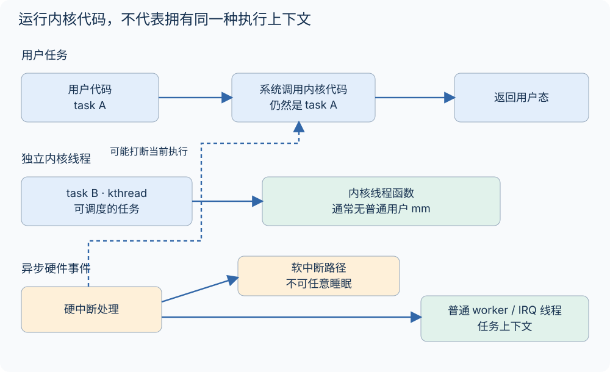
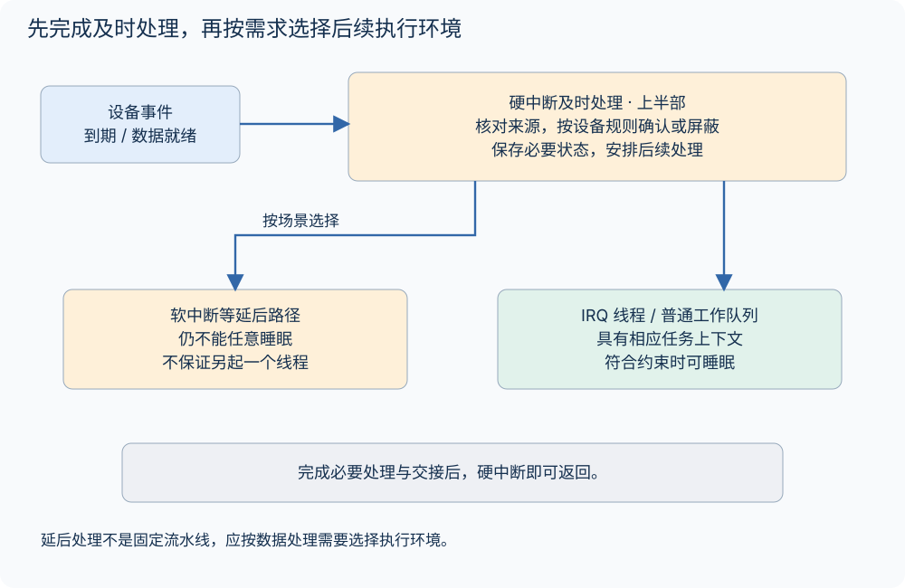
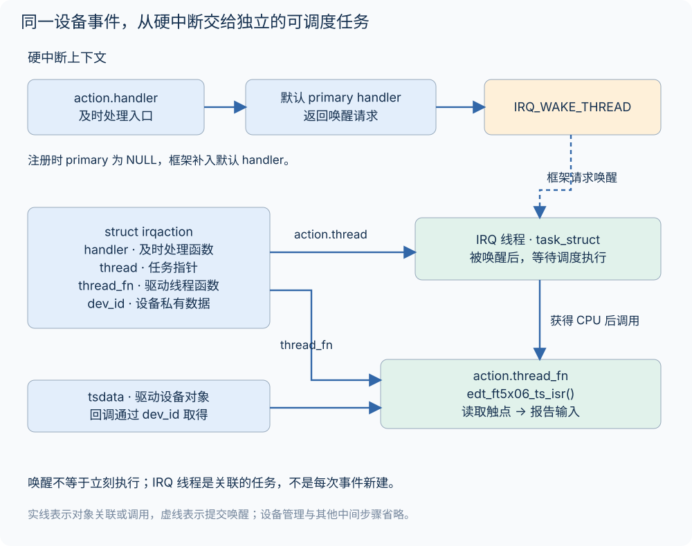

触控芯片发来中断，内核需要读取触点数据，再把结果交给输入子系统。这些工作都属于设备处理，为什么有的必须在硬中断中及时完成，有的却要交给一个线程？把后半段简单叫作“下半部”，还不足以回答它由谁执行、能否等待资源。

本篇文章沿 Linux v6.8 中一个真实触控驱动的处理路径，先建立执行上下文，再解释中断交接。随后对照软中断、tasklet、irq_work 和普通工作队列，最后回到内核线程与停止回收。主线始终是：**谁在执行这段代码，它能否阻塞，以及后续工作怎样交出去。**

源码对照上游 **Linux v6.8**，不展开中断控制器驱动、总线传输协议与锁内部算法。触控驱动只做源码解析，未在虚拟机中加载或触发；`ps` 与 `/proc` 输出则采自 VMware Fusion 中的 Ubuntu 26.04.1 ARM64，运行内核 `6.8.0-149-generic`。以下主要按非 PREEMPT_RT 内核解释，源码摘录以 `/* … */` 标明省略。

系列位置：[1. 对象模型](/p/linux-process-task-model/) · [2. 生命周期](/p/linux-process-lifecycle/) · [3. 调度](/p/linux-process-scheduling/) · **4. 执行上下文** · [5. 用户态同步](/p/linux-userspace-synchronization/) · [6. 内核同步](/p/linux-kernel-synchronization/)。

## 一、执行内核代码的三种情况

### 1.1 进入内核，不等于成为内核线程

普通用户任务调用 `read()` 时，处理器（CPU，Central Processing Unit）进入内核态，仍然由当前任务执行读取请求。它保留自己的 `task_struct`、内核栈和等待状态，可以在合适的位置因等待数据而睡眠，之后被唤醒继续执行。

内核线程同样有 `task_struct`、内核栈与调度属性，主要执行内核函数。例如后台 worker 可以被调度、阻塞和唤醒。内核线程通常没有自己的普通用户地址空间，`mm == NULL`，但“没有用户 mm”不影响它成为一个可调度任务。

硬中断则由异步事件进入，打断 CPU 上原先的执行。内核并不为每次设备中断新建一个普通任务。此时虽然仍能访问 `current`，它指向的通常是被打断任务，不能因此把中断回调当成这个任务主动发起的一次普通请求。



沿图上方看，系统调用前后都是 task A；中间的内核线程是另一个 task；下方的硬中断是异步进入的执行路径。**是否运行内核代码，与是否具有可调度的任务上下文，是两个判断。**

### 1.2 “能睡眠”具体表示什么

这里的睡眠指当前任务因为条件未满足而阻塞，让出 CPU，待条件满足后再被调度执行。它不是整台机器挂起，也不是“耗时稍长”这一泛称。

| 执行位置 | 是否有可按任务协议阻塞的执行者 | 典型等待规则 |
| --- | --- | --- |
| 用户任务的系统调用 | 有，就是当前用户任务 | 合适上下文中可以等待数据或资源 |
| 普通内核线程 | 有，就是该内核任务 | 合适上下文中可以阻塞 |
| 硬中断回调 | 没有为该回调单独建立普通任务 | 不能使用可能睡眠的等待接口 |

任务上下文也不是无条件可睡眠。持有禁止睡眠的锁、关闭抢占等约束仍需检查。硬中断与任务等待的区别，是后面判断软中断和各种线程化处理的基础。

## 二、硬中断为什么只适合及时处理

### 2.1 事件先到达，任务不必正在等待它

设备可以在某个程序计算时、系统调用执行时，甚至 CPU 空闲时发来中断。内核需要经架构入口和中断控制器相关路径，定位中断描述与已注册处理函数，再执行相应回调。

中断请求（IRQ，Interrupt Request）的编号用于内核定位和管理来源，不是跨机器固定不变的设备标识。例如实验机上：

```bash
grep arch_timer /proc/interrupts
```

本次完整筛选结果：

```text
 10:   24222193   29415403     GICv3  27 Level     arch_timer
```

两个累计计数对应本机两个 CPU。这能观察设备中断发生过，不会直接给出回调耗时或后续工作数量。计数的增长也不能代替内核函数跟踪。[通用 IRQ 分层](https://docs.kernel.org/6.8/core-api/genericirq.html)

### 2.2 不能睡眠的原因是执行协议

普通任务等待 mutex 时，可以把自己的状态改为等待，交由调度器切换到其他任务。硬中断回调没有这样的独立阻塞身份，不能拿被打断的 `current` 代替自己等待，再指望某次普通唤醒恢复这次回调。

硬中断还处于中断嵌套、抢占计数及相关本地中断约束下。被打断路径可能正在持锁，如果回调去等待这把锁，而持锁路径又必须等中断返回才能继续，就会形成等待环。内核在允许的中断退出位置处理重调度，与在回调中主动调用睡眠接口，是不同的路径。

| 想做的操作 | 硬中断中的问题 | 合适的处理方向 |
| --- | --- | --- |
| 等待一个可能被占用的 mutex | 获取可能睡眠，也可能等待被打断的持有者 | 把需阻塞的工作转给任务上下文 |
| 执行可能阻塞的设备传输 | 传输可能等待控制器、数据或资源 | 使用符合上下文要求的机制，或线程化处理 |
| 调用 `msleep()` 等待设备准备好 | 试图按任务等待协议阻塞回调 | 安排后续检查或交给可睡眠线程 |
| 在原地长时间循环 | 虽然没有睡眠，仍长期占用当前 CPU | 缩短必要工作，避免用忙等替代完整等待协议 |

因此，临时开启本地中断不会把硬中断变成普通任务，机器拥有更多 CPU 也不会改变这项约束。[中断上下文中的接口规则](https://docs.kernel.org/6.8/kernel-hacking/locking.html)

### 2.3 上半部与下半部按职责划分

上半部承担必须及时完成的工作，例如核对来源、按硬件协议确认或屏蔽事件、保存易丢失状态以及安排后续处理。后半段若计算量大、适合批量处理，或确实需要等待资源，就选择合适的延后执行机制。



这项划分有两个目的：缩短硬中断停留时间，为剩余工作选对执行环境。其他 CPU 并不会因本次中断全部停住，但当前 CPU 的任务和受影响的中断工作可能被拖延。

“下半部”不是某一种固定上下文。它可能很快就在中断退出路径运行，也可能由线程稍后处理；并非每个中断都必须另建下半部。下面用线程化中断，看一次真实交接。

## 三、沿触控驱动看上半部怎样交给线程

### 3.1 注册时，就决定两个回调分别在哪里执行

EDT FT5x06 触控驱动通过 I²C（Inter-Integrated Circuit，集成电路间总线）访问芯片。读触点数据涉及相应总线访问，可能等待资源或传输完成，因此驱动将这部分放进 IRQ 线程。

v6.8 驱动注册中断时有下面几行，省略了其他探测与错误处理代码：

```c
/* … */
irq_flags |= IRQF_ONESHOT;

error = devm_request_threaded_irq(&client->dev, client->irq,
                                NULL, edt_ft5x06_ts_isr, irq_flags,
                                client->name, tsdata);
/* … */
```

| 参数 | 本例传入什么 | 建立的关系 |
| --- | --- | --- |
| IRQ 编号 | `client->irq` | 关联该设备的中断来源 |
| primary handler | `NULL` | 使用框架提供的默认及时处理函数 |
| thread function | `edt_ft5x06_ts_isr` | 真正读触点与报告输入的线程函数 |
| flags | 包含 `IRQF_ONESHOT` | 按框架与控制器能力协调线程处理期间的通知屏蔽与收尾 |
| 私有数据 | `tsdata` | 回调的 `dev_id`，指向驱动设备对象 |

**函数名带 `isr`，不代表它一定在硬中断上下文运行。** 在本例中，它出现在 thread function 参数位置，实际由 IRQ 线程调用。判断执行上下文，应看注册方式和调用路径。[触控驱动注册代码](https://github.com/torvalds/linux/blob/v6.8/drivers/input/touchscreen/edt-ft5x06.c)

### 3.2 默认上半部只请求唤醒线程

传入 `NULL` primary handler、同时提供线程函数时，IRQ 框架使用下面的默认函数：

```c
static irqreturn_t irq_default_primary_handler(int irq, void *dev_id)
{
    return IRQ_WAKE_THREAD;
}
```

`IRQ_WAKE_THREAD` 是交给 IRQ 框架解释的返回值，不是由驱动自己直接调用线程函数。框架记录该 action 的待运行状态并唤醒关联线程，线程再经过调度获得执行机会。

这也说明，上半部不一定要由驱动手写读取、清除设备状态的代码。其他驱动可能需要自己的 primary handler 核对来源和确认设备状态；本例的交接方式不能替代那些设备协议。[默认 primary handler 与线程实现](https://github.com/torvalds/linux/blob/v6.8/kernel/irq/manage.c)

### 3.3 irqaction 将回调、设备对象与线程关联起来

每个已注册处理关联到 `struct irqaction`。下面只摘出本例需要的成员：

```c
struct irqaction {
    irq_handler_t handler;
    void *dev_id;
    /* … */
    irq_handler_t thread_fn;
    struct task_struct *thread;
    /* … */
};
```

`handler` 是及时处理函数，`thread_fn` 是线程函数，`thread` 指向可调度的任务对象。`dev_id` 把两条路径关联到驱动的设备状态。中断描述对象 `irq_desc` 管理相应 IRQ，注册的处理者再通过 action 组织；共享中断还可能关联多个 action。



沿图上半条线走，CPU 处理硬中断并取得 `IRQ_WAKE_THREAD`；再沿交接箭头走到 `action.thread`，这里才出现为后续处理单独管理的可调度任务。线程执行 `action.thread_fn` 时，回调里的 `current` 就是这个 IRQ 线程。[irqaction 定义](https://github.com/torvalds/linux/blob/v6.8/include/linux/interrupt.h)

v6.8 的关键阶段可以这样对应，表格是源码整理，不是本机实测调用栈：

| 阶段 | 相关位置 | 状态变化 |
| --- | --- | --- |
| 调用 primary handler | `handle_irq_event_percpu()` → `__handle_irq_event_percpu()` | 通过 `action->handler` 执行及时处理 |
| 请求线程运行 | `__irq_wake_thread()` | 设置运行标记，唤醒 `action->thread` |
| 线程获得执行机会 | `irq_thread()` | 在独立任务中处理已提交的中断工作 |
| 调用驱动回调 | `irq_thread_fn()` | 通过 `action->thread_fn` 执行，并进行对应 oneshot 收尾 |

唤醒不承诺线程立刻运行，重复到来的通知也不等于每次都新建一个线程。中断到来前，框架已经为这次注册准备相应线程与关联状态。[硬中断到线程的交接](https://github.com/torvalds/linux/blob/v6.8/kernel/irq/handle.c)

### 3.4 触点读取发生在 IRQ 线程里

`edt_ft5x06_ts_isr()` 使用传入的设备对象，核心操作包括下面这些调用，省略错误分支和逐触点解析：

```c
/* … */
error = regmap_bulk_read(tsdata->regmap, tsdata->tdata_cmd, rdbuf,
                         tsdata->tdata_len);
/* … */
input_sync(tsdata->input);
/* … */
```

第一步通过寄存器访问抽象读取触点数据，中间解析触点状态与坐标，最后向输入子系统报告一次输入同步。这个驱动的后备访问涉及 I²C 总线，不能把可能阻塞的访问直接搬到普通硬中断回调里；也不能仅凭 `regmap_bulk_read` 这个名字，推断所有设备的后备访问方式都相同。

线程化把处理放进可等待的任务上下文，但仍需遵守所持锁等约束。`IRQF_ONESHOT` 也不是关闭整台机器的中断，它参与的是相应 IRQ 的处理协调。本例展示的完整关系是：**默认及时处理 → 框架提交与唤醒 → IRQ 线程调度 → 驱动读数据和报告输入。**

到这里，一次交接已经完整：硬中断没有直接调用可能阻塞的触点读取，而是使 IRQ 线程就绪，由调度器选择后运行驱动回调。对应[第三篇](/p/linux-process-scheduling/)，`IRQ_WAKE_THREAD` 表达“需要安排它运行”，不表示线程已经执行完毕。

## 四、其他延后执行机制怎样放到这张图里

### 4.1 用同一组问题比较

触控驱动选择了 IRQ 线程，其他场景可能更适合软中断或普通工作队列。下面按 **Linux v6.8、非 PREEMPT_RT 的主要路径**比较，“可睡眠”仍要求没有额外原子上下文约束。

| 机制 | 在哪里执行 | 能否睡眠 | 常见触发方式 | v6.8 中的主要用途 |
| --- | --- | --- | --- | --- |
| **softirq** | 中断退出等时机，或 `ksoftirqd/N` | 否 | `raise_softirq()` 等 | 网络、定时器等核心子系统的预定义处理类别 |
| **tasklet** | 软中断路径，普通 / 高优先级分别对应 `TASKLET_SOFTIRQ` / `HI_SOFTIRQ` | 否 | `tasklet_schedule()` 等 | 已有驱动中的传统延后接口 |
| **irq_work** | 架构中断、处理器间通知或 tick 等路径 | 否 | `irq_work_queue()` | 受限上下文提交的短小回调 |
| **threaded IRQ** | 相应 IRQ 线程，常见名称 `irq/<n>-<name>` | 可以，受约束 | primary handler 返回 `IRQ_WAKE_THREAD` 等 | 与具体中断源关联的线程化处理 |
| **普通 workqueue** | `kworker/*` 等 worker 线程池 | 可以，受约束 | `queue_work()`、`schedule_work()` | 通用异步任务上下文 |

它们不是从上往下依次执行的步骤。选择结果决定后续工作进入哪种上下文，不能把所有带 work 的名字都理解成可睡眠线程。

### 4.2 softirq 与 ksoftirqd：由线程执行也不随意睡眠

软中断使用预定义类别记录待处理工作，例如网络接收、定时器和读、复制、更新（RCU，Read-Copy-Update）相关工作。不同 CPU 可能并发处理相同类别，相关数据仍需同步。

```bash
head -n 1 /proc/softirqs
grep -E '^[[:space:]]*(TIMER|NET_RX|SCHED|RCU):' /proc/softirqs
```

本次完整筛选结果：

```text
                    CPU0       CPU1
       TIMER:    5262675    7235142
      NET_RX:     950919       1324
       SCHED:   12219308   14840453
         RCU:    6670850    6715427
```

这些值是类别处理次数，不直接等于包数、对象数或处理耗时。工作可能在允许的软中断处理时机完成，也可能交给每 CPU 的 `ksoftirqd`，并非每次都先处理一遍、再由线程处理一遍。

`ksoftirqd` 虽然是内核线程，执行的回调仍遵守软中断处理协议和相应原子上下文约束。**承接执行的载体变成线程，不等于回调契约自动变成普通线程函数。** 这正是它与上一章 IRQ 线程函数的重要区别。[v6.8 软中断处理](https://github.com/torvalds/linux/blob/v6.8/kernel/softirq.c)

### 4.3 tasklet 与 irq_work 各自补什么位置

tasklet 建立在软中断上，同一个 tasklet 的执行有串行化约束，不同 tasklet 仍可能并发。它适合帮助理解已有代码，不需要为了介绍“下半部”就优先给新设计加入一套 tasklet。[tasklet 执行路径](https://github.com/torvalds/linux/blob/v6.8/kernel/softirq.c)

irq_work 则面向短小回调与特殊提交场景。例如从不可屏蔽中断（NMI，Non-Maskable Interrupt）等受限上下文，本地入队路径支持相应安全要求；之后借助架构中断、处理器间中断（IPI，Inter-Processor Interrupt）或 tick 等机会执行。跨 CPU 提交有不同限制，不能把“本地入队支持 NMI”扩展成所有接口都可以随意在 NMI 使用。[irq_work 实现](https://github.com/torvalds/linux/blob/v6.8/kernel/irq_work.c)

PREEMPT_RT 会改变部分软中断、中断和锁路径，某些非硬标记 irq_work 还可交给 `irq_workd`。这些差异不改变本篇选型方法：先确认具体执行上下文，再决定允许做哪些事情。

## 五、普通工作队列与独立内核线程

### 5.1 工作项与 worker 分开管理

当后续工作不需要绑定一条专门的 IRQ 线程，普通工作队列可以将待执行函数交给 worker 池。`struct work_struct` 是工作描述，worker 才是实际获得调度、执行回调的内核任务。

| 对象或接口 | 负责什么 |
| --- | --- |
| `struct work_struct` | 记录工作回调及其排队状态，可嵌入业务对象 |
| `INIT_WORK()` | 初始化工作项与回调关联 |
| `queue_work()` / `schedule_work()` | 提交到指定队列或系统工作队列 |
| worker 池 | 提供实际执行这些工作项的线程 |
| `cancel_work_sync()` | 按退出协议取消或等待相应工作结束 |

每张工作队列不必永久独占一个线程，同一个工作项的重复提交也不等于无条件新增一份独立任务记录。回调可以从内嵌 work 成员恢复外层对象，因此对象必须在排队和执行期间保持有效。

停止时通常要先阻止新提交，再取消或等待已有工作，最后释放对象。若在持有回调退出所需的锁时等待取消完成，就可能死锁。[v6.8 普通工作队列](https://docs.kernel.org/6.8/core-api/workqueue.html)

### 5.2 内核线程从哪里看出来

内核线程不仅用于中断后续处理，也用于系统后台服务。查看本机的两个代表任务：

```bash
ps -e -o pid,ppid,stat,comm | awk 'NR==1 || $4 == "kthreadd" || $4 == "ksoftirqd/0"'
```

本次输出：

```text
    PID    PPID STAT COMMAND
      2       0 S    kthreadd
     16       2 S    ksoftirqd/0
```

再查看 kthreadd 的筛选字段：

```bash
grep -E '^(Name|State|Kthread|VmSize|Threads):' /proc/2/status
```

本次结果：

```text
Name:	kthreadd
State:	S (sleeping)
Kthread:	1
Threads:	1
```

`Kthread: 1` 表明它是内核线程，筛选结果没有普通用户虚拟内存大小 `VmSize`。这与通常 `mm == NULL` 的模型对应，但不是从 /proc 直接测到了内部指针。

调度时内核还会维护 `active_mm` 等地址空间上下文。内核线程在相应路径中可借用执行所需上下文，不等于取得原用户进程内存的所有权，也不表示可以随意访问用户指针。

### 5.3 独立服务线程有自己的停止协议

长期维护独立状态、等待与循环的服务可能使用专门的 kthread；较短的通用异步工作则常适合工作队列。这是设计判断，不是按函数执行超过某个固定时长就自动分类。

| 阶段 | 常见接口 | 调用者与线程各自的责任 |
| --- | --- | --- |
| 创建 | `kthread_create()`，或 `kthread_run()` | 建立任务并检查错误；后者也启动运行 |
| 等待和处理 | 等待队列等相应机制 | 线程在条件满足时处理有限工作，等待条件包含退出需要 |
| 停止 | `kthread_should_stop()`、`kthread_stop()` | 创建者请求停止并等待，线程配合结束 |

`kthread_stop()` 不是强杀，线程若永远无法走出某个等待或不检查停止条件，停止方也可能一直等待。工作项、IRQ 线程与专门 kthread 都有生命周期协议，不能只因任务已经被“唤醒过”就释放其数据。[内核线程实现](https://github.com/torvalds/linux/blob/v6.8/kernel/kthread.c)

## 六、把执行位置与允许的操作对应起来

回到触控驱动：默认上半部运行在硬中断路径，只请求线程处理；框架关联并唤醒独立的 task；驱动再在 IRQ 线程里执行可能等待的总线访问。对象关系、唤醒与调度、接口能否睡眠，在这一条链上分别发挥作用。

| 读一段内核代码时的问题 | 应该沿哪里找 |
| --- | --- |
| 回调到底由谁调用？ | 注册接口的参数位置，以及实际调用者 |
| 此时的 current 是谁？ | 当前是系统调用、专门任务，还是异步中断路径 |
| 能不能等待资源？ | 执行上下文、所持锁、抢占及本地中断约束 |
| 排队后数据还能不能用？ | 对象引用、停止提交与回调收尾协议 |

任务上下文中也可能因持自旋锁而不能睡眠，跨 CPU 互斥也不能用关本地中断代替。下一篇先介绍用户态同步，第六篇再把这些执行条件接到内核锁和等待机制。

本篇回答了后续工作的执行位置。还有一件事尚未由“交给线程”自动解决：如果这个线程与提交者同时访问同一个设备对象，它们仍需保护共享状态、协调等待和回收。接下来的[第五篇](/p/linux-userspace-synchronization/)先用用户态生产与消费说明互斥和等待，[第六篇](/p/linux-kernel-synchronization/)再回到本篇这些内核上下文。

## 七、命令与接口速查

| 命令或接口 | 本篇用途 |
| --- | --- |
| `/proc/interrupts` | 观察 IRQ 的累计统计，不能直接推断耗时 |
| `/proc/softirqs` | 观察各 CPU 的软中断类别处理次数 |
| `ps`、`/proc/PID/status` 的 `Kthread` | 观察内核任务的身份与状态 |
| `request_threaded_irq()` / `devm_request_threaded_irq()` | 注册及时处理与线程函数；后者纳入设备管理的资源生命周期 |
| `IRQ_WAKE_THREAD` | 请求框架安排相应 IRQ 线程执行 |
| `IRQF_ONESHOT` | 参与相应 IRQ 在线程处理期间的屏蔽与收尾协调 |
| `raise_softirq()` | 标记相应类别待处理，不保证当场执行完毕 |
| `tasklet_schedule()` / `tasklet_hi_schedule()` | 提交普通 / 高优先级 tasklet |
| `irq_work_queue()` | 按接口约束提交本地 irq_work |
| `INIT_WORK()`、`queue_work()`、`schedule_work()` | 初始化、提交普通工作项 |
| `cancel_work_sync()` | 配合停止新提交，处理已有工作 |
| `kthread_run()`、`kthread_should_stop()`、`kthread_stop()` | 创建、协作检查停止与等待独立线程退出 |

## 八、名词解释

| 名词 | 本篇含义 |
| --- | --- |
| 任务上下文 | 由一个可调度任务执行代码的环境，仍需满足其他睡眠约束 |
| 硬中断上下文 | 异步响应硬件事件的执行路径，没有为这次回调单独建立普通任务 |
| primary handler | 注册在及时处理位置的回调，通常在硬中断路径执行 |
| threaded IRQ | 把相应中断后续处理交给关联内核线程的机制 |
| irqaction | 关联一次中断注册的回调、私有数据及线程等状态的对象 |
| 上半部 / 下半部 | 及时处理与延后处理的职责划分，不是一对固定执行上下文 |
| I²C | 触控示例中用于访问芯片的串行总线 |
| softirq / ksoftirqd | 预定义软中断处理机制 / 承接相应处理的每 CPU 线程 |
| tasklet / irq_work | 基于软中断的传统接口 / 特殊提交场景的短回调机制 |
| 工作项 / worker | 待处理工作描述 / 实际执行普通队列回调的线程 |
| NMI / IPI | 不可屏蔽中断 / 处理器间中断，具体约束取决于架构与接口 |
| 停止协议 | 协调不再提交、等待退出与释放共享对象的流程 |
