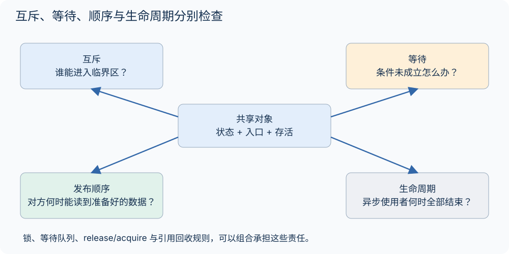
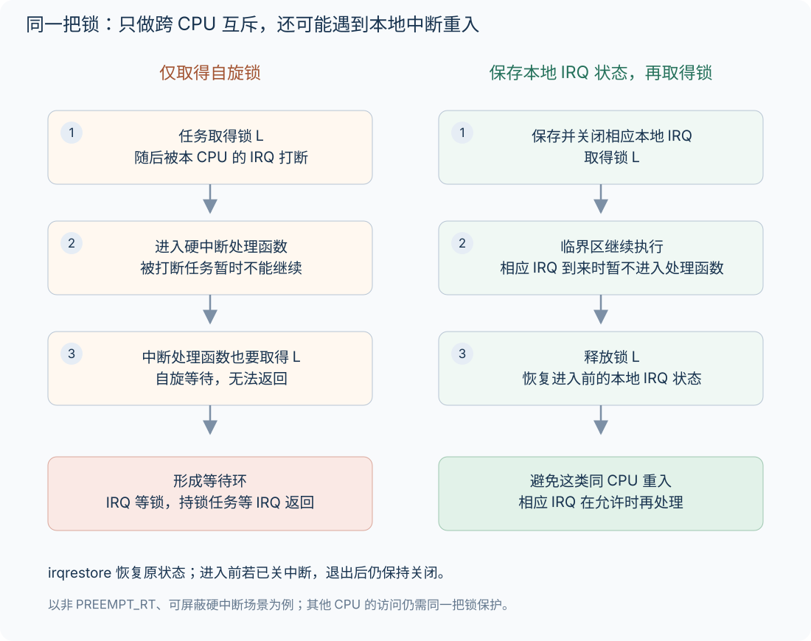
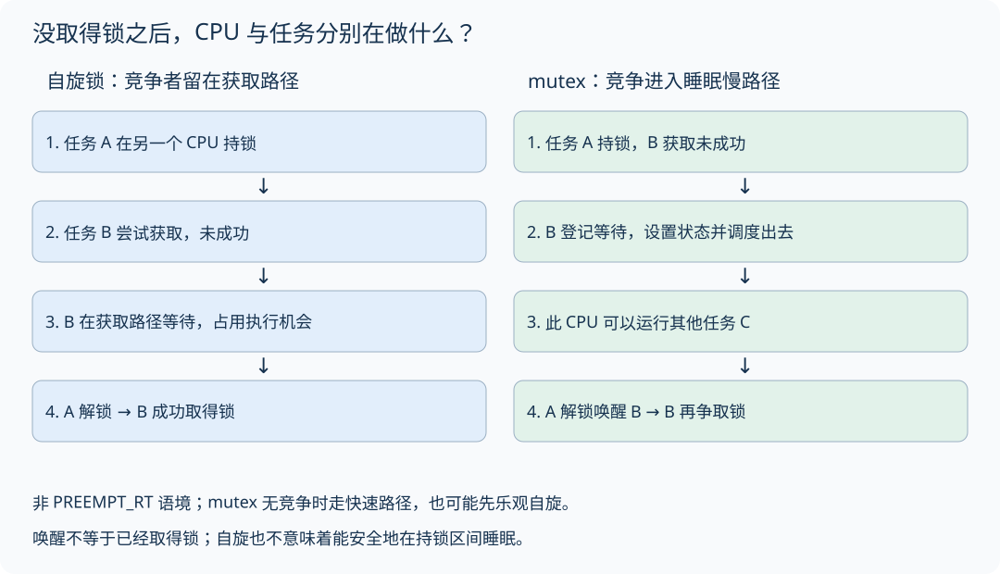
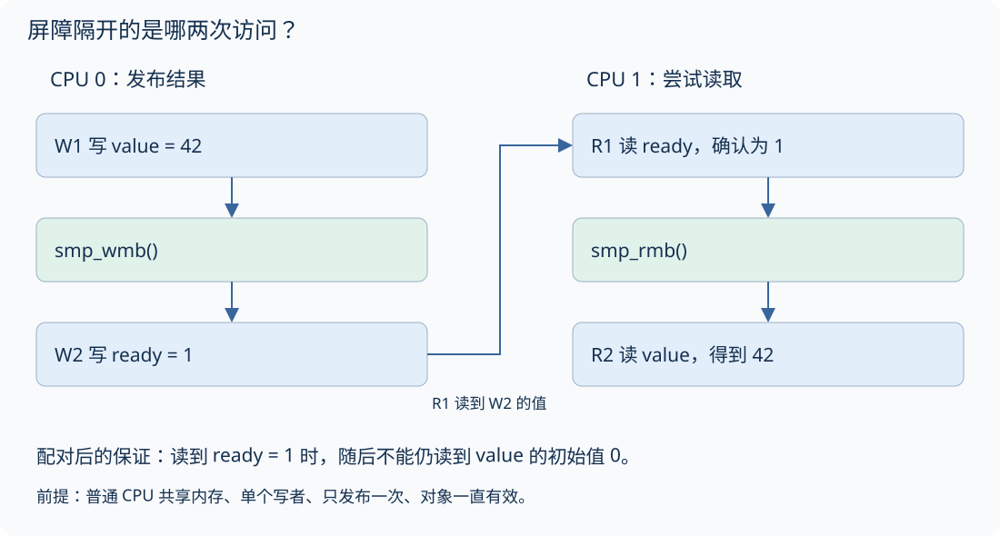
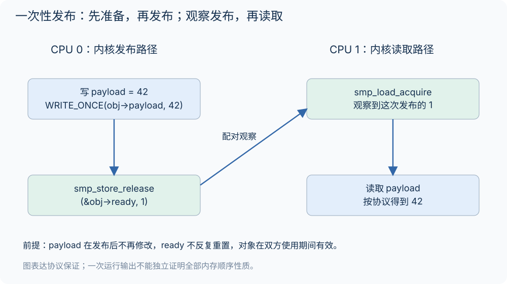

本篇文章介绍 **Linux 内核代码中的同步**：共享数据怎样避免并发修改，任务怎样等待内核事件，以及一个 CPU 准备的数据如何安全地交给另一个 CPU。对象包括内核自旋锁、`struct mutex`、等待队列、completion 和内存顺序接口；上一篇的 `pthread_mutex_t`、条件变量与 `sem_t` 属于用户态接口。

“内核代码”也不等于“只有内核线程运行的代码”。普通用户进程进入系统调用后，同样会执行内核代码、取得内核锁；硬中断和软中断也可能访问同一份内核数据。**判断接口能否使用，要看当前执行上下文，不能只看进程来自哪里。**

源码对照上游 **Linux v6.8**，默认讨论非 PREEMPT_RT 内核，实时配置的差异在 2.3 节说明。正文代码是用于解释协议的内核接口片段，不是用户态可编译程序，也没有作为模块加载实测；源码摘录用 `/* … */` 标明省略部分。本篇解释选择依据与关键对象，不展开每种锁的完整实现算法。

系列位置：[1. 对象模型](/p/linux-process-task-model/) · [2. 生命周期](/p/linux-process-lifecycle/) · [3. 调度](/p/linux-process-scheduling/) · [4. 执行上下文](/p/linux-kernel-execution-context/) · [5. 用户态同步](/p/linux-userspace-synchronization/) · **6. 内核同步**。

## 一、先判断访问者，再选同步机制

### 1.1 三类问题不能互相替代

先用一个驱动中的共享对象区分问题：任务提交请求，中断路径报告进度，完成后任务继续处理。保护进度字段、等待请求完成、发布结果数据，分别需要不同的保证。

| 问题 | 典型机制 | 需要的保证 |
| --- | --- | --- |
| 两个执行者同时修改状态 | 自旋锁、mutex、读写锁等 | 临界区按协议互斥或读写排斥 |
| 条件尚未满足，需要等待 | 等待队列、completion、信号量等 | 正确检查条件、阻塞并在适当时机唤醒 |
| 先准备数据，再让别人使用 | 锁的顺序保证、release/acquire 等 | 对方看到发布标记时能按协议观察已准备的数据 |

某个接口可能同时承担部分责任，但不能把三个问题混成“加一个屏障就安全”。内存屏障不提供一般意义上的互斥，唤醒操作也不替代业务对象的所有同步规则。



本篇自旋锁默认以**非 PREEMPT_RT** 内核为语境。PREEMPT_RT 会改变部分锁实现与可抢占行为，后面单独列出边界。

### 1.2 关中断只约束本 CPU

禁止本地抢占，避免的是当前任务在该范围被调度到另一个任务；关本地中断，约束的是本 CPU 的相应中断进入。其他 CPU 仍然可以运行并访问同一对象。

因此“已经关中断，所以不用锁”只有在另有严格的 CPU 本地归属等条件下才可能成立，不能用于一般跨 CPU 共享数据。

### 1.3 按执行上下文缩小选择范围

| 访问场景 | 先考虑什么 | 典型选择 |
| --- | --- | --- |
| 只有可睡眠的任务路径访问 | 是否需要互斥，持锁期间是否可能阻塞 | `mutex` |
| 硬中断与任务共享少量状态 | 跨 CPU 互斥，以及本 CPU 中断重入 | 短自旋临界区；任务侧通常需保存并关闭本地中断 |
| 任务要等某个条件成立 | 条件由谁保护，唤醒后是否需要重新检查 | 等待队列 |
| 任务要等一次操作结束 | 完成通知与结果对象何时失效 | completion |
| 需要限制同时在用的资源数量 | 许可的取得、归还和错误路径 | 内核信号量 |

“任务上下文”只是允许考虑睡眠接口的前提。若已经持有自旋锁、关闭了抢占，或处在其他原子区间，也不能因为当前有 `current` 就调用可能睡眠的接口。这里的“睡眠”指任务阻塞并让调度器切走，不特指延时函数。

## 二、自旋锁与睡眠锁

### 2.1 自旋锁保护短且不能睡眠的区间

先看为什么需要锁。假设 `counter` 初始为 0，两个 CPU 都执行 `counter++`。这不是天然不可分割的操作，可以拆成读、加一、写回：

| 步骤 | CPU 0 | CPU 1 |
| --- | --- | --- |
| 1 | 读到 0 | |
| 2 | | 也读到 0 |
| 3 | 计算并写回 1 | |
| 4 | | 计算并写回 1 |

两次递增，结果却是 1。自旋锁将这几步包成临界区：只有取得锁的执行者可以进入，其他访问者必须等它解锁。对于单个计数，也可以按需求选择原子操作；这里用递增展示锁保护一段操作的作用。

**自旋是竞争时的等待方式**。普通非实时内核中，CPU 1 获取不到锁时，在获取锁的路径上等待，不会像睡眠锁那样把当前任务挂入等待队列、主动调度出去；CPU 0 解锁后，它才能成功取得锁并继续。具体实现可能使用排队等优化，不等于所有 CPU 都在不停写同一个变量。

| 时刻 | CPU 0 | CPU 1 |
| --- | --- | --- |
| 取得锁 | 成为持有者 | 尝试取锁，未成功 |
| 临界区 | 修改受保护数据 | 在锁获取路径上等待 |
| 解锁以后 | 离开临界区 | 取得锁，再访问数据 |

可以把核心逻辑压缩成下面的 **C 风格伪代码**。`atomic_exchange_acquire()` 是此处定义的抽象操作：原子地写入新值并返回旧值，成功取得锁时提供 acquire 顺序；不是让读者直接调用的 Linux 函数名。

```c
/* 教学模型：0 表示空闲，1 表示被持有。 */
struct simple_spinlock {
    int locked;
};

void simple_spin_lock(struct simple_spinlock *lock)
{
    preempt_disable();
    while (atomic_exchange_acquire(&lock->locked, 1) != 0)
        cpu_relax();
}

void simple_spin_unlock(struct simple_spinlock *lock)
{
    store_release(&lock->locked, 0);
    preempt_enable();
}
```

假设 CPU 0、CPU 1 同时争抢初始为 0 的锁：原子交换保证只有一个读到旧值 0，它把锁变成 1 并进入临界区；另一个读到 1，只能继续等待。持有者 release 写回 0 后，等待者才可能交换成功。**不能用普通的“先判断为 0，再赋值为 1”替代原子交换**，否则两个 CPU 可能同时判断为空闲。

`cpu_relax()` 是自旋中的处理器提示，不是睡眠或调度函数；具体架构可能采用不同等待优化。获取的 acquire 与释放的 release 还承担临界区之间的内存顺序保证，第四章再解释这部分。

这个模型展示最基本的 test-and-set（测试并置位）思路。实际 `spin_lock()` 包含配置、架构及调试等层次，常见实现使用 queued spinlock（排队自旋锁）降低竞争开销，不能把上面的交换循环当作 Linux v6.8 的源码。这里的关闭抢占也不等于关闭硬中断。[v6.8 排队自旋锁入口](https://github.com/torvalds/linux/blob/v6.8/include/asm-generic/qspinlock.h)

因此它适合很短的共享状态更新，例如中断处理与任务之间的计数、队列指针调整。**等待者仍占用处理器的执行机会，持锁者必须尽快前进。** 普通自旋锁持有期间禁止抢占，并要求不睡眠；若调用可能阻塞的 I/O、`mutex_lock()` 或允许直接回收的内存分配，便破坏了这个使用约束。自旋锁本身不自动关闭硬中断，所以还要考虑下面的本 CPU 重入。

假设任务上下文与本 CPU 的硬中断路径使用同一把锁。若任务已取得锁，中断又进入并试图取得它，中断会等待当前任务释放，而当前任务必须等中断返回才能继续，形成自锁。相关任务访问需要同时处理本地中断状态，例如下面的**内核接口示意**：

```c
static DEFINE_SPINLOCK(counter_lock);
static unsigned long counter;

static void count_event(void)
{
    unsigned long flags;

    spin_lock_irqsave(&counter_lock, flags);
    counter++;
    spin_unlock_irqrestore(&counter_lock, flags);
}
```

这里的 irqsave/restore 保存并恢复进入前的本地中断状态，而不是退出时无条件打开中断。所有访问路径还必须遵守一致的保护协议。若共享者只有软中断与任务等不同组合，还需评估 `_bh()` 或其他适当接口，不能把所有场景机械换成同一个后缀。



### 2.2 mutex 的竞争者可以睡眠

假设驱动有一个“读取配置 → 向设备发送配置 → 更新缓存”的操作。两个任务不能交叉执行整段操作，否则设备状态和缓存可能对不上；而设备通信又可能等待。这里适合用内核 mutex：

```c
static DEFINE_MUTEX(config_lock);

/* 仅由允许睡眠的任务路径调用；辅助函数代表驱动业务。 */
static int update_config(int value)
{
    int ret;

    mutex_lock(&config_lock);
    ret = send_config_to_device(value); /* 可能睡眠的设备通信 */
    if (!ret)
        cached_config = value;
    mutex_unlock(&config_lock);
    return ret;
}
```

辅助函数和缓存字段由具体驱动定义。这里要保护的是一次完整更新，而不是某一条赋值。取得 mutex 后可以在合适条件下睡眠，其他任务也不能因此进入这段临界区。所有访问同一配置的路径仍必须遵守这把锁的协议。

竞争时，mutex 与自旋锁的区别发生在“没拿到怎么办”：

| 路径 | 内核在做什么 | 当前任务怎样继续 |
| --- | --- | --- |
| 无竞争快速路径 | 原子地尝试登记当前任务为持有者 | 成功后直接进入临界区 |
| 可选的乐观自旋 | 持有者正在运行等条件合适时，短暂等它解锁 | 可能不必付出睡眠与唤醒成本 |
| 睡眠慢路径 | 把等待任务组织起来，设置任务状态并调度出去 | CPU 可以运行其他任务；解锁路径唤醒等待者后，它再争取锁 |

这解释了为什么 mutex 里既需要持有者信息，也需要等待组织。非 PREEMPT_RT 的 v6.8 定义中，关键字段如下，条件编译字段及调试字段已省略：

```c
struct mutex {
    atomic_long_t owner;
    raw_spinlock_t wait_lock;
    /* … */
    struct list_head wait_list;
    /* … */
};
```

| 字段 | 对应上面的哪一步 |
| --- | --- |
| `owner` | 记录持有任务指针及低位状态标记，支持获取、释放和竞争判断 |
| `wait_list` | 组织进入慢路径的等待者 |
| `wait_lock` | 短暂保护等待组织的变化；任务真正睡下前会释放它 |

内部用自旋锁不代表 mutex 持有期间也不能睡眠：内部锁只保护“登记等待者”等短操作，外层 mutex 则保护调用者的整个业务临界区。

mutex 必须由取得它的任务解锁，不支持递归获取。硬中断没有可供这样阻塞等待的独立任务执行流程，不能使用它。即使当前是任务上下文，若已持自旋锁等，也不能调用 `mutex_lock()`。[mutex 的获取路径与使用规则](https://docs.kernel.org/6.8/locking/mutex-design.html) · [v6.8 定义](https://github.com/torvalds/linux/blob/v6.8/include/linux/mutex.h)



常见读写接口也需要按能否睡眠区分：

| 类型 | 常用接口 | 非 PREEMPT_RT 下的使用边界 |
| --- | --- | --- |
| `rwlock_t` | `read_lock()`、`write_lock()` 及对应解锁 | 自旋读写锁，持锁期间遵守不睡眠约束 |
| `rw_semaphore` | `down_read()`、`down_write()`、`up_read()`、`up_write()` | 可睡眠的读写排斥，用于合适任务上下文 |

读锁只允许多个遵守协议的读者并发，不表示读取本身可以任意修改受保护状态。读多也不自动保证读写锁比 mutex 更快，还要考虑缓存争用、临界区与写者延迟。

### 2.3 PREEMPT_RT 下哪些规则变化

| 对象 | 非 PREEMPT_RT | PREEMPT_RT 的重要差异 |
| --- | --- | --- |
| `spinlock_t` | 常见自旋锁语义 | 基于可阻塞的实时锁机制，相关抢占与中断语义不能照搬普通内核 |
| `raw_spinlock_t` | 原始自旋锁 | 仍保留严格原始自旋语义，用于需要它的底层场景 |
| `mutex` / `rt_mutex` | 睡眠锁及相关专门机制 | 实时配置与优先级继承需要结合具体类型理解 |
| 本地中断/抢占控制 | 约束本 CPU 执行 | 依然不自动提供跨 CPU 互斥 |

这不意味着在硬中断中随便改用 `spinlock_t` 就能睡眠。需要在选定内核配置与执行路径下确认接口规则。[锁类型与 PREEMPT_RT 规则](https://docs.kernel.org/6.8/locking/locktypes.html)

## 三、等待队列、completion 与信号量

### 3.1 等待队列把条件与任务阻塞接起来

等待队列组织需要在事件到来时重新判断条件的任务。v6.8 的相关类型如下：

```c
struct wait_queue_head {
    spinlock_t lock;
    struct list_head head;
};

struct wait_queue_entry {
    unsigned int flags;
    void *private;
    wait_queue_func_t func;
    struct list_head entry;
};
```

`head` 是等待条目的集合，`private` 在常见任务等待路径中关联任务，`func` 决定唤醒处理。等待队列内部锁保护队列组织，业务条件本身仍需要合适的锁、原子状态或发布协议保护。

`wait_event*()` 等接口协调检查条件、设置状态、排队、调度与重新检查。唤醒方更新条件后调用适当的 `wake_up*()`，等待方不能把一次唤醒当成条件一定成立的保证。手写“检查一次，然后随便 schedule”会遗漏关键交叉。[等待队列定义与宏](https://github.com/torvalds/linux/blob/v6.8/include/linux/wait.h)

例如内核工作线程要等队列非空：等待方用 `wait_event()` 检查“有待处理项或正在停止”，生产方在同一套队列保护协议下插入项目，再 `wake_up()`。被唤醒只表示可以重新检查；项目仍可能被另一个消费者先取走。

| 时刻 | 等待任务 | 生产方 |
| --- | --- | --- |
| 条件未满足 | 接口先组织等待，再检查条件，必要时调度出去 | 尚未提交项目 |
| 条件变化 | 等待，或正在重新检查 | 更新共享状态，再唤醒等待者 |
| 再次运行 | 重新检查条件，在保护下尝试取得项目 | 可以继续运行 |

等待队列保存“谁在等”，队列是否为空这样的业务状态保存在业务对象中。两者分开，才容易看清内部的 `lock` 为什么不能自动保护业务数据。

### 3.2 completion 表达“这件事已完成”

v6.8 的实际定义是：

```c
struct completion {
    unsigned int done;
    struct swait_queue_head wait;
};
```

这里使用简单等待队列 `swait_queue_head`，不是直接把旧资料中的普通 `wait_queue_head_t` 定义复制过来。`done` 保存可消费的完成状态，因而先完成、后等待也是有效使用顺序。

下面是**一次性结果交付的内核接口示意**，对象在双方完成前保持有效：

```c
static DECLARE_COMPLETION(result_ready);
static int result;

/* 生产方，在相应任务或允许调用 complete 的上下文中。 */
result = 42;
complete(&result_ready);

/* 消费方，在可睡眠的任务上下文中。 */
wait_for_completion(&result_ready);
pr_info("result=%d\n", result);
```

这几行分别属于生产和消费路径，不是一段顺序执行的测试程序，也没有在虚拟机中作为模块加载。先写结果、后通知完成，与等待成功后读取相配合。若使用超时或可中断等待，需要检查返回值；等待失败就不能继续把结果当成已准备好。

`complete()` 与 `complete_all()` 的消费语义不同，重新使用前还要协调状态重置。超时返回后异步生产者仍可能访问 completion 或外层对象，所以对象不能因为等待者“不等了”就直接释放。[completion 接口规则](https://docs.kernel.org/6.8/scheduler/completion.html) · [v6.8 实现](https://github.com/torvalds/linux/blob/v6.8/kernel/sched/completion.c)

### 3.3 信号量保存可用数量

内核 `struct semaphore` 保存内部锁、可用计数与等待者链表：

```c
struct semaphore {
    raw_spinlock_t lock;
    unsigned int count;
    struct list_head wait_list;
};
```

例如一个内核组件只允许 **3 个任务同时执行某类耗资源操作**。初始化时调用 `sema_init(&slots, 3)`；每个任务先取得一个许可，用完再归还：

```c
static struct semaphore slots;

/* 组件初始化时执行一次，在并发访问开始之前。 */
sema_init(&slots, 3);

/* 以下属于可睡眠的任务处理路径。 */
ret = down_interruptible(&slots);
if (ret)
    return ret; /* 未取得许可，不能执行操作，也不能 up。 */

ret = process_one_job(); /* 可以睡眠；每条退出路径都要归还许可。 */
up(&slots);
return ret;
```

这是初始化与处理路径的分段示意，`process_one_job()` 代表实际业务。它限制并发数量，不负责给任务分配具体的缓冲区，也不保护业务中其他共享链表。

| 事件 | 可用计数 `count` | 等待情况 |
| --- | --- | --- |
| 初始化 | 3 | 无 |
| A、B、C 各取得一个许可 | 0 | 三者可同时处理 |
| D 尝试获取 | 0 | D 排队并睡眠 |
| A 调用 `up()`，D 尚未被信号打断 | 0 | 许可直接交给等待者 D，并唤醒它 |
| D 获得运行机会 | 0 | D 的获取返回成功，继续处理 |
| 此后没有等待者，B 归还许可 | 1 | 后来的任务可以直接获取 |

在 v6.8 中，`count` 是尚可立即取得的许可数，不是用负数记录等待人数。`down_interruptible()` 在计数大于 0 时递减；否则进入等待链表，释放内部锁并调度出去。`up()` 在没有等待者时递增计数，有等待者时则唤醒并向其交付许可。内部 `raw_spinlock_t` 保护这几步，真正处理任务期间并不一直持有它。[v6.8 获取与归还实现](https://github.com/torvalds/linux/blob/v6.8/kernel/locking/semaphore.c)

下面进一步把计数和等待串成 **C 风格伪代码**。为突出正常交付路径，这里采用不处理中断与超时的等待模型；前面的实际使用示例仍选择可被信号中断的 `down_interruptible()`。`lock_internal_irqsave()` 等名称代表内部原始自旋锁操作，`enqueue()` 等代表链表操作。

```c
void simple_down(struct semaphore *sem)
{
    flags = lock_internal_irqsave(sem);
    if (sem->count > 0) {
        sem->count--;
        unlock_internal_irqrestore(sem, flags);
        return;
    }

    waiter.task = current;
    waiter.granted = false;
    enqueue(&sem->wait_list, &waiter);

    for (;;) {
        set_current_state(TASK_UNINTERRUPTIBLE);
        unlock_internal_irqrestore(sem, flags);
        schedule();
        flags = lock_internal_irqsave(sem);

        if (waiter.granted)
            break;
    }
    unlock_internal_irqrestore(sem, flags);
}

void simple_up(struct semaphore *sem)
{
    flags = lock_internal_irqsave(sem);
    if (queue_empty(&sem->wait_list)) {
        sem->count++;
    } else {
        waiter = dequeue_first(&sem->wait_list);
        waiter->granted = true;
        wake_up_process(waiter->task);
    }
    unlock_internal_irqrestore(sem, flags);
}
```

这段省略类型声明的伪代码保留了三个关键关系：

- **检查计数和登记等待必须在同一内部锁保护下完成**。否则获取者刚发现没有许可、还没入队，归还者就可能错过它。
- **先设置睡眠状态，再释放内部锁，最后调度**。若归还者恰好在解锁后、`schedule()` 前交付许可并唤醒，任务已被置为可运行，不会因为随后调用调度就漏掉这次通知。醒来后还要在锁下检查 `granted`，不能把任意一次唤醒当作成功。
- **有等待者时，直接将许可交给等待者**。所以该路径不先把 `count` 加成 1，也不要求被唤醒者再次递减计数；`granted` 表示它已经取得这次许可。

`waiter` 的存储在获取函数返回前保持有效，归还方在内部锁保护下将它摘链并完成交付。实际可中断与超时路径还需要在失败时安全摘除等待者；不能直接拿这个省略了退出分支的模型代替 `down_interruptible()`。[v6.8 的 __down_common 与 __up](https://github.com/torvalds/linux/blob/v6.8/kernel/locking/semaphore.c)

| 问题 | mutex | 内核信号量 |
| --- | --- | --- |
| 同时允许多少个取得者 | 一个持有者 | 初始计数及归还协议决定 |
| 谁来释放 | 必须是持有任务 | 不要求由取得许可的同一任务归还 |
| 表达什么 | 这段共享操作一次只能一个任务执行 | 这类资源或操作还剩多少许可 |

初值为 1 时，信号量也能限制一次一个任务进入，但仍没有 mutex 的拥有者规则。只需要互斥时通常优先用 mutex；只等一次完成时用 completion 更直接。可阻塞的获取应放在允许睡眠的任务路径，`up()` 可由中断路径调用，不能把二者的上下文要求混为一谈。

## 四、内存屏障究竟保证什么

### 4.1 为什么标记已就绪，数据还可能是旧的

现在换一个问题：只有一个 CPU 写结果，另一个 CPU 读结果，不存在两个写者争抢计数。初始 `payload = 0`、`ready = 0`，写方代码如下：

```c
/* CPU 0：没有建立发布顺序的版本。 */
WRITE_ONCE(obj->payload, 42);
WRITE_ONCE(obj->ready, 1);

/* CPU 1 */
if (READ_ONCE(obj->ready))
    consume(READ_ONCE(obj->payload));
```

直觉是“看到 `ready == 1`，结果必然已是 42”。但这段代码没有建立相应跨 CPU 顺序。在允许这种观察的架构上，**CPU 1 可能看到 ready 为 1，却仍读到 payload 为 0**。

| 观察阶段 | CPU 0 的源码顺序 | CPU 1 可能观察到的结果 |
| --- | --- | --- |
| 准备结果 | 写 `payload = 42` | 尚不能据此保证另一 CPU 已观察到这次写 |
| 设置标记 | 写 `ready = 1` | 先读到标记 1 |
| 使用结果 | | 随后仍读到旧的 payload 0 |

这是允许结果的推演，不是本机实测输出。编译器优化和处理器的访存执行、传播与观察规则，都使“源码排在前面”不等于“其他 CPU 必须按此顺序观察”。即使缓存一致性保证了单个位置的相应一致性，也不自动保证 **payload 与 ready 两个不同位置**之间的发布关系；`if` 分支本身也不能建立所需的读取顺序。

内存屏障的作用，就是为协议中必须保留的访存顺序加约束。它不会把这一整段变成互斥区，也不是“立刻将所有缓存刷回物理内存”。这里需要约束的是：准备结果在发布标记之前，对方确认这次发布后再读取结果。[Linux 内存屏障：访问顺序与配对规则](https://docs.kernel.org/6.8/core-api/wrappers/memory-barriers.html)

### 4.2 一个直接使用读写屏障的例子

假设内核工作线程计算完一个结果，另一个 CPU 上的任务在后续调用中尝试读取它。结果只产生一次，成功读取后也不回收或修改对象。这里不需要让读取者阻塞：未就绪就返回，之后再检查。

下面是放在内核组件中的**教学示例**，使用真实内核接口，但没有作为模块加载运行。`result` 在双方开始访问前已静态初始化为 0，并在整个访问期间保持有效。

```c
#include <linux/compiler.h>
#include <asm/barrier.h>

static struct {
    int value;
    int ready;
} result;

/* 只由一个生产者调用一次。 */
static void publish_result(void)
{
    WRITE_ONCE(result.value, 42); /* W1：准备结果 */
    smp_wmb();                   /* W1 必须排在 W2 之前 */
    WRITE_ONCE(result.ready, 1);  /* W2：发布就绪标记 */
}

/* out 是调用者提供的有效输出指针。 */
static bool try_read_result(int *out)
{
    if (!READ_ONCE(result.ready)) /* R1：先读取标记 */
        return false;

    smp_rmb();                   /* R1 必须排在 R2 之前 */
    *out = READ_ONCE(result.value); /* R2：读取结果 */
    return true;
}
```

调用者执行 `try_read_result(&value)`：返回 `false` 表示本次尚未观察到就绪；返回 `true` 时，输出参数应是 42。在这个单次发布协议中，不能出现“返回 true，输出却为初始值 0”。



读图时沿两侧各走一遍，再看中间的配对关系：

| 位置 | 屏障约束哪两次访问 | 在例子中解决什么问题 |
| --- | --- | --- |
| 写方 `smp_wmb()` | 写 value → 写 ready | 结果的写入不能在协议要求的观察顺序上落到发布标记之后 |
| 读方 `smp_rmb()` | 读 ready → 读 value | 使用结果的读取不能越过确认就绪的读取 |
| 两侧配对 | R1 读到了 W2 写入的 1 | 将 W1 与 R2 接起来，排除仍读取初始值 0 的结果 |

**只加一侧不够。** 只加写屏障，不能建立读侧所需的读取顺序；只加读屏障，不能建立写侧的发布顺序。若把写屏障移到两次写入之后，它也就没有隔开要排序的两次写；读屏障放到读取结果之后同样解决不了本例的问题。[内核文档中的读写屏障配对](https://docs.kernel.org/6.8/core-api/wrappers/memory-barriers.html#smp-barrier-pairing)

这里没有要求写方等待读方，也没有把两个 CPU 串行成一个临界区。屏障只补上这条数据交付所需的顺序。它不负责唤醒任务、不保证读方何时再次检查，也不允许多个生产者随意覆盖结果。

### 4.3 用 release/acquire 表达同一个交付协议

上面的场景也可以使用更直接的发布与获取接口。下面将结果字段命名为 `payload`，前提保持不变：对象有效、单个发布者、只发布一次，发布后不再修改结果或重置标记。

```c
struct published_result {
    int payload;
    int ready;
};

/* 发布路径：obj 已正确初始化，双方均可访问且不会被释放。 */
WRITE_ONCE(obj->payload, 42);
smp_store_release(&obj->ready, 1);

/* 另一个 CPU 上的读取路径。 */
if (smp_load_acquire(&obj->ready))
    consume(READ_ONCE(obj->payload));
```

两段分别属于发布路径与读取路径，`consume()` 代表使用结果的业务代码。它们说明顺序协议，不是完整的可运行程序。

| 步骤 | 操作 | 保证或含义 |
| --- | --- | --- |
| 1 | 写入 `payload` | 准备数据，此时尚未交付 |
| 2 | release 存储 `ready = 1` | 把前面的准备排在发布之前 |
| 3 | acquire 读取 `ready`，观察到这次发布的 1 | 与发布方配对，为后面的读取建立顺序 |
| 4 | 读取 `payload` | 在上述前提下读取已发布的 42 |



沿图从左到右看：关键是读取方**观察到了 release 发布的值**，随后才使用结果；仅仅先后调用两个名字相似的接口并不够。如果读到 0，这次就不使用结果。该示意没有阻塞等待，也不要求读取方忙等，什么时候再次检查由调用方决定。

只把 `ready` 写成 `WRITE_ONCE()`，不能据此建立这条跨 CPU 发布顺序。反过来，release/acquire 也不提供多写者互斥或自动引用计数。若结果需要反复更新，应重新设计版本、锁或其他同步协议，不能直接在这里反复把 `ready` 清零。

### 4.4 几种接口各自约束什么

| 接口 | 作用 | 放在本例中怎样理解 |
| --- | --- | --- |
| `READ_ONCE()` / `WRITE_ONCE()` | 约束指定标量访问，避免相应编译器合并、消除等变化 | 保留对字段的访问，但单独使用不建立 payload 与 ready 的发布关系 |
| `smp_store_release()` | 将前面的访问排在这次发布存储之前 | 先准备 payload，再发布 ready |
| `smp_load_acquire()` | 将后面的访问排在这次获取读取之后 | 先确认发布，再使用 payload |
| `smp_wmb()` | 在适用的普通共享内存协议中约束前后的写顺序 | 可用于明确设计的写侧屏障配对协议，不单独解决读侧顺序 |
| `smp_rmb()` | 约束前后的读顺序 | 可用于相应读侧协议，不替代写侧发布 |
| `smp_mb()` | 提供完整内存屏障的相应顺序约束 | 用于需要更强顺序的协议，并非加在哪里都能修复竞争 |
| `barrier()` | 编译器屏障 | 不提供所需的 CPU 间硬件访存顺序保证 |

对于这个交付场景，release/acquire 的写法更直接，因为“准备数据 → 发布入口 → 读取入口 → 使用数据”正好与接口语义对应。屏障必须放在协议要求的位置并按规则配对；不能只在错误代码末尾随手补一个 `smp_mb()`。

### 4.5 什么场景需要显式考虑内存顺序

| 场景 | 要保证的关系 | 通常怎样处理 |
| --- | --- | --- |
| 同一把锁保护的共享配置 | 前一持有者的修改交给后一持有者 | 正确使用锁的获取与释放保证 |
| 任务等待异步结果 | 结果写入后才通知，成功等待后才使用 | 按 completion 的接口保证组织流程 |
| 单生产者、单消费者的无锁环形队列 | 槽位内容准备好后再发布写位置 | 使用经过设计的发布/获取协议；还需处理槽位回收 |
| 初始化后公开共享对象 | 读者见到入口时，对象初始化已完成 | 使用相应发布原语；RCU 对象按 RCU 规则发布与读取 |
| 设备读取描述符或 CPU 访问寄存器 | 普通内存、DMA 与设备访问的相应顺序 | 使用设备要求的 DMA/I/O 接口，不能照搬普通 CPU 共享内存示例 |

本篇的一次性 `ready` 示例就是“准备好一份结果，再公开它”的最小模型。环形队列还要处理反复复用，动态对象还要处理回收；只有顺序保证仍不足以完成这些协议。

### 4.6 已经用锁或 completion 时，还要加屏障吗

若双方已按同一把锁保护结果，正常使用锁的获取与释放保证即可；若通过 3.2 节的一次性 completion 交付结果，就按 completion 的接口保证组织写入、通知、等待和读取。**不需要在这些接口外机械地叠加一套 ready 与屏障。**

release/acquire 示例把锁和阻塞等待暂时拿开，是为了单独说明“数据准备好之后如何发布”。它不能代替前面所有机制。只有在设计明确的无锁协议时，才需要进一步逐项核对访问顺序、并发更新和对象回收。

`mb/rmb/wmb` 与 `smp_*` 屏障在适用场景上还有区别，设备寄存器与 DMA（Direct Memory Access，直接内存访问）的顺序需用相应 I/O 与 DMA 接口，不能把普通共享内存的发布模式直接搬到硬件设备交互中。

## 五、把锁协议和生命周期一起收尾

### 5.1 避免锁顺序与等待环

若任务 A 持锁 L1 等 L2，任务 B 持 L2 等 L1，就形成经典锁顺序环。即使只有一把锁，也可能因持锁等待工作队列取消、线程退出或 completion，而被等待方恰好要取得同一把锁，造成死锁。

可以按下面顺序检查：先确定谁会访问对象，再统一多锁顺序，避免在持有阻塞对方所需资源时等待；最后设计停止提交、唤醒退出、等待结束和释放内存的顺序。

lockdep 根据运行中观察到的锁类与依赖关系发现许多潜在锁问题，但不是证明全部业务协议正确的工具，未报告也不等于没有任何竞态。[lockdep 设计](https://docs.kernel.org/6.8/locking/lockdep-design.html)

### 5.2 RCU 与 seqcount 放在什么位置

RCU 适合相应读多写少场景的入口发布与延迟回收，仍需协调写者及对象引用。seqcount 适合读侧检测更新交叉后重试，写侧仍需正确串行化；它也不能让已经释放的指针对象凭空恢复有效。

它们与前面的锁、等待机制各自有适用范围。系列到这里形成闭环：任务对象持有状态，调度器安排执行，执行上下文决定能使用哪些接口，同步协议再保证共享状态和对象生命周期。

## 六、命令与接口速查

| 接口 | 用途与边界 |
| --- | --- |
| `spin_lock()` / `spin_unlock()` | 按所用内核配置保护短临界区 |
| `spin_lock_irqsave()` / `spin_unlock_irqrestore()` | 配合保存恢复本地中断状态的锁保护 |
| `mutex_lock()` / `mutex_unlock()` | 任务上下文中的睡眠互斥锁接口 |
| `wait_event*()` / `wake_up*()` | 围绕受正确同步保护的条件组织等待与唤醒 |
| `wait_for_completion*()` / `complete()` | 等待与交付完成状态，检查超时或中断返回值 |
| `down*()` / `up()` | 内核信号量取得与增加可用量 |
| `READ_ONCE()` / `WRITE_ONCE()` | 指定访问约束，不代替一般发布顺序 |
| `smp_store_release()` / `smp_load_acquire()` | 共享内存中配对的发布与读取顺序 |
| `smp_wmb()` / `smp_rmb()` | 本篇一次性结果交付中的写侧与读侧屏障 |

## 七、名词解释

| 名词 | 本篇含义 |
| --- | --- |
| 任务上下文 | 代表某个任务执行的内核路径，包括系统调用与内核线程；能否睡眠还取决于当前约束 |
| 原子上下文 | 必须遵守不能睡眠等约束的执行环境，不能与“只做原子变量操作”混为一谈 |
| 自旋锁 | 竞争者按相应配置等待获取、保护短临界区的锁机制 |
| 睡眠锁 | 获取过程中允许任务阻塞的锁，需要适合的任务上下文 |
| 等待队列 | 组织等待事件者，并协调唤醒处理的对象 |
| completion | 保存完成状态并组织等待的内核同步对象 |
| 原子性 | 特定操作按其接口语义不可分割地完成 |
| release / acquire | 发布前的准备与观察发布后的读取之间建立相应顺序的语义 |
| 内存屏障 | 在内存模型与配对规则下约束访问顺序的工具 |
| PREEMPT_RT | 改变部分锁与中断执行方式、面向实时响应的内核配置体系 |
| lockdep | 根据锁类及已观察依赖检查锁使用问题的内核工具 |
| 生命周期协议 | 协调对象可达、在用、异步处理结束与最终释放的规则 |
