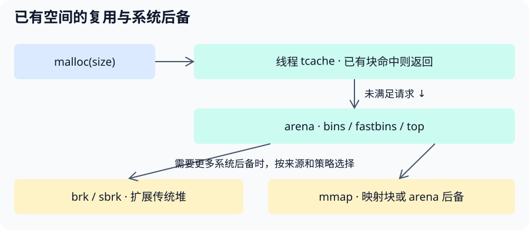

`malloc()` 返回的是一段可用的用户地址。分配器已经可能写过块头，但对象里尚未访问到的其他页仍可以没有物理后备。随后一次普通赋值，会把“合法的虚拟区间”推进为“具有数据页的有效映射”。

本篇沿“进程 → 虚拟地址空间 → 页表映射 → 物理页”的顺序，把分配和首次写入接在一起。源码对照 GNU C 库（glibc，GNU C Library）2.42、Linux v6.8，实验虚拟机当前为 Ubuntu 26.04.1 ARM64、glibc 2.43，运行内核 `6.8.0-149-generic`。用户态库的具体调用选择以本次跟踪为准。[第二篇](/p/linux-virtual-address-translation/)已经展开硬件地址翻译。

本篇使用的对象、虚拟区间、物理页及 `mmap / madvise` 接口关系，可对照[第一篇的概念说明](/p/linux-memory-management-basics/)。

## 一、在同一个进程观察申请和写入

### 1.1 从小块申请走到一页尚未触及的对象空间

保存为 `write-lab.c`。小块请求用于观察传统堆，大块请求用于取得足够大的对象，让目标页远离分配器已经写过的头部。

程序在大块对象内部选取完整页范围，并使用 `MADV_NOHUGEPAGE` 限定基本页观察。这里的地址上取整到页边界，长度下取整，整个建议范围都在用户对象边界内。该建议可能拆分原虚拟内存区域（VMA，Virtual Memory Area），因此观察时使用打印出的 `target`。

```c
#include <stdint.h>
#include <stdio.h>
#include <stdlib.h>
#include <sys/mman.h>
#include <unistd.h>

static void stop_at(const char *stage)
{
    printf("stage = %s\n", stage);
    if (getchar() == EOF)
        exit(EXIT_FAILURE);
}

int main(void)
{
    setbuf(stdout, NULL);
    setbuf(stdin, NULL);
    long page = sysconf(_SC_PAGESIZE);
    if (page <= 0)
        return EXIT_FAILURE;
    printf("pid = %ld, page_size = %ld\n", (long)getpid(), page);
    stop_at("baseline");

    unsigned char *small = malloc(64);
    if (small == NULL)
        return EXIT_FAILURE;
    small[0] = 'S';
    printf("small = %p\n", (void *)small);
    stop_at("small");

    size_t size = 16 * 1024 * 1024;
    unsigned char *large = malloc(size);
    if (large == NULL) {
        free(small);
        return EXIT_FAILURE;
    }

    /* Select complete pages inside the user object's bounds. */
    uintptr_t start = ((uintptr_t)large + (size_t)page - 1)
                      & ~((uintptr_t)page - 1);
    size_t length = ((uintptr_t)large + size - start)
                    & ~((size_t)page - 1);
    if (madvise((void *)start, length, MADV_NOHUGEPAGE) == -1) {
        perror("madvise");
        free(large);
        free(small);
        return EXIT_FAILURE;
    }
    volatile unsigned char *target = (void *)start;
    printf("large = %p, target = %p, length = %zu\n",
           (void *)large, (void *)start, length);
    stop_at("reserved");
    target[0] = 'A';
    stop_at("written");

    free(large);
    free(small);
    return EXIT_SUCCESS;
}

```

在程序终端运行：

```bash
cc -Wall -Wextra -O0 -g write-lab.c -o write-lab
strace -qq -s 256 -e trace=brk,mmap,madvise,munmap,write -o write.trace ./write-lab
```

`-o` 保存跟踪，`-s 256` 保留完整的阶段输出，`-e trace=` 选出本篇关注的系统调用。`write()` 让阶段标记也出现在跟踪中。

| 暂停点 | 下一次 Enter 后执行什么 |
| --- | --- |
| `baseline` | 申请 64 字节并写入 |
| `small` | 申请 16 MiB，选择和设置观察范围 |
| `reserved` | 向 `target[0]` 写入 `A` |
| `written` | 清理并退出 |

### 1.2 用户指针与内核映射的观测

本次程序输出依次为：

```text
pid = 1548480, page_size = 4096
stage = baseline
small = 0xb558c51b6010
stage = small
large = 0xfe526926f010, target = 0xfe5269270000, length = 16773120
stage = reserved
stage = written
```

在观察终端设置进程标识（PID，Process ID），读取小块分配后的堆区间。

```bash
pid=1548480
grep '\[heap\]' "/proc/$pid/maps"
```

```text
b558c51b6000-b558c5200000 rw-p 00000000 00:00 0                          [heap]
```

本次 `write.trace` 在 `baseline` 与 `small` 标记之间的内存调用为：

```text
brk(NULL)                               = 0xb558c51b6000
brk(0xb558c5200000)                     = 0xb558c5200000
```

对象指针 `small` 落在此区间。`[heap]` 的 296 KiB 容量包含分配器当前取得的空间，64 字节只是其中一个对象。

大块申请后的跟踪是：

```text
mmap(NULL, 16781312, PROT_READ|PROT_WRITE, MAP_PRIVATE|MAP_ANONYMOUS, -1, 0) = 0xfe526926f000
madvise(0xfe526926f000, 16781312, MADV_HUGEPAGE) = 0
madvise(0xfe5269270000, 16773120, MADV_NOHUGEPAGE) = 0
```

本次 glibc 先请求较大范围并发出透明大页建议，程序随后把内部完整页范围设置为禁用大页。原映射起点是 `0xfe526926f000`，用户对象从偏移 16 字节处开始，观察页从下一个页边界 `0xfe5269270000` 开始。观察范围长 4095 个基本页，合计 16380 KiB。

### 1.3 从 0 到 4 KiB 的变化

在 `reserved` 和 `written` 两个暂停点重复运行：

```bash
base=fe5269270000
sed -n "/^$base-/,/^VmFlags:/p" "/proc/$pid/smaps" | grep -E '^[0-9a-f]+-|^(Size|Rss|Private_Dirty|Anonymous|AnonHugePages):'
```

`sed` 选择目标 VMA 的统计块，`grep` 保留地址和要比较的字段。若区间发生合并，先在 `maps` 找到覆盖 `target` 的起点，再筛选。

写入前：

```text
fe5269270000-fe526a26f000 rw-p 00000000 00:00 0
Size:              16380 kB
Rss:                   0 kB
Private_Dirty:         0 kB
Anonymous:             0 kB
AnonHugePages:         0 kB
```

写入后：

```text
fe5269270000-fe526a26f000 rw-p 00000000 00:00 0
Size:              16380 kB
Rss:                   4 kB
Private_Dirty:         4 kB
Anonymous:             4 kB
AnonHugePages:         0 kB
```

`Rss` 是驻留集大小（Resident Set Size）。VMA 的大小与权限保持一致，首次写入让一个 4 KiB 数据页到位并被修改。后文沿这次增量向下追，具体物理页帧号用符号 P 表示。 [Linux v6.8 procfs 字段](https://docs.kernel.org/6.8/filesystems/proc.html)

## 二、进程中的分配器先找到一块用户空间

### 2.1 chunk 保存对象周围的分配信息

glibc 用 chunk 表示内部内存块。调用者拿到的是用户区指针，分配器还需要保存大小和标志，空闲后还可能在块内保存链表信息。

下面摘录上游 glibc 2.42 的 `malloc_chunk`。这是一种用于解释内存布局的视图，字段会随块是否空闲及块大小承担不同用途。

```c
struct malloc_chunk {
    INTERNAL_SIZE_T mchunk_prev_size;
    INTERNAL_SIZE_T mchunk_size;
    struct malloc_chunk *fd;
    struct malloc_chunk *bk;
    struct malloc_chunk *fd_nextsize;
    struct malloc_chunk *bk_nextsize;
};
```

| 字段 | 用途 |
| --- | --- |
| `mchunk_prev_size` | 在前块空闲等适用条件下记录前块大小，帮助向前合并 |
| `mchunk_size` | 当前块大小及低位标志 |
| `fd / bk` | 适用空闲块的前后链表指针 |
| `fd_nextsize / bk_nextsize` | 较大空闲块按大小组织时使用的附加链接 |


图中标志名称展开为上一块正在使用（PREV_INUSE）、独立映射（IS_MMAPPED）和非主 arena（NON_MAIN_ARENA）。`IS_MMAPPED` 表示该块来自独立映射，`NON_MAIN_ARENA` 标识适用的非主 arena 情形，`PREV_INUSE` 表示前一块的使用状态。这些标志被编码在大小字段的低位，因为块按一定边界对齐。这里的元数据在进程用户空间中，由 glibc 操作。 [glibc 2.42 chunk 定义与布局](https://github.com/bminor/glibc/blob/glibc-2.42/malloc/malloc.c#L1144)

### 2.2 arena 和 tcache 组织可复用空间

**arena** 是分配器的一组管理状态，保存空闲块组织、尾部剩余块及锁等信息。上游相关字段摘录如下。

```c
struct malloc_state {
    /* … */
    mfastbinptr fastbinsY[NFASTBINS];
    mchunkptr top;
    mchunkptr last_remainder;
    mchunkptr bins[NBINS * 2 - 2];
    unsigned int binmap[BINMAPSIZE];
    /* … */
    struct malloc_state *next;
    /* … */
    INTERNAL_SIZE_T system_mem;
    /* … */
};
```

`bins` 和 `fastbinsY` 组织适用的空闲块，`binmap` 辅助查找。`top` 是 arena 尾部尚可用于分配的块，必要时可以通过扩展后备增加空间。`next` 关联其他 arena，`system_mem` 记录从系统取得的容量。多线程程序可以使用多个 arena 减少同一把锁上的竞争。

**tcache（thread-local cache，线程本地缓存）**把适用大小的空闲块放到线程附近复用。它与 arena 中的空闲组织共同解释了再次申请为什么可能没有系统调用。缓存可以关闭，容量和适用尺寸还受版本、配置及可调参数影响。



已有空闲块能满足请求时，返回路径可以留在用户空间。是否命中某个缓存需要结合用户态库源码或调试器检查。 [glibc 2.42 arena 状态](https://github.com/bminor/glibc/blob/glibc-2.42/malloc/malloc.c#L1820) · [线程缓存](https://github.com/bminor/glibc/blob/glibc-2.42/malloc/malloc.c#L3127)

### 2.3 从 malloc 入口到申请系统后备

| 源码位置 | 所做的事 |
| --- | --- |
| `__libc_malloc()` | 核对大小并尝试适用的线程缓存 |
| `__libc_malloc2()`、`_int_malloc()` | 选择 arena，在已有空闲块和 `top` 等来源中寻找空间 |
| `sysmalloc()` | 现有空间无法满足时，尝试取得更多系统后备 |
| `sysmalloc_mmap()` 等路径 | 建立独立匿名映射，返回具有对应标志的块 |
| 主 arena 的更多空间请求 | 在适用情况下通过 `MORECORE` 获取空间，Linux glibc 通常以 `sbrk()` 实现 |

这是 glibc 2.42 的入口名称，沿表阅读时还需要考虑失败、重试和多线程分支。现有块能满足请求时，搜索过程就在用户空间完成。空间不足时才可能出现本次实验中的 `brk()` 或 `mmap()`。 [glibc 2.42 分配入口](https://github.com/bminor/glibc/blob/glibc-2.42/malloc/malloc.c#L3428) · [取得系统后备](https://github.com/bminor/glibc/blob/glibc-2.42/malloc/malloc.c#L2539)


## 三、内核为地址范围建立可写的 VMA

### 3.1 program break 与 mm_struct

**program break** 是传统堆当前的上边界。`sbrk(increment)` 请求相对移动边界，glibc 根据当前状态使用 `brk()` 完成底层操作。内核的 `mm_struct` 中有以下相关成员。

```c
struct mm_struct {
    /* … */
    unsigned long start_brk, brk, start_stack;
    /* … */
};
```

`start_brk` 记录堆的起始边界，`brk` 记录当前边界。`/proc/<pid>/maps` 的 `[heap]` 展示相应映射范围，VMA 按页组织，其边界与分配器内部对象边界各自管理。

Linux v6.8 的 `brk` 系统调用检查地址、资源限制和邻接映射等条件。扩展时，经 `do_brk_flags()` 创建或调整相应匿名 VMA，并更新 `mm->brk`。普通按需场景的数据页随后由缺页路径建立。缩小时则撤销适用范围的映射。 [Linux v6.8 brk 实现](https://github.com/torvalds/linux/blob/v6.8/mm/mmap.c#L167) · [mm_struct 字段](https://github.com/torvalds/linux/blob/v6.8/include/linux/mm_types.h)

跟踪里的原始 `brk` 返回最终边界。程序调用的 glibc `brk()` 包装接口成功返回 0，失败返回 -1 并设置错误码。`sbrk()` 成功时返回此前的边界，读源码或跟踪时要对应到具体层次。 [glibc Linux brk 包装](https://github.com/bminor/glibc/blob/glibc-2.42/sysdeps/unix/sysv/linux/brk.c) · [sbrk 实现](https://github.com/bminor/glibc/blob/glibc-2.42/misc/sbrk.c)

### 3.2 mmap 可以在其他地址建立匿名区间

`mmap(NULL, length, PROT_READ | PROT_WRITE, MAP_PRIVATE | MAP_ANONYMOUS, -1, 0)` 让内核选择地址并建立私有匿名区间。它适合独立映射的大块分配，非主 arena 的后备也可以来自映射，因此“小对象”也可能位于通过映射取得的 arena 内。

在 Linux v6.8 中，可以从 `ksys_mmap_pgoff()`、`vm_mmap_pgoff()`、`do_mmap()` 读到 `mmap_region()`。内核选择合法地址，检查权限和记账，建立或合并 VMA，并在普通按需场景中等待访问时建立数据页映射。`munmap()` 则撤销范围并释放相关映射引用。 [Linux v6.8 mmap 实现](https://github.com/torvalds/linux/blob/v6.8/mm/mmap.c) · [映射包装与锁](https://github.com/torvalds/linux/blob/v6.8/mm/util.c)

### 3.3 阈值会影响来源，但要结合已有空间和策略

glibc 的 `mmap_threshold` 等参数影响取得更多系统后备时的选择。文档列出的初始阈值可以随分配行为动态调整，显式设置后还有相应的策略变化。分配器也可能先从已有空闲空间满足请求，因此单看申请字节数难以推定最终系统调用。

本次以 64 字节和 16 MiB 拉开请求大小，并保留实际跟踪。相同代码在别的版本、启动环境或分配历史下，堆扩展量、地址和大页建议都可能变化。 [glibc 内存分配参数](https://sourceware.org/glibc/manual/2.43/html_node/Memory-Allocation-Tunables.html)


## 四、写入时，从目标地址进入匿名缺页处理

### 4.1 malloc 返回成功之后还需要什么

`reserved` 时，`target` 位于可写的私有匿名 VMA，内核已允许程序在这里写入。本次统计中该观察范围没有驻留数据页。中央处理器（CPU，Central Processing Unit）执行 `target[0] = 'A'` 时，经内存管理单元（MMU，Memory Management Unit）查找映射，遇到缺失的条目后进入异常。

ARM64 的 `do_page_fault()` 根据当前进程的 `mm_struct` 查找 VMA，并检查本次写入是否满足区间权限。若区间合法，转入通用处理。下面针对本实验的基本页路径省略锁重试和失败回滚分支。 [Linux v6.8 ARM64 缺页入口](https://github.com/torvalds/linux/blob/v6.8/arch/arm64/mm/fault.c)

| 入口 | 对哪个对象做什么 |
| --- | --- |
| `do_page_fault()` | 从当前任务取得地址空间，找到覆盖 `target` 的 VMA，核对写权限 |
| `handle_mm_fault()` | 准备故障处理标志和记账上下文 |
| `__handle_mm_fault()` | 沿 `mm->pgd` 进入各级表，补齐缺少的下级页表 |
| `handle_pte_fault()` | 发现匿名区间的末级映射尚未建立 |
| `do_anonymous_page()` | 为本次写入准备私有匿名数据页及条目 |

页表页保存映射条目，数据页保存 `A` 及对象内容，所需的两种内存可能分别分配。[第二篇](/p/linux-virtual-address-translation/)的地址索引计算同时适用于这里的查找。

### 4.2 vm_fault 传递这次写入的现场

其中的条目指针对应中层页目录（PMD，Page Middle Directory）、上层页目录（PUD，Page Upper Directory）和末级页表项（PTE，Page Table Entry）。硬件层级与地址索引沿用第二篇的四级配置。

```c
struct vm_fault {
    /* … */
    struct vm_area_struct *vma;
    pgoff_t pgoff;
    unsigned long address;
    /* … */
    enum fault_flag flags;
    pmd_t *pmd;
    pud_t *pud;
    /* … */
    struct page *page;
    /* … */
    pte_t *pte;
    spinlock_t *ptl;
    /* … */
};
```

这是 Linux v6.8 的相关成员摘录，省略了外围匿名结构、联合体与其他字段。`vma` 提供区间属性，`address` 是页对齐后的故障地址，`flags` 中的 `FAULT_FLAG_WRITE` 表明需要处理写入。`pmd / pud / pte` 用于访问当前查到的条目，成员有效性取决于分支与锁。`ptl` 指向适用的页表锁，`page` 也可用于传递回调取得的数据页。 [Linux v6.8 vm_fault](https://github.com/torvalds/linux/blob/v6.8/include/linux/mm.h#L495)


## 五、从匿名缺页取得物理页 P

本节先跟用户匿名页的分配，再对照内核对象和内核虚拟区间的申请，说明它们怎样使用同一页分配层。

### 5.1 分配请求带着 order 和 GFP 标志

`do_anonymous_page()` 调用 `alloc_anon_folio()` 取得匿名后备。本实验对目标区间禁用了透明大页，因此走到基本页后备路径 `vma_alloc_zeroed_movable_folio()`。

基本页对应 `order = 0`。分配标志 GFP（Get Free Pages）说明使用约束。v6.8 的这个包装以 `GFP_HIGHUSER_MOVABLE`、order 0 调用 `vma_alloc_folio()`，取得页后再执行 `clear_user_highpage()` 清零。进程因此获得未写入字节为零的匿名内容。 [Linux v6.8 匿名页分配](https://github.com/torvalds/linux/blob/v6.8/mm/memory.c#L4170) · [分配包装](https://github.com/torvalds/linux/blob/v6.8/include/linux/highmem.h)

| 函数或阶段 | 保留了哪些约束 |
| --- | --- |
| `vma_alloc_zeroed_movable_folio()` | 目标 VMA、地址、基本页阶，取得后显式清零 |
| `vma_alloc_folio()` | 结合地址和 VMA 内存策略确定分配偏好 |
| `alloc_pages_mpol()` | 整合策略节点、允许节点掩码和回退 |
| `__alloc_pages()` | 根据标志、阶、节点列表等寻找可用页 |

用户虚拟地址 `target` 不会直接指定一个物理页帧号。内核从允许的候选内存中取得 P，然后让页表把这个 VA 映射到 P。 [Linux v6.8 内存策略分配](https://github.com/torvalds/linux/blob/v6.8/mm/mempolicy.c#L2164)

### 5.2 从 node、zone 到一个空闲块

`__alloc_pages()` 准备分配上下文，经 `get_page_from_freelist()` 遍历候选 node 和 zone，并检查水位等条件。允许可迁移页的请求可以来自适用的 Movable 或其他可用 zone，具体选择受拓扑、策略和可用内存影响。

取得空闲页时，`rmqueue()` 可以从每 CPU 页缓存（PCP，Per-CPU Pages）取页，也可能进入伙伴分配器。PCP 把适用空闲页临时放在 CPU 附近，减少频繁竞争 zone 的共享锁。


伙伴分配器按阶组织空闲块。`__rmqueue_smallest()` 从能满足请求的最小可用阶取得块，必要时经 `expand()` 拆分。以 order-0 请求为例，若需要从 order-2 块拆分，四页逐级拆成两页和一页，把一页交给调用者，其余部分放回相应空闲链表。这个路径与第一篇的合并规则相配合。

`prep_new_page()` 等步骤准备取得页的内核状态。返回匿名分配包装后，`clear_user_highpage()` 对该页清零，然后才交给后面的映射安装路径。 [Linux v6.8 页分配器](https://github.com/torvalds/linux/blob/v6.8/mm/page_alloc.c)

### 5.3 用户态和内核态的申请在哪里汇合

用户进程的 `malloc()` 管理用户对象，内核代码也需要给结构体和缓冲区分配空间。两者共享底层物理内存资源，上层组织和返回地址则分别由各自的分配接口负责。


从左列读，本篇用户路径先取得用户虚拟空间，目标页首次写入时才经匿名缺页取得数据后备。中列是内核小对象，SLUB 可先从已有 slab 中取一个空闲对象，需要新 slab 时才向页分配器申请页。右列的 `vmalloc()` 取得后备页，并在内核虚拟地址区间建立映射。

| 入口 | 返回和管理的范围 | 物理连续性 | 何时需要底层页 |
| --- | --- | --- | --- |
| `malloc(size)` | 用户对象地址，内部由 chunk、arena、tcache 管理 | 普通用法下只要求用户可用范围连续 | 已有块可复用，新增匿名范围的数据后备可在访问时分配 |
| `kmalloc(size, flags)` | 内核对象地址，适合多种小块请求 | 返回范围物理连续 | 缓存命中即可返回，需要扩容或走大块路径时申请页 |
| `kmem_cache_alloc(cache, flags)` | 指定内核对象缓存中的一个对象 | 对象位于相应 slab 的后备页中 | 有空闲对象则复用，缺少可用 slab 时申请页 |
| `vmalloc(size)` | 一段连续内核虚拟地址 | 后备页可以分散 | 通常先取得后备页并建立内核映射，再返回可用地址 |
| `alloc_pages(flags, order)` | 指向连续物理页块头页的 `struct page *` | 连续 2 的 order 次幂个基本页 | 直接向页分配器提出请求 |

图中汇合的位置是**页分配层**，底下有每 CPU 页缓存和伙伴空闲块管理。已有对象、缓存块或空闲页可以被复用，每次上层调用走多深由当时的可用资源决定。`vmalloc()` 会通过其范围管理和页表组织内核地址，用户映射则由进程的 `mm_struct` 和 VMA 管理。 [Linux v6.8 内存分配指南](https://docs.kernel.org/6.8/core-api/memory-allocation.html)

### 5.4 slab、SLUB 与 kmalloc 的关系

**slab** 表示用于容纳多个内核对象的一组后备页以及相应管理单位。`kmem_cache` 描述一类对象的大小、对齐等属性，SLUB 是本篇内核使用的 slab 分配器实现。旧资料中大写的 **SLAB** 还会指历史上的另一套实现，阅读时应结合内核版本。

本次虚拟机检查如下：

```text
$ grep -E '^CONFIG_(SLUB|SLAB)=' "/boot/config-$(uname -r)"
CONFIG_SLUB=y
```

SLUB 把从页分配器取得的内存切成可重复分配的小对象。理解它时，可以先看三层关系。

| 层次 | 是什么 | 数量关系 |
| --- | --- | --- |
| `kmem_cache` | 一类对象的管理描述，记录对象大小、对齐和相关缓存状态 | 一个 cache 可以管理多个 slab |
| slab | 为这类对象提供存储的一组页 | 一个 slab 中可以放多个对象槽位 |
| 对象 | 一次申请交给调用者的可用空间 | 占用其中一个槽位 |


以图中的**尺寸示意**为例，假设某类对象每个槽位占 128 字节，一个 slab 使用一张 4 KiB 页，并暂时忽略额外对齐、调试和管理布局的影响，那么可以划出 `4096 / 128 = 32` 个槽位。内核申请其中一个对象，只需要从可用槽位里取一个地址，剩下的 31 个槽位留待后续申请。实际 slab 的页数、槽位大小和对象数量由该 cache 的配置计算。

对适用尺寸，`kmalloc()` 按请求大小选择通用对象缓存，`kmem_cache_alloc()` 则由调用者指定缓存，例如一种内核结构体的专用缓存。它们随后都可以使用相应 cache 中的空闲对象。

一次申请和释放可以按下面的顺序理解：

1. **先复用空闲对象。** 当前 CPU 的可用对象或相应部分空闲 slab 能满足请求时，SLUB 取出一个槽位并返回。
2. **缺少可用 slab 时再扩容。** 从页分配器取得一组页，建立 slab，组织其中的空闲对象，再交出一个。
3. **释放时归还对象槽位。** `kfree()` 或 `kmem_cache_free()` 让对象重新进入对应的空闲管理，后续申请可以复用。
4. **整组页满足释放条件时才归还页。** slab 内仍有在用对象时，需要保留其后备。完全空闲的 slab 可以按缓存保留、收缩等规则释放。

这也解释了为什么一个对象释放后，内核仍可能保留整组页。对象槽位的复用减少了反复取页和初始化管理布局的成本，SLUB 还通过每 CPU 状态降低频繁争用共享管理数据的开销。空闲对象链、部分空闲 slab 和整页后备各自有不同的回收时机。 [Linux v6.8 SLUB 对象组织与释放](https://github.com/torvalds/linux/blob/v6.8/mm/slub.c)

在 v6.8 的 SLUB 中，新 slab 的 `allocate_slab()` 路径调用 `alloc_slab_page()`，后者通过 `alloc_pages_node()` 请求相应阶的物理页。某些较大的 `kmalloc()` 请求可经 `__kmalloc_large_node()` 直接申请页块。内核取得的 slab 后备通常需要保留用于对象访问，和用户匿名可迁移页的分配约束有所区别。 [Linux v6.8 SLUB](https://github.com/torvalds/linux/blob/v6.8/mm/slub.c) · [SLUB 配置](https://github.com/torvalds/linux/blob/v6.8/mm/Kconfig)

`vmalloc()` 的数据后备同样来自页分配层。可以沿 `__vmalloc_area_node()`、`vm_area_alloc_pages()` 查看后备页取得过程，再沿 `vmap_pages_range()` 查看它们怎样映射到连续的内核虚拟区间。它会需要范围记录、页数组、页表等管理内存，这些辅助对象也可能调用其他内核分配接口。图里保留的是数据后备的主路径。 [Linux v6.8 vmalloc 实现](https://github.com/torvalds/linux/blob/v6.8/mm/vmalloc.c)

回到用户进程的首次写入，无论物理页 P 是经 PCP 快速取得，还是需要伙伴分配器提供，它接下来都交还给匿名缺页路径，由内核建立该进程的可写映射。

### 5.5 没有立即找到页时

页分配的快路径可能失败。允许相应操作的请求可进入慢路径，唤醒后台回收、尝试直接回收或整理，再检查是否能满足本次阶和约束。持续无法满足时，故障处理可能得到内存不足结果，后续错误或进程处置取决于上下文。

回收可以丢弃可重新读取的干净文件缓存，也可以借助 swap 保存可交换匿名内容，再撤销相应映射并释放满足条件的页帧。这些空闲页可能随后满足本次分配。哪些页可被回收取决于页状态、约束和后备可用性。后续读取被换出的内容时，再进入第二篇提到的换入分支。 [Linux v6.8 回收路径](https://github.com/torvalds/linux/blob/v6.8/mm/vmscan.c) · [第一篇的 swap 定义](/p/linux-memory-management-basics/)

`malloc()` 返回时与稍后写缺页时是两个资源检查时点。虚拟空间建立成功后，后续实际访问仍可能遇到内存压力。本次实验是在分配成功的条件下记录的。 [Linux v6.8 分配慢路径](https://github.com/torvalds/linux/blob/v6.8/mm/page_alloc.c)

## 六、安装页表映射，回到原指令写入 A

### 6.1 把数据页 P 关联到当前地址空间

拿到 folio 后，`do_anonymous_page()` 继续进行内存控制组记账、准备映射属性，并在锁保护下重新检查条目。另一线程可能已处理过同一故障，内核要避免重复安装和泄漏新分配的页。

v6.8 中的核心语句可以对应到这些对象变化：

| 源码操作 | 当前状态怎样变化 |
| --- | --- |
| `__folio_mark_uptodate(folio)` | 标记清零后的匿名数据有效，并以所需顺序发布 |
| `mk_pte(&folio->page, vma->vm_page_prot)` | 用 P 的地址和区间保护属性构造末级条目 |
| `pte_sw_mkyoung(entry)` | 设置新映射的相应访问状态 |
| `pte_mkwrite(pte_mkdirty(entry), vma)` | 对本次允许写入的区间准备可写、脏属性 |
| `folio_add_new_anon_rmap()`、`folio_add_lru_vma()` | 建立匿名反向映射及回收管理关系 |
| `set_ptes()` | 把条目安装到当前页表 |
| `update_mmu_cache_range()` | 完成该架构要求的映射维护 |

反向映射让内核能从匿名页相关信息追踪它被哪些地址空间映射。它与前向页表查找配合，用于回收、迁移等操作。

本路径此前没有有效映射，v6.8 在这里明确注明无需针对旧的有效条目做失效处理。修改已有有效映射、权限或执行写时复制时，按相应路径维护 TLB（Translation Lookaside Buffer，快表）与并发状态。 [Linux v6.8 匿名映射安装](https://github.com/torvalds/linux/blob/v6.8/mm/memory.c#L4300)

### 6.2 原写入指令重试后，三层状态对齐


| 层次 | `reserved` | `written` |
| --- | --- | --- |
| 用户对象 | `malloc()` 已返回 `large`，`target` 位于内部 | 同一个对象仍在使用 |
| 虚拟地址空间 | 目标 VMA 存在，可写 | 范围和权限保持 |
| 页表映射 | 目标页尚无有效数据映射 | 指向物理页 P，允许此次用户写入 |
| 数据内容 | 没有目标页的独立数据后备 | P 中起始字节写为 `A` |
| 观测统计 | `Rss / Anonymous / Private_Dirty = 0` | 三项变为 4 KiB |

异常返回用户态后，处理器重新执行 `target[0] = 'A'`，这次按有效映射到达 P 并完成写入。若随后用指针读回该字节，就沿第二篇的成功翻译路径取得 `A`。

### 6.3 已有映射的普通写入与写时复制

目标页已经可写时，后续写入直接使用现有翻译。若 `fork()` 后私有页共享而被写保护，区间仍允许写，但页表项会触发保护异常。

这时走 `do_wp_page()` 等分支。原页需要继续共享时，内核取得新页、复制旧内容，再让写入方映射新页；能够独占时，也可能复用原页并恢复写权限。首次匿名写入需要零值内容，写时复制需要保留原内容，两条路径在准备数据的方式上不同，最终都要让写入方获得正确的可写映射。 [Linux v6.8 写保护处理](https://github.com/torvalds/linux/blob/v6.8/mm/memory.c#L3435)

## 七、命令和接口速查

| 命令或接口 | 本篇用途 |
| --- | --- |
| `getconf GNU_LIBC_VERSION` | 查询 glibc 版本 |
| `getconf PAGE_SIZE` | 查询基本页字节数 |
| `cc -Wall -Wextra -O0 -g write-lab.c -o write-lab` | 编译实验 |
| `strace -qq -s 256 -e trace=brk,mmap,madvise,munmap,write -o write.trace ./write-lab` | 以阶段标记对应库请求和系统调用 |
| `/proc/<pid>/maps`、`smaps` | 查看区间与驻留状态 |
| `malloc()` | 为用户对象取得地址，失败返回空指针 |
| `brk()`、`mmap()` | 扩展堆或建立其他虚拟区间 |
| `madvise(..., MADV_NOHUGEPAGE)` | 本次对对象内部完整页禁用透明大页 |
| `target[0] = 'A'` | 普通用户内存写指令的 C 表达式 |

## 八、名词解释

| 名词 | 含义 |
| --- | --- |
| chunk、arena、tcache | 用户态块、分配管理状态与线程缓存 |
| program break | 传统堆的当前上边界 |
| VMA | 描述一段连续虚拟地址及属性的内核对象 |
| `vm_fault` | 传递一次缺页处理现场的内核对象 |
| order | 连续物理块包含 2 的多少次幂个基本页 |
| GFP | 页分配标志，用于表达内存来源、回收和初始化等约束 |
| PCP | 每 CPU 页缓存，用于复用适用的空闲页 |
| slab、SLUB | 内核对象的页级容器，以及本篇使用的对象分配器实现 |
| kmalloc、vmalloc | 内核对象分配入口，以及连续内核虚拟区间分配入口 |
| 反向映射 | 从数据页关联到映射它的用户地址空间的管理关系 |
| TLB | 缓存地址翻译和权限的硬件结构 |
| COW（Copy-on-Write，写时复制） | 私有写入需要独立数据时按需分离共享页的机制 |
