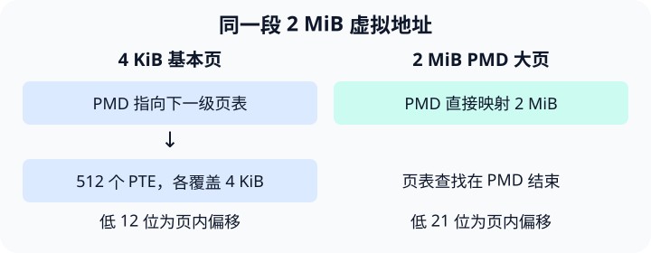
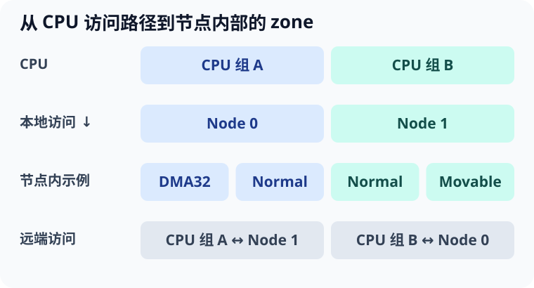

本篇介绍 Linux 内存管理中的基本概念，包括虚拟页和物理页帧、地址空间与映射、连续页块、folio、大页，以及物理内存的 node 和 zone。各节按定义、用途和相互关系组织，地址换算统一以 4 KiB 基本页为例。内核接口以 Linux v6.8 为参照。

## 一、基本页、页帧与地址编号

### 1.1 基本页与页帧

下面是在 Ubuntu 24.04 ARM64 虚拟机上的输出。

```text
$ uname -r
6.8.0-149-generic
$ getconf PAGE_SIZE
4096
```

这台机器的基本页大小是 **4096 字节（4 KiB）**。以这个大小为单位切分虚拟地址空间，得到的是**虚拟页**。用同样的大小切分物理地址空间，得到的基本单位叫作**页帧**。物理地址空间里还可能有空洞，某个位置能算出编号，并不保证那里有 RAM。基本页大小与架构、内核配置有关，4 KiB 是这台虚拟机的配置，实验时可以用 `getconf PAGE_SIZE` 查自己的系统。 [Linux v6.8 页表文档](https://docs.kernel.org/6.8/mm/page_tables.html) · [Linux v6.8 物理内存文档](https://docs.kernel.org/6.8/mm/physical_memory.html)

### 1.2 页号与页内偏移

以虚拟地址 `0x12345` 为例。每页 4096 字节，即 `0x1000` 字节。用地址除以页大小，商是**虚拟页号（VPN，Virtual Page Number）**，余数是**页内偏移**。在十六进制下可以直接读出来，低三位 `345` 是偏移，其余的 `12` 是页号。

| 要看的量 | 本例的值 | 含义 |
| --- | --- | --- |
| 虚拟地址 | `0x12345` | 指令要访问的字节地址 |
| 虚拟页号（VPN） | `0x12` | 指定虚拟地址空间里的哪一页 |
| 虚拟页起始地址 | `0x12000` | 页号乘以页大小 |
| 页内偏移 | `0x345` | 从页起点向后数 837 个字节 |

假设这个虚拟页已映射到物理页帧 `0xAB`。按基本页做地址转换时，内存管理单元（MMU，Memory Management Unit）将虚拟页号转换为**物理页帧号（PFN，Page Frame Number）**，然后保留原来的页内偏移。因此访问的是从物理地址 `0xAB000` 往后 837 字节的位置，也就是 `0xAB345`。这里的地址用于演示拆分和拼接。实际系统中，映射关系由内核建立并通过页表描述。 [Linux v6.8 页表文档](https://docs.kernel.org/6.8/mm/page_tables.html)


在 4 KiB 的前提下，这套换算也可以写成位运算：`VPN = VA >> 12`，`offset = VA & 0xfff`，`PA = (PFN << 12) | offset`。物理页帧的起始地址低 12 位全为零，因而可以直接拼上偏移。

这也解释了为什么 **PFN 和虚拟页号要分别理解**。虚拟页号的含义取决于它所在的地址空间。同一个虚拟地址在两个进程中可能映射到不同的页帧。反过来，两个进程也可以通过不同的虚拟地址访问同一个页帧，例如共享映射中的同一页。

## 二、虚拟地址空间、映射与驻留

### 2.1 虚拟地址空间与 VMA

**虚拟地址空间**是一个进程使用的虚拟地址范围。代码、堆、栈、共享库和文件映射都占用其中的区间，区间之间可以留有空洞。

内核用**虚拟内存区域（VMA，Virtual Memory Area）**记录一段连续地址及其共同属性，包括范围、权限和映射来源。一个 VMA 可以包含许多虚拟页。

`/proc/<pid>/maps` 显示进程的这些区间。下面沿用 Ubuntu ARM64 虚拟机的一次采样，`self` 指打开该文件的进程，这里是 `head`。

```text
$ head -n 1 /proc/self/maps
c894a2890000-c894a315c000 r-xp 00000000 fc:00 138                        /usr/lib/cargo/bin/coreutils/head
```

区间左闭右开。`r-xp` 表示可读、可执行、私有映射，后面的字段依次是文件偏移、设备号、inode 编号和路径。该行描述一段来自可执行文件的虚拟区间。 [Linux v6.8 procfs 文档](https://docs.kernel.org/6.8/filesystems/proc.html)

### 2.2 映射与驻留是两个相关的状态

| 概念 | 含义 | 观察入口 |
| --- | --- | --- |
| 区间 | 地址范围及允许的访问方式 | `maps` |
| 页表映射 | 虚拟页到物理页帧的对应关系，以及访问属性 | 内核页表、受权限约束的 `pagemap` |
| 驻留 | 当前数据页是否在物理内存中 | `smaps` 的 `Rss` 等统计 |

**按需分页**允许内核先记录合法区间，访问时再按需要建立页映射或取得数据后备。虚拟区间大小因此可以大于当时的驻留量。缺页异常是处理缺失映射、写保护等情形的入口。


图中的四个虚拟页可以属于同一 VMA。前两页已有数据后备，物理页帧分散在不同位置，后两页尚待建立有效映射。虚拟连续性由地址范围决定，物理连续性由页帧编号决定。 [Linux v6.8 页表文档](https://docs.kernel.org/6.8/mm/page_tables.html)

### 2.3 写时复制

**写时复制（COW，Copy-on-Write）**让多个私有映射先共享页内容，发生需要分离的写入时再复制。典型用途是 `fork()` 后父子进程的私有匿名内存。

共享期间，区间可以保留允许写入的属性，页表项则先写保护。写入触发异常后，内核检查区间权限和页状态。原页仍需共享时，内核复制内容并更新写入方的映射，若能够独占原页，也可以恢复写权限后继续使用。 [Linux v6.8 写保护处理](https://github.com/torvalds/linux/blob/v6.8/mm/memory.c#L3435)

## 三、连续页块的三种粒度

页分配、内核对象管理和地址翻译各有自己的粒度。下表中的 order、folio 和页表项分别描述这三个维度。中央处理器（CPU，Central Processing Unit）通过页表完成地址翻译。

| 维度 | 术语 | 回答的问题 |
| --- | --- | --- |
| 物理分配 | order | 一次能从空闲链表取得多少连续页帧？ |
| 内核管理 | folio | 哪些基本页共用同一个缓存对象和锁？ |
| 地址翻译 | PTE（Page Table Entry，页表项）、PMD（Page Middle Directory，中层页目录） | 一条页表映射覆盖多大的虚拟地址范围？ |


### 3.1 物理分配 · order 与伙伴系统

#### 3.1.1 页块的大小和对齐

**物理连续页块**由编号相邻的页帧组成。伙伴分配器按 **order（阶）**组织物理连续页块。一个 order-`n` 块包含 2ⁿ 个连续基本页，起始 PFN 按 2ⁿ 个页对齐。以 4 KiB 基本页为例：

| 阶 | 基本页数 | 大小 | 一组可能的 PFN |
| --- | ---: | ---: | --- |
| 0 | 1 | 4 KiB | 64 |
| 1 | 2 | 8 KiB | 64–65 |
| 2 | 4 | 16 KiB | 64–67 |
| 9 | 512 | 2 MiB | 512–1023 |

高阶分配需要物理上连续且对齐的空闲页块。如果空闲内存散落在许多小块里，即使总量够，也可能找不到所需的高阶块。这是物理内存碎片化的一种表现。查看 `/proc/buddyinfo` 时，每行对应一个 node 的一个 zone，数字从 order 0 起按阶排列，统计的是**空闲块数**。一列若显示 3 个 order-2 块，相当于这一列贡献了 12 个空闲基本页。 [Linux v6.8 物理内存文档](https://docs.kernel.org/6.8/mm/physical_memory.html) · [procfs 文档](https://docs.kernel.org/6.8/filesystems/proc.html)

#### 3.1.2 伙伴块的拆分与合并

伙伴系统按阶组织空闲块。两个块能合并，需要它们是同一较大对齐块的两半，处于相同的阶，并满足空闲、zone 等条件。伙伴起始 PFN 的计算式为 `pfn XOR (1 << order)`。以下用 64–67 四个页帧展示合并结果。


1. **先找同阶伙伴。** order 0 的块长为 1 页，计算 `64 XOR (1 << 0) = 65`。65 是空闲的同阶伙伴，于是从 order-0 空闲链表取下它，合并为 64–65。
2. **升一阶再找。** 新块从 PFN 64 开始，order 1 的块长为 2 页，`64 XOR (1 << 1) = 66`。66 是空闲块 66–67 的起点，于是再合并为 64–67。
3. **合不动就挂回链表。** order 2 的伙伴从 PFN 68 开始。若 68–71 还在用，当前的 64–67 就以 order 2 加入空闲链表，供以后的 16 KiB 分配使用。

异或翻转起始 PFN 的第 `order` 位。同一对伙伴是上一级对齐块的左右两半，这一位恰好区分两半。例如 PFN 65 和 66 虽然相邻，但两者的 order-0 伙伴分别是 64 和 67。直接合并 65–66 会得到一个从奇数 PFN 开始的两页块，无法满足 order 1 的对齐要求。

分配时可以反着走。如果只请求一页，而合适的空闲链表里只有 64–67 这个 order-2 块，就先拆出 64–65 和 66–67，再拆 64–65，把 64 交给调用者，把 65 和 66–67 分别留在 order 0 和 order 1 的空闲链表中。

#### 3.1.3 内核中的伙伴检查

在 Linux v6.8 中，`__find_buddy_pfn()` 算出候选伙伴，`page_is_buddy()` 检查块阶和 zone 等条件，`__free_one_page()` 执行逐阶合并。某些迁移类型也会限制合并。这里描述页进入伙伴分配器后的过程，小块若先进入每 CPU 页缓存，要等它回到伙伴分配器才会走这条合并路径。 [Linux v6.8 伙伴查找](https://github.com/torvalds/linux/blob/v6.8/mm/internal.h#L302) · [Linux v6.8 页分配器](https://github.com/torvalds/linux/blob/v6.8/mm/page_alloc.c)

### 3.2 内核管理 · 为什么需要 folio

#### 3.2.1 folio 的定义与引入原因

**folio** 是内核作为一个整体管理的内存对象，大小为基本页大小的 2 的幂倍，物理连续，并按自身大小对齐。它可以只包含一个基本页，也可以包含多个。用于页缓存时，其对应的文件偏移同样按 folio 大小对齐。

旧的页接口里，同一个 `struct page *` 类型既可以指独立的基本页，也可以指复合页的头页或尾页。对于以整个复合页为单位的操作，调用者或底层助手得先弄清传进来的是哪一种，必要时由尾页找到头页。仅看参数类型，读代码时难以确认这一步是否已经做过。

#### 3.2.2 folio 的操作范围

Linux 引入 `struct folio *`，让这类接口直接接收**整个内存对象**。例如，一个由四页组成的 16 KiB folio，从第三个基本页可以用 `page_folio(page)` 取得所属 folio，随后 `folio_lock(folio)` 锁的是缓存这 16 KiB 的整体。`folio_size(folio)` 得到 16 KiB。需要处理第三个基本页时，可以用 `folio_page(folio, 2)` 取回对应的 `struct page *`。

这个接口也适用于只有 4 KiB 的 folio。调用者可以用同一套接口处理不同大小的页缓存对象，并从参数类型看出锁操作的范围。多个连续基本页由一个缓存对象管理时，页缓存还可以按对象处理锁与脏状态。

图中的四个基本页可以组成一个 16 KiB folio，页表依然可以分别用四个 PTE 映射。 [Linux v6.8 内存管理 API](https://docs.kernel.org/6.8/core-api/mm-api.html)

### 3.3 地址翻译 · 基本页与 PMD 大页

#### 3.3.1 大页与基本页

**大页**使用大于基本页的映射或内存后备粒度。以 4 KiB 基本页、2 MiB PMD 映射为例，一项 PMD 大页映射可以覆盖 512 个基本页大小的范围。

#### 3.3.2 翻译覆盖范围

在使用 4 KiB 基本页的示例中，如果用普通页表项，每个表项只覆盖 4 KiB，整段需要 512 项。如果架构支持 2 MiB PMD 映射，且虚拟、物理范围满足连续和对齐等条件，页表可以在 PMD 这一层用一项覆盖整段。此时地址的低 21 位都用作偏移，第一节的基本页示例只保留低 12 位。PMD 大页允许一条快表（TLB，Translation Lookaside Buffer）缓存映射覆盖更大的地址范围。TLB 是 CPU 用来缓存地址翻译结果的结构。实际支持的页大小受架构和配置影响。



Linux 中常见的两个入口是 **HugeTLB** 和 **THP（Transparent Huge Pages，透明大页）**。HugeTLB 通过专门的大页池提供大页，程序可以使用 `MAP_HUGETLB` 或 hugetlbfs。THP 则根据系统策略和映射条件尝试使用较大的内存单元。Linux 6.8 文档也介绍了仍通过 PTE 映射的多尺寸 THP，因此看到「大 folio」或「THP」时，还要结合页表层级判断具体如何映射。 [Linux v6.8 透明大页文档](https://docs.kernel.org/6.8/admin-guide/mm/transhuge.html) · [HugeTLB 文档](https://docs.kernel.org/6.8/admin-guide/mm/hugetlbpage.html)

#### 3.3.3 空间与性能取舍

以同一个对齐的 2 MiB 匿名区间为例，并假设写入时按需分配。两种访问模式会得到不同的结果。

| 访问方式 | 用 4 KiB 基本页 | 使用一个 2 MiB PMD 大页时 |
| --- | --- | --- |
| 写遍整个区间，之后反复扫描 | 最终有 512 个基本页映射，页帧可以分开分配 | 一个 PMD 项覆盖整段，单条 TLB 翻译覆盖的范围更大 |
| 只写其中一个字节 | 通常只为访问到的 4 KiB 页分配数据后备 | 若成功按 2 MiB 分配，整个大页都成为物理后备，剩余空间可能长期用不到 |
| 内存碎片较多 | 各次分配只需要一个空闲基本页 | 需要满足对齐的 512 个连续页帧，内核可能整理内存，THP 也可能回退 |

第一种适合密集访问的大内存工作集，第二种体现了基本页在稀疏访问下的空间优势。2 MiB 映射覆盖范围是 4 KiB 的 512 倍，实际速度还取决于访问模式、CPU 的 TLB 和分配成本。想看某个进程哪些区间用了 PMD 级匿名 THP，可以在 `/proc/<pid>/smaps` 中按区间找 `AnonHugePages`。 [Linux v6.8 透明大页文档](https://docs.kernel.org/6.8/admin-guide/mm/transhuge.html)

#### 3.3.4 查看大页统计

在实验机上，`/sys/kernel/mm/transparent_hugepage/enabled` 显示 `always [madvise] never`，方括号是当前顶层策略。`/proc/meminfo` 同一次采样中 `AnonHugePages` 为 159744 kB，`HugePages_Total` 为 0。前者统计 PMD 级匿名 THP 占用，后者统计默认尺寸的 HugeTLB 池页数。两项分别对应两种机制，读计数时要先认清字段。 [Linux v6.8 透明大页文档](https://docs.kernel.org/6.8/admin-guide/mm/transhuge.html)

## 四、物理内存的组织

### 4.1 UMA、NUMA 与 node

**UMA（Uniform Memory Access，统一内存访问）**表示 CPU 对主存的访问成本在拓扑上大致一致。**NUMA（Non-Uniform Memory Access，非统一内存访问）**表示访问成本随内存所在节点而变化，本地访问通常比远端访问更便宜。

Linux 用 **node** 表示内存拓扑节点。节点可以有 CPU 和内存，也可能缺少其中一种资源。同一种 zone 类型可以在多个 node 内分别存在。实验虚拟机的 `cat /sys/devices/system/node/online` 输出 `0`，表示来宾看到一个在线节点。



### 4.2 zone 与水位

**zone** 是节点内按分配约束划分的内存区域。Normal 用于普通内存，DMA（Direct Memory Access，直接内存访问）和 DMA32 范围照顾设备寻址限制，Movable 主要容纳可迁移的页，HighMem 用于某些 32 位架构的高端内存。具体范围取决于架构和配置。

`/proc/zoneinfo` 中的 `present` 表示存在的页数，`managed` 表示页分配器管理的页数。水位字段以基本页为单位。

| 水位 | 基本用途 |
| --- | --- |
| `min` | 普通分配检查使用的最低基准 |
| `low` | 后台回收通常开始介入的参考 |
| `high` | `kswapd` 通常用于判断是否恢复平衡的目标 |

实际检查还会考虑请求阶、保留页和分配标志。部分高优先级请求可动用部分储备，符合条件的内存回收路径可跳过水位检查。 [Linux v6.8 物理内存组织](https://docs.kernel.org/6.8/mm/physical_memory.html) · [页分配器水位检查](https://github.com/torvalds/linux/blob/v6.8/mm/page_alloc.c#L2758)

### 4.3 SPARSEMEM 与内存热插拔

**SPARSEMEM（Sparse Memory，稀疏内存模型）**按 section 组织物理页元数据，以适应 RAM（Random Access Memory，随机存取存储器）范围之间存在空洞的布局。PFN 可以按地址计算，能否用于分配还取决于对应内存是否存在、是否交给内核管理。

启用 SPARSEMEM_VMEMMAP 时，内核通过 `vmemmap` 中按 PFN 编址的虚拟区域定位 `struct page`。这些对象记录页帧状态。

**内存热插拔**允许运行期间添加或移除符合条件的内存。对普通 RAM，添加时先登记物理范围，再将其上线，交给页分配器。移除前则需要下线，把范围内仍在使用的数据迁走或释放，并从分配器撤出该范围。

### 4.4 ZONE_MOVABLE 怎样帮助内存下线

**ZONE_MOVABLE 通过限制分配类型，提高内存下线的可靠性。** 它主要承接可迁移的分配，例如常见的用户匿名页和页缓存。页表、大多数内核小对象等不可迁移分配由 Normal 等内核 zone 承接。下线一个内存块时，范围内若有无法迁走的内核对象，就可能无法腾空整个块。

| 上线方式 | 内存进入哪里 | 对后续下线的影响 |
| --- | --- | --- |
| `online_movable` | ZONE_MOVABLE | 通过分配约束减少不可迁移对象落入该范围 |
| `online_kernel` | 对应的内核 zone，通常为 ZONE_NORMAL | 可承接不可迁移分配，下线能否成功取决于实际占用 |
| `online` | 由内核上线策略选择 | 需要结合最终所属 zone 和页状态判断 |

Normal 中的内存同样可以参与热添加和符合条件的下线。下线成功还要求平台、内存块布局、迁移目标容量等条件满足，Movable 中的块也可能因混合 zone、特殊保留范围等限制而失败。可迁移分配也能来自 Normal，因此判断某一页能否迁移还要看它的具体用途和状态。 [Linux v6.8 内存热插拔与 ZONE_MOVABLE](https://docs.kernel.org/6.8/admin-guide/mm/memory-hotplug.html#zone-movable)

## 五、命令速查

| 命令 | 查看什么 |
| --- | --- |
| `uname -r` | 当前运行的内核版本 |
| `getconf PAGE_SIZE` | 系统基本页大小，单位是字节 |
| `head -n 1 /proc/self/maps` | 打开文件的进程自身的第一个虚拟内存区间 |
| `cat /proc/<pid>/maps` | 指定进程的虚拟内存区间，把 `<pid>` 替换为实际进程编号 |
| `cat /proc/buddyinfo` | 各 node、zone 中每个 order 的空闲块数 |
| `cat /sys/devices/system/node/online` | 在线 NUMA 节点编号 |
| `cat /proc/zoneinfo` | 每个 node 内各 zone 的容量、空闲页数和水位 |
| `cat /sys/kernel/mm/transparent_hugepage/enabled` | 查看 THP 顶层策略，方括号标出当前值 |

## 六、名词解释

| 名词 | 含义 |
| --- | --- |
| 基本页、`PAGE_SIZE` | 系统的基础分页粒度及其字节数 |
| 虚拟页、VPN | 虚拟地址空间按页切分得到的区间，以及它在地址空间中的编号 |
| 页帧、PFN | 按基本页大小对齐的物理地址单元，以及它在物理地址空间中的编号 |
| 页内偏移 | 目标字节到当前映射单元起点的距离 |
| 写时复制（COW） | 先共享原页，写入需要独立数据时再复制并更新写入方的映射 |
| VMA | 记录一段连续虚拟地址及其权限、映射来源等属性的内核对象 |
| 页表、PTE、TLB | 页表描述地址映射，PTE 是基本页所在层的页表项，TLB 缓存地址翻译 |
| `struct page` | 内核用于描述页帧及其状态的元数据对象 |
| 大页 | 以大于基本页的粒度进行映射或提供页后备的一类机制 |
| 高阶页块 | 伙伴分配器按 order 组织的物理连续且对齐的基本页块 |
| folio | 内核作为一个整体管理的内存单元，可以包含一个或多个基本页 |
| UMA、NUMA | 描述 CPU 访问内存成本是否随拓扑距离变化的两种模型 |
| node、zone | node 表示内存拓扑节点，zone 进一步组织节点内具有不同分配约束的页帧 |
| zone 水位 | 页分配器与回收逻辑使用的空闲页门槛，常见字段为 `min`、`low`、`high` |
| SPARSEMEM、section | 支持稀疏物理地址布局的内存模型，以及该模型划分物理地址的单位 |
| 内存热插拔 | 运行期间添加、上线、下线或移除内存的机制 |
