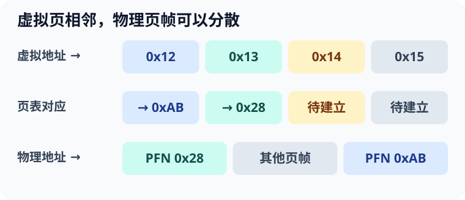
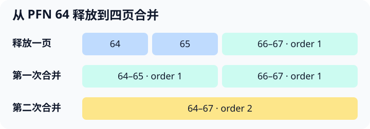
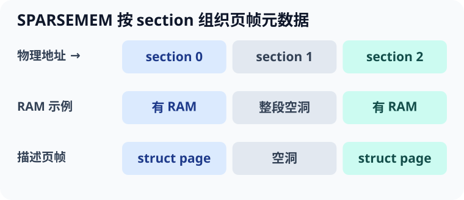

假设一个程序用 `mmap` 申请了一段 16 KiB 的匿名私有内存。调用成功后，它可以拿到一段连续的虚拟地址。可如果程序只往其中一个字节写入数据，内核需要马上拿出整段 16 KiB 的物理内存吗？如果它最终写遍这段地址，底下的物理内存也要连在一起吗？

本篇沿着这段内存走一遍。示意中使用 4 KiB 基本页，先观察普通按需分页，再看内核为什么有时要一次找来几页连续内存。最后把视角从单个进程移到整台机器，看看分配器去哪里找页，以及机器上的 RAM 发生变化时，Linux 怎样更新它能管理的范围。

## 一、CPU 怎样找到要写的那个字节

### 1.1 先看系统的基本页大小

下面是在 Ubuntu 24.04 ARM64 虚拟机上的输出。

```text
$ uname -r
6.8.0-149-generic
$ getconf PAGE_SIZE
4096
```

这台机器的基本页大小是 **4096 字节（4 KiB）**。以这个大小为单位切分虚拟地址空间，得到的是**虚拟页**。用同样的大小切分物理地址空间，得到的基本单位叫作**页帧**。物理地址空间里还可能有空洞，某个位置能算出编号，并不保证那里有 RAM。4 KiB 是这台虚拟机的配置，实验时可以用 `getconf PAGE_SIZE` 查自己的系统。 [Linux v6.8 页表文档](https://docs.kernel.org/6.8/mm/page_tables.html) · [Linux v6.8 物理内存文档](https://docs.kernel.org/6.8/mm/physical_memory.html)

### 1.2 地址由页号和页内偏移组成

为方便演算，假设示例中的 16 KiB 区间从 `0x12000` 开始，在 `0x16000` 结束。程序第一次写入的字节位于 `0x12345`。每页 4096 字节，即 `0x1000` 字节。用地址除以页大小，商是**虚拟页号（VPN）**，余数是**页内偏移**。在十六进制下可以直接读出来，低三位 `345` 是偏移，其余的 `12` 是页号。

| 要看的量 | 本例的值 | 含义 |
| --- | --- | --- |
| 虚拟地址 | `0x12345` | 指令要访问的字节地址 |
| 虚拟页号（VPN） | `0x12` | 指定虚拟地址空间里的哪一页 |
| 虚拟页起始地址 | `0x12000` | 页号乘以页大小 |
| 页内偏移 | `0x345` | 从页起点向后数 837 个字节 |

假设这个虚拟页已映射到物理页帧 `0xAB`。按基本页做地址转换时，MMU 将虚拟页号转换为**物理页帧号（PFN）**，然后保留原来的页内偏移。因此访问的是从物理地址 `0xAB000` 往后 837 字节的位置，也就是 `0xAB345`。这里的地址用于演示拆分和拼接。实际系统中，映射关系由内核建立并通过页表描述。 [Linux v6.8 页表文档](https://docs.kernel.org/6.8/mm/page_tables.html)


在 4 KiB 的前提下，这套换算也可以写成位运算：`VPN = VA >> 12`，`offset = VA & 0xfff`，`PA = (PFN << 12) | offset`。物理页帧的起始地址低 12 位全为零，因而可以直接拼上偏移。

这也解释了为什么 **PFN 和虚拟页号要分别理解**。虚拟页号的含义取决于它所在的地址空间。同一个虚拟地址在两个进程中可能映射到不同的页帧。反过来，两个进程也可以通过不同的虚拟地址访问同一个页帧，例如共享映射中的同一页。

## 二、申请了 16 KiB，物理内存什么时候到位

### 2.1 先确认进程拥有哪些地址

`/proc/<pid>/maps` 列出进程当前的虚拟内存区间。下面在同一台虚拟机上读取 `/proc/self/maps`。这里的 `self` 由内核解析为打开这个文件的进程，因此看到的是 `head` 自己的映射。地址可能随运行变化。

```text
$ head -n 1 /proc/self/maps
c894a2890000-c894a315c000 r-xp 00000000 fc:00 138                        /usr/lib/cargo/bin/coreutils/head
```

最左边是一个左闭右开的地址区间，结束地址本身在当前区间之外。`r-xp` 表示可读、可执行、私有映射。`00000000` 是文件偏移，后面依次是设备号、inode 编号和路径。这里的 inode 标识映射所关联的文件，可以和文件系统系列里见到的 inode 对上。 [Linux v6.8 procfs 文档](https://docs.kernel.org/6.8/filesystems/proc.html)

### 2.2 写到哪一页，先为哪一页建立映射

回到那段 16 KiB 匿名内存。假设没有预填充，并且按基本页分配。调用成功后，`maps` 就可以显示这段区间，因为内核已经用 **VMA** 记录了范围、权限和映射类型。此时还可以没有对应的物理页帧。上面实测的 `head` 行展示的是同一种区间记录，只是它关联了一个可执行文件。

| 程序做到哪一步 | 内核发生什么变化 |
| --- | --- |
| `mmap` 返回 | 内核记录区间 `[0x12000, 0x16000)` |
| 写入 `0x12345` | 首次写入触发缺页异常。内核确认这段 VMA 允许写入，为虚拟页 `0x12` 分配页帧并建立映射 |
| 写入 `0x13000` | 跨过页边界，虚拟页 `0x13` 可以独立获得另一个页帧 |
| 继续写 `0x12346` | 地址仍在虚拟页 `0x12`，已有映射可继续使用 |



只写第一个字节时，按这个例子的前提，只需要为第一虚拟页分配一个基本页帧作为数据后备。以后把四页都写遍，它们也可以落在四处不同的物理位置。CPU 每跨进一个新页，都会按该页自己的映射找到数据。这样程序就能使用连续的指针地址，而内核可以在物理内存的不同位置找空页。 [Linux v6.8 页表文档](https://docs.kernel.org/6.8/mm/page_tables.html)

### 2.3 用四次采样确认页什么时候驻留

把下面的程序保存为 `residency.c`。它通过 `sysconf` 获取基本页大小，映射四页，再用 `MADV_NOHUGEPAGE` 让这段匿名内存按基本页观察。`mincore` 为每个基本页返回一个字节，最低位表示采样时是否驻留。用 `volatile` 保留刻意安排的写入顺序。

```c
#include <stdio.h>
#include <stdlib.h>
#include <sys/mman.h>
#include <unistd.h>

static void show_pages(const char *step, void *base, size_t length)
{
    unsigned char resident[4];

    if (mincore(base, length, resident) == -1) {
        perror("mincore");
        exit(EXIT_FAILURE);
    }
    printf("%s %u %u %u %u\n", step,
           resident[0] & 1u, resident[1] & 1u,
           resident[2] & 1u, resident[3] & 1u);
}

int main(void)
{
    long page = sysconf(_SC_PAGESIZE);
    if (page <= 0)
        return EXIT_FAILURE;

    size_t length = 4 * (size_t)page;
    void *base = mmap(NULL, length, PROT_READ | PROT_WRITE,
                      MAP_PRIVATE | MAP_ANONYMOUS, -1, 0);
    if (base == MAP_FAILED) {
        perror("mmap");
        return EXIT_FAILURE;
    }
    if (madvise(base, length, MADV_NOHUGEPAGE) == -1) {
        perror("madvise");
        return EXIT_FAILURE;
    }

    volatile unsigned char *bytes = base;
    show_pages("mmap:   ", base, length);
    bytes[0] = 1;
    show_pages("page 0: ", base, length);
    bytes[page] = 2;
    show_pages("page 1: ", base, length);
    bytes[1] = 3;
    show_pages("page 0: ", base, length);

    if (munmap(base, length) == -1) {
        perror("munmap");
        return EXIT_FAILURE;
    }
}
```

```bash
cc -Wall -Wextra -O2 residency.c -o residency
./residency
```

在实验虚拟机上得到：

```text
mmap:    0 0 0 0
page 0:  1 0 0 0
page 1:  1 1 0 0
page 0:  1 1 0 0
```

四列与图中的四个虚拟页一一对应。对第二页的写入刚好比起点多一个 `PAGE_SIZE`，因此第二列变成 1。最后一次只改写第一页里的另一个字节，驻留页数仍然是两页。这个实验观察驻留状态，图上的 PFN 用于演示地址换算。 [Linux v6.8 mincore 实现](https://github.com/torvalds/linux/blob/v6.8/mm/mincore.c)

### 2.4 fork 后，父子进程为什么能先共用一页

接着用前面的匿名私有映射。假设父进程已经向虚拟地址 `0x12345` 写入 `A`，这一页在图示中对应 PFN `0xAB`。执行 `fork()` 后，子进程也能从同一个虚拟地址读到 `A`。如果子进程把它改成 `B`，父进程随后仍能读到 `A`。Linux 用**写时复制（Copy-on-Write，COW）**把页内容的复制推迟到有写入、且需要分离时。 [fork(2) 手册](https://man7.org/linux/man-pages/man2/fork.2.html)

| 时刻 | 父进程的页表 | 子进程的页表 |
| --- | --- | --- |
| `fork()` 前 | 指向 `0xAB`，可写，内容为 `A` | 子进程尚未创建 |
| `fork()` 后，双方都只读 | 指向 `0xAB`，页表项写保护 | 指向同一个 `0xAB`，页表项写保护 |
| 子进程写入 `B`，父进程仍保有原映射 | 继续指向 `0xAB`，读到 `A` | 改为指向新页帧，页表项可写，读到 `B` |

为什么 `/proc/<pid>/maps` 里的区间仍然可以显示 `rw-p`？`w` 来自 VMA，表示这个区间允许程序写入。页表项的写保护则让 CPU 在尝试写入时触发保护型缺页异常。内核检查 VMA 允许写入后，为子进程分配新页，复制原来的整页内容，再把子进程的页表项切到新页。指令重试时才把其中一个字节改成 `B`。因此这里虽然只写一个字节，仍要保留这张 4 KiB 页中其余字节的内容。 [Linux v6.8 fork 时设置写保护](https://github.com/torvalds/linux/blob/v6.8/mm/memory.c#L972) · [写保护异常的复制路径](https://github.com/torvalds/linux/blob/v6.8/mm/memory.c#L3116)

前面的首次写入是在一页尚无数据后备时建立映射。这里已经有一页有效数据，内核要在更换映射时保留原内容。如果处理写入时匿名页已经能由写入进程独占，Linux 也可以直接恢复写权限，继续使用原页。 [Linux v6.8 do_wp_page](https://github.com/torvalds/linux/blob/v6.8/mm/memory.c#L3435)

## 三、什么时候需要四个物理页连在一起

### 3.1 高阶页描述物理分配

假设内核现在有一个必须连续的 16 KiB 请求。四个分散的空页加起来也是 16 KiB，却无法提供一个连续的物理地址范围。伙伴分配器按 **order（阶）**组织物理连续页块。一个 order-`n` 块包含 2ⁿ 个连续基本页，起始 PFN 按 2ⁿ 个页对齐。以 4 KiB 基本页为例：

| 阶 | 基本页数 | 大小 | 一组可能的 PFN |
| --- | ---: | ---: | --- |
| 0 | 1 | 4 KiB | 64 |
| 1 | 2 | 8 KiB | 64–65 |
| 2 | 4 | 16 KiB | 64–67 |
| 9 | 512 | 2 MiB | 512–1023 |

高阶分配需要物理上连续且对齐的空闲页块。如果空闲内存散落在许多小块里，即使总量够，也可能找不到所需的高阶块。这是物理内存碎片化的一种表现。查看 `/proc/buddyinfo` 时，每行对应一个 node 的一个 zone，数字从 order 0 起按阶排列，统计的是**空闲块数**。一列若显示 3 个 order-2 块，相当于这一列贡献了 12 个空闲基本页。 [Linux v6.8 物理内存文档](https://docs.kernel.org/6.8/mm/physical_memory.html) · [procfs 文档](https://docs.kernel.org/6.8/filesystems/proc.html)

### 3.2 伙伴系统怎样把小块合成大块

假设同一个 zone 里，PFN 64 仍在使用，PFN 65 是空闲的 order-0 块，PFN 66–67 已经是一个空闲的 order-1 块。这时释放 PFN 64，分配器能把这四页合成一个 16 KiB 块吗？



1. **先找同阶伙伴。** order 0 的块长为 1 页，计算 `64 XOR (1 << 0) = 65`。65 是空闲的同阶伙伴，于是从 order-0 空闲链表取下它，合并为 64–65。
2. **升一阶再找。** 新块从 PFN 64 开始，order 1 的块长为 2 页，`64 XOR (1 << 1) = 66`。66 是空闲块 66–67 的起点，于是再合并为 64–67。
3. **合不动就挂回链表。** order 2 的伙伴从 PFN 68 开始。若 68–71 还在用，当前的 64–67 就以 order 2 加入空闲链表，供以后的 16 KiB 分配使用。

异或翻转起始 PFN 的第 `order` 位。同一对伙伴是上一级对齐块的左右两半，这一位恰好区分两半。例如 PFN 65 和 66 虽然相邻，但两者的 order-0 伙伴分别是 64 和 67。直接合并 65–66 会得到一个从奇数 PFN 开始的两页块，无法满足 order 1 的对齐要求。

分配时可以反着走。如果只请求一页，而合适的空闲链表里只有 64–67 这个 order-2 块，就先拆出 64–65 和 66–67，再拆 64–65，把 64 交给调用者，把 65 和 66–67 分别留在 order 0 和 order 1 的空闲链表中。

在 Linux v6.8 中，`__find_buddy_pfn()` 算出候选伙伴，`page_is_buddy()` 检查块阶和 zone 等条件，`__free_one_page()` 执行逐阶合并。某些迁移类型也会限制合并。本例从页进入伙伴分配器时算起，小块若先进入每 CPU 页缓存，要等它回到伙伴分配器才会走这条合并路径。 [Linux v6.8 伙伴查找](https://github.com/torvalds/linux/blob/v6.8/mm/internal.h#L302) · [Linux v6.8 页分配器](https://github.com/torvalds/linux/blob/v6.8/mm/page_alloc.c)

### 3.3 为什么需要 folio

现在把 PFN 64–67 用来缓存同一个文件中对齐的 16 KiB。假设调用者手里拿的是第三个基本页（PFN 66）的 `struct page *`，接下来要锁住整个缓存对象。锁应当落在哪个对象上？

旧的页接口里，同一个 `struct page *` 类型既可以指独立的基本页，也可以指复合页的头页或尾页。对于以整个复合页为单位的操作，调用者或底层助手得先弄清传进来的是哪一种，必要时由尾页找到头页。仅看参数类型，读代码时难以确认这一步是否已经做过。

Linux 引入 `struct folio *`，让这类接口直接接收**整个内存对象**。例如，从第三个基本页可以用 `page_folio(page)` 取得所属 folio，随后 `folio_lock(folio)` 锁的是缓存这 16 KiB 的整体。`folio_size(folio)` 得到 16 KiB。需要处理第三个基本页时，可以用 `folio_page(folio, 2)` 取回对应的 `struct page *`。

这个接口也适用于只有 4 KiB 的 folio。调用者可以用同一套接口处理不同大小的页缓存对象，并从参数类型看出锁操作的范围。多个连续基本页由一个缓存对象管理时，页缓存还可以按对象处理锁与脏状态。


图里的四个基本页可以组成一个 16 KiB folio，页表仍可以用四个基本页表项分别映射。**order 说的是物理分配，folio 说的是内核管理对象，PTE 说的是地址翻译。** [Linux v6.8 内存管理 API](https://docs.kernel.org/6.8/core-api/mm-api.html)

### 3.4 大页扩大一条地址翻译覆盖的范围

把范围扩大到对齐的 2 MiB，问一个不同的问题：CPU 能否用一次地址翻译覆盖整段？在使用 4 KiB 基本页的示例中，如果用普通页表项，每个表项只覆盖 4 KiB，整段需要 512 项。如果架构支持 2 MiB PMD 映射，且虚拟、物理范围满足连续和对齐等条件，页表可以在 PMD 这一层用一项覆盖整段。此时地址的低 21 位都用作偏移，第一节的基本页示例只保留低 12 位。后者允许一条 TLB 缓存映射覆盖更大的地址范围。TLB 是 CPU 用来缓存地址翻译结果的结构。实际支持的页大小受架构和配置影响。

Linux 中常见的两个入口是 **HugeTLB** 和 **THP**。HugeTLB 通过专门的大页池提供大页，程序可以使用 `MAP_HUGETLB` 或 hugetlbfs。THP 则根据系统策略和映射条件尝试使用较大的内存单元。Linux 6.8 文档也介绍了仍通过 PTE 映射的多尺寸 THP，因此看到「大 folio」或「THP」时，还要结合页表层级判断具体如何映射。 [Linux v6.8 透明大页文档](https://docs.kernel.org/6.8/admin-guide/mm/transhuge.html) · [HugeTLB 文档](https://docs.kernel.org/6.8/admin-guide/mm/hugetlbpage.html)

在实验机上，`/sys/kernel/mm/transparent_hugepage/enabled` 显示 `always [madvise] never`，方括号是当前顶层策略。`/proc/meminfo` 同一次采样中 `AnonHugePages` 为 159744 kB，`HugePages_Total` 为 0。前者统计匿名 THP 占用，后者统计默认尺寸的 HugeTLB 池页数。两项分别对应两种机制，读计数时要先认清字段。 [Linux v6.8 透明大页文档](https://docs.kernel.org/6.8/admin-guide/mm/transhuge.html)

### 3.5 连续扫描与稀疏访问各适合哪种页

以同一个对齐的 2 MiB 匿名区间为例，并假设写入时按需分配。两种访问模式会得到不同的结果。

| 访问方式 | 用 4 KiB 基本页 | 使用一个 2 MiB PMD 大页时 |
| --- | --- | --- |
| 写遍整个区间，之后反复扫描 | 最终有 512 个基本页映射，页帧可以分开分配 | 一个 PMD 项覆盖整段，单条 TLB 翻译覆盖的范围更大 |
| 只写其中一个字节 | 通常只为访问到的 4 KiB 页分配数据后备 | 若成功按 2 MiB 分配，整个大页都成为物理后备，剩余空间可能长期用不到 |
| 内存碎片较多 | 各次分配只需要一个空闲基本页 | 需要满足对齐的 512 个连续页帧，内核可能整理内存，THP 也可能回退 |

第一种适合密集访问的大内存工作集，第二种体现了基本页在稀疏访问下的空间优势。2 MiB 映射覆盖范围是 4 KiB 的 512 倍，实际速度还取决于访问模式、CPU 的 TLB 和分配成本。想看某个进程哪些区间用了 PMD 级匿名 THP，可以在 `/proc/<pid>/smaps` 中按区间找 `AnonHugePages`。 [Linux v6.8 透明大页文档](https://docs.kernel.org/6.8/admin-guide/mm/transhuge.html)

## 四、去哪里找一个合适的空页帧

### 4.1 node 描述内存访问的距离

现在把那次写入放到一台双节点服务器上。程序正在 CPU 组 A 上运行，Node 0 和 Node 1 都有空页。选择哪个页帧，会影响 CPU 之后访问这段数据的路径。

**UMA** 是统一内存访问模型，各 CPU 对主存的访问成本在拓扑上大致一致。**NUMA** 是非统一内存访问模型，某组 CPU 访问本地内存通常延迟更低，访问远端节点的内存可能要经过处理器或系统互连。Linux 用 **node** 表示这类拓扑关系，一个节点可以有自己的 CPU 和内存，系统也可能存在没有本地内存的节点。


在实验虚拟机里，`cat /sys/devices/system/node/online` 输出 `0`，表示来宾系统只看到一个在线节点，编号是 0。这个结果描述的是来宾所见的拓扑。 [Linux v6.8 物理内存文档](https://docs.kernel.org/6.8/mm/physical_memory.html)

### 4.2 从 CPU 编号查到 NUMA 节点

在实验虚拟机中执行：

```text
$ lscpu -e=CPU,NODE,SOCKET,CORE
CPU NODE SOCKET CORE
  0    0      0    0
  1    0      0    1
```

`-e`（`--extended`）以每个逻辑 CPU 一行显示拓扑，等号后指定输出列。`CPU` 是调度器使用的逻辑 CPU 编号，`CORE` 和 `SOCKET` 是来宾看到的核与插槽编号，`NODE` 是该 CPU 所属的 NUMA 节点。这台来宾的两个逻辑 CPU 都属于 Node 0。物理机上，一个 socket 也可能包含多个 NUMA 节点，所以看内存局部性时应直接查 `NODE` 列。

不带参数的 `lscpu` 适合读总览，`lscpu -p=CPU,NODE`（`--parse`）输出可供脚本读取的逗号分隔数据，注释行以 `#` 开头。`lscpu --help` 可查看本机版本支持的列。 [util-linux 的 lscpu 手册](https://github.com/util-linux/util-linux/blob/v2.41.3/sys-utils/lscpu.1.adoc)

### 4.3 距离矩阵里的 10 和 21 从哪里来

`numactl -H`（`--hardware`）会列出节点的 CPU、内存和距离矩阵。虚拟机这里只有 Node 0，所以矩阵只有一个值：

```text
node distances:
node     0
   0:   10
```

也可以直接读取 `/sys/devices/system/node/node0/distance`，得到 Node 0 到各在线节点的一行距离。换成一台双节点机器，可能看到下面的矩阵。这里的 `21` 是示例值。

```text
node     0    1
   0:   10   21
   1:   21   10
```

**行是访问的起点，列是内存所在节点。** 例如 CPU 组 A 位于 Node 0，它访问 Node 0 时查第 0 行第 0 列，访问 Node 1 时查第 0 行第 1 列。对角线上的 `10` 是本地归一化基准。`21 / 10 = 2.1` 表示在这张表的尺度下，远端相对本地是 2.1 倍的距离值。实际访问延迟需要在控制 CPU、页位置和访问模式的条件下另行测量。

距离一般来自平台拓扑，例如支持 ACPI SLIT 的机器可以由固件提供矩阵。Linux 使用平台提供的距离，缺少条目时可使用架构的回退值。节点编号只负责标识节点，距离应查矩阵。`10` 和 `21` 也没有纳秒单位。 [Linux v6.8 ACPI NUMA 源码](https://github.com/torvalds/linux/blob/v6.8/drivers/acpi/numa/srat.c) · [Linux v6.8 node sysfs 源码](https://github.com/torvalds/linux/blob/v6.8/drivers/base/node.c)

### 4.4 用 numactl 分开控制 CPU 与内存

要验证本地和远端的区别，需要同时知道程序**在哪些 CPU 上运行**和**新分配的内存可以来自哪里**。在这台单节点虚拟机上，可以先把程序限制在逻辑 CPU 0，并把分配策略限制在 Node 0：

```bash
numactl --physcpubind=0 --membind=0 -- numactl --show
```

实测输出中的 `policy: bind`、`physcpubind: 0` 和 `membind: 0` 分别确认内存策略、逻辑 CPU 和可用于分配的节点。两个 `0` 来自不同的编号列。装有更多节点的机器上，可以用上一节的 `lscpu` 和 `numactl -H` 先找出实际编号。

| 选项 | 作用 |
| --- | --- |
| `--physcpubind=0` | 只允许程序在逻辑 CPU 0 运行 |
| `--cpunodebind=0` | 允许在 Node 0 有资格使用的 CPU 上运行 |
| `--membind=0` | 将受该策略控制的新分配限制在 Node 0，无法满足时可能分配失败 |
| `--preferred=0` | 优先从 Node 0 分配，有需要时可以回退 |
| `--interleave=0,1` | 在节点 0 和 1 间按策略交错分配，需要两个可用节点 |
| `--show` | 显示当前进程的 CPU 和内存策略 |

在双节点机器上，做本地与远端对照时，可固定 `--cpunodebind=0`，分别用 `--membind=0` 和 `--membind=1` 启动同一个测试。让测试程序逐页写入刚创建的匿名区间，再读 `/proc/<pid>/numa_maps`。在该区间对应的行里，`N0=256` 表示观察时有 256 页在 Node 0，`N1=256` 对应 Node 1。策略设置和页的实际位置是两项不同的观察。默认情况下，匿名页首次写入通常会尝试从执行写入的 CPU 所在节点分配，具体结果还受内存策略、可用内存和 cpuset 限制。 [numactl 手册](https://github.com/numactl/numactl/blob/master/numactl.8) · [Linux NUMA 内存策略](https://docs.kernel.org/6.8/admin-guide/mm/numa_memory_policy.html)

### 4.5 zone 描述页帧适用于什么用途

如果请求来自只能寻址某个物理范围的设备，还要看候选页的地址是否合适。即使同在 Node 0，两页也可能分别处在设备可达和不可达的范围。Linux 把这类分配约束表达在 **zone** 的划分里。同一种 zone 类型可以出现在多个节点，每个节点有自己的统计和空闲页管理。

| 常见 zone | 主要含义 |
| --- | --- |
| `DMA`、`DMA32` | 照顾设备寻址范围受限的场景，具体边界由架构决定 |
| `Normal` | 供内核正常访问和一般分配使用的物理内存 |
| `Movable` | 主要用于可迁移的页，便于整理内存或将内存下线 |
| `HighMem` | 某些 32 位架构使用，内核访问其中的页可能需要建立临时映射 |
| `Device` | 为设备相关的物理地址范围提供页元数据等服务 |

可以在 `/proc/zoneinfo` 中按节点查看各 zone。例如本次采样中 Node 0 的 DMA32 的 `present` 和 `managed` 都是 0，Normal 的 `present` 为 524288 页，`managed` 为 491624 页。用 4 KiB 换算，后者约为 1920 MiB。要判断某个 zone 实际有没有页，可以接着看 `present`，并用 `managed` 了解其中有多少页由页分配器管理。列表中出现一个 zone 名称时，它也可能是空的。 [Linux v6.8 物理内存文档](https://docs.kernel.org/6.8/mm/physical_memory.html)

### 4.6 zone 水位决定何时开始回收

同一个 zone 的空闲页会随着分配而下降。等到空闲页快耗尽时才回收，请求内存的进程就可能要自己等待回收。因此内核在 zone 里设置几个水位，让后台回收可以提前开始，并在恢复后保留一段余量。

下面是实验虚拟机的 Node 0、Normal zone 的一次采样，数值以基本页为单位。

| `/proc/zoneinfo` 字段 | 页数 | 在这个例子里怎么看 |
| --- | ---: | --- |
| `pages free` | 80131 | 当时约有 313 MiB 空闲 |
| `min` | 5420 | 约 21.2 MiB。低水位检查未通过后，分配慢路径可按更低的水位重试。常规请求仍无法取得页时，可能进入直接回收 |
| `low` | 6775 | 约 26.5 MiB。普通分配的低水位检查未通过时，慢路径可唤醒 `kswapd` |
| `high` | 8130 | 约 31.8 MiB。通常是 `kswapd` 判断节点相关 zone 是否恢复平衡时使用的水位 |
| `boost` | 0 | 本次没有临时提高水位。某些碎片化场景下，内核会提高回收目标 |

可以把这三个水位想成不同的动作门槛。以表里的数字为例，从 8,000 页降到 6,500 页时，已从 `high` 与 `low` 之间降到 `low` 以下，后续分配可能唤醒后台回收。等空闲页恢复到 `high` 附近，后台回收可以判断是否已经达到目标。这样可以减少刚回收几页、再分配几页就又唤醒一次的情况。若压力继续增大，允许直接回收的分配请求可能要在自己的执行路径上回收页，表现为分配延迟增加。

这条时间线用 `pages free` 简化说明。实际分配还会考虑请求的阶、低端 zone 的保留页和分配标志。例如水位之上还有不少空闲页时，order-9 请求仍可能找不到满足要求的连续块。需要区分两个问题：`zoneinfo` 里的水位描述何时施加回收压力，`buddyinfo` 里的各阶统计描述有多少连续空闲块。 [Linux v6.8 页分配器](https://github.com/torvalds/linux/blob/v6.8/mm/page_alloc.c) · [Linux v6.8 内存回收](https://github.com/torvalds/linux/blob/v6.8/mm/vmscan.c)

## 五、PFN 对应的内存可能不存在，也可能后来才加入

### 5.1 SPARSEMEM 如何表示带空洞的物理地址空间

给定一个 PFN，把它乘以基本页大小就能算出物理地址。要把这个页帧交给分配器，还得知道它是否有 RAM、属于哪个 zone、当前是什么状态。内核用 `struct page` 保存受管理页帧的元数据。物理地址可以连续编号，RAM 却可能分布在几段相隔很远的地址范围。举例来说，两段 RAM 中间可能隔着一段保留地址。中间那些地址也能算出 PFN，内核需要另外判断对应页帧是否存在、能否用于普通分配。



**SPARSEMEM** 是 Linux 组织物理页元数据的一种模型。它把物理地址范围划成固定大小的 **section**，按段记录哪些范围存在以及如何找到页元数据。图里用整段空洞举例，实际 section 内部也可以有空洞。启用 **SPARSEMEM_VMEMMAP** 时，内核可以用 `vmemmap` 中按 PFN 编址的虚拟数组来定位相应的 `struct page`。数组占用的是一段内核虚拟地址空间，元数据的物理后备可以按需建立。这里讨论的是物理内存模型，第二节的 VMA 则描述一个进程的虚拟地址区间。 [Linux v6.8 物理内存模型](https://docs.kernel.org/6.8/mm/memory-model.html)

### 5.2 热插拔怎样改变可用内存

假设机器启动时，图里的 section 1 留着一段支持热添加的物理地址。后来平台提供了这段 RAM，内核就可以为相应范围补上页元数据，并按流程让它参与分配。**内存热插拔**允许系统在运行时增加或移除符合条件的内存。以普通系统 RAM 为例，增加一段内存通常分两步：内核先登记物理地址范围并建立必要的元数据，随后把内存 **online**，交给页分配器使用。移除时先 **offline**，内核会尝试迁移可移动的页，并将这段范围撤出分配器。若有无法迁移或仍被固定的页，下线可能失败。

用户态可通过 `/sys/devices/system/memory/` 观察 **memory block**。它是 sysfs 暴露的热插拔管理粒度，由一个或多个 section 组成，也与第三节的伙伴分配块用途不同。实验虚拟机的 `block_size_bytes` 输出 `8000000`，按十六进制读是 128 MiB。继续读一个实际存在的块，能把编号、物理范围和状态对上：

```text
$ cat /sys/devices/system/memory/memory16/phys_index
00000010
$ cat /sys/devices/system/memory/memory16/state
online
$ cat /sys/devices/system/memory/memory16/valid_zones
DMA
```

`phys_index` 是十六进制，`0x10` 就是目录名中的十进制 16。用块大小乘以编号，得到范围起点 `16 × 128 MiB = 2 GiB`，因此这个块对应 `[0x80000000, 0x88000000)`。`online` 表示这个块已上线，此时这里的 `valid_zones` 显示它所在的 zone。 [Linux v6.8 内存热插拔文档](https://docs.kernel.org/6.8/admin-guide/mm/memory-hotplug.html)

## 六、命令速查

| 命令 | 查看什么 |
| --- | --- |
| `uname -r` | 当前运行的内核版本 |
| `getconf PAGE_SIZE` | 系统基本页大小，单位是字节 |
| `head -n 1 /proc/self/maps` | 打开文件的进程自身的第一个虚拟内存区间 |
| `cat /proc/<pid>/maps` | 指定进程的虚拟内存区间，把 `<pid>` 替换为实际进程编号 |
| `lscpu -e=CPU,NODE,SOCKET,CORE` | 逐个逻辑 CPU 查看拓扑 |
| `numactl -H` | 查看 NUMA 节点、CPU、内存和距离矩阵 |
| `numactl --show` | 查看当前任务的 CPU 和内存策略 |
| `cat /proc/<pid>/numa_maps` | 查看进程各区间的 NUMA 策略与页分布 |
| `cat /proc/buddyinfo` | 各 node、zone 中每个 order 的空闲块数 |
| `cat /sys/devices/system/node/online` | 在线 NUMA 节点编号 |
| `cat /proc/zoneinfo` | 每个 node 内各 zone 的容量、空闲页数和水位 |
| `cat /sys/kernel/mm/transparent_hugepage/enabled` | 查看 THP 顶层策略，方括号标出当前值 |
| `cat /sys/devices/system/memory/block_size_bytes` | sysfs 内存块大小，以十六进制字节数显示 |

## 七、名词解释

| 名词 | 含义 |
| --- | --- |
| 基本页、`PAGE_SIZE` | 系统的基础分页粒度及其字节数 |
| 虚拟页、VPN | 虚拟地址空间按页切分得到的区间，以及它在地址空间中的编号 |
| 页帧、PFN | 按基本页大小对齐的物理地址单元，以及它在物理地址空间中的编号 |
| 页内偏移 | 目标字节到当前映射单元起点的距离 |
| 写时复制（COW） | 先共享原页，写入需要独立数据时再复制并更新写入方的映射 |
| VMA | 记录一段连续虚拟地址及其权限、映射来源等属性的内核对象 |
| 页表、PTE、TLB | 页表描述地址映射，PTE 是基本页所在层的页表项，TLB 缓存地址翻译 |
| `struct page` | 内核用于描述页帧及其状态的元数据对象 |
| 大页 | 以大于基本页的粒度进行映射或提供页后备的一类机制 |
| 高阶页块 | 伙伴分配器按 order 组织的物理连续且对齐的基本页块 |
| folio | 内核作为一个整体管理的内存单元，可以包含一个或多个基本页 |
| UMA、NUMA | 描述 CPU 访问内存成本是否随拓扑距离变化的两种模型 |
| node、zone | node 表示内存拓扑节点，zone 进一步组织节点内具有不同分配约束的页帧 |
| zone 水位 | 页分配器与回收逻辑使用的空闲页门槛，常见字段为 `min`、`low`、`high` |
| SPARSEMEM、section | 支持稀疏物理地址布局的内存模型，以及该模型划分物理地址的单位 |
| 内存热插拔 | 运行期间添加、上线、下线或移除内存的机制 |
