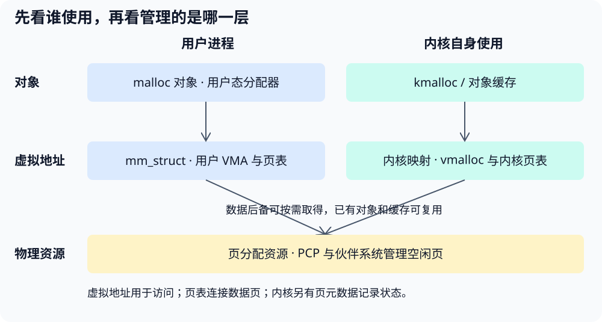
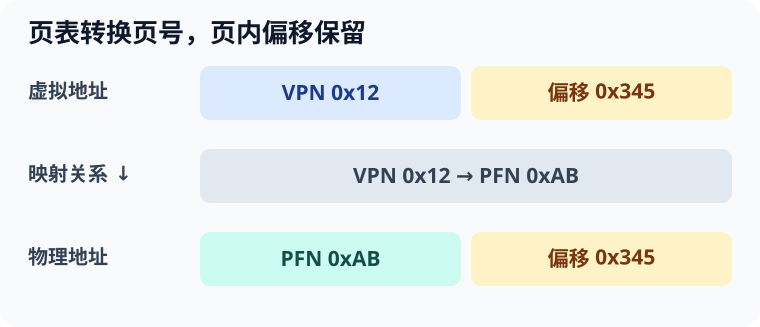
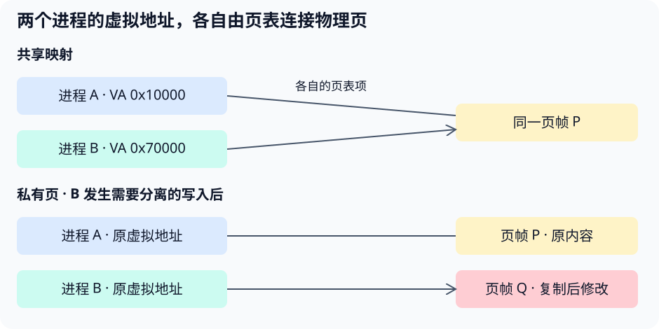
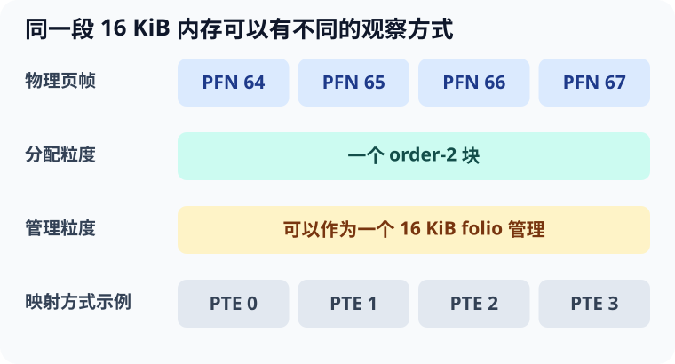

本篇按“谁在使用、管理什么、由哪一层负责”组织 Linux 内存管理的基本概念。先区分用户对象、虚拟地址区间和物理页，再介绍相关接口、页粒度和物理内存组织。地址换算采用 4 KiB 基本页，内核接口以 Linux v6.8 为参照。

[第二篇](/p/linux-virtual-address-translation/)从进程走到一次内存读取，[第三篇](/p/linux-malloc-brk-mmap/)沿同一层次解释 `malloc()` 与首次写入。本篇提供它们共用的定义和接口关系。

## 一、先区分使用者和管理层次

### 1.1 用户态、内核态与虚拟地址

**用户态和内核态**描述代码执行时的权限级别。用户程序通过库管理自己的对象，需要建立映射等服务时通过系统调用请求内核。内核以相应权限维护进程地址空间、页表和物理页，也会为自己的对象申请内存。

**虚拟地址和物理地址**描述访问位置。用户代码和内核代码都可以使用虚拟地址，由相应的映射连接到物理位置。同一个物理页也可以出现在用户映射和适用的内核直接映射中。 [Linux v6.8 内存概念](https://docs.kernel.org/6.8/admin-guide/mm/concepts.html)

### 1.2 对象、虚拟区间与物理页

| 管理层次 | 用户进程侧 | 内核自身使用侧 |
| --- | --- | --- |
| 对象 | `malloc` 对象，GNU C 库（glibc，GNU C Library）内部的 chunk、arena 等 | `kmalloc`、专用 `kmem_cache` 缓存中的对象 |
| 虚拟地址范围 | `mm_struct` 组织的用户虚拟内存区域（VMA，Virtual Memory Area）与页表 | 内核直接映射、`vmalloc` 等范围与内核页表 |
| 物理后备 | 用户映射背后的匿名页、文件页等 | 对象缓存后备页、内核数据页、页表页等 |



程序对象可以小于一页，虚拟区间可以包含许多对象，物理页则由内核记录状态、引用和分配用途。用户页和内核后备页最终使用同一物理页分配体系，分配时的约束与所选资源可以不同。 [Linux v6.8 分配接口](https://docs.kernel.org/6.8/core-api/memory-allocation.html)

## 二、基本页、页帧与地址编号

### 2.1 基本页与页帧

下面是在 Ubuntu 24.04 ARM64 虚拟机上的输出。

```text
$ uname -r
6.8.0-149-generic
$ getconf PAGE_SIZE
4096
```

这台机器的基本页大小是 **4096 字节（4 KiB）**。以这个大小为单位切分虚拟地址空间，得到的是**虚拟页**。用同样的大小切分物理地址空间，得到的基本单位叫作**页帧**。物理地址空间里还可能有空洞，某个位置能算出编号，并不保证那里有 RAM。基本页大小与架构、内核配置有关，4 KiB 是这台虚拟机的配置，实验时可以用 `getconf PAGE_SIZE` 查自己的系统。 [Linux v6.8 页表文档](https://docs.kernel.org/6.8/mm/page_tables.html) · [Linux v6.8 物理内存文档](https://docs.kernel.org/6.8/mm/physical_memory.html)

### 2.2 页号与页内偏移

以虚拟地址 `0x12345` 为例。每页 4096 字节，即 `0x1000` 字节。用地址除以页大小，商是**虚拟页号（VPN，Virtual Page Number）**，余数是**页内偏移**。在十六进制下可以直接读出来，低三位 `345` 是偏移，其余的 `12` 是页号。

| 要看的量 | 本例的值 | 含义 |
| --- | --- | --- |
| 虚拟地址 | `0x12345` | 指令要访问的字节地址 |
| 虚拟页号（VPN） | `0x12` | 指定虚拟地址空间里的哪一页 |
| 虚拟页起始地址 | `0x12000` | 页号乘以页大小 |
| 页内偏移 | `0x345` | 从页起点向后数 837 个字节 |

假设这个虚拟页已映射到物理页帧 `0xAB`。按基本页做地址转换时，内存管理单元（MMU，Memory Management Unit）将虚拟页号转换为**物理页帧号（PFN，Page Frame Number）**，然后保留原来的页内偏移。因此访问的是从物理地址 `0xAB000` 往后 837 字节的位置，也就是 `0xAB345`。这里的地址用于演示拆分和拼接。实际系统中，映射关系由内核建立并通过页表描述。 [Linux v6.8 页表文档](https://docs.kernel.org/6.8/mm/page_tables.html)



在 4 KiB 的前提下，这套换算也可以写成位运算：`VPN = VA >> 12`，`offset = VA & 0xfff`，`PA = (PFN << 12) | offset`。物理页帧的起始地址低 12 位全为零，因而可以直接拼上偏移。

这也解释了为什么 **PFN 和虚拟页号要分别理解**。虚拟页号的含义取决于它所在的地址空间。同一个虚拟地址在两个进程中可能映射到不同的页帧。反过来，两个进程也可以通过不同的虚拟地址访问同一个页帧，例如共享映射中的同一页。

### 2.3 页大小与分配大小

内存操作中有几种不同的大小单位。

| 单位 | 表达什么 | 例子 |
| --- | --- | --- |
| 程序申请的字节数 | 程序需要的对象容量 | `malloc(100)` 请求 100 字节 |
| 分配器内部对象大小 | 用户态分配器按对齐和管理规则划出的空间 | 100 字节请求可能占用更大的内部块 |
| 基本页大小 | 内核分页和页帧编号的基础粒度 | 本机 `PAGE_SIZE = 4096` |
| 连续物理页块大小 | 内核一次按阶分配的物理范围 | order 2 包含四个基本页，共 16 KiB |
| 文件系统块大小 | 文件系统分配磁盘空间的粒度 | ext4 可以使用 1 KiB、2 KiB、4 KiB 等块大小 |

用户态分配器可以把已有内存切成许多小对象，多次 `malloc()` 因而可以共用同一个基本页。需要更多内存时，分配器再通过相应系统调用扩展可用范围。文件系统块大小由文件系统格式决定，例如在支持的配置下，4 KiB 内存页可以覆盖四个 1 KiB 文件系统块。 [Linux 内存概念](https://docs.kernel.org/6.8/admin-guide/mm/concepts.html) · [ext4 块大小](https://docs.kernel.org/6.8/filesystems/ext4/overview.html#blocks)

## 三、虚拟地址空间、映射与驻留

### 3.1 虚拟地址空间与 VMA

**虚拟地址空间**是一个进程使用的虚拟地址范围。代码、堆、栈、共享库和文件映射都占用其中的区间，区间之间可以留有空洞。

内核用**虚拟内存区域（VMA，Virtual Memory Area）**记录一段连续地址及其共同属性，包括范围、权限和映射来源。一个 VMA 可以包含许多虚拟页。

| 内核对象 | 记录和组织什么 |
| --- | --- |
| `task_struct` | 一个任务的执行状态，其 `mm` 成员关联用户地址空间 |
| `mm_struct` | 用户地址空间的区间索引、根页表入口及统计 |
| `vm_area_struct` | 一个 VMA 的边界、权限和后备信息 |
| 页表 | 当前虚拟页到物理页帧的翻译和访问属性 |
| `struct page` / folio | 页帧的内核元数据与一个或多个基本页的整体管理 |

多个普通线程可共享同一个 `mm_struct`，因此看到同一套用户映射。`mm_struct` 和 VMA 提供范围管理，页表与页对象则让内核分别维护翻译和物理资源。 [Linux v6.8 内存结构定义](https://github.com/torvalds/linux/blob/v6.8/include/linux/mm_types.h)


`/proc/<pid>/maps` 显示进程的这些区间。下面沿用 Ubuntu ARM64 虚拟机的一次采样，`self` 指打开该文件的进程，这里是 `head`。

```text
$ head -n 1 /proc/self/maps
c894a2890000-c894a315c000 r-xp 00000000 fc:00 138                        /usr/lib/cargo/bin/coreutils/head
```

区间左闭右开。`r-xp` 表示可读、可执行、私有映射，后面的字段依次是文件偏移、设备号、inode 编号和路径。该行描述一段来自可执行文件的虚拟区间。 [Linux v6.8 procfs 文档](https://docs.kernel.org/6.8/filesystems/proc.html)

### 3.2 映射与驻留是两个相关的状态

| 概念 | 含义 | 观察入口 |
| --- | --- | --- |
| 区间 | 地址范围及允许的访问方式 | `maps` |
| 页表映射 | 虚拟页到物理页帧的对应关系，以及访问属性 | 内核页表、受权限约束的 `pagemap` |
| 驻留 | 当前数据页是否在物理内存中 | `smaps` 的 `Rss` 等统计 |

**按需分页**允许内核先记录合法区间，访问时再按需要建立页映射或取得数据后备。虚拟区间大小因此可以大于当时的驻留量。缺页异常是处理缺失映射、写保护等情形的入口。


图中的四个虚拟页可以属于同一 VMA。前两页已有数据后备，物理页帧分散在不同位置，后两页尚待建立有效映射。虚拟连续性由地址范围决定，物理连续性由页帧编号决定。 [Linux v6.8 页表文档](https://docs.kernel.org/6.8/mm/page_tables.html)

### 3.3 匿名页与文件页

**匿名页**保存没有普通文件作为内容来源的进程数据，常见于私有匿名映射、堆和栈。匿名内存在首次使用时提供零值语义，修改后的内容可能在内存压力下写入交换空间，具体取决于页属性和系统配置。

**文件页**通常指页缓存中关联文件内容的页。内核可按文件和页索引定位它，多个进程映射同一段文件时可以共用这些缓存页。共享文件映射的修改可以把对应文件页标脏，再由写回机制处理。

私有文件映射发生写时复制后，修改页可以成为匿名副本。同一个文件 VMA 中也就可以同时出现仍指向页缓存的映射和已经指向匿名副本的映射，原文件内容由私有写入语义保护。 [Linux 匿名内存与页缓存](https://docs.kernel.org/6.8/admin-guide/mm/concepts.html)

### 3.4 内存共享与共享映射

**内存共享**表示多个虚拟映射可以指向同一物理页帧。映射可以属于不同进程，也可以是同一进程的不同区间，虚拟地址各自独立。共享的对象由后备关系决定，两个进程恰好使用同一个虚拟地址也可能得到不同内容。



| 形式 | 共享的内容来自哪里 | 写入的语义 |
| --- | --- | --- |
| 同一文件范围的 `MAP_SHARED` 映射 | 文件页缓存中的相应内容 | 修改可由相应共享映射看到，文件持久化还需遵循同步规则 |
| 共享匿名映射 | 共享的匿名内存对象，例如 `MAP_SHARED \| MAP_ANONYMOUS` 建立后经 `fork()` 继承 | 相关映射访问共同内容 |
| `fork()` 后的私有匿名页 | 父子进程暂时共享原页 | 写入需要保持私有语义时，通过 COW 分离或在可独占时复用 |
| 同一文件范围的私有映射 | 未修改页可以共用文件缓存 | 私有写入可形成匿名副本，保留私有修改语义 |

图中上半部分是共享映射，A、B 两个进程各自的页表把不同虚拟地址映射到 P。下半部分是私有页发生写时复制后的结果，B 的修改落到 Q，A 继续使用 P。

共享映射提供共同存储，访问顺序仍需由锁、原子操作等同步机制组织。父子进程的 `MAP_PRIVATE` 保留独立修改语义，共用物理页只是实现这一语义时可以采用的优化。 [mmap 共享与私有映射](https://man7.org/linux/man-pages/man2/mmap.2.html) · [Linux v6.8 写时复制](https://github.com/torvalds/linux/blob/v6.8/mm/memory.c)

### 3.5 写时复制

**写时复制（COW，Copy-on-Write）**让多个私有映射先共享页内容，发生需要分离的写入时再复制。典型用途是 `fork()` 后父子进程的私有匿名内存。

共享期间，区间可以保留允许写入的属性，页表项则先写保护。写入触发异常后，内核检查区间权限和页状态。原页仍需共享时，内核复制内容并更新写入方的映射，若能够独占原页，也可以恢复写权限后继续使用。 [Linux v6.8 写保护处理](https://github.com/torvalds/linux/blob/v6.8/mm/memory.c#L3435)

### 3.6 虚拟容量、驻留量与页的内容状态

| 概念 | 含义 | 常见观察字段 |
| --- | --- | --- |
| 虚拟容量 | 地址空间中映射区间所占的范围 | `smaps` 的 `Size`，`status` 的 `VmSize` |
| 驻留量 | 当前驻留在物理内存中的映射数据量 | `Rss`（Resident Set Size，驻留集大小） |
| 比例分摊量 | 共享页按共享数分摊后的驻留量 | `Pss`（Proportional Set Size，比例集大小） |
| 脏页 | 内容被修改、相关状态被标记的页 | `Private_Dirty`、`Shared_Dirty` 等 |
| 回写 | 把脏数据提交给相应后备存储的过程 | 页或 folio 的 writeback 状态 |
| 交换 | 把可交换内存的数据保存到交换后备，需要时再恢复 | `smaps` 的 `Swap` 等 |

例如一个 16 KiB 匿名映射尚未触页时，区间大小可为 16 KiB、驻留量为 0。按基本页首次写入一个字节后，驻留量通常增加 4 KiB。若这页随后被另一个进程共享，双方的驻留统计都可以包含该页，PSS 则按共享情况分摊。

文件页被回收后，可以在后续访问时从文件重新读取。经过修改的匿名内容通常需要交换等后备机制才能在撤走物理页后保留。脏状态、回写和驻留分别描述内容修改、存储操作和物理占用，具体页会同时具有其中多种属性。 [Linux procfs 内存统计](https://docs.kernel.org/6.8/filesystems/proc.html)

### 3.7 swap 怎样保留被换出的内容

**交换（swap）**为可交换页提供后备存储。常见后备是交换分区或交换文件，也可以使用压缩内存设备等形式。内存回收需要腾出页帧时，可以保存匿名内容、撤销相应驻留映射，并在满足引用和状态条件后释放原页帧。

| 阶段 | 虚拟区间 | 页表与数据内容 |
| --- | --- | --- |
| 驻留 | VMA 仍覆盖原地址 | 有效页表映射指向物理页 P，数据在内存中 |
| 换出并回收 | VMA 可以保持 | 内容保存到交换后备，相应条目记录交换类型和位置等信息 |
| 后续访问 | 原地址仍可具有合法访问权限 | 触发缺页，内核查交换缓存或从后备恢复内容，建立有效映射后重试指令 |

重新取得的页帧可以是 Q，用户程序仍使用原来的虚拟地址。交换缓存中已有内容时也可能直接复用相应页，实际恢复路径由当时状态决定。

普通干净文件缓存页可以直接回收，后续从文件重新取得。私有写入形成的匿名副本则需要保留自己的内容。能否换出还取决于页类型、锁定或固定状态，以及交换后备是否可用。交换空间同时占用后备资源，频繁换出、换入也会增加访问开销。 [Linux v6.8 回收与匿名内存概念](https://docs.kernel.org/6.8/admin-guide/mm/concepts.html) · [换入处理](https://github.com/torvalds/linux/blob/v6.8/mm/memory.c)

`/proc/swaps` 列出启用的交换后备，`/proc/<pid>/smaps` 的 `Swap` 等字段提供区间交换统计。交换字段与 `Rss` 描述不同位置的内容，需要结合页的共享及后备类型读取。 [Linux v6.8 procfs 文档](https://docs.kernel.org/6.8/filesystems/proc.html)

## 四、用户态接口怎样影响内核内存状态

### 4.1 库函数、系统调用和内核分配接口

| 入口 | 由谁调用和实现 | 直接管理什么 |
| --- | --- | --- |
| `malloc / free` | 用户代码调用，用户态分配器实现对象管理 | 对象与可复用内存块，必要时再请求内核 |
| `brk` | 用户态包装进入系统调用 | 传统堆的 program break，即堆的当前上边界 |
| `mmap / munmap` | 用户代码或库通过系统调用进入内核 | 建立或撤销用户虚拟地址区间 |
| `mprotect` | 通过系统调用进入内核 | 区间和已有映射的访问权限 |
| `madvise` | 通过系统调用进入内核 | 给已有区间设置策略，或对其中的页执行指定操作 |
| `kmalloc / kmem_cache_alloc` | 内核代码调用 | 内核对象及对象缓存 |
| `vmalloc` | 内核代码调用 | 连续的内核虚拟地址和后备页 |
| `alloc_pages` | 内核代码调用 | 指定阶的物理连续页块 |

对象缓存用 `kmem_cache` 描述某一类内核对象，slab 承载多个对象的后备页，SLUB 是本系列内核采用的对象分配器实现。普通的 `malloc` 分配器则在用户空间组织自己的块和缓存。

系统调用把请求交给内核，内核再更新地址空间或页状态。普通指针读写则由指令使用已有映射访问内容，遇到需要处理的缺页或权限异常时才进入相应异常路径。 [Linux v6.8 内存分配指南](https://docs.kernel.org/6.8/core-api/memory-allocation.html)

### 4.2 mmap 描述一段地址及其内容来源

常用 C 接口为：

```c
#include <sys/mman.h>

void *mmap(void *addr, size_t length, int prot,
           int flags, int fd, off_t offset);
```

| 参数 | 含义 | 本系列中的常见值 |
| --- | --- | --- |
| `addr` | 地址提示 | `NULL` 让内核选取合法的页对齐地址 |
| `length` | 希望映射的字节数 | 内核按页管理覆盖范围 |
| `prot` | 允许的访问类型 | `PROT_READ \| PROT_WRITE` 为可读写 |
| `flags` | 映射的共享方式和其他属性 | `MAP_PRIVATE \| MAP_ANONYMOUS` 为私有匿名映射 |
| `fd` | 文件或设备的描述符 | 匿名映射使用 `-1` |
| `offset` | 文件起始偏移，以字节表示 | 文件映射通常要求按基本页对齐，匿名示例使用 0 |

成功时返回映射地址，失败返回 `MAP_FAILED`，并设置错误码。普通按需匿名映射成功后，可以已经有合法 VMA，而数据页仍待访问时取得。文件映射则记录文件和偏移，之后可通过页缓存取得数据。带预填充等标志的调用会改变这一时序。 [mmap 接口与参数](https://man7.org/linux/man-pages/man2/mmap.2.html)

`MAP_PRIVATE` 表达私有修改语义，修改文件映射时可以通过写时复制形成匿名副本。`MAP_SHARED` 允许相应映射间共享修改，普通文件映射还涉及文件更新与持久化规则。`munmap(addr, length)` 撤销范围，后续访问需要重新具有合法映射。

### 4.3 madvise 对已有区间设置策略或处理页

接口名称为 `madvise()`，其中 advice 是对已有范围的建议或操作类型。

```c
#include <sys/mman.h>

int madvise(void *addr, size_t length, int advice);
```

地址要求页对齐，长度以字节传入，按页覆盖。成功返回 0，失败返回 -1 并设置错误码。它作用于已经存在的映射，具体影响由 `advice` 决定。

| advice | 主要作用层次 | 对状态的影响 |
| --- | --- | --- |
| `MADV_HUGEPAGE` | 区间策略 | 建议在适用条件下使用透明大页，实际是否采用取决于内核和资源 |
| `MADV_NOHUGEPAGE` | 区间策略 | 将该范围标为禁用透明大页，设置策略时可以拆分 VMA |
| `MADV_WILLNEED` | 内容准备 | 告知近期会访问，内核可尝试提前准备数据，效果取决于后备类型 |
| `MADV_DONTNEED` | 数据后备与映射 | 对适用映射丢弃相应内容或撤销页映射，虚拟区间仍可保留 |
| `MADV_FREE` | 私有匿名页 | 允许内核延迟丢弃内容，实际回收前旧数据可能仍在，程序应按可丢弃语义使用 |

普通私有匿名内存使用 `MADV_DONTNEED` 后，后续访问可以重新取得零值内容。文件映射则按文件后备重新取得数据，其他映射有各自限制。与之相比，`MADV_NOHUGEPAGE` 主要设置策略，不能从调用成功直接推断已有大页已立即拆分或驻留量已降低。 [madvise 接口及各 advice 的语义](https://man7.org/linux/man-pages/man2/madvise.2.html) · [Linux v6.8 实现](https://github.com/torvalds/linux/blob/v6.8/mm/madvise.c)

### 4.4 用同一组指标区分几种操作

| 操作 | 用户对象 | 虚拟区间 | 物理后备 |
| --- | --- | --- | --- |
| 从已有空闲块完成 `malloc` | 新对象可用 | 可以保持原区间 | 可以复用原页 |
| 普通按需匿名 `mmap` | 直接取得一段地址 | 建立区间 | 后备可等访问时分配 |
| 设置 `MADV_NOHUGEPAGE` | 对象仍可用 | 属性可能变化或发生拆分 | 不能仅凭返回值确定占用变化 |
| 适用匿名区间的 `MADV_DONTNEED` | 调用者声明可丢弃内容 | 可以保留 | 相关页可被丢弃，后续按规则重新取得 |
| `munmap` | 被撤销范围失去原映射 | 移除相应范围 | 释放相应映射引用，页是否回收取决于其他使用者 |
| 缓存内完成的 `kmalloc` | 内核对象可用 | 使用对象缓存的已有后备 | 新对象可以复用 slab 的页 |

这张表对应后两篇的观测方法。`maps` 查看范围，`smaps` 查看所选区间的物理占用统计，`strace` 查看进程进入的系统调用；用户态缓存命中与内核对象分配的内部细节需要结合源码或调试工具。 [Linux v6.8 procfs 文档](https://docs.kernel.org/6.8/filesystems/proc.html)

## 五、连续页块的三种粒度

页分配、内核对象管理和地址翻译各有自己的粒度。下表中的 order、folio 和页表项分别描述这三个维度。中央处理器（CPU，Central Processing Unit）通过页表完成地址翻译。

| 维度 | 术语 | 回答的问题 |
| --- | --- | --- |
| 物理分配 | order | 一次能从空闲链表取得多少连续页帧？ |
| 内核管理 | folio | 哪些基本页共用同一个缓存对象和锁？ |
| 地址翻译 | PTE（Page Table Entry，页表项）、PMD（Page Middle Directory，中层页目录） | 一条页表映射覆盖多大的虚拟地址范围？ |



### 5.1 物理分配 · order 与伙伴系统

#### 5.1.1 页块的大小和对齐

**物理连续页块**由编号相邻的页帧组成。伙伴分配器按 **order（阶）**组织物理连续页块。一个 order-`n` 块包含 2ⁿ 个连续基本页，起始 PFN 按 2ⁿ 个页对齐。以 4 KiB 基本页为例：

| 阶 | 基本页数 | 大小 | 一组可能的 PFN |
| --- | ---: | ---: | --- |
| 0 | 1 | 4 KiB | 64 |
| 1 | 2 | 8 KiB | 64–65 |
| 2 | 4 | 16 KiB | 64–67 |
| 9 | 512 | 2 MiB | 512–1023 |

高阶分配需要物理上连续且对齐的空闲页块。如果空闲内存散落在许多小块里，即使总量够，也可能找不到所需的高阶块。这是物理内存碎片化的一种表现。查看 `/proc/buddyinfo` 时，每行对应一个 node 的一个 zone，数字从 order 0 起按阶排列，统计的是**空闲块数**。一列若显示 3 个 order-2 块，相当于这一列贡献了 12 个空闲基本页。 [Linux v6.8 物理内存文档](https://docs.kernel.org/6.8/mm/physical_memory.html) · [procfs 文档](https://docs.kernel.org/6.8/filesystems/proc.html)

#### 5.1.2 伙伴块的拆分与合并

伙伴系统按阶组织空闲块。两个块能合并，需要它们是同一较大对齐块的两半，处于相同的阶，并满足空闲、zone 等条件。伙伴起始 PFN 的计算式为 `pfn XOR (1 << order)`。以下用 64–67 四个页帧展示合并结果。


1. **先找同阶伙伴。** order 0 的块长为 1 页，计算 `64 XOR (1 << 0) = 65`。65 是空闲的同阶伙伴，于是从 order-0 空闲链表取下它，合并为 64–65。
2. **升一阶再找。** 新块从 PFN 64 开始，order 1 的块长为 2 页，`64 XOR (1 << 1) = 66`。66 是空闲块 66–67 的起点，于是再合并为 64–67。
3. **合不动就挂回链表。** order 2 的伙伴从 PFN 68 开始。若 68–71 还在用，当前的 64–67 就以 order 2 加入空闲链表，供以后的 16 KiB 分配使用。

异或翻转起始 PFN 的第 `order` 位。同一对伙伴是上一级对齐块的左右两半，这一位恰好区分两半。例如 PFN 65 和 66 虽然相邻，但两者的 order-0 伙伴分别是 64 和 67。直接合并 65–66 会得到一个从奇数 PFN 开始的两页块，无法满足 order 1 的对齐要求。

分配时可以反着走。如果只请求一页，而合适的空闲链表里只有 64–67 这个 order-2 块，就先拆出 64–65 和 66–67，再拆 64–65，把 64 交给调用者，把 65 和 66–67 分别留在 order 0 和 order 1 的空闲链表中。

#### 5.1.3 内核中的伙伴检查

在 Linux v6.8 中，`__find_buddy_pfn()` 算出候选伙伴，`page_is_buddy()` 检查块阶和 zone 等条件，`__free_one_page()` 执行逐阶合并。某些迁移类型也会限制合并。这里描述页进入伙伴分配器后的过程，小块若先进入每 CPU 页缓存，要等它回到伙伴分配器才会走这条合并路径。 [Linux v6.8 伙伴查找](https://github.com/torvalds/linux/blob/v6.8/mm/internal.h#L302) · [Linux v6.8 页分配器](https://github.com/torvalds/linux/blob/v6.8/mm/page_alloc.c)

### 5.2 内核管理 · 为什么需要 folio

#### 5.2.1 folio 的定义与引入原因

**folio** 是内核作为一个整体管理的内存对象，大小为基本页大小的 2 的幂倍，物理连续，并按自身大小对齐。它可以只包含一个基本页，也可以包含多个。用于页缓存时，其对应的文件偏移同样按 folio 大小对齐。

旧的页接口里，同一个 `struct page *` 类型既可以指独立的基本页，也可以指复合页的头页或尾页。对于以整个复合页为单位的操作，调用者或底层助手得先弄清传进来的是哪一种，必要时由尾页找到头页。仅看参数类型，读代码时难以确认这一步是否已经做过。

#### 5.2.2 folio 的操作范围

Linux 引入 `struct folio *`，让这类接口直接接收**整个内存对象**。例如，一个由四页组成的 16 KiB folio，从第三个基本页可以用 `page_folio(page)` 取得所属 folio，随后 `folio_lock(folio)` 锁的是缓存这 16 KiB 的整体。`folio_size(folio)` 得到 16 KiB。需要处理第三个基本页时，可以用 `folio_page(folio, 2)` 取回对应的 `struct page *`。

这个接口也适用于只有 4 KiB 的 folio。调用者可以用同一套接口处理不同大小的页缓存对象，并从参数类型看出锁操作的范围。多个连续基本页由一个缓存对象管理时，页缓存还可以按对象处理锁与脏状态。

图中的四个基本页可以组成一个 16 KiB folio，页表依然可以分别用四个 PTE 映射。 [Linux v6.8 内存管理 API](https://docs.kernel.org/6.8/core-api/mm-api.html)

#### 5.2.3 页状态标志与 pageflags 枚举

`struct page` 的 `unsigned long flags` 中，低位用于记录多个可同时成立的页标志，高位还可按配置编码 node、zone 等信息。Linux 用 `enum pageflags` 定义标志的**位编号**。例如 v6.8 中 `PG_dirty` 的枚举值是 4，对应的掩码是 `1UL << PG_dirty`，即 `0x10`。

下面摘录枚举开头的真实顺序。

```c
enum pageflags {
    PG_locked,
    PG_writeback,
    PG_referenced,
    PG_uptodate,
    PG_dirty,
    PG_lru,
    PG_head,
    PG_waiters,
    PG_active,
    /* … */
};
```

| 标志 | 常见含义 |
| --- | --- |
| `PG_locked` | 页或所属 folio 的相应操作正在持锁 |
| `PG_uptodate` | 数据在其所属子系统的语义下有效，例如文件页读取完成 |
| `PG_dirty` | 数据已修改，需要由相应后备管理机制处理 |
| `PG_writeback` | 写回正在进行 |
| `PG_referenced` | 回收逻辑使用的访问参考标志 |
| `PG_lru` | 位于最近最少使用（LRU，Least Recently Used）回收管理链表体系中 |
| `PG_active` | 传统活跃、非活跃回收管理使用的活跃标志，具体使用受回收实现影响 |
| `PG_head` | 标识复合页的头页 |

一个页可以同时带有多个标志，写回期间又被修改时，`dirty` 和 `writeback` 可以同时成立。内核一般通过 `PageDirty(page)`、`folio_test_dirty(folio)` 等接口读状态，由相应子系统负责更新，以遵守原子操作、锁和复合页规则。

这些标志与第二篇的页表项访问位、脏位分属不同对象。一次写入怎样从映射状态反映到页对象状态，要结合具体匿名页或文件页路径理解。页的引用计数、映射计数和部分类型信息也保存在其他字段，枚举中的部分标志还会按用途复用位。 [Linux v6.8 页标志定义与访问接口](https://github.com/torvalds/linux/blob/v6.8/include/linux/page-flags.h) · [物理页结构](https://github.com/torvalds/linux/blob/v6.8/include/linux/mm_types.h)

### 5.3 地址翻译 · 基本页与 PMD 大页

#### 5.3.1 大页与基本页

**大页**使用大于基本页的映射或内存后备粒度。以 4 KiB 基本页、2 MiB PMD 映射为例，一项 PMD 大页映射可以覆盖 512 个基本页大小的范围。

#### 5.3.2 翻译覆盖范围

在使用 4 KiB 基本页的示例中，如果用普通页表项，每个表项只覆盖 4 KiB，整段需要 512 项。如果架构支持 2 MiB PMD 映射，且虚拟、物理范围满足连续和对齐等条件，页表可以在 PMD 这一层用一项覆盖整段。此时地址的低 21 位都用作偏移，第二节的基本页示例只保留低 12 位。PMD 大页允许一条快表（TLB，Translation Lookaside Buffer）缓存映射覆盖更大的地址范围。TLB 是 CPU 用来缓存地址翻译结果的结构。实际支持的页大小受架构和配置影响。


Linux 中常见的两个入口是 **HugeTLB** 和 **THP（Transparent Huge Pages，透明大页）**。HugeTLB 通过专门的大页池提供大页，程序可以使用 `MAP_HUGETLB` 或 hugetlbfs。THP 则根据系统策略和映射条件尝试使用较大的内存单元。Linux 6.8 文档也介绍了仍通过 PTE 映射的多尺寸 THP，因此看到「大 folio」或「THP」时，还要结合页表层级判断具体如何映射。 [Linux v6.8 透明大页文档](https://docs.kernel.org/6.8/admin-guide/mm/transhuge.html) · [HugeTLB 文档](https://docs.kernel.org/6.8/admin-guide/mm/hugetlbpage.html)

#### 5.3.3 空间与性能取舍

以同一个对齐的 2 MiB 匿名区间为例，并假设写入时按需分配。两种访问模式会得到不同的结果。

| 访问方式 | 用 4 KiB 基本页 | 使用一个 2 MiB PMD 大页时 |
| --- | --- | --- |
| 写遍整个区间，之后反复扫描 | 最终有 512 个基本页映射，页帧可以分开分配 | 一个 PMD 项覆盖整段，单条 TLB 翻译覆盖的范围更大 |
| 只写其中一个字节 | 通常只为访问到的 4 KiB 页分配数据后备 | 若成功按 2 MiB 分配，整个大页都成为物理后备，剩余空间可能长期用不到 |
| 内存碎片较多 | 各次分配只需要一个空闲基本页 | 需要满足对齐的 512 个连续页帧，内核可能整理内存，THP 也可能回退 |

第一种适合密集访问的大内存工作集，第二种体现了基本页在稀疏访问下的空间优势。2 MiB 映射覆盖范围是 4 KiB 的 512 倍，实际速度还取决于访问模式、CPU 的 TLB 和分配成本。想看某个进程哪些区间用了 PMD 级匿名 THP，可以在 `/proc/<pid>/smaps` 中按区间找 `AnonHugePages`。 [Linux v6.8 透明大页文档](https://docs.kernel.org/6.8/admin-guide/mm/transhuge.html)

#### 5.3.4 查看大页统计

在实验机上，`/sys/kernel/mm/transparent_hugepage/enabled` 显示 `always [madvise] never`，方括号是当前顶层策略。`/proc/meminfo` 同一次采样中 `AnonHugePages` 为 159744 kB，`HugePages_Total` 为 0。前者统计 PMD 级匿名 THP 占用，后者统计默认尺寸的 HugeTLB 池页数。两项分别对应两种机制，读计数时要先认清字段。 [Linux v6.8 透明大页文档](https://docs.kernel.org/6.8/admin-guide/mm/transhuge.html)

## 六、物理内存的组织

### 6.1 UMA、NUMA 与 node

**UMA（Uniform Memory Access，统一内存访问）**表示 CPU 对主存的访问成本在拓扑上大致一致。**NUMA（Non-Uniform Memory Access，非统一内存访问）**表示访问成本随内存所在节点而变化，本地访问通常比远端访问更便宜。

Linux 用 **node** 表示内存拓扑节点。节点可以有 CPU 和内存，也可能缺少其中一种资源。同一种 zone 类型可以在多个 node 内分别存在。实验虚拟机的 `cat /sys/devices/system/node/online` 输出 `0`，表示来宾看到一个在线节点。


### 6.2 zone 与水位

**zone** 是节点内按分配约束划分的内存区域。Normal 用于普通内存，DMA（Direct Memory Access，直接内存访问）和 DMA32 范围照顾设备寻址限制，Movable 主要容纳可迁移的页，HighMem 用于某些 32 位架构的高端内存。具体范围取决于架构和配置。

`/proc/zoneinfo` 中的 `present` 表示存在的页数，`managed` 表示页分配器管理的页数。水位字段以基本页为单位。

| 水位 | 基本用途 |
| --- | --- |
| `min` | 普通分配检查使用的最低基准 |
| `low` | 后台回收通常开始介入的参考 |
| `high` | `kswapd` 通常用于判断是否恢复平衡的目标 |

实际检查还会考虑请求阶、保留页和分配标志。部分高优先级请求可动用部分储备，符合条件的内存回收路径可跳过水位检查。 [Linux v6.8 物理内存组织](https://docs.kernel.org/6.8/mm/physical_memory.html) · [页分配器水位检查](https://github.com/torvalds/linux/blob/v6.8/mm/page_alloc.c#L2758)

### 6.3 SPARSEMEM 与内存热插拔

**SPARSEMEM（Sparse Memory，稀疏内存模型）**按 section 组织物理页元数据，以适应 RAM（Random Access Memory，随机存取存储器）范围之间存在空洞的布局。PFN 可以按地址计算，能否用于分配还取决于对应内存是否存在、是否交给内核管理。

启用 SPARSEMEM_VMEMMAP 时，内核通过 `vmemmap` 中按 PFN 编址的虚拟区域定位 `struct page`。这些对象记录页帧状态。

**内存热插拔**允许运行期间添加或移除符合条件的内存。对普通 RAM，添加时先登记物理范围，再将其上线，交给页分配器。移除前则需要下线，把范围内仍在使用的数据迁走或释放，并从分配器撤出该范围。

### 6.4 ZONE_MOVABLE 怎样帮助内存下线

**ZONE_MOVABLE 通过限制分配类型，提高内存下线的可靠性。** 它主要承接可迁移的分配，例如常见的用户匿名页和页缓存。页表、大多数内核小对象等不可迁移分配由 Normal 等内核 zone 承接。下线一个内存块时，范围内若有无法迁走的内核对象，就可能无法腾空整个块。

| 上线方式 | 内存进入哪里 | 对后续下线的影响 |
| --- | --- | --- |
| `online_movable` | ZONE_MOVABLE | 通过分配约束减少不可迁移对象落入该范围 |
| `online_kernel` | 对应的内核 zone，通常为 ZONE_NORMAL | 可承接不可迁移分配，下线能否成功取决于实际占用 |
| `online` | 由内核上线策略选择 | 需要结合最终所属 zone 和页状态判断 |

Normal 中的内存同样可以参与热添加和符合条件的下线。下线成功还要求平台、内存块布局、迁移目标容量等条件满足，Movable 中的块也可能因混合 zone、特殊保留范围等限制而失败。可迁移分配也能来自 Normal，因此判断某一页能否迁移还要看它的具体用途和状态。 [Linux v6.8 内存热插拔与 ZONE_MOVABLE](https://docs.kernel.org/6.8/admin-guide/mm/memory-hotplug.html#zone-movable)

## 七、命令速查

| 命令 | 查看什么 |
| --- | --- |
| `mmap / munmap` | 建立与撤销用户虚拟区间 |
| `mprotect` | 修改指定区间的访问权限 |
| `madvise` | 对已有范围设置策略或执行指定页操作 |
| `cat /proc/swaps` | 查看启用的交换后备 |
| `uname -r` | 当前运行的内核版本 |
| `getconf PAGE_SIZE` | 系统基本页大小，单位是字节 |
| `head -n 1 /proc/self/maps` | 打开文件的进程自身的第一个虚拟内存区间 |
| `cat /proc/<pid>/maps` | 指定进程的虚拟内存区间，把 `<pid>` 替换为实际进程编号 |
| `cat /proc/buddyinfo` | 各 node、zone 中每个 order 的空闲块数 |
| `cat /sys/devices/system/node/online` | 在线 NUMA 节点编号 |
| `cat /proc/zoneinfo` | 每个 node 内各 zone 的容量、空闲页数和水位 |
| `cat /sys/kernel/mm/transparent_hugepage/enabled` | 查看 THP 顶层策略，方括号标出当前值 |

## 八、名词解释

| 名词 | 含义 |
| --- | --- |
| 系统调用 | 用户程序请求内核执行服务的接口 |
| program break | 传统堆当前的上边界 |
| kmalloc、vmalloc | 内核对象和连续内核虚拟区间的常见申请入口 |
| 基本页、`PAGE_SIZE` | 系统的基础分页粒度及其字节数 |
| 虚拟页、VPN | 虚拟地址空间按页切分得到的区间，以及它在地址空间中的编号 |
| 页帧、PFN | 按基本页大小对齐的物理地址单元，以及它在物理地址空间中的编号 |
| 页内偏移 | 目标字节到当前映射单元起点的距离 |
| 内存共享 | 多个虚拟映射访问同一物理页或共同后备内容 |
| swap | 为可交换内容提供后备，并在后续访问时恢复驻留映射 |
| 写时复制（COW） | 先共享原页，写入需要独立数据时再复制并更新写入方的映射 |
| VMA | 记录一段连续虚拟地址及其权限、映射来源等属性的内核对象 |
| 页表、PTE、TLB | 页表描述地址映射，PTE 是基本页所在层的页表项，TLB 缓存地址翻译 |
| `struct page` | 内核用于描述页帧及其状态的元数据对象 |
| 大页 | 以大于基本页的粒度进行映射或提供页后备的一类机制 |
| 高阶页块 | 伙伴分配器按 order 组织的物理连续且对齐的基本页块 |
| folio | 内核作为一个整体管理的内存单元，可以包含一个或多个基本页 |
| UMA、NUMA | 描述 CPU 访问内存成本是否随拓扑距离变化的两种模型 |
| node、zone | node 表示内存拓扑节点，zone 进一步组织节点内具有不同分配约束的页帧 |
| zone 水位 | 页分配器与回收逻辑使用的空闲页门槛，常见字段为 `min`、`low`、`high` |
| SPARSEMEM、section | 支持稀疏物理地址布局的内存模型，以及该模型划分物理地址的单位 |
| 内存热插拔 | 运行期间添加、上线、下线或移除内存的机制 |
