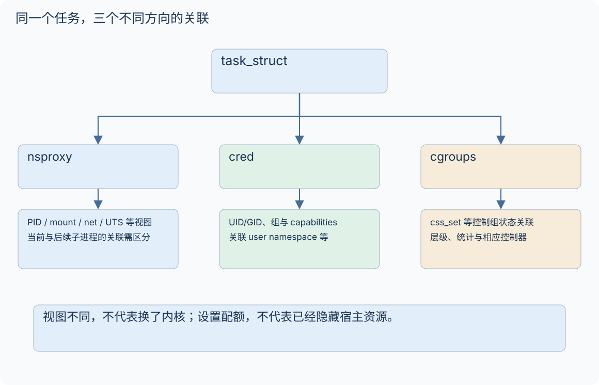
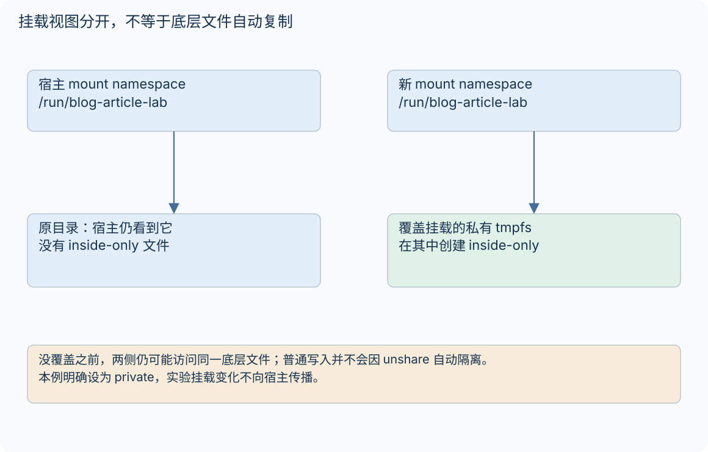
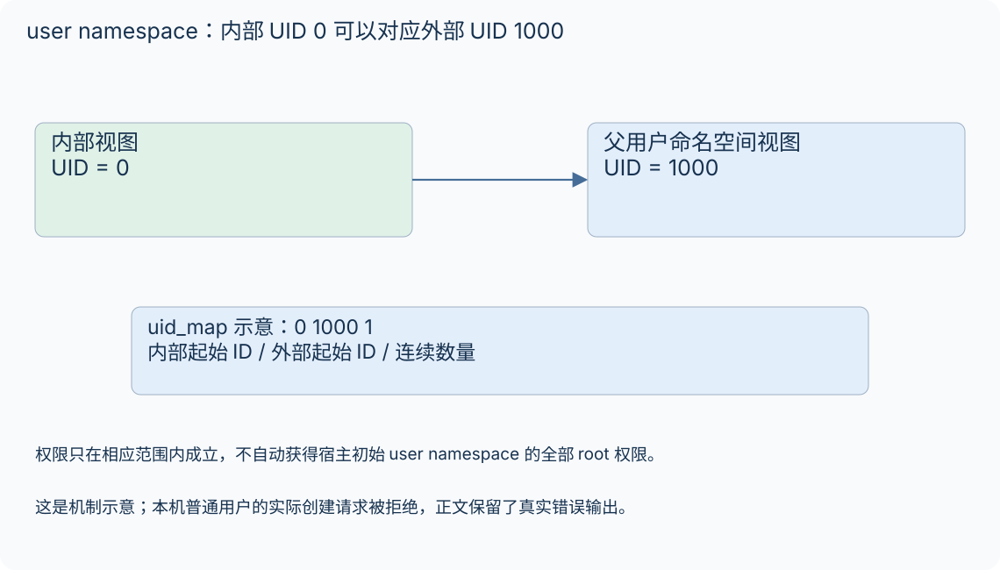
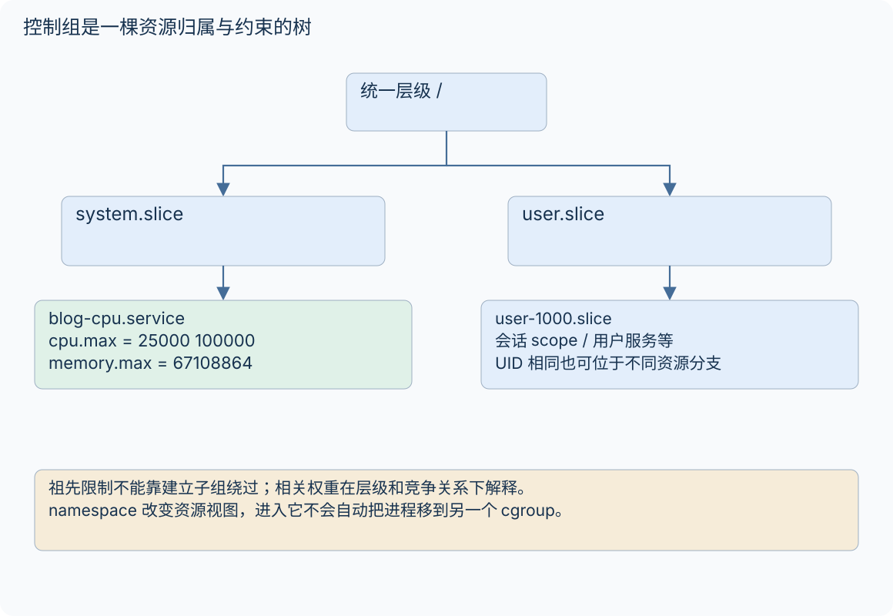
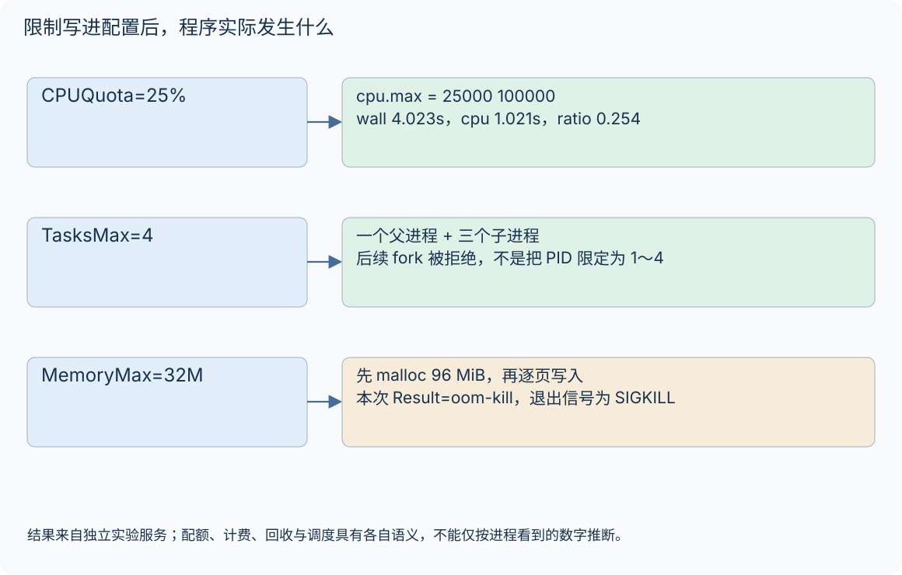

一个进程可以只看到一小组 PID、拥有不同主机名和网络接口，却仍与宿主共享同一个内核。另一方面，它也可以看到宿主的大部分资源，却只能使用四分之一 CPU。前者主要涉及资源视图，后者涉及资源控制。

本篇先用 namespace 改变几个可观察的视图，再通过 systemd 创建独立控制组，验证 cgroup v2 的 CPU、任务数和内存约束。沿同一个 `task_struct` 看，命名空间、凭据和控制组是不同关联，并不是一个统一的“容器开关”。

实验环境为 Ubuntu ARM64，内核 `6.8.0-149-generic`、systemd 259、util-linux `2.41.3`；内核对象与 cgroup 文档参照上游 Linux v6.8。带 sudo 的命令创建独立实验环境或实验服务，不修改宿主网卡和主机名。实验结束后相关进程、运行时单元与目录均已清理。

收尾系列：[启动与账户](/p/linux-boot-root-login/) · [systemd 服务管理](/p/linux-systemd-service-management/) · **namespace 与 cgroup v2**。

## 一、先分清三个不同的问题

| 问题 | 主要机制 | 例子 |
| --- | --- | --- |
| 进程看到的是哪一份资源视图？ | namespace | PID 编号、挂载关系、网络栈、主机名 |
| 它以什么身份、具备哪些权限访问？ | 凭据、user namespace、capabilities 等 | 内外 UID 映射、允许执行哪些特权操作 |
| 一组进程能够使用多少资源？ | cgroup 及其控制器 | CPU 配额、内存上限、任务数量 |



namespace 不会自动附带内存配额，cgroup 也不会因为限制 CPU 就隐藏其他进程。隔离与权限还会相互影响，例如创建或进入命名空间需要相应权限，但不能因此把它们混成同一种机制。

## 二、namespace：同一内核中的不同资源视图

### 2.1 从 proc 看到自己属于哪些命名空间

```bash
readlink /proc/self/ns/{mnt,pid,user,net,uts,cgroup}
```

本次完整输出：

```text
mnt:[4026531841]
pid:[4026531836]
user:[4026531837]
net:[4026531840]
uts:[4026531838]
cgroup:[4026531835]
```

这些链接标识当前进程关联的命名空间。在同一台机器的相应观察中，对比同类型链接的标识可以判断是否共享该实例；不要把不同机器上的相同数字当作同一对象。

| 类型 | 主要隔离或表达什么 | 容易混淆的点 |
| --- | --- | --- |
| PID | 进程编号与可见关系 | 新命名空间的 PID 1 仍是宿主内核中的一个进程 |
| mount | 挂载拓扑视图 | 默认不复制文件内容，传播规则还影响挂载变化是否外溢 |
| network | 接口、协议栈、路由、端口等 | 新建后不会自动接通宿主网络 |
| UTS | 主机名等 | 改名字不代表建立了新的网络连接 |
| IPC | System V IPC、POSIX 消息队列等 | 不是把一切进程通信方式都切断 |
| user | 用户/组身份映射与权限边界 | 里面的 UID 0 不自动等于宿主 root |
| cgroup | cgroup 路径等的可见根 | 不自行创建或重新分配资源配额 |
| time | 单调与启动相关时钟的相应偏移 | 不等于任意改动所有时钟，实时时钟有不同语义 |

UTS 是 UNIX Time-sharing System 的历史名称；IPC 是 Interprocess Communication，进程间通信。列出类型是为了辨认用途，下面只对关键几种做实验。[namespace 概览](https://man7.org/linux/man-pages/man7/namespaces.7.html)

### 2.2 一次改变 PID 与主机名视图

先看宿主主机名，再在新环境中观察：

```bash
hostname
sudo unshare --mount --uts --pid --fork --mount-proc --propagation private /bin/sh -c 'hostname blogbox; printf "inside_pid=%s hostname=%s\n" "$$" "$(hostname)"; ps -eo pid,comm; printf "done\n"'
hostname
```

三条命令的完整输出依次为：

```text
master
```

```text
inside_pid=1 hostname=blogbox
    PID COMMAND
      1 sh
      4 ps
done
```

```text
master
```

| 参数 | 本例作用 |
| --- | --- |
| `--uts` | 创建独立主机名视图，里面改为 blogbox 不影响宿主 master |
| `--pid` | 为后续子进程创建新的 PID 命名空间 |
| `--fork` | 创建子进程，让它进入新的 PID 编号环境 |
| `--mount` | 准备独立挂载视图 |
| `--mount-proc` | 在新环境中挂载与该 PID 视图相应的 procfs |
| `--propagation private` | 明确把相应挂载传播设为 private，避免把实验挂载变化向外传播 |

`unshare(CLONE_NEWPID)` 影响之后创建的子进程，不会直接把调用者自己的 PID 改成 1；这就是这里需要 fork 的原因。`ps` 又通过 procfs 观察任务，因此只换 PID 视图却继续读取原来的 proc 挂载，会得到难以理解的组合。

示例中的 2、3 等编号可被命令替换使用的短命进程消耗，`ps` 显示 4 并不表示“里面藏着三个持续运行的任务”。PID 1 的 sh 在这里按顺序执行有限命令，结束后实验环境退出；如果要充当长期容器 init，还必须处理信号转发和子进程回收等责任。[unshare 与 proc 挂载](https://man7.org/linux/man-pages/man1/unshare.1.html)

### 2.3 mount namespace 隔离挂载，不自动复制磁盘

先在宿主建立一个专用空目录，随后只在新挂载视图中覆盖它：

```bash
sudo install -d -m 0755 /run/blog-article-lab
sudo unshare --mount --propagation private /bin/sh -c 'mount -t tmpfs tmpfs /run/blog-article-lab; touch /run/blog-article-lab/inside-only; findmnt -no FSTYPE --mountpoint /run/blog-article-lab; test -f /run/blog-article-lab/inside-only && echo inside_file=yes'
test ! -e /run/blog-article-lab/inside-only && echo host_file=no
sudo rmdir /run/blog-article-lab
```

创建与删除目录的命令成功时无输出，中间两次观察的完整输出为：

```text
tmpfs
inside_file=yes
```

```text
host_file=no
```

新环境在这个路径上挂了独立 tmpfs，里面创建的文件位于该 tmpfs；宿主看到的仍是原来的空目录。namespace 消失后，这个只在里面使用的挂载随引用释放而清理。

**如果不覆盖路径，而是在仍共享的底层文件系统中写普通文件，其他视图中的访问者仍可能看到修改。** mount namespace 改变的是挂载关系，不是默认把所有 inode 和数据克隆一份。



另外，shared、slave、private 等传播关系决定挂载变化能否传播。看到“已经 unshare mount”还不足以忽略传播设置；本例明确使用 private。[挂载命名空间](https://man7.org/linux/man-pages/man7/mount_namespaces.7.html)

### 2.4 network namespace 需要另行连接

```bash
sudo unshare --net ip -brief link
```

完整输出：

```text
lo               DOWN           00:00:00:00:00:00 <LOOPBACK>
```

新网络命名空间没有自动继承宿主的 enp2s0 等接口，也没有自动获得网关和 DNS。需要通信时，还要设置接口、地址、路由以及适用的名称解析；容器运行时或网络组件可以负责这些工作。

这与[虚拟机安装篇](/p/ubuntu-server-vm-install/)的双网卡不是同一层：虚拟机网卡是来宾看到的设备，network namespace 则在同一个来宾内核中组织网络视图。

## 三、内核对象把视图、身份和资源关系分开保存

### 3.1 task_struct 的三条关联

按 Linux v6.8 相关成员顺序摘录，配置分支和无关成员已省略：

```c
struct task_struct {
    /* … */
    const struct cred __rcu *cred;
    /* … */
    struct nsproxy *nsproxy;
    /* … */
    struct css_set __rcu *cgroups;
    /* … */
};
```

| 关联 | 主要组织什么 |
| --- | --- |
| `cred` | 当前凭据，关联用户身份、组、capabilities 与 user namespace 等 |
| `nsproxy` | 多种命名空间对象的组合，例如 mount、UTS、network 和后续子进程的 PID 命名空间 |
| `cgroups` | 控制组子系统状态集合等关联，连接任务归属与相应控制器状态 |

并非所有 namespace 都直接由 nsproxy 同一方式保存。尤其 user namespace 与凭据有关；任务当前 PID 所属层级和 `pid_ns_for_children` 也不是一个可随意互换的字段。

创建任务时，clone 标记可以选择共享或新建相关命名空间；`unshare()` 拆分当前任务的部分关联，`setns()` 在满足条件时进入已有命名空间。对象可以共享和被引用，因此命名空间生命周期也不只是“终端窗口是否还开着”。[task_struct](https://github.com/torvalds/linux/blob/v6.8/include/linux/sched.h) · [nsproxy](https://github.com/torvalds/linux/blob/v6.8/include/linux/nsproxy.h)

### 3.2 user namespace 里的 root 到底意味着什么

假设一个允许普通用户创建相应命名空间的系统，宿主 UID 为 1000 的进程在里面映射为 0。下面是**映射示意**，不是本机成功创建后的输出：

```text
         0       1000          1
```

`uid_map` 的三列依次是内部起始 ID、相对于父用户命名空间的外部起始 ID、连续映射数量。上述行只映射一个身份，不是把整个宿主账户数据库复制进去。



里面显示 UID 0，可以在该 user namespace 所允许的范围拥有相应 capabilities；并不自动获得宿主初始 user namespace 的全局管理权限。目录内容与用户名显示又取决于挂载和账户查询，单独创建 user namespace 不会自动准备一套新的 `/etc/passwd`。

本机普通用户实际执行：

```bash
unshare --user --map-root-user sh -c 'id; cat /proc/self/uid_map'
```

得到：

```text
unshare: write failed /proc/self/uid_map: Operation not permitted
```

因此不能把上面的示意映射当成本机实测成功。用户命名空间、ID 映射和挂载还受权限、内核配置及安全策略限制；本机 `kernel.apparmor_restrict_unprivileged_userns` 为 1。仅凭这个值也不能替代完整审计日志判断每个拒绝点，本篇不为完成示例关闭宿主策略。[user namespace 与映射规则](https://man7.org/linux/man-pages/man7/user_namespaces.7.html)

### 3.3 怎样观察并进入已有环境

`lsns` 可以列出可见命名空间及关联任务；要定位目标，应结合明确 PID，不假定所有进程共享当前 shell 的视图。`nsenter --target PID --mount --uts --net` 等按权限加入选定命名空间。

进入 PID 命名空间还要考虑新子进程，进入 mount namespace 也不等于无条件改变当前进程根目录和工作目录。最重要的是：**进入 namespace 不会自动把任务移动到目标 cgroup，也不会自动获得完整容器环境。** 这些动作需要分别组织。

## 四、cgroup v2：给一组进程安排资源

### 4.1 统一层级与控制器

```bash
findmnt -no FSTYPE /sys/fs/cgroup
cat /sys/fs/cgroup/cgroup.controllers
```

本次完整输出：

```text
cgroup2
cpuset cpu io memory hugetlb pids rdma misc
```

本机使用 v2 统一层级，控制器再分别负责相应资源。控制器存在，不代表每个子组都已经启用，也不代表所有子组都设置了明确限制。

| 文件或关系 | 用途 |
| --- | --- |
| `cgroup.controllers` | 当前层级可供进一步使用的控制器 |
| `cgroup.subtree_control` | 向子树启用相应控制器的组织入口 |
| `cgroup.procs` | 相应组直接关联的进程列表等操作入口 |
| `cgroup.threads` | 相应线程组织与迁移入口，规则需结合组类型 |
| `cpu.max`、`memory.max`、`pids.max` | 各控制器的限制配置 |
| `memory.events`、`cpu.stat` 等 | 资源事件和统计 |

默认 domain 模型通常按进程组织线程组，v2 还有 threaded 子树等规则，不能把所有迁移都理解成任意写一个 TID。创建子进程时通常继承组归属，迁移某进程不会自动搬走它已经存在的全部后代。[cgroup v2 组织与控制器](https://docs.kernel.org/6.8/admin-guide/cgroup-v2.html)

### 4.2 与 systemd 的层级接起来

普通 shell 本次一条会话记录为：

```text
0::/user.slice/user-1000.slice/session-560.scope
```

这是 `cat /proc/self/cgroup` 的一次采样，会话编号会改变。`0::` 是 v2 的对应展示，不是 cgroup 文件系统内部只有一层目录。

[上一篇](/p/linux-systemd-service-management/)的服务位于 `/system.slice/blog-lab.service`。它和用户会话位于不同分支，即使进程都以 UID 1000 运行，也不因此属于同一控制组。

限制还具有层级关系：子组不能绕过祖先已经施加的上限；权重通常在相关同层竞争者之间比较。管理器拥有的树应通过管理接口组织，需要自己管理子树时使用适当委派，避免一边手写 systemd 所管理目录、一边让管理器同时修改它。



## 五、把 CPU、任务数、内存限制实际跑一次

### 5.1 准备一个有明确边界的 C 程序

完整源码：[resource-lab.c](resource-lab.c)。三个模式分别执行：

| 参数 | 程序做什么 | 观察目标 |
| --- | --- | --- |
| `cpu` | 在约 4 秒墙上时间内计算，记录实际 CPU 时间 | 配额如何限制总执行机会 |
| `tasks` | 最多尝试创建 16 个子进程，遇错后终止并回收已建子进程 | 任务数限制如何拒绝后续 fork |
| `memory` | 请求 96 MiB，再逐页写入 | 虚拟申请与实际内存计费、内存上限的关系 |

```bash
gcc -std=c11 -O2 -Wall -Wextra -Werror resource-lab.c -o resource-lab
sudo install -d -m 0755 /tmp/blog-resource-lab
sudo install -m 0755 resource-lab /tmp/blog-resource-lab/resource-lab
```

安装位置是本次专用实验目录。先确认没有同名的既有内容，再按本篇创建和清理；本机 `/run` 带 `noexec`，所以把单元配置放在 `/run` 并不代表也能直接执行那里编译的程序。目录权限、文件权限和挂载属性需要分别判断。

### 5.2 CPUQuota 限制的是 CPU 时间预算

下面两条命令作为一段连续执行，在四秒实验窗口内立即读取控制组文件：

```bash
sudo systemd-run --service-type=exec --unit=blog-cpu --property=CPUQuota=25% --property=MemoryMax=64M --property=TasksMax=8 --property=User=lxj /tmp/blog-resource-lab/resource-lab cpu
cat /sys/fs/cgroup/system.slice/blog-cpu.service/{cpu.max,memory.max,pids.max}
```

这是运行时 service，`Type=exec` 让管理器确认程序执行成功后再报告相应启动结果。上面 cat 的完整输出：

```text
25000 100000
67108864
8
```

| 数值 | 换算 |
| --- | --- |
| `cpu.max = 25000 100000` | 在相应带宽控制周期中，配额为 25000 微秒，周期为 100000 微秒 |
| `memory.max = 67108864` | 64 MiB 的相应内存上限 |
| `pids.max = 8` | 相应组可用任务数上限 |

等待计算结束，再查应用记录：

```bash
sudo journalctl -b _SYSTEMD_UNIT=blog-cpu.service -n 1 -o cat --no-pager
```

完整输出：

```text
wall=4.023 s cpu=1.021 s ratio=0.254
```

这次约四秒墙上时间取得约一秒 CPU 时间。短时观测会受周期边界、调度和虚拟机环境影响，不保证每次精确为 0.250。

`25%` 按一份 CPU 执行能力解释，不是“无论机器几核，都固定占整机算力 25%”。`CPUWeight` 表达竞争份额，`CPUQuota` 表达预算上限，cpuset 等再控制允许在哪些 CPU 上运行。这三件事可接回[调度篇](/p/linux-process-scheduling/)。[systemd 资源参数](https://www.freedesktop.org/software/systemd/man/259/systemd.resource-control.html)

### 5.3 TasksMax 不是 PID namespace

```bash
sudo systemd-run --service-type=exec --unit=blog-tasks --wait --pipe --property=TasksMax=4 --property=User=lxj /tmp/blog-resource-lab/resource-lab tasks
```

本次程序标准输出完整为：

```text
parent=1 children=3 fork_error=Resource temporarily unavailable
```

这里 `parent=1` 是程序报告“一个父进程”的数量，**不是它在宿主中的 PID 为 1**。该组已有父进程，再创建三个子进程就达到四个任务，后续 fork 返回错误。`systemd-run` 另外输出单元名、结果与耗时等管理信息，与程序标准输出分别理解。

pids 控制器约束任务数量，线程也参与相关计数。它不负责把可见 PID 改成 1、2、3，也不负责隐藏宿主的其他任务。fork 的 `EAGAIN` 在一般系统中还可能有其他资源原因，本例通过明确的组上限和创建数量对应其效果。

### 5.4 MemoryMax 限制实际计费，不是 malloc 参数

```bash
sudo systemd-run --service-type=exec --unit=blog-memory --wait --pipe --property=MemoryMax=32M --property=MemorySwapMax=0 --property=User=lxj /tmp/blog-resource-lab/resource-lab memory
```

程序标准输出停在：

```text
allocated=96 MiB; touching pages
```

`malloc` 返回了地址，逐页写入却需要实际后备与计费，超过组内可承受范围后本次进程被内存不足（OOM，Out Of Memory）处理终止。`systemd-run` 本次返回失败；随后查询：

```bash
systemctl show blog-memory.service -p Result -p ExecMainCode -p ExecMainStatus
```

完整输出：

```text
Result=oom-kill
ExecMainCode=2
ExecMainStatus=9
```

`ExecMainCode=2` 表示相应 CLD_KILLED 退出分类，`ExecMainStatus=9` 是 SIGKILL。这个结果属于独立实验服务，并不等于宿主所有进程一起耗尽了内存。

| 参数或文件 | 主要语义 |
| --- | --- |
| `MemoryHigh` / `memory.high` | 超过后促使回收、节流等处理，不是简单的立即杀进程阈值 |
| `MemoryMax` / `memory.max` | 相应硬上限；无法通过回收等满足时可能进入组内 OOM 等路径 |
| `MemorySwapMax` / `memory.swap.max` | 单独控制相应交换使用，不应与物理内存上限混算 |
| `memory.current` | 当前相应内存计费，不能直接当成某个进程的 RSS |
| `memory.events` | high、max、oom、oom_kill 等事件计数，存在层级与本地视图差别 |

内存计费还可能包含页缓存等，不只是应用自己累加的 malloc 大小。不同工作负载、祖先限制和内核配置可能得到不同错误处理结果，本篇展示实际发生的 oom-kill，不把它推广为所有分配失败的唯一表现。[v6.8 内存控制器](https://docs.kernel.org/6.8/admin-guide/cgroup-v2.html#memory)



## 六、组合机制，仍然共享同一个内核

### 6.1 容器运行时需要组织一组步骤

| 机制 | 主要补上什么 |
| --- | --- |
| namespace | 选定的资源视图 |
| 挂载与根目录准备 | 程序看到的文件系统内容与路径基础 |
| user namespace 与凭据 | 数字身份映射及相应权限边界 |
| cgroup | 进程归属、统计与资源策略 |
| capabilities | 拆分传统特权，控制允许的管理操作 |
| seccomp | 按过滤策略限制系统调用，名称来自 secure computing |
| AppArmor / SELinux 等 | 按相应安全策略检查访问，属于 Linux 安全模块体系的实现 |

因此单独运行 `unshare` 不等于已经创建一个完整容器，单独设置 `MemoryMax` 也不意味着应用已经安全隔离。这些机制组合后的实际边界取决于配置、权限、共享资源与内核实现。

systemd 的 `PrivateTmp=`、`PrivateNetwork=`、`ProtectSystem=`、`NoNewPrivileges=` 等可以把部分机制提供给服务配置，但各自作用不同。比如私有网络视图不自动接通外网，`NoNewPrivileges` 也不是资源配额开关，使用前要按实际服务需求核对。[服务执行与隔离设置](https://www.freedesktop.org/software/systemd/man/259/systemd.exec.html)

### 6.2 清理本篇实验

namespace 实验里的有限命令已经退出，没有留下长期环境。资源测试程序的 tasks 模式会终止并回收自己的孩子，其他两种模式分别自行完成或因组内 OOM 结束。

清理前先确认单元状态，只操作本篇创建的名字：

```bash
sudo systemctl stop blog-cpu.service blog-tasks.service blog-memory.service
sudo systemctl reset-failed blog-cpu.service blog-tasks.service blog-memory.service
sudo rm -f /tmp/blog-resource-lab/resource-lab
sudo rmdir /tmp/blog-resource-lab
```

已成功结束并被管理器回收的临时单元，可能报告找不到单元，需结合当前状态理解；它不表示所有实验仍在后台运行。本次实测相关运行时服务、失败状态和目录已经清理。

到这里可以把此前内容接起来：进程对象记录执行与关联，虚拟内存管理地址映射，VFS 和设备子系统提供访问接口，systemd 管理生命周期，namespace 和 cgroup 则分别改变资源视图与资源组织。后续写网络或容器时，可以从这些接口继续，而不必再为 Linux 基础补一套无限延伸的名词表。

## 七、命令与接口速查

| 命令或入口 | 用途 |
| --- | --- |
| `/proc/PID/ns/TYPE` | 观察目标进程的命名空间关联 |
| `lsns` | 列出可见命名空间信息 |
| `unshare --pid --fork --mount-proc --mount` | 配合创建 PID 和 proc 挂载视图，具体命令还需适当权限与传播设置 |
| `unshare --uts/--net/--mount` | 创建指定类型的资源视图 |
| `nsenter --target PID ...` | 按权限进入选定命名空间，不自动完成其他容器设置 |
| `/proc/PID/uid_map`、`gid_map` | 观察用户和组 ID 的内外映射 |
| `/proc/PID/cgroup` | 观察任务关联的控制组路径展示 |
| `systemd-run --service-type=exec --property=...` | 创建运行时实验服务并施加相应属性 |
| `CPUQuota/MemoryMax/TasksMax` | systemd 提供的 CPU 预算、内存和任务数量策略 |
| `cpu.max/memory.max/pids.max` | 内核 cgroup v2 的对应控制文件 |

## 八、名词解释

| 名词 | 本篇含义 |
| --- | --- |
| namespace | 让一组任务共享特定资源视图的内核机制 |
| nsproxy | 在任务与多种命名空间之间组织关联的内核对象 |
| user namespace | 定义相应用户和组身份映射及权限范围的命名空间 |
| mount propagation | 决定挂载变化能否在相关挂载之间传播的规则 |
| cgroup v2 | 以统一层级组织任务并由相应控制器管理资源的内核机制 |
| controller | 负责特定资源或相关行为的控制器，例如 cpu、memory、pids |
| 委派 | 按协议允许下级管理者管理某个子树的组织方式 |
| CPU quota | 在相应控制周期内可使用的 CPU 时间预算 |
| OOM | 内存不足处理，本篇观察到独立控制组中的进程被终止 |
| capability | 对传统特权进行拆分后的权限单元，检查还与 user namespace 等上下文有关 |
| seccomp | 根据过滤策略约束系统调用的机制 |
