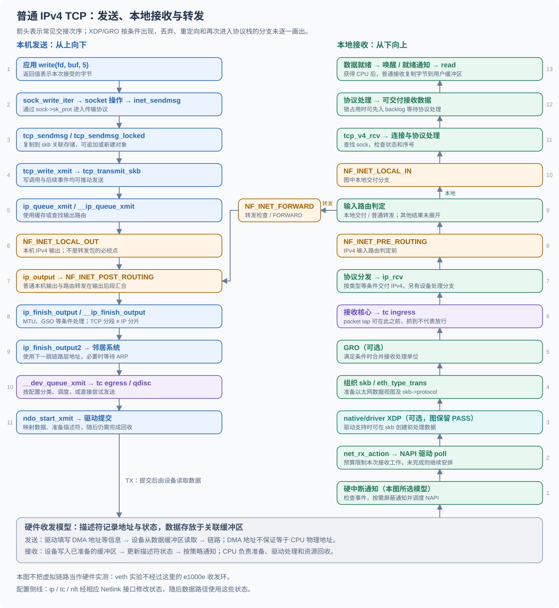

一次 `write()` 返回 5，说明内核收下了这 5 个字节，仅此而已。它们随后被拷进 skb（内核描述一个报文的对象，数据本体在它指向的缓冲区里）、排进队列、加上各层头部、交给驱动，再从对端网卡的中断里出来，穿过协议栈，最后落进 `read()` 的缓冲区。中间换过几次上下文、经过谁的队列，就是本文要走的路线。

这是系列的第一篇，只做一张地图：把这条路切成五块，每块说清三件事——这一刻数据在谁手里、它做了什么、交给谁；块与块之间那几处容易看错的边界单独讲。具体的内核函数、分支和数据结构留给后面各篇，9.2 是索引。

系列安排：一、路径地图 · 二、socket 与多路复用 · 三、sk_buff · 四、驱动与 NAPI · 五、路由与邻居 · 六、qdisc 与流控 · 七、Netlink · 八、网络命名空间 · 九、veth 与 bridge · 十、Netfilter 与连接跟踪。

## 一、问题与实验环境

### 1.1 一个可以核对的问题

在 A 上写 5 个字节，B 上读出这 5 个字节。同一次收发，三个工具给出三个不相等的数字：`tcpdump` 说链路上是 71 字节的一帧，`strace` 说 `write` 的第三个参数是 5，`ss -ti` 里则是一串拥塞窗口和队列长度。这三个数字分别属于链路、应用和内核队列，把它们的对应关系讲清楚，大半条路径也就出来了。

### 1.2 实验环境

环境是 VMware Fusion 里的 Ubuntu 26.04.1 LTS（ARM64），内核 `7.0.0-44-generic`，2 vCPU，3892 MB 内存；源码参照上游 Linux v7.0。

虚拟机接了两块 `e1000e`，分工是固定的：`enp2s0` 走 NAT，`192.168.126.135/24`，负责出网和 DNS；`enp10s0` 走仅主机网络，静态 `192.168.190.10/24`，Mac 从这里 SSH 进来，也就是实验流量走的那块。两块网卡参数相同：单收发队列、RX/TX 环形缓冲各 256、排队规则 `fq_codel`。这两块网卡怎么分的网段、静态地址怎么填，见[《Ubuntu Server 虚拟机安装及配置》](/p/ubuntu-server-vm-install/)（那篇装的是 24.04，双网卡布局与此相同）。

路径实验跑在两个 network namespace 里，用一对 veth 相连，不碰物理网卡。用到的文件有五个：[netdemo.c](netdemo.c)、[lab.sh](lab.sh)，以及附录、块 D、第八节各用一个的 [tl3.bt](tl3.bt)、[gro3.bt](gro3.bt)、[hooks.bt](hooks.bt)。一并放到同一个工作目录，后面每条命令都在这里执行：

```bash
mkdir -p ~/nslab && cd ~/nslab
wget -q https://lixiaojun2914.github.io/p/linux-network-stack-map/netdemo.c
wget -q https://lixiaojun2914.github.io/p/linux-network-stack-map/lab.sh
wget -q https://lixiaojun2914.github.io/p/linux-network-stack-map/tl3.bt
wget -q https://lixiaojun2914.github.io/p/linux-network-stack-map/gro3.bt
wget -q https://lixiaojun2914.github.io/p/linux-network-stack-map/hooks.bt
# 新装的 Ubuntu Server 上 bpftrace、tcpdump、nft、nc、gcc 不一定齐
sudo apt install -y bpftrace tcpdump nftables netcat-openbsd ethtool strace gcc
gcc -O0 -g -Wall -Wextra netdemo.c -o netdemo
sudo bash lab.sh direct
```

建完网，一次完整的收发按这个顺序来：**先抓包，再起服务端，最后发客户端**；重复实验前先 `sudo bash lab.sh clean`，否则 namespace 已存在会直接退出。三个终端各跑一条：

```bash
# 终端一：先把 tcpdump 起起来，-c 8 抓够自己退
sudo ip netns exec nslab-a tcpdump -i a0 -nn -e -X -c 8 'tcp port 18082'

# 终端二：B 侧监听，前台跑着，接上之后先等 1500 ms 再 read
sudo ip netns exec nslab-b ./netdemo tcp-server 10.77.1.2 18082 1500

# 终端三：A 侧连过去，写 5 个字节
sudo ip netns exec nslab-a ./netdemo tcp-client 10.77.1.2 18082 5
```

`tcpdump` 必须早于客户端，晚一步就漏掉 SYN 和握手三帧；放在第一个终端最省事。

`'tcp port 18082'` 这个过滤条件不是可选项。新建的 netns 里接口刚起来那两三秒，IPv6 会发 DAD 和 MLD 组播，不加过滤时 `-c 8` 会被这些帧吃光：抓到的 8 帧全是 `ethertype IPv6`，握手一帧都进不来。

服务端第 4 个参数是 accept 之后等多少毫秒再读，客户端的是写多少字节（不给就是 5）。终端二先打 `ready TCP 10.77.1.2:18082`，客户端退出后才补一行 `received=5 bytes`——中间这段空白就是那 1500 ms。

A 是 `10.77.1.1/24`，B 是 `10.77.1.2/24`，中间没有网关。[环境记录](environment.txt)、[抓包原文](wire-71bytes.txt)、[函数时间线](trace-5byte.txt)、[网卡侧计数](nic-napi.txt)、[hook 对照](netfilter-hooks.txt) 都在同目录，也可以直接下[实验记录包](experiment-records.zip)。

### 1.3 五块与十四个交接点

一条路按"数据在谁手里"切成五块，块里是十四个交接点，发送侧记作 S1–S7、接收侧记作 R1–R7，全文只用这一套编号。

| 块 | 站点 | 这一块做什么 | 展开在哪篇 |
| --- | --- | --- | --- |
| A 应用与 socket | S1–S2 | 把字节拷进 skb、挂到发送队列，判断能不能发 | 第二篇 |
| B 协议栈的发送 | S3–S4 | 组 TCP 段、填 IP 头、定路由、两次 hook、分片判断 | 第三篇 |
| C 设备与链路 | S5–S7 | 查 MAC、过 tc 与 qdisc、交给驱动与 DMA | 第四、六篇 |
| D 对端的接收上半程 | R1–R4 | 中断、轮询、GRO、二层分发 | 第四篇 |
| E 本地交付、入队与唤醒 | R5–R7 | 路由判定、四元组查找、入队、唤醒 `read()` | 第二、五篇 |



图从上往下是一条路：左边一列是执行上下文，中间是 S1–S7 与 R1–R7，右边标着 hook 与 tc 的位置。从 S1 出发，跨过中间那条虚线（veth）就进了对端，R1 之后是接收半程。走一遍时只看"下一步谁接手"，函数名可以整段跳过。

veth 上能走完 A 到 E 的全部站点，只有 C 末尾的 DMA 与描述符环、D 开头的硬中断在这条路上不存在；那两处的数字来自另一组网卡实验，后文会分开标注。

## 二、线路上 71 字节帧的构成

### 2.1 数据帧的抓包记录

命令就是 1.2 节终端一那条，`-e` 让它打出链路层头，`-X` 把从 IP 头开始的内容按十六进制排开。所以下面这段输出里既有两端的 MAC 和 ethertype，也有末尾那五个 `41`：

```text
12:34:18.140047 02:00:00:77:01:01 > 02:00:00:77:01:02, ethertype IPv4 (0x0800), length 71: 10.77.1.1.44862 > 10.77.1.2.18082: Flags [P.], seq 1:6, ack 1, win 126, options [nop,nop,TS val 2833223901 ecr 702975311], length 5
	0x0000:  4500 0039 9831 4000 4006 8bf1 0a4d 0101  E..9.1@.@....M..
	0x0010:  0a4d 0102 af3e 46a2 0f82 a941 4c34 7e60  .M...>F....AL4~`
	0x0020:  8018 007e 16c8 0000 0101 080a a8df 90dd  ...~............
	0x0030:  29e6 8d4f 4141 4141 41                   )..OAAAAA
```

`4141 4141 41` 就是应用写出的五个 `A`。这一帧在链路上 71 字节，按层次拆开是：

| 层次 | 长度 | 依据 |
| --- | --- | --- |
| 应用数据 | 5 字节 | `write(fd, "AAAAA", 5)` |
| TCP 段 | 37 字节 | 20 字节固定头 + 12 字节选项（`nop,nop,TS`）+ 5 字节数据 |
| IP 包 | 57 字节 | `4500 0039` 里 `0x0039 = 57`，即 20 字节 IP 头 + 37 字节负载 |
| 以太网帧 | 71 字节 | 14 字节帧头 + 57 字节 IP 包，与 tcpdump 的 `length 71` 一致 |

### 2.2 应用、IP 与链路的三个长度

同一个包有三个长度，各有各的用处：

- 应用关心 5，这是它写进去的字节数。
- IP 层关心 57，这是 IP 头里声明的总长，决定了要交给上层多少字节。
- 驱动和 `tc` 关心 71，这是链路上实际搬运的字节数，MTU 比对、qdisc 计数都用它。

另有一段开销不进任何一层：线路上每个帧前面还有 8 字节前导码，帧与帧之间留 12 字节间隙。这两段不写进 `skb`，所以 `ip -s link` 的字节数永远对不上物理层速率，算带宽时要自己加上去。

### 2.3 66 字节头部与 13 倍固定开销

2.1 那张表里四层加起来，属于应用数据的只有 5 个字节，其余 66 字节都是各层头部。为送这 5 个字节，协议栈在每个包上花了 13 倍的代价。短请求、小响应躲不开这笔固定开销，各种合并小包的优化也大多出自这个动机。

## 三、块 A：应用与 socket（S1–S2）

`write()` 把用户缓冲区里的字节交给内核。socket 层按 fd 找到这条连接，把字节拷进 skb，挂到它的发送队列上——做完这一步，`write()` 就可以返回 5 了。返回值只说明"进队成功"，不说明字节已经上路。

什么时候真发出去，由 TCP 的发送判定决定：拥塞窗口、对端通告窗口、Nagle、发送队列长度限制（TSQ）任何一条不满足，数据就继续等在队列里。所以抓不到包而 `write` 成功并不奇怪，包可能还躺在这一块。

数据在这里换了主人：之前属于用户缓冲区，之后归 socket 的发送队列。fd 到 socket 之间有几层对象、队列满了怎么办，是第二篇的题目。

## 四、块 B：协议栈的发送（S3–S4）

出队之后，TCP 把字节组装成段、填上 TCP 头，交给 IP 层。IP 层填 IP 头、算校验和，并按目的地址选路由：出口设备和源地址在这一步定下来，后面的处理都依赖这个结果。

这一段会先后经过两个 netfilter hook——`LOCAL_OUT` 在路由已定的包上，`POST_ROUTING` 在即将交给链路层的包上。它们不是"层"，是固定在既有路径上的回调点，没有规则也会被调用，第八节给出证据。

最后一个判断是能不能整块交给下一跳：不超过 MTU 直接放过，超过就分片。开了 GSO 的大包是个例外——它交给网卡去切，不在协议栈里分段，这两种"分段"经常被混为一谈。

## 五、块 C：设备与链路（S5–S7）

交给网卡之前要先补以太网头：拿下一跳地址查邻居表，换成 MAC。查不到就先发 ARP、把包挂起来等，所以第一个包的延迟总比后续高。

再往下是设备的发送入口：选发送队列、过 tc egress、入 qdisc，然后交给驱动。tc 的 egress 挂在 qdisc 之前，这是它两个位置中的一个；qdisc 决定有没有排队——veth 是 `noqueue`，真实网卡是 `fq_codel`，所以"在 veth 上测不出队列延迟"不是方法问题，是这条路上根本没有队列。

驱动力这最后一段：从环形缓冲里取一个描述符，写好 skb 的 DMA 地址和长度，敲门铃通知网卡；之后网卡自己发 DMA 读请求搬数据，CPU 不再参与。

veth 没有 DMA、没有描述符环、没有中断：它的发送函数直接把 skb 交给对端命名空间的接收路径，这也是第八节里"接收在发送的 `write` 里跑完"的原因。

## 六、块 D：对端的接收上半程（R1–R4）

对端网卡收到帧，用 DMA 写进 rx 环里描述符指向的缓冲区，然后发一个中断。驱动进来先把这个队列的中断关掉，改由软中断轮询取包——中断只负责叫醒，搬运交给轮询。省下的中断很可观：灌 20 MB 进来，一万四千多个报文只触发 82 次硬中断。

轮询一次取一批（预算默认 64 个），每取一个就建 skb、从帧头读出协议类型。GRO 紧接着做合并：同一条流、同方向、序号连续的段合成一个大段。还是那 20 MB，一万四千多个 skb 交给协议栈时只剩 610 次 IP 层处理，约 24 个合一个。

二层分发是这一块的最后一关，顺序固定：先过 tc ingress（tc 的第二个位置），再按协议类型找上层处理函数。IPv4 在这里注册了两个入口，单个包一个、批量一个；网卡接收因为 GRO 攒成了批量，走的是批量那条，所以只画单包入口的路径图在这条路上是错的。

## 七、块 E：本地交付、入队与唤醒（R5–R7）

IP 层拿到包先查路由：目的地址是本机就本地交付，中间过 `LOCAL_IN`；不是本机且允许转发就走转发，过 `FORWARD`。这个分岔决定了后面碰哪几个 hook。

本地交付时，按四元组在连接表与监听表里找到 socket，把数据挂到接收队列；序号不连续则先进乱序队列等重传。到这一步，数据已经在内核里等应用了，但应用还没醒。

唤醒发生在入队之后：TCP 通知 socket 可读，等在 `read()` 上的进程被叫醒，把接收队列里的 skb 拷进用户缓冲区。用了 epoll 的话，就绪事件先走一遍回调链挂到就绪链表——这条链是第二篇的题目。

## 八、块与块之间的三处边界

- 贯穿全程的是 skb。每次"交给谁"，交的都是一个 skb 指针，在 veth 上甚至就是同一个对象转手。它不是数据本身，是指向数据的一组指针加上各层头的位置；谁持有它，数据就在谁的队列或缓冲区里。
- hook 和 tc 都不是"层"。hook 是协议栈里五个固定位置的回调点，调用发生在既有代码路径上；tc 也只有两个位置，egress 在 qdisc 之前、ingress 在二层分发之前。把它们画成独立的层，就会误解它们能改什么。一个现成的例子：全新的、`nft list ruleset` 为空的命名空间里，出方向两个 hook 每次都在被调用，挂的是 Ubuntu 默认启用的 AppArmor 表项（记录见 [netfilter-hooks.txt](netfilter-hooks.txt)）——判断包有没有经过 netfilter，看的是 hook 有没有被调用，不是 `nft list ruleset` 空不空。
- 接收侧有两个入口。单包和批量（GRO 之后）走的是两条路径，一张图很难同时画对；本篇按批量画，那是网卡上实际发生的那条。

## 九、现象定位与后续篇目

### 9.1 现象与落点

| 现象 | 先看哪一块 | 命令 |
| --- | --- | --- |
| `write` 返回 5，抓包没有 | A（是否入队）、B（是否放行） | `ss -ti`、`tc -s qdisc show` |
| 本机抓到了，对端抓不到 | C | `ip -s link`、`ethtool -S` |
| 对端抓到了，应用读不到 | D、E | `ss -mni`、`cat /proc/net/snmp` |
| 收包丢在环上 | D 的前半 | `ethtool -S enp10s0 \| grep -i drop` |
| 收包丢在协议栈 | D、E | `nstat -az`、`tc -s filter show` |
| 延迟忽高忽低 | C、D | `cat /proc/interrupts`、`tc -s qdisc` |

### 9.2 各块与后续篇目

| 块 | 展开在哪篇 |
| --- | --- |
| A 的 socket 对象与等待队列 | 第二篇 socket 与多路复用 |
| skb 的组成与各层头 | 第三篇 sk_buff |
| C、D 的 DMA、描述符环、NAPI、GRO | 第四篇 驱动与 NAPI |
| 路由判定与邻居解析 | 第五篇 路由与邻居 |
| qdisc 与 tc | 第六篇 qdisc 与流控 |
| 配置类命令怎么下发 | 第七篇 Netlink |
| 这套拓扑怎么造出来 | 第八篇 网络命名空间 |
| veth 与 bridge 的内部 | 第九篇 veth 与 bridge |
| hook、conntrack 与 AppArmor 表项 | 第十篇 Netfilter 与连接跟踪 |

## 十、附：一次五字节的耗时分布

把十四个交接点拆成二十七个探针点，按段归并，这一趟收发的时间这样分：

| 段 | 从 | 到 | 用时 |
| --- | --- | --- | --- |
| socket 层入口 | `write()` 进内核 | 字节进发送队列 | 2.5 µs |
| TCP 组包与发送判定 | 发送队列 | 交出 TCP 段 | 7.2 µs |
| IP 层 | 收到 TCP 段 | 定下出口、交给设备 | 2.6 µs |
| 设备与驱动 | 设备发送入口 | 对端建出 skb | 1.4 µs |
| 接收半程 | 对端 skb | 数据进接收队列 | 5.0 µs |

合计不到 19 µs，其中接收半程那 5 µs 是在发送进程的 `write()` 里跑完的——就是块 C 末尾那条 veth 捷径。在这份记录里，绝对耗时只能当量级看：换几组探针数，同一段路径的总量在十几到二十几微秒之间跳，与探针自身的开销同量级。二十七个点的原始记录在 [trace-5byte.txt](trace-5byte.txt)，探针脚本是 [tl3.bt](tl3.bt)。

## 十一、命令与接口速查

| 命令 | 用途 | 关键输出 |
| --- | --- | --- |
| `wget -q https://lixiaojun2914.github.io/p/linux-network-stack-map/netdemo.c` | 取源码、建网脚本、三个 bt 脚本 | 落到当前目录，其余四个同理 |
| `sudo bash lab.sh direct` | 建两个 netns 加一对 veth | `nslab-a` / `nslab-b`，`lab.sh clean` 清掉 |
| `sudo ip netns exec nslab-b ./netdemo tcp-server 10.77.1.2 18082 1500` | 起服务端（前台） | `ready TCP`，接上后等 1500 ms 再 `received=5 bytes` |
| `sudo ip netns exec nslab-a ./netdemo tcp-client 10.77.1.2 18082 5` | 发 5 字节 | 客户端 `write accepted=5 bytes`，服务端 `received=5 bytes` |
| `sudo ip netns exec nslab-a tcpdump -i a0 -nn -e -X -c 8 'tcp port 18082'` | 看链路层帧 | `length 71`，末尾 5 字节是负载 |
| `sudo bpftrace tl3.bt -c 'ip netns exec nslab-a ./netdemo tcp-client 10.77.1.2 18082 5'` | 抓 27 点函数时间线 | 带 `tid`、`cpu`，顺序为主 |
| `nc -l 9002 > /dev/null` + 宿主机灌 20 MB | 造批量收包流量 | 配合 `gro3.bt` 看合并比 |
| `sudo bpftrace gro3.bt` | 数 skb、ip_list_rcv、poll、中断 | 7 个计数点 |
| `write(fd, buf, 5)` | 发送 5 字节 | 返回 5 只表示进了内核队列 |
| `tc -s qdisc show dev enp10s0` | 看排队与丢弃 | `sent/backlog/drops` |
| `nft list ruleset` | 看 nft 规则 | 空不等于 hook 没参与 |
| `ethtool -g enp10s0` | 看环形缓冲 | RX/TX 256 |
| `ethtool -S enp10s0 \| grep -i drop` | 看网卡侧丢弃 | `rx_missed_errors` 等 |
| `cat /proc/interrupts` | 看中断分布 | 每队列一条 MSI-X |
| `ss -ti` | 看 TCP 内部状态 | `cwnd`、`rtt`、`retrans` |
| `ss -mni` | 看 socket 内存与队列 | `skmem`、`recv-q` |
| `ip -s link show enp10s0` | 看设备计数 | `RX/TX packets/errors/dropped` |
| `nstat -az` | 看协议栈统计 | `IpInReceives`、`TcpInErrs` |

## 十二、名词解释

| 术语 | 一句话含义 |
| --- | --- |
| skb（`struct sk_buff`） | 内核里描述一个报文的对象，数据本身在它指向的缓冲区里 |
| veth | 成对出现的虚拟以太网设备，一端发送直接进另一端接收 |
| DMA | 设备直接读写内存，不经过 CPU 搬运 |
| 描述符环 | 驱动与网卡共享的环形数组，每项描述一块缓冲区的地址和状态 |
| MSI-X | 一种 PCI 中断方式，可以为不同队列分配不同中断向量 |
| NAPI | 中断只负责唤醒、由软中断轮询批量取包的机制 |
| 软中断（softirq） | 中断后半段执行的机制，`NET_RX` 是网络收包用的那一个 |
| GRO | 收包时把同一条流的连续小段合并成一个大段，减少上层遍历次数 |
| qdisc | 设备上的排队规则，决定包按什么顺序、什么时候发出 |
| tc | 流量控制工具，egress 在 qdisc 之前、ingress 在协议分发之前 |
| netfilter hook | 协议栈里五个固定位置的回调点，防火墙规则挂在这里 |
| XDP | 驱动层的最早挂点，在 `skb` 分配之前处理原始帧 |
| backlog | 每 CPU 的待处理包队列，网卡中断和 veth 都往这里放 |
| `sk_receive_queue` | 接收 socket 上等待应用读取的数据队列 |
| MTU | 一次能在链路上传输的最大负载长度，以太网默认 1500 |
| GSO | 发送侧延迟分段，让网卡或后续路径去切分大 skb |

<!--
进度：第一篇已按 S1–S7 / R1–R7 重写，实测数据来自 7.0.0-44 虚拟机，待作者校验。
2026-11-27 修订：统一 H2/H3 为陈述式标题（对齐其余九篇）、速查小节改名「命令与接口速查」；2.1 删去与 1.2 重复的 tcpdump 命令及说明；速查表删去正文未使用的命令并与正文写法对齐；修正 6.3 的篇目预告。
2026-11-27 二审：H3 统一为名词短语；2.1 只留输出怎么读，参数与过滤交回 1.2；2.3 不再重复 2.1 表内已列的头长。
2026-11-27 五审：按“分块”重写。正文改为 A–E 五块加三处边界，不再出现任何内核函数名；27 点时间线归并为五段耗时放进附录；hook 的 AppArmor 证据并入边界一节。
2026-11-27 四审：按 roadmap 重排。三、四章每站压到两三句，删去调用顺序树、分片分支细节、逐站命令块与 nft/tc 三组构造命令；GRO 与 hook 的计数只留表、比值和结论，命令与过程回到 netfilter-hooks.txt 等记录文件。
2026-11-27 三审：正文去掉“实测”标签与逐站 ns 读数（数字留给 5.1 表与记录文件），计数改为量级与比值表述，把逐次实验的口吻改成机制陈述。
已清理旧结构的五张 SVG（topology、three-paths、capture-points、rx-data-notification、socket-wait-stages），只保留 path.svg。
下一步：校验通过后改写第二篇（socket 与多路复用、LT/ET、四组 demo），其余八篇随后。
-->
