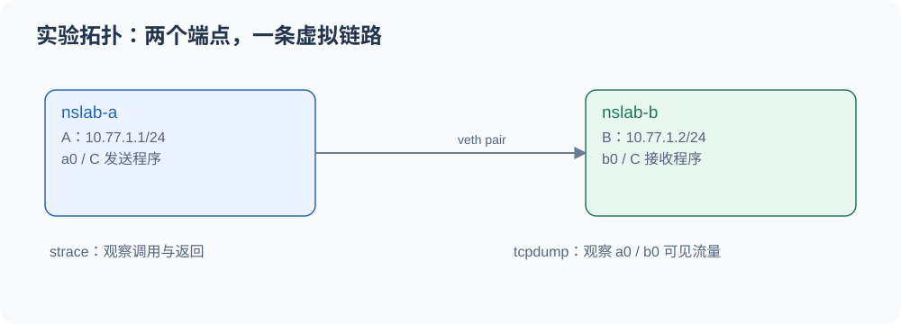
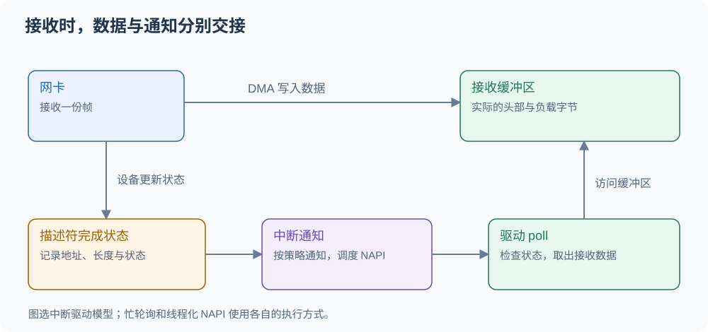
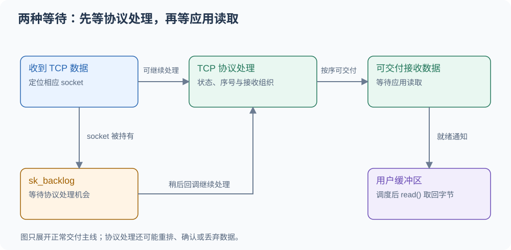
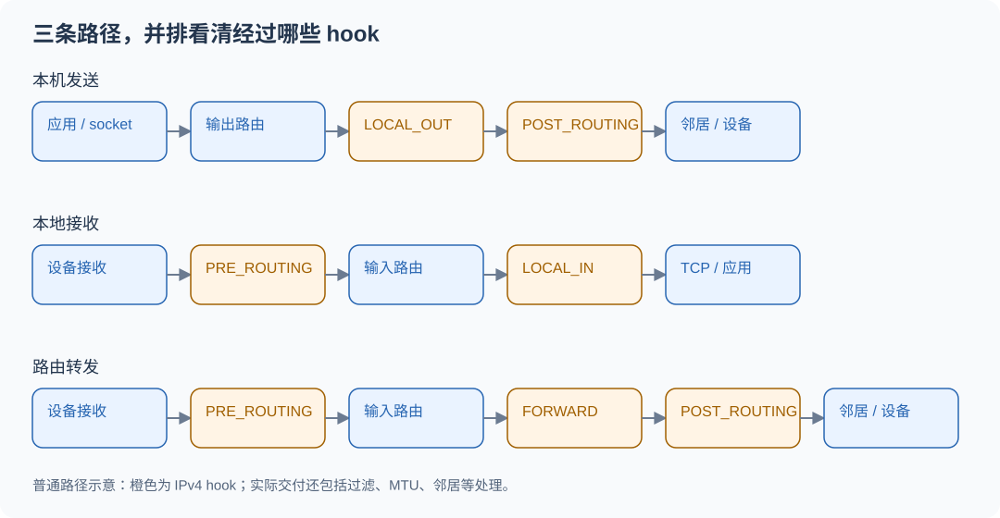
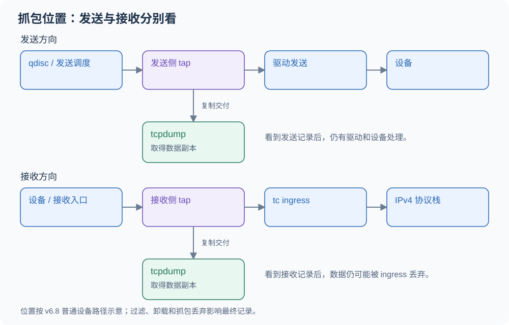

一次 `write()` 返回 5，表示内核接受了这 5 个字节。接下来，数据怎样从发送程序到达另一端，又怎样交到接收程序的缓冲区里？

本篇从一次五字节发送开始，沿着应用、协议栈和设备之间的交接，建立一张网络路径地图。主线采用普通 IPv4（Internet Protocol version 4，互联网协议第 4 版）上的 TCP（Transmission Control Protocol，传输控制协议）通信，分别说明本机发送、本地接收和路由转发。后续九篇再逐段展开对象、机制与实验。

系列安排：**一：路径地图** · 二：socket 与传输层 · 三：sk_buff · 四：驱动与 NAPI · 五：路由与邻居 · 六：qdisc · 七：Netlink · 八：网络命名空间 · 九：veth 与 bridge · 十：Netfilter 与连接跟踪。

## 一、先让五个字节走一遍

### 1.1 实验环境与可复现资源

实测环境为 VMware Fusion 中的 Ubuntu ARM64，运行内核 `6.8.0-149-generic`，源码参照上游 Linux v6.8。实验拓扑建在 `nslab-*` 网络命名空间中，独立于虚拟机现有网卡。[环境记录](environment.txt)和[完整实验记录包](experiment-records.zip)保留了本次测试依据。

下载 [拓扑脚本](lab.sh) 与[完整 C 程序](netdemo.c)，放入同一目录后执行：

```bash
gcc -O0 -g -Wall -Wextra netdemo.c -o netdemo
sudo bash lab.sh direct
```

脚本创建两个有独立设备、地址和路由视图的 network namespace（网络命名空间），再用一对 veth（虚拟以太网设备）连接。这里先将它们当作两台可控端点；第八、九篇再解释它们怎样存在和互联。



A 的地址是 `10.77.1.1/24`，B 是 `10.77.1.2/24`。同一前缀让它们直接寻找彼此的链路层地址，无须网关。两端都不连接外网。

### 1.2 两个终端，一次发送

在终端一运行接收端；最后的 `1500` 表示接受 TCP 连接后，先等待 1500 毫秒才读取：

```bash
sudo ip netns exec nslab-b ./netdemo tcp-server 10.77.1.2 18080 1500
```

终端二运行发送端并记录系统调用：

```bash
sudo ip netns exec nslab-a strace -qq -s 128 -e trace=socket,connect,write,close -o trace.txt ./netdemo tcp-client 10.77.1.2 18080
grep -E '^socket|^connect|^write\(3' trace.txt
```

下面是实测跟踪中按上述条件筛出的完整三行：

```text
socket(AF_INET, SOCK_STREAM, IPPROTO_IP) = 3
connect(3, {sa_family=AF_INET, sin_port=htons(18080), sin_addr=inet_addr("10.77.1.2")}, 16) = 0
write(3, "AAAAA", 5)                    = 5
```

`3` 是发送 socket 的文件描述符，`write()` 返回 5 表示本次五个字节被全部接受。接收端刻意延迟读取，让本地提交与远端应用消费之间的时间差更容易观察。

接收端最终输出：

```text
ready TCP 10.77.1.2:18080
received=5 bytes
```

接收端结束 1500 毫秒等待后才开始读取，最终报告收到了 5 个字节。发送端的写调用已经返回，但远端应用消费数据还有后续步骤。下面就从发送端出发，看这些步骤分别由谁完成。

## 二、发送路径：从 write 到描述符环

把实验中的 A 看作发送端，沿下面图的左列从上向下读，就能看到五个字节怎样从应用交到设备。右列是接收端，稍后从底部向上阅读；中间的箭头表示路由转发。


图中用 skb 表示协议栈组织的数据。`struct sk_buff` 保存长度、协议、设备和数据位置等信息，字节则存放在它关联的缓冲区里。后面的第三篇会展开这种布局；这里先把 skb 理解为内核传递网络数据时使用的描述对象。

橙色框是 Netfilter hook（挂接点），规则可以在这些位置检查或处理数据；紫色框是 tc（Traffic Control，流量控制）的设备方向挂点。先顺着箭头理解它们的位置，第四节再把这些位置放到一起比较。

### 2.1 应用与 socket：根据 fd 找到协议

1. 应用调用 `write(fd, buf, 5)`。内核通过文件描述符找到打开文件对象，再由 VFS（Virtual Filesystem，虚拟文件系统）的文件操作表调用 `sock_write_iter()`。
2. `sock_write_iter()` 将写入请求交给 socket 消息发送层。普通 IPv4 socket 经 `__sock_sendmsg()` 的检查和操作表分发，进入 `inet_sendmsg()`，再由 `sk->sk_prot->sendmsg` 调用对应的传输协议实现。

这里有两层分工：`struct socket` 连接文件接口与网络接口，`struct sock` 保存协议状态。对本实验的 TCP 连接，接下来进入 `tcp_sendmsg()`；UDP（User Datagram Protocol，用户数据报协议）则有自己的发送实现。[socket 分发](https://github.com/torvalds/linux/blob/v6.8/net/socket.c) · [IPv4 socket 操作](https://github.com/torvalds/linux/blob/v6.8/net/ipv4/af_inet.c)

第二篇会沿这两个对象继续解释发送缓冲、接收队列和应用等待。

### 2.2 TCP：接收用户字节，并安排发送

3. `tcp_sendmsg()` / `tcp_sendmsg_locked()` 将字节复制到 skb 关联的数据区域，维护发送队列和内存记账。已有 skb 还有空间时可以继续追加，需要更多空间时再创建对象。
4. TCP 尝试将数据交给下一层。`tcp_write_xmit()` 根据拥塞窗口、对端接收窗口以及小数据合并策略等条件推进发送，`tcp_transmit_skb()` 组织 TCP 头和后续交付。尚未获得确认的数据仍需保留，以便必要时重传。

**写调用本身就可以推动发送。** `tcp_sendmsg_locked()` 接受数据后会调用 `tcp_push()`；如果当时条件不允许继续，后续的 ACK、窗口变化或定时器事件会再次推进。ACK 是 Acknowledgment，表示协议确认。

因此，从应用到协议栈的交接可以和向设备输出交错进行。TCP 又是字节流，多次小写入可以合并，一次大写入也可以分成多个数据段。图中的站点表示处理职责，应用调用次数、skb 数量和线上帧数各有自己的计数口径。[TCP 发送实现](https://github.com/torvalds/linux/blob/v6.8/net/ipv4/tcp.c)

### 2.3 IP：选择路径，经过输出 hook

TCP 准备好数据后，将它交给 IP 层。IP 层要回答两个问题：目的地怎么到达，这份数据从哪个接口送出？

5. `ip_queue_xmit()` / `__ip_queue_xmit()` 取得输出路由。有效的缓存结果可以继续使用，缓存不可用时再查找。结果确定出口和下一跳等路径信息。
6. IP 头准备好后，本机生成的 IPv4 数据经过 **`NF_INET_LOCAL_OUT`**，随后通过 `dst_output()` 等进入选定的输出函数。
7. 普通单播输出进入 `ip_output()`，经过 **`NF_INET_POST_ROUTING`**。路由器转发的数据也会从自己的输出路径来到这里。
8. hook 放行后调用 `ip_finish_output()`，再按路径 MTU、分段标记等条件继续处理，最终交给 `ip_finish_output2()`。

这几个函数把输出顺序串了起来：**取得路由 → LOCAL_OUT → 输出函数中的 POST_ROUTING → 后续 MTU 处理**。规则会在各自位置影响交付；例如 LOCAL_OUT 改变关键条件后，内核可能重新选择路由。[IPv4 输出实现](https://github.com/torvalds/linux/blob/v6.8/net/ipv4/ip_output.c)

MTU 是 Maximum Transmission Unit，最大传输单元。数据到达这一层时，还要区分 TCP 分段和 IP 分片：

| 机制 | 处理的单位 | 结果 |
| --- | --- | --- |
| TCP 分段 | 字节流中的一段数据 | 组织成多个 TCP 数据段，各自承载在 IP 包中 |
| IPv4 分片 | 一个 IP 数据报 | 拆成多个 IP 分片，接收端需要进行 IP 重组 |

GSO（Generic Segmentation Offload，通用分段卸载）允许延后分段；支持 TSO（TCP Segmentation Offload，TCP 分段卸载）的网卡还能完成相应 TCP 分段。因此，本地抓包看见的较大数据对象，到了线上可能已经成为多个帧。

### 2.4 邻居：找到下一跳的链路层地址

路由已经选好出口与下一跳，接下来还要准备当前链路上的发送。以以太网为例，这一步需要目的 MAC（Media Access Control，介质访问控制）地址。

9. `ip_finish_output2()` 使用下一跳邻居项，经 `neigh_output()` 等进入链路层发送。邻居地址尚未解析时，内核可以发起 ARP（Address Resolution Protocol，地址解析协议），将待发数据暂存在受限队列中；得到地址后继续发送。

本实验中 A 与 B 直连，A 寻找 B 的 MAC。如果目的地位于另一个网段，路由通常选择网关作为下一跳，此时 A 寻找的是网关的 MAC。

地址解析需要时间，所以首份请求有时比后续请求慢。解析失败或等待队列超限时，数据也可能被丢弃。第五篇会把路由结果、下一跳和邻居状态放进同一组实验中观察。

### 2.5 设备输出：分类、排队，再交给驱动

10. `__dev_queue_xmit()` 进入设备发送路径，按配置执行 tc egress，并使用所选发送队列关联的 qdisc（Queueing Discipline，排队规则）安排交付。数据可以先入队等待，也可以直接尝试发送。
11. 数据经发送分发进入驱动的 `ndo_start_xmit` 回调。驱动检查可用资源，准备数据映射和描述符，再通知设备。设备完成发送后，驱动还要回收相应资源。

这一步解释了出口为什么可能产生等待：数据已经离开 TCP 的发送安排，却仍在等待设备获得服务。队列的长度、调度方式和丢弃策略会影响延迟，第六篇用 qdisc 实验展开这一点。

`tc -s qdisc` 提供相应队列的 backlog、发送和丢弃等统计，适合观察这段等待；协议层和驱动层的丢弃则需要各自的证据。

### 2.6 网卡：通过描述符取得数据

支持 DMA（Direct Memory Access，直接内存访问）的网卡，可以直接在设备与内存之间传输数据。驱动为数据缓冲区建立设备可用的 DMA 映射，将地址、长度和控制信息填写到发送描述符中，再更新设备可见的队列状态。网卡据此读取缓冲区并向链路发送。

这时可以将三个对象对应起来：

| 对象 | 负责记录什么 |
| --- | --- |
| skb | 内核处理网络数据所需的元信息，以及数据存放位置 |
| 数据缓冲区 | 实际的头部和负载字节 |
| 发送描述符 | 设备读取数据所需的 DMA 地址、长度和控制信息 |

DMA 地址属于设备可用的地址空间，可能经过 IOMMU（Input/Output Memory Management Unit，输入输出内存管理单元）等机制转换，与 CPU 物理地址存在映射关系。CPU 负责准备、协议处理和资源管理，设备负责这段数据传输。[DMA 地址说明](https://docs.kernel.org/6.8/core-api/dma-api-howto.html)

## 三、接收路径：从设备通知到应用读取

沿图右列从底部向上读，接收端要依次完成三次交接：设备把数据放进内存，驱动把数据交给协议栈，协议栈再交给应用。

这一列画的是常见的中断驱动 NAPI 接收模型。可选的 XDP 和 GRO 在设备支持、配置启用并满足条件时参与处理。

### 3.1 数据进入内存，NAPI 接手处理

接收前，驱动已经准备好缓冲区，并将其 DMA 地址写入接收描述符。帧到达后，设备写入数据、更新完成状态，再按通知策略产生中断。



沿图先看上方的数据传输，再看下方的状态与通知：缓冲区保存字节，描述符记录完成情况，poll 根据这些信息继续处理。

1. 接收中断处理函数检查事件，按驱动需要屏蔽相关通知源并调度 NAPI，将后续接收工作安排给 poll 回调。
2. 在常见软中断路径中，`NET_RX_SOFTIRQ` 的处理函数 `net_rx_action()` 组织 NAPI 实例，调用驱动注册的 poll 回调，从接收环取出已有工作。

NAPI 将通知与批量处理衔接起来。poll 的 budget 限制一次接收工作量，尚有工作时继续安排处理。软中断整体达到时间或重启限制后，后续工作可由 `ksoftirqd` 线程继续执行。

NAPI 也支持忙轮询和专用线程模式，设备还可以合并中断通知。这些方式改变了处理工作的时机与上下文。第四篇会用 e1000e 的统计和 poll 事件说明实际运行情况。[NAPI 文档](https://docs.kernel.org/6.8/networking/napi.html)

### 3.2 从驱动数据到协议分发

3. 驱动支持并挂载 native/driver XDP（eXpress Data Path，快速数据路径）时，可以在构造 skb 前执行接收程序。图中沿 `XDP_PASS` 继续向上；其他动作可以丢弃、发送或重定向数据。未启用时直接进入后续接收处理。
4. 驱动组织 skb，将数据交给协议栈。常见以太网路径中的 `eth_type_trans()` 记录链路层信息、推进数据起点，并设置 `skb->protocol`，为按协议类型分发做好准备。
5. GRO（Generic Receive Offload，通用接收卸载）在条件满足时合并可合并的数据，减少上层的处理次数。
6. 数据进入 `__netif_receive_skb_core()` 等接收核心后，按配置经过 tc ingress。这里可以分类、丢弃、修改或重定向数据。
7. 接收核心根据以太类型等信息将数据交给上层协议。普通 IPv4 进入 `ip_rcv()`；协议通过 `packet_type` 注册参与这一分发。

从设备到上层之间还可以接入 VLAN（Virtual LAN，虚拟局域网）和 bridge 等处理。它们可能改变接收设备或转发方向，第九篇会在虚拟互联拓扑中展开。[设备接收核心](https://github.com/torvalds/linux/blob/v6.8/net/core/dev.c)

### 3.3 路由判定：交给本机，还是继续转发

8. `ip_rcv()` 等逻辑检查 IPv4 数据，经过 **`NF_INET_PRE_ROUTING`**，继续输入路由处理。
9. 输入路由决定数据的去向。沿本篇的普通单播主线，这里重点看本地交付和路由转发两条分支。
10. 目的地属于本机时，数据经 **`NF_INET_LOCAL_IN`** 进入本地交付，再按 IP 协议号进入 TCP、UDP 等处理。

如果需要继续转发，数据从第 9 站进入 `ip_forward()` 等逻辑，检查转发条件和 TTL（Time To Live，生存时间），经过 **`NF_INET_FORWARD`**，再汇入图左列第 7 站。它随后经过 POST_ROUTING、后续输出、邻居和设备，继续向下一跳发送。

两条分支的职责由此分开：本地交付将负载送向本机应用，普通路由转发则由内核继续传递 IP 包。不可达、广播和组播等情况还有各自的处理规则。

### 3.4 TCP 找到连接，再通知应用

11. `tcp_v4_rcv()` 根据地址、端口以及网络命名空间等条件查找连接，进入对应 TCP 处理，检查状态和序号。
12. TCP 组织接收数据：可交付的字节等待应用读取，乱序数据可以另行暂存。socket 被用户上下文持有时，接收侧还可以先将 skb 放入 `sk_backlog`，稍后通过回调继续执行协议处理。
13. 数据可读时，`sk_data_ready`、`sock_def_readable()` 等通知等待者。线程获得 CPU 后，`read()` 经 socket 接收分发进入 `tcp_recvmsg()`，将字节复制到用户缓冲区。



图中向下绕行的 backlog 分支，最终回到 TCP 协议处理；右侧可交付数据则等待应用读取。第二篇会将这两种等待与 socket 状态和 `ss` 联系起来。[TCP 接收入口](https://github.com/torvalds/linux/blob/v6.8/net/ipv4/tcp_ipv4.c)

到这一步，实验中的 B 才能从 `read()` 得到五个字节。对端 TCP 的确认、应用被唤醒和读取完成，可以发生在不同时间；调度器决定被唤醒的线程何时真正运行。

## 四、把关键位置连成三条路径

前面分别走过了发送与接收。现在将它们收拢，就能看出哪些位置属于同一条路径，哪些位置处于不同分支。

### 4.1 本机发送、本地接收与路由转发



按行向右读：本机发送经 LOCAL_OUT 和 POST_ROUTING；本地接收经 PRE_ROUTING 和 LOCAL_IN；路由转发经 PRE_ROUTING、FORWARD 和 POST_ROUTING。转发一行继续走向输出设备，本地接收一行才交给 TCP 和应用。

### 4.2 Netfilter 与 tc 分别站在哪里

| 位置 | 在图中的坐标 | 适合处理的事情 |
| --- | --- | --- |
| PRE_ROUTING | 接收侧输入路由之前 | 检查输入数据；例如 DNAT 后让路由使用新的目的地址 |
| LOCAL_IN / FORWARD | 输入路由之后的两个分支 | 分别处理本地交付与转发 |
| LOCAL_OUT | 本机输出，IP 头和初步路由准备好之后 | 处理本机生成的数据，必要时重新选路 |
| POST_ROUTING | 输出后段，`ip_finish_output()` 之前 | 处理即将继续输出的数据 |
| tc ingress | 设备接收核心中，进入 IPv4 PRE_ROUTING 前 | 按设备接收方向分类和执行动作 |
| tc egress | 本篇普通输出经过 POST_ROUTING 后，进入设备发送时 | 按设备发送方向分类和执行动作 |

DNAT 是 Destination Network Address Translation，目的网络地址转换。它说明位置为什么重要：在输入路由之前修改目的地址，后续路由就能按新地址选择去向。

Netfilter 提供挂接位置，iptables、nftables 等工具配置相应规则。tc 的 ingress/egress 则面向设备方向，分类动作之后是否排队、怎样调度，由对应配置决定；出口 qdisc 在第六篇展开。

本表对应图中的一次普通路径。虚拟设备、隧道和重定向可以增加处理轮次，每一轮都要结合当时的设备与协议位置阅读。

### 4.3 eBPF 程序怎样放进这张图

eBPF（extended Berkeley Packet Filter，扩展伯克利包过滤器）可以在不同挂点执行程序。挂点决定程序拿到什么对象，也决定它能在哪一步影响处理。

| 挂点 | 位置与可见对象 |
| --- | --- |
| native/driver XDP | 驱动接收时，在 skb 构造前处理接收数据 |
| generic/SKB XDP | skb 已存在的通用接收路径，从 skb 组织 XDP 视图 |
| tc ingress/egress | 在相应设备方向取得 skb，进行分类和动作处理 |
| socket filter | 筛选特定 socket 接收的数据 |
| cgroup BPF | 按程序与挂载类型，处理连接/地址相关操作，或 skb ingress/egress 数据 |

native XDP 在接收早期作出决定，可以省去被丢弃或重定向数据的后续处理。generic 模式、硬件卸载模式有各自的运行位置和条件。实际使用时，先确定希望处理哪一步，再选择设备和内核支持的程序类型。[BPF 程序类型](https://github.com/torvalds/linux/blob/v6.8/include/uapi/linux/bpf.h)

## 五、把抓包放到地图上

### 5.1 在哪里抓，决定看到了什么

重新运行收发前，先在第三个终端开始抓包，完成后按 Ctrl-C：

```bash
sudo ip netns exec nslab-a tcpdump -nn -i a0 'tcp port 18080'
```

[原始抓包文本](map-capture.txt) 保留了本次完整记录。TCP 常见标记可以这样读：

| 标记 | 此处含义 |
| --- | --- |
| `[S]`、`[S.]`、`[.]` | 建连中的 SYN、SYN+ACK、ACK |
| `[P.]` 且 `length 5` | 这次记录中的五字节数据段 |
| `ack 6` | 以相对序号展示时，已确认开头的五字节；SYN 也占一个序号 |
| `[F.]` | 该方向结束发送，FIN 也占序号 |

其中 ACK 报告对端 TCP 对字节的接收进度，应用读取则由接收程序自己推进。

将抓包记录放回路径图时，要同时看接口和方向：



上排是发送：在普通路径中，qdisc 之后、驱动发送之前的 `dev_queue_xmit_nit()` 可以将副本交给抓包 socket；之后仍有驱动与设备处理。

下排是接收：接收核心的 packet tap 可以先于 tc ingress。因此抓到一份入站数据时，它仍可能在后续规则中被丢弃。队列等待和规则命中，需要结合相应统计与跟踪观察。

tcpdump 通常通过 AF_PACKET 的 packet socket 取得协议栈交来的数据副本。记录的形态受卸载、过滤条件和抓包丢弃等因素影响。相关位置见 [设备收发与 packet tap](https://github.com/torvalds/linux/blob/v6.8/net/core/dev.c)。

### 5.2 用不同工具观察不同交接点

| 想知道什么 | 首先看哪里 |
| --- | --- |
| 应用提交或取回了多少字节 | strace 中的调用与返回值 |
| TCP 数据是否还在等待确认或读取 | `ss -tinm` 的连接与队列状态 |
| 数据选了哪个出口、下一跳是否可用 | `ip route get` 与 `ip neigh` |
| 出口是否积压，队列是否丢弃 | `tc -s qdisc` |
| 数据命中了哪条过滤规则 | 规则计数与 Netfilter trace |
| 某个设备上能看到什么流量 | 该设备上的 tcpdump |

这些工具分别观察路径中的一部分。排查时，可以先确定数据已经走到哪个交接点，再选择下一处证据。

与收发数据并行的还有配置路径：`ip`、`tc`、`nft` 通过各自的 Netlink 接口修改内核状态，随后数据路径使用这些状态选择路由、安排队列或执行规则。第七篇会跟踪一次配置请求如何进入内核。

## 六、源码入口与实验边界

| v6.8 源码入口 | 在本篇地图中的位置 |
| --- | --- |
| `sock_write_iter()`、`__sock_sendmsg()`、`inet_sendmsg()` | 发送第 1、2 站：文件写入到 socket 与协议分发 |
| `tcp_sendmsg()` | 发送第 3 站：TCP 接受用户数据 |
| `tcp_write_xmit()`、`tcp_transmit_skb()` | 发送第 4 站：尝试输出与组织 TCP 头 |
| `ip_queue_xmit()` | 发送第 5 站：使用或查找路由 |
| `ip_output()`、`ip_finish_output()` | 发送第 7、8 站：POST_ROUTING 及后续 MTU/分段处理 |
| `ip_finish_output2()`、`neigh_output()` | 发送第 9 站：邻居输出 |
| `__dev_queue_xmit()` | 发送第 10 站：tc egress 与 qdisc |
| `net_rx_action()`、NAPI poll 回调 | 接收第 2 站：常见软中断处理路径 |
| `eth_type_trans()` | 接收第 4 站：以太网视图与协议标记 |
| `__netif_receive_skb_core()` | 接收第 6、7 站：设备方向处理与协议分发 |
| `ip_rcv()`、`ip_local_deliver()` | 接收第 8、10 站：IPv4 接收与本地交付 |
| `tcp_v4_rcv()` | 接收第 11 站：连接查找与协议处理 |
| `tcp_recvmsg()` | 接收第 13 站：把字节交给应用 |

源码分别见 [socket.c](https://github.com/torvalds/linux/blob/v6.8/net/socket.c)、[tcp.c](https://github.com/torvalds/linux/blob/v6.8/net/ipv4/tcp.c)、[ip_output.c](https://github.com/torvalds/linux/blob/v6.8/net/ipv4/ip_output.c)、[dev.c](https://github.com/torvalds/linux/blob/v6.8/net/core/dev.c)、[ip_input.c](https://github.com/torvalds/linux/blob/v6.8/net/ipv4/ip_input.c)、[tcp_ipv4.c](https://github.com/torvalds/linux/blob/v6.8/net/ipv4/tcp_ipv4.c)。正文中的 strace 和抓包记录描述本次运行结果，表中的源码入口解释这些交接怎样实现。源码链接固定到 v6.8 文件，可以按函数名继续定位。

本篇用 veth 复现应用通信，硬件收发则采用源码中的常见模型讲解。两者的交接方式不同：veth 在内核中将数据交到配对端，支持 DMA 的网卡通过描述符和缓冲区完成设备传输。第四篇另用虚拟机的 e1000e 接口观察中断、驱动统计与 NAPI poll；第二篇用 socket 实验细看接收第 12、13 站。

结束实验后清理：

```bash
sudo bash lab.sh clean
```

沿着这张地图，可以分别找到应用提交、协议处理、设备交付与应用读取的位置。后续各篇就在这些位置上展开：先看 socket 怎样保存连接与队列，再看 skb、驱动、路由和出口处理如何接力。

## 七、命令与接口速查

| 命令/接口 | 本篇用途 |
| --- | --- |
| `ip netns exec NAME CMD` | 在指定网络命名空间运行命令 |
| `strace -e trace=socket,connect,write,close` | 观察实验实际使用的系统调用 |
| `tcpdump -nn -i a0` | 在指定设备抓包，区分发送/接收方向及相应观察位置 |
| `ip route get ADDR` | 查看第 5 站会做出的路由选择 |
| `ip neigh` | 查看第 9 站的邻居表状态 |
| `tc -s qdisc show dev IFACE` | 查看第 10 站的排队与丢弃计数 |
| `socket()`、`connect()`、`write()` | 创建端点、建立连接、提交字节 |

## 八、名词解释

| 名词 | 含义 |
| --- | --- |
| socket | 应用使用的通信端点及对应内核接口 |
| skb | `struct sk_buff` 的常用简称，描述网络数据及其元信息 |
| 协议栈 | 按协议和路径分工处理通信的一组内核机制 |
| 数据路径/配置路径 | 前者推进通信数据，后者修改处理数据时使用的状态 |
| 描述符环 | 驱动与设备用地址、长度和状态等信息组织收发；多队列设备可有多组环 |
| DMA | 设备在已配置的映射与缓冲区上直接传输数据，CPU 仍负责准备、管理及协议处理 |
| hook | 内核中的挂接位置；本篇聚焦五个常见 IPv4 Netfilter hook |
| ptype | packet_type 注册与相关分发集合，参与按以太类型等条件交付上层协议 |
