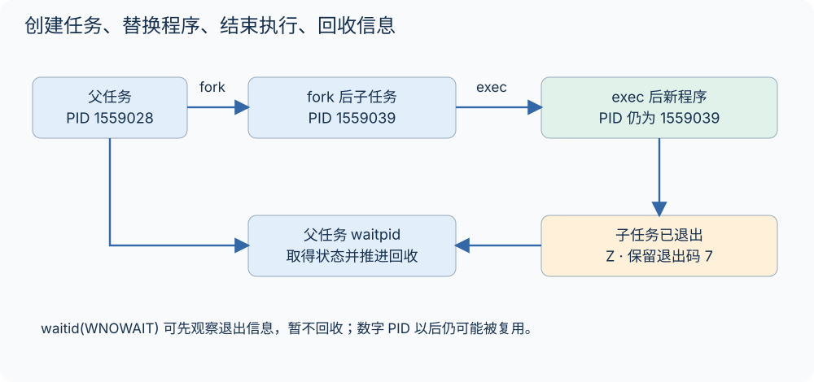
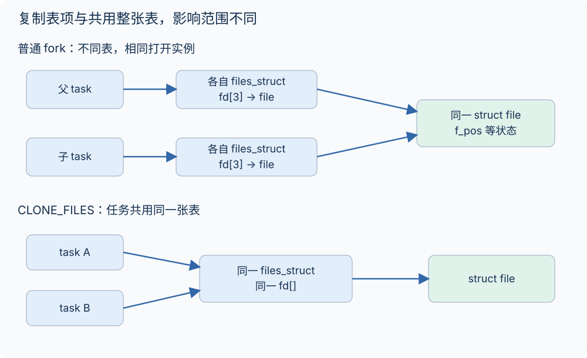
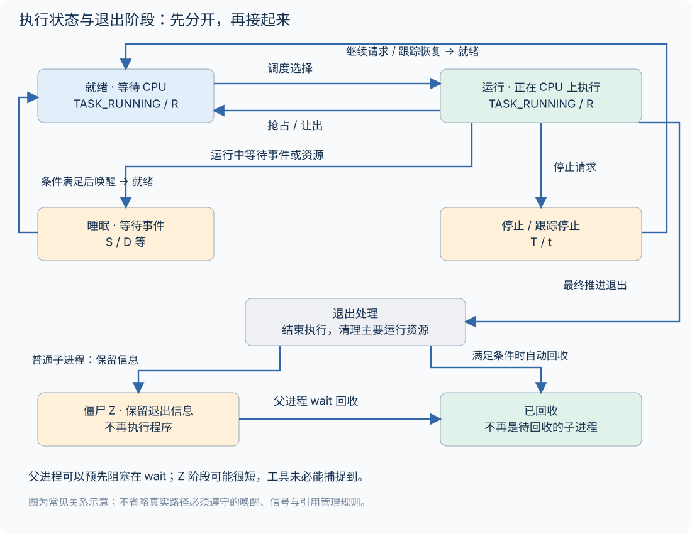

创建一个子进程、启动一个线程、执行另一个程序，看起来都会产生新的执行流程，内核所做的事情却不同。本篇通过一次 fork、exec 和等待回收实验，把任务的创建、资源共享和生命周期接成一条线。

本系列实验环境为 VMware Fusion 中的 Ubuntu 26.04.1 ARM64，运行内核 `6.8.0-149-generic`，glibc 2.43。源码对照上游 **Linux v6.8**，发行版可能带有额外补丁。源码摘录用 `/* … */` 标明省略部分，接口示意与实测程序分别说明。

系列位置：[1. 对象模型](/p/linux-process-task-model/) · **2. 生命周期** · [3. 调度](/p/linux-process-scheduling/) · [4. 执行上下文](/p/linux-kernel-execution-context/) · [5. 用户态同步](/p/linux-userspace-synchronization/) · [6. 内核同步](/p/linux-kernel-synchronization/)。

## 一、exec 前后为什么 PID 相同

### 1.1 创建、替换程序与回收是三个阶段

保存为 [lifecycle.c](lifecycle.c)。子进程重新执行当前可执行文件，带上 `--child` 参数后返回退出码 7。父进程先等待退出但暂不回收，观察状态后才调用 `waitpid()`。

完整程序分为下面三段。这里用 **C 风格伪代码**突出顺序，打印、状态文件读取和错误处理保留在源码文件中：

```c
child = fork();
if (child == 0) {
    print_current_pid();
    exec_current_program_with_child_argument();
    /* exec 成功后，从新程序入口运行，打印 PID 并返回 7。 */
} else {
    waitid(P_PID, child, &info, WEXITED | WNOWAIT);
    print_child_state(); /* 子进程已退出，暂不回收。 */
    waitpid(child, &status, 0);
    print_exit_code(status);
}
```

先抓住三件事：`fork()` 增加一个子任务，`exec` 替换子任务执行的程序，父进程的最后一次等待收集并回收退出信息。复现时使用 [lifecycle.c](lifecycle.c)，伪代码中的辅助名称不是可直接调用的接口。

实验是单线程父进程，因此子进程在 exec 前调用 `printf()` 等库接口没有多线程 fork 后的锁继承问题。对于多线程父进程，子进程到 exec 之间应遵守异步信号安全接口限制，不应直接照搬这一段输出代码。

```bash
gcc -std=c11 -O2 -Wall -Wextra -Werror lifecycle.c -o lifecycle
./lifecycle
```

本次完整输出：

```text
before exec pid=1559039 ppid=1559028
after exec pid=1559039 ppid=1559028
before reap State:	Z (zombie)
parent=1559028 child=1559039 exit=7
after reap status_missing=1
```

两次输出 PID 相同，说明 exec 替换了当前任务执行的程序，没有为这次替换额外创建一个子进程。`WNOWAIT` 让父进程取得退出信息而保留待回收状态，避免靠固定 `sleep` 猜测观察时机。最后的 `status_missing=1` 表示本次回收后该状态路径已不存在；数字 PID 后续仍可能被复用。



## 二、fork 与线程创建怎样选择共享资源

### 2.1 clone 参数表达共享关系

`fork()` 提供传统进程复制语义，`clone()` 与 `clone3()` 则能细化哪些资源共享。线程库通常利用这些接口建立线程，并补上用户栈、线程局部存储（TLS，Thread-Local Storage）及库层管理。

| 参数 | 共享或配置什么 | 需要说明的边界 |
| --- | --- | --- |
| `CLONE_VM` | 用户地址空间 mm | 共享地址空间不自动等于加入同一线程组 |
| `CLONE_FILES` | 文件描述符表 | 一个任务关闭共享表内的 fd，会影响其他共享者 |
| `CLONE_FS` | 当前目录、根目录、umask 等 | 与共享整个文件系统实例不是一回事 |
| `CLONE_SIGHAND` | 信号处理方式 | 不意味着共用每线程信号屏蔽字；要求 `CLONE_VM` |
| `CLONE_THREAD` | 加入同一线程组 | 要求 `CLONE_SIGHAND`，因此也要求 `CLONE_VM` |
| `CLONE_SETTLS` | 设置新线程 TLS 相关状态 | 参数的具体含义有架构差异 |
| `CLONE_PARENT_SETTID` | 在创建者指定位置写入子任务 TID | 用于创建协调，不是资源共享开关 |
| `CLONE_CHILD_CLEARTID` | 退出时清除指定位置并执行相关 futex 唤醒 | 与线程结束等待等库层实现有关 |

`clone3()` 用 `struct clone_args` 组织参数，旧 clone 的不同库包装与原始系统调用接口则存在参数约定差异。本篇不手写一份缩减版线程库。[clone 与参数约束](https://man7.org/linux/man-pages/man2/clone.2.html)

### 2.2 copy_process 怎样把参数落实到对象

创建路径可按下面几个阶段理解，具体架构的系统调用入口可能不同：

| 阶段 | 相关函数 | 对象上的变化 |
| --- | --- | --- |
| 接收创建请求 | `kernel_clone()` | 整理创建参数，调用任务复制路径 |
| 创建任务骨架 | `copy_process()`、`dup_task_struct()` | 建立新的任务对象和内核执行所需状态 |
| 配置资源关系 | `copy_mm()`、`copy_files()`、`copy_fs()` 等 | 按标记共享已有对象或建立新对象 |
| 设置执行现场 | `copy_thread()` 等架构相关实现 | 准备新任务首次运行所需的寄存器与栈状态 |
| 使任务可运行 | `wake_up_new_task()` | 将已初始化的新任务交给调度器 |

这不是“创建参数直接存进 task_struct 就结束”。参数决定了后续每种资源如何关联；任何阶段失败，还要回滚已经分配或取得的资源。[任务创建源码](https://github.com/torvalds/linux/blob/v6.8/kernel/fork.c)

`copy_mm()` 中最关键的选择如下，省略其余代码：

```c
/* … */
if (clone_flags & CLONE_VM) {
    mmget(oldmm);
    mm = oldmm;
} else {
    mm = dup_mm(tsk, current->mm);
    if (!mm)
        return -ENOMEM;
}
/* … */
```

共享时增加 mm 引用，继续指向原对象；不共享时建立新的地址空间管理对象。普通 fork 的匿名内存通常通过写时复制（COW，Copy-On-Write）避免立即复制全部物理页，因此“新 mm”不等于“所有内容都已复制到新物理页”。[已有的内存管理说明](/p/linux-memory-management-basics/)可以与此对应。

### 2.3 复制描述符表仍可能共享打开实例



fork 后父子通常有不同的 `files_struct`，但是复制的表项会引用同一 `struct file`。因此父子可以共享文件偏移，却能分别关闭自己的表项。`CLONE_FILES` 更进一步，让两者直接使用同一张表。这与第一篇中的“任务与资源分层”是一致的。

## 三、exec 替换哪些内容

### 3.1 新程序映像与保留的身份

`execve()` 读取指定程序，经过二进制格式处理路径建立新的程序映像。ELF（Executable and Linkable Format）程序还涉及可执行段、初始用户栈以及可能的解释器加载。

| 状态 | exec 时的典型变化 |
| --- | --- |
| 程序代码、用户数据、用户栈 | 被新程序映像替换 |
| `argv`、`envp` | 按调用者提供的内容建立新程序初始环境 |
| 进程可见 PID | 不因为 exec 本身另外分配一个新进程身份 |
| 文件描述符 | 通常保留，带 `FD_CLOEXEC` 的关闭 |
| 已安装的信号处理函数 | 被捕获的处理方式通常恢复默认，忽略状态按接口规则处理 |
| 多线程执行 | 成功 exec 后其他线程终止，留下执行新程序的线程 |
| 凭据 | 特定文件属性与安全策略下可能改变，不能一概认为全部保留 |

多线程中若非组长线程成功 exec，还有线程组身份转换的细节，不能用单线程实验推断每个内部 TID 都保持不变。[execve 语义](https://man7.org/linux/man-pages/man2/execve.2.html)

### 3.2 从系统调用到新程序入口

源码可沿 `do_execveat_common()`、`bprm_execve()`、`exec_binprm()` 看请求和执行分发，再到具体二进制处理器。不是所有格式都走同一个加载函数，脚本还可能经解释器处理。

成功 exec 不会像普通函数一样返回原程序调用点；失败则返回错误，原程序在尚能恢复的失败阶段继续处理错误。实验里 `execl()` 是 C 库包装，实际创建与替换边界应以系统调用和源码分别解释。[exec 分发实现](https://github.com/torvalds/linux/blob/v6.8/fs/exec.c)

## 四、信号、退出与回收

### 4.1 信号到来不等于立即执行处理函数

信号首先需要选择目标并进入待处理状态。任务的屏蔽字、信号处理方式及当前执行状态决定何时递达和如何处理。进程定向信号可能由一个合适线程接收，线程定向信号则有明确目标。

普通信号通常不按发送次数逐个排队，实时信号有不同的排队语义。`SIGKILL`、`SIGSTOP` 不能被捕获或屏蔽，但致命信号也不意味着能跳过所有内核等待协议立刻销毁对象。用户态处理函数还受到异步信号安全约束。[信号概述](https://man7.org/linux/man-pages/man7/signal.7.html)

| 容易混淆的对象 | 含义 |
| --- | --- |
| signal | 异步通知及相应递达处理机制 |
| semaphore | 控制可用资源数量的同步对象，即信号量 |
| `pthread_cond_signal()` | 通知条件变量上的等待者，不是在发送操作系统信号 |

### 4.2 一条线程退出与整个线程组退出

线程结束自己的执行，不等于整个进程结束。`pthread_exit()` 与线程入口返回用于线程生命周期，`pthread_join()` 还要完成线程库层面的结束同步和资源处理。

C 库 `exit()` 会执行退出处理并刷新标准 I/O；`_exit()` 不执行这套用户态收尾。Linux 上常见的 glibc `_exit()` 包装使用 `exit_group` 结束线程组，而原始 `SYS_exit` 系统调用结束单个线程，两者应区分。[exit_group 语义](https://man7.org/linux/man-pages/man2/exit_group.2.html)

内核的 `do_exit()` 会释放任务持有的 mm、文件及其他资源，通知相关等待者；需要等待父进程收集的信息仍可能保留。最终任务对象的回收还涉及引用与延迟释放，不能把 `waitpid()` 返回简单理解成当场直接 `kfree(task_struct)`。[退出和等待源码](https://github.com/torvalds/linux/blob/v6.8/kernel/exit.c)

### 4.3 普通子进程退出后，先保留退出信息，再等待回收

在默认的子进程退出处理方式下，可以把主线明确写成：**子进程结束执行 → 内核清理主要运行资源并保留退出信息，进入僵尸状态 → 父进程通过 wait 系列接口取得信息并回收。**

子进程的“退出”和父进程的“回收”是两个阶段。子进程已经停止执行，父进程仍然可能需要知道它是正常返回、被哪种信号终止，以及消耗了多少资源。因此内核保留 PID、退出状态、资源使用等必要管理信息，供父进程后续读取。僵尸不会继续执行程序，也不是仍保留完整用户地址空间运行的“卡住进程”。

| 子进程的退出阶段 | 父进程看到什么 | 后续动作 |
| --- | --- | --- |
| 仍在执行或等待事件 | 尚无可回收的退出结果 | 普通阻塞 wait 可以先睡眠等待 |
| 已退出、尚未回收 | 通常处于 `Z`，退出信息可供取得 | 父进程执行回收式 wait |
| 已取得并回收 | 这次退出的子进程不再是待回收对象 | 相应管理信息继续按内核引用规则释放 |

**父进程可以先调用 wait，并不需要先看见 Z 再调用。** 若父进程已阻塞等待，子进程退出会推进通知与唤醒，父进程随后完成回收，僵尸阶段可能短到用户工具无法捕捉。反过来，父进程一直不回收，就可能长期留下僵尸。

本篇实验的 `waitid(..., WEXITED | WNOWAIT)` 特意只取得退出信息，暂不回收，所以接下来能稳定读到 `Z`；之后的 `waitpid()` 才推进回收。`WNOWAIT` 并没有让一个原本正常运行的子进程“变成僵尸”，它让已经退出的子进程继续保留可等待状态。

### 4.4 哪些情况可以自动回收

上面的主线针对通常需要父进程收集退出状态的子进程，不能概括成“任何线程、任何子进程都必须等待一次父进程 wait”。

| 配置或场景 | 与普通主线的区别 |
| --- | --- |
| `SIGCHLD` 保持默认处理方式 | 普通子进程通常保留退出信息，等待父进程回收 |
| **显式**将 `SIGCHLD` 设为 `SIG_IGN` | Linux 可以自动回收，不为普通等待保留僵尸 |
| 设置 `SA_NOCLDWAIT` | 可以自动回收，父进程不按普通方式取得该子进程的待回收退出状态 |
| 线程组内的非组长线程退出 | 不应直接套用独立子进程的僵尸与父进程 wait 模型，pthread 的 join 还有库层协议 |

尤其要区分 `SIGCHLD` 的默认处理方式与显式设置 `SIG_IGN`。虽然经常都被口头描述成“忽略通知”，两者对于子进程退出回收的影响不同。[wait 的僵尸与自动回收规则](https://man7.org/linux/man-pages/man2/waitpid.2.html)

### 4.5 常见状态怎样转换



图把“就绪”和“正在 CPU 上运行”分成两个框，是为了说明调度关系；Linux 的 `TASK_RUNNING` 以及工具显示的 `R` 同时覆盖这两种情况。睡眠等待事件结束后，任务先重新具备运行资格，并不保证马上得到 CPU。

| 转换 | 典型原因 | 容易误解的边界 |
| --- | --- | --- |
| 就绪 → 运行 | 调度器选择任务 | `R` 不保证当时正在 CPU 上执行 |
| 运行 → 就绪 | 被抢占、让出等 | 程序并未退出 |
| 运行 → `S` / `D` | 等待事件或资源 | `D` 不等于所有情况下都在读磁盘 |
| `S` / `D` → 就绪 | 等待条件及相应唤醒协议满足 | 不同等待类型对信号的响应规则不同 |
| 运行 → `T` / `t` | 作业控制停止或被跟踪停止 | 停止与睡眠、退出不同 |
| 停止 → 就绪 | 继续执行请求及对应恢复条件满足 | 作业控制的 `SIGCONT` 不替代所有 ptrace 恢复规则 |
| 退出 → `Z` → 回收 | 普通退出信息保留与父进程 wait | `Z` 没有回到正常运行的路径 |

这是常见关系的概念图，不是所有状态位、信号交叉与内核中间状态的完整自动机。任务在某个等待状态收到致命信号时，仍需遵守该路径的唤醒与退出规则；图中的“退出”是最终推进退出处理，不表示可以瞬间跳过这些条件。

### 4.6 孤儿改变的是父子关系

孤儿描述父子关系的变化：父任务退出后，子进程可能被适当的子收割者或该 PID 命名空间中的 init 接管。子进程可以继续正常运行，之后退出时再由接管者处理回收。

因此，**僵尸描述已退出但仍保留信息的阶段，孤儿描述原父任务退出后的亲属关系**。一个正在运行的孤儿不是僵尸，处理僵尸也不是再给它发送一个终止信号，而是让有回收责任的任务完成相应 wait 或自动回收流程。

回看第一篇中读管道的线程：它虽然睡眠，仍然可能被唤醒后继续执行；本篇的僵尸则已结束执行，只留下待回收信息。接下来只讨论仍有运行资格的任务：[第三篇](/p/linux-process-scheduling/)解释它们如何竞争 CPU，以及睡眠任务被唤醒后怎样重新参与选择。

## 五、命令与接口速查

| 接口 | 用途 |
| --- | --- |
| `fork()` | 成功时父进程得到子 PID，子进程得到 0；失败为 -1 |
| `clone()` / `clone3()` | 通过标记控制资源共享与任务创建属性 |
| `execl()` / `execve()` | 库层便捷包装 / 执行新程序的系统接口，成功不返回原调用点 |
| `waitid(..., WNOWAIT)` | 取得退出信息但暂不回收 |
| `waitpid()`、`WIFEXITED()`、`WEXITSTATUS()` | 等待并回收子进程，按宏解释编码后的退出状态 |
| `sigaction()`、`pthread_sigmask()` | 配置信号处理方式、设置线程屏蔽字 |
| `pthread_exit()` / `pthread_join()` | 结束线程 / 等待可连接线程 |
| `_exit()` / `exit_group` | 区分用户态包装与内核线程组退出接口 |

## 六、名词解释

| 名词 | 本篇含义 |
| --- | --- |
| clone 标记 | 创建任务时选择共享资源及其他行为的参数位 |
| COW | 写入前允许共享物理后备、写入时再按规则建立私有副本的机制 |
| 程序映像 | 执行程序所需的代码、数据、栈及相关映射状态 |
| ELF | Linux 常见的可执行文件与链接格式 |
| 信号屏蔽字 | 某线程暂不递达哪些信号的集合 |
| 异步信号安全 | 信号处理环境允许安全调用接口所需满足的规则 |
| 回收 | 父进程收集退出状态并推进子任务最终清理的过程 |
| 子收割者 | 在合适条件下接管后代孤儿进程、承担等待回收责任的任务 |
