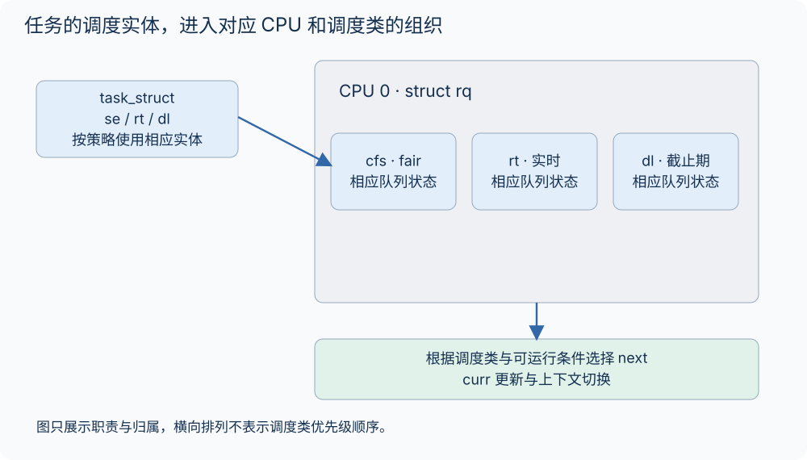
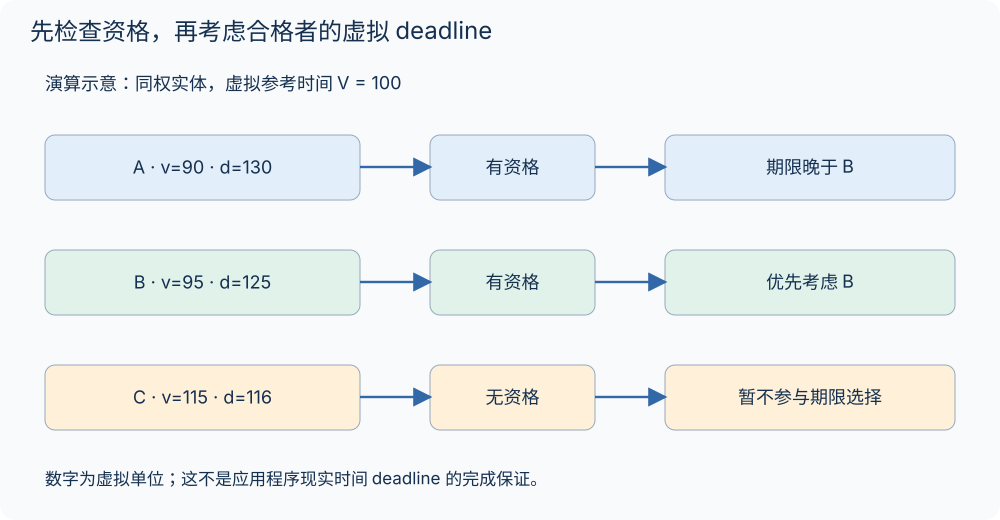

一个任务已经具备执行条件，仍然需要等待处理器。多个计算任务同时就绪时，调度器要选择谁先运行、运行多久，以及什么时候换人。本篇从同一 CPU 上两个任务的权重实验出发，说明运行队列、公平调度、实时策略和上下文切换。

本系列实验环境为 VMware Fusion 中的 Ubuntu 26.04.1 ARM64，运行内核 `6.8.0-149-generic`，glibc 2.43。源码对照上游 **Linux v6.8**，发行版可能带有额外补丁。源码摘录用 `/* … */` 标明省略部分，接口示意与实测程序分别说明。

系列位置：[1. 对象模型](/p/linux-process-task-model/) · [2. 生命周期](/p/linux-process-lifecycle/) · **3. 调度** · [4. 执行上下文](/p/linux-kernel-execution-context/) · [5. 用户态同步](/p/linux-userspace-synchronization/) · [6. 内核同步](/p/linux-kernel-synchronization/)。

## 一、先在同一个 CPU 上观察权重

### 1.1 两个任务竞争一份执行机会

实验让两个子进程固定在同一个允许的处理器（CPU，Central Processing Unit）上，分别使用 nice 0 和 nice 5，在共同的两秒时间窗口内持续计算。父进程等两个子进程都完成配置后再发出开始通知，最后读取它们各自的 CPU 时间。

保存为 [share-lab.c](share-lab.c)。程序只提高 nice 数值、降低其中一个任务的公平权重，不申请实时调度。运行前确保当前 shell 使用通常的 nice 0 与 `SCHED_OTHER`；受限容器或特殊调度环境可能不满足实验条件。

完整程序包含父子进程协调与统计。正文只摘每个子进程的关键操作，其他代码用注释省略：

```c
/* … */
if (sched_setaffinity(0, sizeof(one), &one) == -1) fail("pin");
int target_nice = i * 5; /* 两个子进程分别取 0 和 5。 */
if (setpriority(PRIO_PROCESS, 0, target_nice) == -1) fail("nice");
/* … 等待父进程统一发出开始通知 … */
struct timespec before = now(CLOCK_PROCESS_CPUTIME_ID);
volatile unsigned long work = 0;
while (milliseconds(now(CLOCK_MONOTONIC)) < milliseconds(*deadline))
    for (int j = 0; j < 4096; j++) work++;
struct timespec after = now(CLOCK_PROCESS_CPUTIME_ID);
/* … 将 after - before 交给父进程汇总 … */
```

同一个 CPU 排除了“两个任务各自在不同 CPU 上同时执行”的情况；共同时间窗口便于比较；进程 CPU 时钟记录实际获得的执行时间。复现时使用链接中的完整源码。

```bash
gcc -std=c11 -O2 -Wall -Wextra -Werror share-lab.c -o share-lab
./share-lab
```

本次完整输出：

```text
cpu=0 wall_target=2000 ms
nice=0 cpu=1451.228 ms
nice=5 cpu=475.431 ms
cpu_ratio=3.052
```

两者都运行了接近相同的墙上时间窗口，却获得不同 CPU 时间。两份 CPU 时间相加小于两秒，还包括其他任务、内核工作和虚拟化调度等影响。没有竞争时，nice 5 的任务仍然可以使用空闲 CPU，nice 不是固定限速百分比。

### 1.2 nice 值表示什么

nice 是普通公平调度任务的用户可见参数，取值范围为 **-20 到 19**，通常从 0 开始。数值越小，公平权重越大；数值越大，任务在竞争中让出的份额越多。这里的“优先”体现为相对份额，不保证较小 nice 的任务每次都先运行。

| nice 值 | 大致含义 | 使用边界 |
| --- | --- | --- |
| -20 | 最大普通公平权重 | 仍不是实时调度任务 |
| 0 | 常见默认值 | 不能解释成优先级或 CPU 份额为零 |
| 19 | 最小普通公平权重 | 有空闲 CPU 时仍然可以运行 |

Linux 中 nice 按线程管理，创建子任务时通常继承。普通用户通常可以增大 nice、降低自己的竞争权重；减小 nice、提高权重则受权限及资源限制约束。它主要影响 `SCHED_OTHER`、`SCHED_BATCH` 等公平调度行为，不拿来比较 FIFO/RR 实时优先级，`SCHED_IDLE` 也不按普通 nice 权重调整其策略地位。[nice 与调度规则](https://man7.org/linux/man-pages/man7/sched.7.html)

命令与接口还有一个常见区别：`nice -n 5 ./program` 表示在继承值的基础上增加 5；本篇程序中的 `setpriority(PRIO_PROCESS, 0, 5)` 则把调用线程设置为目标 nice 5。因此实验要求起始环境合适，并检查设置是否成功。

### 1.3 从 nice 换算权重：近似公式与真实查表

理解权重增长趋势时，可以使用下面的**近似关系**，其中 `n` 是 nice 值：

```text
weight(n) ≈ 1024 × 1.25^(-n)
weight(n + 1) / weight(n) ≈ 1 / 1.25 = 0.8
```

也就是说，nice 每增加 1，权重大约变成原来的 80%；每减小 1，权重大约乘以 1.25。nice 的影响是乘法累积，而不是把数值直接当作权重或时间片长度。

内核实际使用整数表 `sched_prio_to_weight[]`，不在每次调度时计算指数。下面是 Linux v6.8 表中的部分准确值：

| nice | 表中权重 | 与 nice 0 相比 |
| --- | --- | --- |
| -20 | 88761 | 约 86.68 倍 |
| -10 | 9548 | 约 9.32 倍 |
| -5 | 3121 | 约 3.05 倍 |
| 0 | 1024 | 1 倍 |
| 1 | 820 | 约 0.80 倍 |
| 5 | 335 | 约 0.33 倍 |
| 10 | 110 | 约 0.11 倍 |
| 19 | 15 | 约 0.015 倍 |

**近似公式说明趋势，源码查表值决定实际计算。** 不能简单对指数公式四舍五入，就宣称所得结果与全部表项完全一致。[v6.8 的权重表与设计说明](https://github.com/torvalds/linux/blob/v6.8/kernel/sched/core.c)

在普通任务的内部静态优先级编码中，还有 `static_prio = 120 + nice` 这一映射，对应 100 到 139。它是内核优先级编码，不是权重计算公式，也不是用户设置的 FIFO/RR 实时优先级。[nice 与内部优先级转换](https://github.com/torvalds/linux/blob/v6.8/include/linux/sched/prio.h)

### 1.4 从权重估算 CPU 份额

假设同一 CPU、同一公平调度组中只有若干持续可运行的同层任务竞争，没有额外配额限制。长期平均份额可用下面的理想化关系理解：

```text
任务 i 的份额 ≈ weight_i / 所有竞争任务的权重之和
任务 i 与任务 j 的 CPU 时间比 ≈ weight_i / weight_j
```

本篇两个任务的权重分别是 1024 与 335：

| 计算 | 结果 |
| --- | --- |
| 总权重 `1024 + 335` | 1359 |
| nice 0 的理想份额 `1024 / 1359` | 约 75.35% |
| nice 5 的理想份额 `335 / 1359` | 约 24.65% |
| 两者 CPU 时间比 `1024 / 335` | 约 3.057 |

实验观测比值为 `3.052`，与权重比接近。若可分配给两者的实际 CPU 执行时间少于两秒，比例应用于这份可分配时间，不能直接承诺 nice 0 必定取得两秒的 75.35%。

还要区分**权重变化**与**CPU 百分比变化**。原先两个 nice 0 任务各约 50%，若其中一个改为 nice 1，权重变成 820，它的理想份额是 `820 / (1024 + 820) ≈ 44.47%`。权重约减少 20%，份额却不是简单从 50% 减为 30%，也不是任何环境下都固定下降某个百分比。

控制组（cgroup，control group）的权重与配额、层级调度、其他竞争者和任务阻塞等因素都会改变实际结果。只有一个可运行任务时，无须按这些权重把剩余 CPU 闲置下来。

## 二、从 task 到每 CPU 运行队列

### 2.1 rq 与不同调度类

Linux 调度的主要对象是线程级任务。每个 CPU 有自己的运行队列 `struct rq`，其中再组织公平、实时和截止期等调度状态。以下只摘出相关成员：

```c
struct rq {
    /* … */
    unsigned int nr_running;
    /* … */
    struct cfs_rq cfs;
    struct rt_rq rt;
    struct dl_rq dl;
    /* … */
    struct task_struct __rcu *curr;
    struct task_struct *idle;
    /* … */
};
```

`curr` 指向当前任务，`nr_running` 参与记录可运行负载，几个子队列服务不同调度类。调度类通过 `struct sched_class` 提供入队、出队、选择和更新等操作，任务的 `sched_class` 指向相应实现。[运行队列与调度类定义](https://github.com/torvalds/linux/blob/v6.8/kernel/sched/sched.h)



普通任务通常通过 `task_struct.se` 参与公平调度，实时任务使用 `rt` 等相应实体。调度组也可以有自己的 `sched_entity`，所以在公平调度源码里看到一个实体时，不能总直接当作一个普通线程。

### 2.2 策略、优先级与调度类

| 用户可见策略 | 主要实现归属 | 选择依据 |
| --- | --- | --- |
| `SCHED_OTHER`，内核也称 `SCHED_NORMAL` | fair 类 | 公平权重、资格与虚拟期限等 |
| `SCHED_BATCH` | fair 类 | 面向批处理的公平调度策略 |
| `SCHED_IDLE` | fair 类 | 极低优先级的用户任务策略 |
| `SCHED_FIFO`、`SCHED_RR` | rt 类 | 实时优先级及同优先级排列规则 |
| `SCHED_DEADLINE` | dl 类 | 运行预算、周期与截止期约束 |

`SCHED_IDLE` 用户策略与调度器的 idle 类、每 CPU 空闲线程不同。v6.8 中通常按 stop、deadline、实时、公平、idle 等层次组织类的选择，具体还受带宽和可运行条件影响；不能将所有策略放进同一张按 nice 数值排序的表。[调度策略接口](https://man7.org/linux/man-pages/man7/sched.7.html)

## 三、从 CFS 的公平思想到 EEVDF

### 3.1 vruntime 把执行时间按权重归一化

完全公平调度器（CFS，Completely Fair Scheduler）的核心思想，是用虚拟运行时间比较获得了多少服务。对普通权重实体，可用下面的简化关系理解增量：

```text
虚拟运行时间增量 ≈ 实际执行时间 × 1024 / 实体权重
```

权重大，同样实际时间增加的虚拟时间较少，因此还能获得相应比例的执行机会。权重小，虚拟时间增长较快。

对本篇实验的两个任务，假设它们各实际运行 1 毫秒：

| 任务 | 实际执行增量 | 虚拟运行时间增量，按简化公式 |
| --- | --- | --- |
| nice 0，权重 1024 | 1 ms | `1 × 1024 / 1024 = 1 ms` |
| nice 5，权重 335 | 1 ms | `1 × 1024 / 335 ≈ 3.057 ms` |

较小权重的任务更快推进虚拟进度。在这个简化比较中，当 nice 0 实际运行约 3.057 毫秒、nice 5 实际运行 1 毫秒时，两者的虚拟时间增量接近。这就把“按权重分配实际执行机会”与“按虚拟进度记账”连在一起。

v6.8 的 `calc_delta_fair()` 用 `NICE_0_LOAD` 与实体负载权重完成这类换算。内部还有负载缩放、定点算术等细节，不能把上面的毫秒演算当成函数原样执行的浮点公式。[虚拟运行时间增量实现](https://github.com/torvalds/linux/blob/v6.8/kernel/sched/fair.c)

`vruntime` 不是挂钟，也不表示进程创建以来经过的墙上时间。

Linux 从 6.6 开始引入 EEVDF（Earliest Eligible Virtual Deadline First，最早合格虚拟截止期优先）选择逻辑。v6.8 的公平调度仍有 `cfs_rq` 等名称，不能仅凭名称就把实现描述成“永远选最小 vruntime”。本篇具体行为以 v6.8 `pick_eevdf()` 为准，不套用后来版本的延迟出队等变化。[v6.8 公平调度源码](https://github.com/torvalds/linux/blob/v6.8/kernel/sched/fair.c)

### 3.2 合格以后，再比较虚拟截止时间

EEVDF 先考虑实体是否还应得到服务，再从合格实体中考虑较早的虚拟截止时间。服务差额通常用 lag 解释，已经超过其应得份额的实体可能暂时不合格。

这里还要回答：**虚拟 deadline 从哪里来？** 在 v6.8 的请求更新路径中，`update_deadline()` 在实体用完当前请求后，用下面的关系准备下一次请求：

```text
下一虚拟 deadline = 当前 vruntime + 请求执行量换算后的虚拟时间
虚拟时间增量 ≈ 请求的实际执行时间 × 1024 / weight
```

请求执行量对应 `slice`。它描述这次安排的执行请求，不是程序总运行时间，也不是现实世界的完成期限。权重通过换算影响虚拟时间；同样的请求量，对较低权重会对应更大的虚拟增量。[v6.8 update_deadline 与 pick_eevdf](https://github.com/torvalds/linux/blob/v6.8/kernel/sched/fair.c)

下面连续演算几轮，数字全部是**演算示意**，不是本机读数。只考虑两个持续就绪、同组且同权的实体 A、B，每份请求都是 10 个时间单位，因此实际运行 1 单位，虚拟时间也增加 1。没有新任务加入，也不考虑迁移；只在表格给定的检查点比较资格和期限，不模拟每一次 tick 或中途调度。表内的运行量是为了推演选定检查点的状态，不是承诺内核会让任务连续执行完整请求。

初始时 A 刚开始一份请求：`vruntime = 90`，deadline 为 `90 + 10 = 100`。B 的当前请求从虚拟时间 105 开始，已执行 5，因此 `vruntime = 110`、deadline 为 `105 + 10 = 115`，还剩 5。这里是在观察两个任务各自执行进度的某一时刻，不要求它们同时开始请求。

在这个简化的同权场景中，虚拟参考时间可以按两者 `vruntime` 的平均值理解。实体 `vruntime` 不超过参考值时合格，再比较合格者的 deadline：

| 选择时刻 | A：vruntime / deadline | B：vruntime / deadline | 参考时间 | 选择及后续更新 |
| --- | --- | --- | --- | --- |
| 初始 | 90 / 100 | 110 / 115 | 100 | 只有 A 合格，A 执行 10；到达 100 后，新 deadline 为 110 |
| 第二次 | 100 / 110 | 110 / 115 | 105 | 只有 A 合格，A 再执行 10；到达 110 后，新 deadline 为 120 |
| 第三次 | 110 / 120 | 110 / 115 | 110 | 两者都合格，B 的 deadline 更早，B 执行剩余 5；新 deadline 为 125 |
| 第四次 | 110 / 120 | 115 / 125 | 112.5 | 只有 A 合格，下一步选择 A |

A 开始时落后，所以先获得服务；追到相同虚拟进度后，两者都有资格，才比较剩余请求的虚拟 deadline。**资格回答“现在该不该给它服务”，deadline 回答“合格者中先服务谁”。**



图中前三次选择与表格保持同一组数字，第四次选择可继续沿表格推演。实际内核按权重、运行队列状态和当前实体等计算资格，并在具体调度时机更新状态，不会逐字执行这个教学时间表。观察到 `cfs_rq` 这个名字时，应继续看 v6.8 的选择逻辑，而不是直接套用旧式“永远选最小 vruntime”的说法。

### 3.3 sched_entity 把这些状态放在哪里

按 v6.8 定义顺序摘录部分成员：

```c
struct sched_entity {
    struct load_weight load;
    struct rb_node run_node;
    u64 deadline;
    u64 min_vruntime;
    /* … */
    u64 sum_exec_runtime;
    /* … */
    u64 vruntime;
    s64 vlag;
    u64 slice;
    /* … */
};
```

`load` 保存权重，`run_node` 是内嵌红黑树节点，`sum_exec_runtime` 累计实际执行时间，`vruntime` 用于公平进度，`deadline` 与 `slice` 参与虚拟期限安排。`vlag` 用于保存特定时机的服务差额状态，不应假定它在任何指令处都是已实时更新的完整 lag。

v6.8 的树按虚拟 deadline 排序，`min_vruntime` 为子树的资格剪枝提供信息。读源码时可以先理解状态分工，不必从红黑树旋转开始。[sched_entity 定义](https://github.com/torvalds/linux/blob/v6.8/include/linux/sched.h)

## 四、实时调度的规则与限制

### 4.1 FIFO 与 RR 怎样选择

`SCHED_FIFO` 和 `SCHED_RR` 使用实时优先级，数值越大用户可见优先级越高。nice 不参与这两类任务的同类排序。

| 场景 | FIFO | RR |
| --- | --- | --- |
| 更高实时优先级任务就绪 | 可以抢占当前较低优先级任务 | 同样可以抢占 |
| 同优先级任务竞争 | 当前任务可继续，直到阻塞、主动让出或被更高优先级抢占等 | 还有同优先级时间片轮转 |
| 没有竞争者 | 不因普通公平份额用尽而轮换到其他公平任务 | 时间片届满不意味着必须运行普通公平任务 |

查看支持范围：

```bash
chrt -m
```

本次输出：

```text
SCHED_OTHER min/max priority	: 0/0
SCHED_FIFO min/max priority	: 1/99
SCHED_RR min/max priority	: 1/99
SCHED_BATCH min/max priority	: 0/0
SCHED_IDLE min/max priority	: 0/0
SCHED_DEADLINE min/max priority	: 0/0
```

`SCHED_DEADLINE` 在这里显示 `0/0`，并不是没有调度优先级作用，而是它不使用 FIFO/RR 的 1–99 数值模型。它需要独立的预算和截止期参数，以及相应准入约束。

### 4.2 实时策略不等于无条件准时

读本次 shell 的策略：

```bash
chrt -p $$
```

本次输出：

```text
pid 1559274's current scheduling policy: SCHED_OTHER
pid 1559274's current scheduling priority: 0
```

这里的普通策略优先级 `0` 与 nice `0` 不是同一个属性。设置实时策略涉及权限和资源限制，实验没有将计算循环升级为实时任务。

实时线程仍然可能等待锁、I/O 或被不可抢占区间拖延。高优先级任务等待低优先级持锁者时，可能发生优先级反转，优先级继承锁在相应场景下缓解这一问题。

本机实时带宽设置：

```bash
cat /proc/sys/kernel/sched_rt_period_us
cat /proc/sys/kernel/sched_rt_runtime_us
```

依次输出：

```text
1000000
950000
```

它们是普通实时带宽控制相关的微秒参数，不能简单当成任何实时任务必定获得 95% CPU 的承诺。控制组、内核配置及其他调度条件还会影响实际约束。[实时调度实现](https://github.com/torvalds/linux/blob/v6.8/kernel/sched/rt.c)

## 五、从就绪到上下文切换

### 5.1 什么事情会促成重新选择

任务主动等待、时间片和记账更新、其他任务唤醒、优先级变化等都可能促成调度。tick 是其中一个处理机会，调度不要求每次都等固定节拍到来。唤醒可以要求重调度，但不等于在唤醒函数中立刻执行完整切换。

| 阶段 | 源码中的相关位置 | 状态变化 |
| --- | --- | --- |
| 等待结束、准备唤醒 | `try_to_wake_up()` | 检查状态，确定目标 CPU 并推进任务就绪 |
| 重新选择 | `__schedule()` 等调度入口 | 在运行队列保护下处理当前状态与 next 选择 |
| 切换上下文 | `context_switch()` | 处理地址空间上下文及架构相关执行现场 |
| 完成切换后处理 | `finish_task_switch()` 等 | 处理切换后的锁、引用与收尾工作 |

这是一条职责链，不代表每次 `schedule()` 都会换成另一个任务；如果 next 仍是当前任务，就不需要同样的完整切换。[调度核心实现](https://github.com/torvalds/linux/blob/v6.8/kernel/sched/core.c)

### 5.2 切换执行者与切换特权级不同

用户任务执行系统调用，是同一任务从用户态进入内核态；从任务 A 切换到任务 B，才改变正在执行的任务。线程共享 mm 时，任务切换仍需切换寄存器、内核栈等状态，但不等于总要更换用户地址空间。

TLB（Translation Lookaside Buffer，地址转换旁路缓存）是否以及怎样维护还与架构、地址空间标识和切换场景相关，不能将每次上下文切换都描述成“清空所有页表缓存”。

CPU 亲和性限制任务可运行的位置，负载均衡则在允许范围内调整任务分布。绑核不等于隔离该 CPU，也不排除中断与其他允许任务的竞争。内核可抢占配置与用户任务的调度策略同样是不同维度。

把本篇与前两篇接起来：任务创建后可以进入可运行集合；主动等待时暂时不参与普通可运行任务的竞争；事件唤醒它后，它重新获得运行资格，随后才由调度器选择。至于事件怎样从设备中断交到可唤醒任务的路径，继续看[第四篇的中断交接](/p/linux-kernel-execution-context/)。

## 六、命令与接口速查

| 接口或命令 | 用途 |
| --- | --- |
| `sched_getaffinity()` / `sched_setaffinity()` | 读取、设置当前任务允许的 CPU 集合 |
| `setpriority()` / `nice` | 调整普通任务的 nice 值与公平权重 |
| `CLOCK_PROCESS_CPUTIME_ID` | 累计本实验子进程实际得到的 CPU 执行时间 |
| `taskset -p PID` / `taskset -cp PID` | 查看 CPU 亲和性掩码或列表 |
| `chrt -m` / `chrt -p PID` | 查看策略优先级范围、指定任务策略 |
| `sched_setscheduler()` / `sched_setattr()` | 按权限与参数要求设置调度策略及属性 |
| `sched_rr_get_interval()` | 读取 RR 时间片相关信息 |
| `sched_rt_period_us` / `sched_rt_runtime_us` | 查看普通实时调度带宽参数 |

## 七、名词解释

| 名词 | 本篇含义 |
| --- | --- |
| rq | 某个 CPU 的运行队列及调度状态对象 |
| 调度类 | 内核组织一组任务选择、入队及记账规则的实现接口 |
| nice / 权重 | 普通任务公平份额的用户参数及对应内核数值 |
| vruntime | 按权重归一化的执行进度 |
| EEVDF | 从合格实体中考虑最早虚拟截止时间的公平调度选择方法 |
| 实时优先级 | FIFO/RR 等策略使用的优先级，与 nice 不同 |
| 优先级反转 | 高优先级任务因等待低优先级持有资源而受阻的现象 |
| 上下文切换 | 将执行者从一个任务切换到另一个任务的过程 |
| CPU 亲和性 | 任务允许运行在哪些 CPU 上的约束 |
