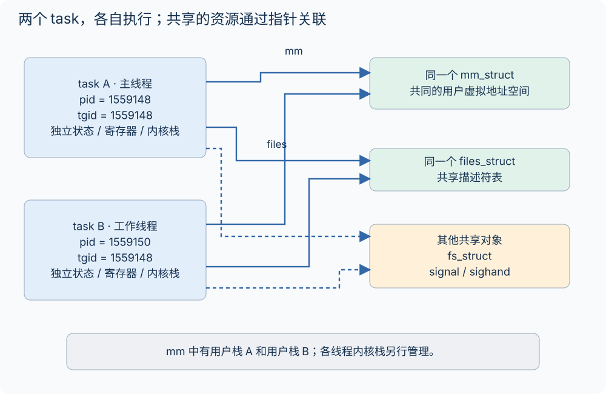

程序运行以后，操作系统需要记录它的身份、执行现场、地址空间和打开文件。加入第二个线程以后，一部分状态仍然共享，另一部分必须各自保存。本篇文章从两个线程的可见信息出发，对照 `task_struct`，建立后续创建、调度与同步文章共用的对象模型。

本系列实验环境为 VMware Fusion 中的 Ubuntu 26.04.1 ARM64，运行内核 `6.8.0-149-generic`，glibc 2.43。源码对照上游 **Linux v6.8**，发行版可能带有额外补丁。源码摘录用 `/* … */` 标明省略部分，接口示意与实测程序分别说明。

系列位置：**1. 对象模型** · [2. 生命周期](/p/linux-process-lifecycle/) · 3. 调度（待发布） · 4. 执行上下文（待发布） · 5. 用户态同步（待发布） · 6. 内核同步（待发布）。

## 一、用两个线程观察身份与地址

### 1.1 运行一个可以停留的程序

保存为 [task-lab.c](task-lab.c)。主线程等待终止信号，工作线程等待读取管道。使用阻塞等待，是为了让它们在观察期间保持存活，不必持续占用处理器（CPU，Central Processing Unit）。

```c
#define _GNU_SOURCE
#include <errno.h>
#include <pthread.h>
#include <signal.h>
#include <stdio.h>
#include <stdlib.h>
#include <string.h>
#include <sys/syscall.h>
#include <unistd.h>

static int shared_value = 42;
static int channel[2];

static void check(int err, const char *what)
{
    if (err) {
        fprintf(stderr, "%s: %s\n", what, strerror(err));
        exit(EXIT_FAILURE);
    }
}

static void *worker(void *arg)
{
    int local = 2;
    char token;
    (void)arg;
    check(pthread_setname_np(pthread_self(), "worker-demo"), "setname");
    printf("worker pid=%ld tid=%ld shared=%p local=%p\n",
           (long)getpid(), syscall(SYS_gettid),
           (void *)&shared_value, (void *)&local);
    ssize_t n;
    do {
        n = read(channel[0], &token, 1);
    } while (n == -1 && errno == EINTR);
    if (n == -1) {
        perror("read");
        exit(EXIT_FAILURE);
    }
    return NULL;
}

int main(void)
{
    pthread_t thread;
    sigset_t signals;
    int local = 1, received;
    setbuf(stdout, NULL);
    sigemptyset(&signals);
    sigaddset(&signals, SIGTERM);
    check(pthread_sigmask(SIG_BLOCK, &signals, NULL), "sigmask");
    if (pipe(channel) == -1) {
        perror("pipe");
        return EXIT_FAILURE;
    }
    printf("main   pid=%ld tid=%ld shared=%p local=%p\n",
           (long)getpid(), syscall(SYS_gettid),
           (void *)&shared_value, (void *)&local);
    check(pthread_create(&thread, NULL, worker, NULL), "create");
    check(sigwait(&signals, &received), "sigwait");
    if (write(channel[1], "x", 1) != 1) {
        perror("write");
        return EXIT_FAILURE;
    }
    check(pthread_join(thread, NULL), "join");
    close(channel[0]);
    close(channel[1]);
    return EXIT_SUCCESS;
}
```

错误处理辅助函数接收 pthread 接口直接返回的错误号。`SIGTERM` 在创建线程前被屏蔽，新线程继承该屏蔽设置，最后由主线程的 `sigwait()` 同步接收。收到后主线程写管道、等待工作线程退出，再关闭描述符。

```bash
gcc -std=c11 -O2 -Wall -Wextra -Werror -pthread task-lab.c -o task-lab
./task-lab > task-lab.out &
pid=$!
sleep 1
cat task-lab.out
```

本次输出：

```text
main   pid=1559148 tid=1559148 shared=0xc50daba50010 local=0xffffddecb1c8
worker pid=1559148 tid=1559150 shared=0xc50daba50010 local=0xe061c476e8c4
```

进程标识（PID，Process Identifier）在两行相同。内核线程标识（TID，Thread Identifier）不同。主线程的 TID 在此等于进程标识，工作线程有另一个 TID；`pthread_t` 是线程库使用的不透明标识，不能替代这里的内核 TID。

两次 `&shared_value` 相同，各自局部变量的地址不同。局部变量位于各自用户栈中，但这些栈仍属于共享的用户地址空间，并不是彼此隔离的内存区域。

### 1.2 /proc 为什么显示两份任务信息

```bash
ps -L -p "$pid" -o pid,tid,tgid,ppid,stat,comm
```

本次输出：

```text
    PID     TID    TGID    PPID STAT COMMAND
1559148 1559148 1559148 1559147 Sl   task-lab
1559148 1559150 1559148 1559147 Sl   worker-demo
```

线程组标识（TGID，Thread Group Identifier）把这两个任务归为一个进程。`-L` 要求按线程展示。`STAT` 中的 `S` 是睡眠，`l` 是多线程进程标记，不是另一个睡眠状态。

从输出取出工作线程 TID，再读它的状态文件：

```bash
worker_tid=$(sed -n 's/^worker .*tid=\([0-9]*\).*/\1/p' task-lab.out)
grep -E '^(Name|State|Tgid|Pid|PPid|Threads|Uid|Gid|Cpus_allowed_list):' /proc/"$pid"/task/"$worker_tid"/status
```

本次完整筛选结果：

```text
Name:	worker-demo
State:	S (sleeping)
Tgid:	1559148
Pid:	1559150
PPid:	1559147
Uid:	1000	1000	1000	1000
Gid:	1000	1000	1000	1000
Threads:	2
Cpus_allowed_list:	0-1
```

`status` 的 `Pid` 在这里指这个任务的 TID，`Tgid` 对应程序 `getpid()` 看到的值。`Uid`、`Gid` 分别是用户标识（UID，User Identifier）与组标识（GID，Group Identifier）字段，各自四列是实际、有效、保存及文件系统使用的身份。`Cpus_allowed_list` 是允许执行的处理器集合，不能据此断言任务此刻在哪个 CPU 上运行。

这些标识需要结合 PID 命名空间解释。同一个任务在不同命名空间中可能有不同可见编号，不能把某个命名空间里的编号直接当成所有观察者共用的永久身份。[proc_pid_status 字段](https://man7.org/linux/man-pages/man5/proc_pid_status.5.html)

## 二、task_struct 与资源对象

### 2.1 内核为每个可调度线程保留任务对象

普通 Linux pthread 实现中，每个线程都有自己的 `task_struct`。进程级概念通过线程组和共享资源表达，并不意味着“一整个多线程进程只有一份 task_struct”。



沿图从两个 task 出发，既能看到各自独立的执行状态，也能看到指向同一资源对象的箭头。下面按 v6.8 定义顺序摘录部分成员，省略其他字段与配置分支：

```c
struct task_struct {
    /* … */
    unsigned int __state;
    /* … */
    void *stack;
    /* … */
    struct mm_struct *mm;
    struct mm_struct *active_mm;
    /* … */
    int exit_state;
    /* … */
    pid_t pid;
    pid_t tgid;
    /* … */
    struct task_struct __rcu *real_parent;
    /* … */
    struct task_struct *group_leader;
    /* … */
    const struct cred __rcu *cred;
    /* … */
    struct fs_struct *fs;
    struct files_struct *files;
    /* … */
    struct signal_struct *signal;
    struct sighand_struct __rcu *sighand;
    /* … */
};
```

| 成员 | 记录或指向什么 | 本篇如何理解 |
| --- | --- | --- |
| `__state`、`exit_state` | 执行等待状态与退出状态 | 每个任务分别记录，后面分开介绍 |
| `stack` | 内核栈关联地址 | 与用户程序打印的局部变量地址不同 |
| `mm` | 用户地址空间对象 | 两个 pthread 线程共享同一个 mm |
| `active_mm` | 当前使用或借用的地址空间上下文 | 内核线程场景在第四篇展开 |
| `pid`、`tgid` | 任务与线程组编号的内部记录 | 对外编号还要经过命名空间转换 |
| `real_parent`、`group_leader` | 父任务、线程组组长 | 父子关系与线程组关系分别存在 |
| `cred` | 凭据对象 | 通过专用凭据接口管理，不直接改指针内字段 |
| `files`、`fs` | 描述符表；目录与 umask 等状态 | 是否共享由创建方式决定 |
| `signal`、`sighand` | 线程组信号相关状态；处理方式 | 不等于所有线程共用一个信号屏蔽字 |

这里的 `fs_struct` 不表示文件系统超级块，`files_struct` 也不保存文件内容。它们分别组织任务使用文件系统时的上下文和文件描述符表。之前的[打开文件对象模型](/p/linux-file-object-model/)可以与此对应。[task_struct 源码定义](https://github.com/torvalds/linux/blob/v6.8/include/linux/sched.h)

### 2.2 地址空间共享，不等于执行现场共享

比较地址映射：

```bash
cmp /proc/"$pid"/maps /proc/"$pid"/task/"$worker_tid"/maps
```

本次命令成功返回且没有输出，表示比较时两份映射列表相同。由于实验期间映射保持稳定，这与两个线程共享 mm 的模型一致；它不能代替内核指针级别的直接测量。

再看用户主栈的标记：

```bash
grep '\[stack\]' /proc/"$pid"/maps
```

本次输出：

```text
ffffddeab000-ffffddecc000 rw-p 00000000 00:00 0                          [stack]
```

工作线程用户栈通常在另一段匿名映射中，不保证各自显示一个 `[stack]` 标签。需要定位时可结合打印地址，或使用 `pthread_getattr_np()` 等接口取得具体范围。

每个线程还有自己的寄存器现场、内核栈和线程局部存储（TLS，Thread-Local Storage）。进入系统调用时，CPU 从用户态切到内核态，仍然处理当前任务；内核栈用于内核执行，用户栈仍保存在原地址空间中。地址翻译细节可对照[虚拟地址到物理地址](/p/linux-virtual-address-translation/)。

## 三、状态与属性怎样分开读

### 3.1 运行、等待与退出

| 可见状态 | 典型含义 | 内核对象层面的要点 |
| --- | --- | --- |
| `R` | 正在运行，或已经就绪等待 CPU | `TASK_RUNNING` 同时覆盖这两种情况 |
| `S` | 可中断睡眠 | 等待事件，某些信号可结束等待 |
| `D` | 不可中断一类的等待 | 常见于内核等待，不能一概解释为“正在读磁盘” |
| `T` / `t` | 作业控制停止 / 跟踪停止 | 需要区分停止原因 |
| `Z` | 已退出但尚未完成回收 | 与 `exit_state` 相关，通常保留退出信息 |
| `I` | 空闲内核线程等状态的展示 | 是工具对内核状态的解释，不是用户态 `sleep()` 的专用标记 |

`__state` 是组合状态位，`TASK_RUNNING` 的值为零；`exit_state` 单独记录退出阶段。用户工具显示的是整理后的状态字符，不是直接把一个字段值转换成字母。某些等待还具有可被致命信号唤醒等组合语义，因此不能仅凭 `D` 就给出“任何信号永远无效”的结论。[任务状态定义](https://github.com/torvalds/linux/blob/v6.8/include/linux/sched.h)

### 3.2 属性不全属于同一个共享层次

调度策略、优先级和 CPU 亲和性在 Linux 中按线程管理；文件描述符表、当前目录、信号处理方式等则常在线程间共享。信号屏蔽字属于线程，处理方式通常属于共享对象。调用一个接口前，要先看它作用于单个任务、线程组还是某个共享对象。

此外，进程组与会话组织作业控制和终端关系，资源限制管理可用描述符数等额度，命名空间则影响可见身份及资源视图。这些属性不应都塞进“PID 的其他字段”里：

| 属性 | 典型作用 | 观察入口 |
| --- | --- | --- |
| 进程组 / 会话 | shell 作业控制、终端与相关信号的目标组织 | `ps` 的 `PGID`、`SID`，`getpgid()`、`getsid()` |
| 资源限制 | 区分软硬限制，约束描述符等资源 | `/proc/PID/limits`、`getrlimit()` |
| 命名空间关联 | 决定任务在哪一组隔离视图中观察资源 | `/proc/PID/ns/` |
| 调度属性 | 策略、优先级与允许 CPU 集合 | `/proc/PID/task/TID/`、调度接口 |

本篇先确定它们的归属和用途，创建标记与调度行为在后文分别展开，不在这里重复介绍容器隔离机制。

凭据还有库层协调与内核逐任务记录之间的区别。例如线程库会协调符合 POSIX 要求的身份变更，不能仅看到 `task_struct.cred` 就推断普通 pthread 的身份变更只影响一个线程。[pthread 属性共享规则](https://man7.org/linux/man-pages/man7/pthreads.7.html)

观察完毕，在启动实验的 shell 中结束程序：

```bash
kill -TERM "$pid"
wait "$pid"
```

第二篇将改变任务创建方式，观察哪些资源变成复制，哪些仍然共享。

## 四、命令与接口速查

| 接口或命令 | 用途 |
| --- | --- |
| `getpid()` / `syscall(SYS_gettid)` | 取得进程可见 TGID / 当前任务 TID |
| `pthread_create()` / `pthread_join()` | 创建线程、等待可连接线程结束；失败直接返回错误号 |
| `pthread_sigmask()` / `sigwait()` | 设置当前线程信号屏蔽字、同步接收指定信号 |
| `ps -L -p PID` | 按线程显示一个进程 |
| `/proc/PID/task/TID/status` | 查看单个任务的身份、状态与属性 |
| `/proc/PID/maps` | 查看共享用户地址空间的映射列表 |
| `cmp` | 比较两份映射文本，成功相同时不输出 |
| `kill -TERM PID` / `wait PID` | 请求实验程序退出，并由当前 shell 等待其结束 |

## 五、名词解释

| 名词 | 本篇含义 |
| --- | --- |
| task | 内核按任务对象管理的执行实体，普通线程各有一份 |
| PID / TID / TGID | 进程可见编号、任务编号与线程组编号，含义要结合接口与命名空间 |
| mm_struct | 用户虚拟地址空间的内核管理对象 |
| 用户栈 / 内核栈 | 用户代码与内核任务执行分别使用的栈空间 |
| TLS | 每线程定位的局部存储机制，不表示建立独立进程地址空间 |
| 凭据 | 用户、组及权限判断相关的身份状态对象 |
| 就绪 | 已具备执行条件，但尚未获得 CPU 的状态 |
| 僵尸 | 已退出而保留等待回收信息的任务状态 |
