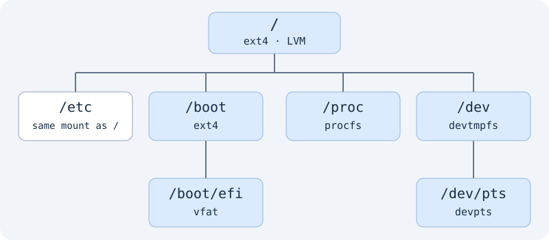
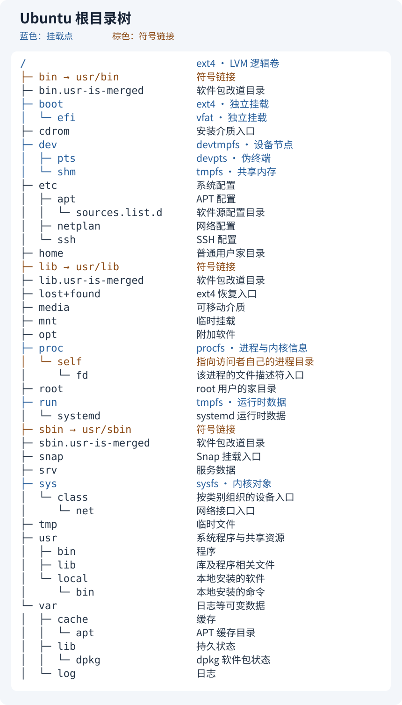

这篇文章从 Ubuntu 的根目录 `/` 出发，介绍 Linux 的目录树是如何组织起来的。运行 `ls /` 时，`/etc`、`/home`、`/proc`、`/dev` 看起来都是根目录下的入口，可它们的内容是不是都来自同一个文件系统？

先区分三个容易混淆的概念：

- `/`：当前进程看到的根目录。
- 根文件系统：为这个根目录提供内容的文件系统。
- `/root`：root 用户的家目录，和根目录不是一回事。

概念依据见[文件系统层次标准](https://specifications.freedesktop.org/fhs/latest/rootFilesystem.html)。

接下来在 Ubuntu 虚拟机里用 `ls` 看目录项、用 `cd` 切换当前目录、用 `stat` 查看路径对应对象的属性，再用 `findmnt` 核对这些路径落在哪个挂载上。两个问题由此分开回答：**这个目录通常放什么？访问这个路径时，实际由哪个文件系统提供内容？**

Linux 解析路径时会结合挂载关系，所以目录树的上下级关系和背后的存储布局不必一一对应（见 [Linux 内核路径查找文档](https://cdn.kernel.org/doc/html/latest/filesystems/path-lookup.html)）。

本篇只建立对目录树和挂载的认识。`stat` 显示的 inode 编号和链接数从哪里来、`ls` 又怎样向内核读取目录项，留给后续文章，结合实验结果和对应版本的源码展开。

## 一、从 `/` 看目录树和挂载 {#从--看目录树和挂载}

**`/etc` 和 `/proc` 都是目录，但它们的内容来自不同的文件系统。** 在这台 Ubuntu 虚拟机上，用 `stat` 看类型，再用 `findmnt -T` 看每个路径落在哪个挂载里：

```bash
LC_ALL=C stat -c '%n: %F' /etc /proc
findmnt -n -T /etc -o TARGET,FSTYPE
findmnt -n -T /proc -o TARGET,FSTYPE
```

实际输出：

```text
/etc: directory
/proc: directory
/      ext4
/proc  proc
```

`/etc` 由挂载在 `/` 的 ext4 文件系统提供；访问 `/proc` 时则进入 procfs，读到的是内核提供的进程和系统信息。两者看起来都像普通目录，这正是只用 `ls` 或 `stat` 判断不了的地方。

### 1.1 挂载点也可以嵌套 {#挂载点也可以嵌套}



`/boot` 是独立的 ext4 挂载，其中的 `/boot/efi` 又来自 vfat。类似地，`/dev` 是 devtmpfs，但访问 `/dev/pts` 时又会跨入 devpts。**目录位置和挂载归属是两件事。** 要查具体路径属于哪一个挂载，用 `findmnt -T 路径`。

以 `/boot/efi` 为例，查找到 `boot` 这个目录项时，VFS 会查看当前挂载中的这个位置是否接了另一个挂载。如果接了，就把当前路径切换到新挂载和它的根目录项，再从那里继续查找 `efi`。找到 `efi` 时还能再跨一次挂载。因此，一次路径查找走的是**目录项与挂载的组合**。具体调用链见[第三篇的 openat 路径解析](/p/linux-file-object-model/#32-openat-path-walk)。[Linux v6.8 路径查找文档](https://docs.kernel.org/6.8/filesystems/path-lookup.html)

`findmnt` 展示的是调用者所在挂载命名空间的视图。不同命名空间可以看到不同的挂载树。共享挂载可以在对等挂载间传播挂载和卸载事件，私有挂载的事件留在各自的挂载树中。[Linux 挂载传播文档](https://docs.kernel.org/filesystems/sharedsubtree.html)

再看安装时定下的三个挂载点：

| 挂载点 | 本机来源 | 文件系统 |
| --- | --- | --- |
| `/` | `/dev/mapper/ubuntu--vg-ubuntu--lv` | ext4 |
| `/boot` | `/dev/nvme0n1p2` | ext4 |
| `/boot/efi` | `/dev/nvme0n1p1` | vfat |

根文件系统建在 LVM 逻辑卷上，另外两个来自单独的分区。三个路径在目录树里逐层嵌套，内容却由不同的挂载提供。

> 目录树回答“这个路径在哪里”，挂载表回答“访问这个路径时进入哪个文件系统”。

### 1.2 本机观察：`*.usr-is-merged` 为什么会出现？ {#本机观察usr-is-merged-为什么会出现}
这台 Ubuntu 上，`/bin`、`/lib`、`/sbin` 分别指向 `/usr/bin`、`/usr/lib`、`/usr/sbin`。这种布局常称为 **merged-/usr**：常用程序和库集中在 `/usr` 下，旧路径靠链接继续可用。

旁边的 `/bin.usr-is-merged`、`/lib.usr-is-merged`、`/sbin.usr-is-merged` 是另一套机制。它们在这台机器上都是空目录，既不是符号链接指向的位置，也不是合并前那批程序的备份。可以用下面的命令确认：

```bash
ls -ld /*.usr-is-merged
dpkg-divert --list '*.usr-is-merged'
```

第二条命令显示 `base-files` 为这些路径登记了 **diversion（路径改道）**，例如 `/bin` 对应 `/bin.usr-is-merged`。这是包管理器处理旧目录路径与合并后符号链接冲突的安排：普通进程访问 `/bin` 时，仍然沿链接走到 `/usr/bin`。所以看到这些空目录不代表迁移失败，也没必要因为它们为空就删掉（背景见 [Debian merged-/usr 的 base-files 实现讨论](https://bugs.debian.org/cgi-bin/bugreport.cgi?bug=1064459)）。

### 1.3 查阅：本机完整目录图与常用入口 {#查阅本机完整目录图与常用入口}

想从头看这台机器有哪些目录，可以先切到 `/`，再列出第一层：

```bash
cd /
pwd
ls -l /
```

`pwd` 确认当前目录是 `/`；`ls -l /` 只列这里的直接子项，不递归展开，也不标示挂载关系。下图保留第一层，并将少数关键分支展开到第三层。蓝色为选取的挂载点，棕色为符号链接。



有些重要入口藏在更深一层：

| 想找什么 | 可以从哪里看 |
| --- | --- |
| 软件源、网络和 SSH 的配置 | `/etc/apt/sources.list.d`、`/etc/netplan`、`/etc/ssh` |
| 系统命令与本地安装的命令 | `/usr/bin`、`/usr/local/bin` |
| 日志、软件包状态和缓存 | `/var/log`、`/var/lib/dpkg`、`/var/cache/apt` |
| 进程的文件描述符、网络接口 | `/proc/self/fd`、`/sys/class/net` |
| 伪终端、共享内存和运行时数据 | `/dev/pts`、`/dev/shm`、`/run/systemd` |

### 1.4 根目录里的其他入口 {#根目录里的其他入口}


下表说的是目录的常见用途。比如 `/mnt` 通常用来临时挂载，但光看目录名判断不了它现在有没有挂载，还得查 `findmnt`（依据见[文件系统层次标准](https://specifications.freedesktop.org/fhs/latest/rootFilesystem.html)）。

| 目录 | 用途 |
| --- | --- |
| `/opt` | 附加软件的安装位置。例如，将独立分发的软件放在 `/opt/myapp`。 |
| `/mnt` | 管理员手动临时挂载文件系统的位置，例如检查另一块磁盘。 |
| `/media` | 可移动介质的常用挂载位置，例如 U 盘。 |
| `/cdrom` | 本机保留的光盘或安装介质入口。目录存在不意味着 ISO 仍挂载在这里。 |
| `/srv` | 本机对外提供服务的数据，例如站点文件或共享数据；实际路径取决于服务配置。 |
| `/tmp` | 临时文件，内容不应依赖长期保留。 |
| `/snap` | Ubuntu 上 Snap 软件的版本目录及挂载入口；与普通 APT 软件的布局不同。 |
| `/lost+found` | ext4 文件系统用于放置检查修复过程中找回的文件或目录的地方。 |
