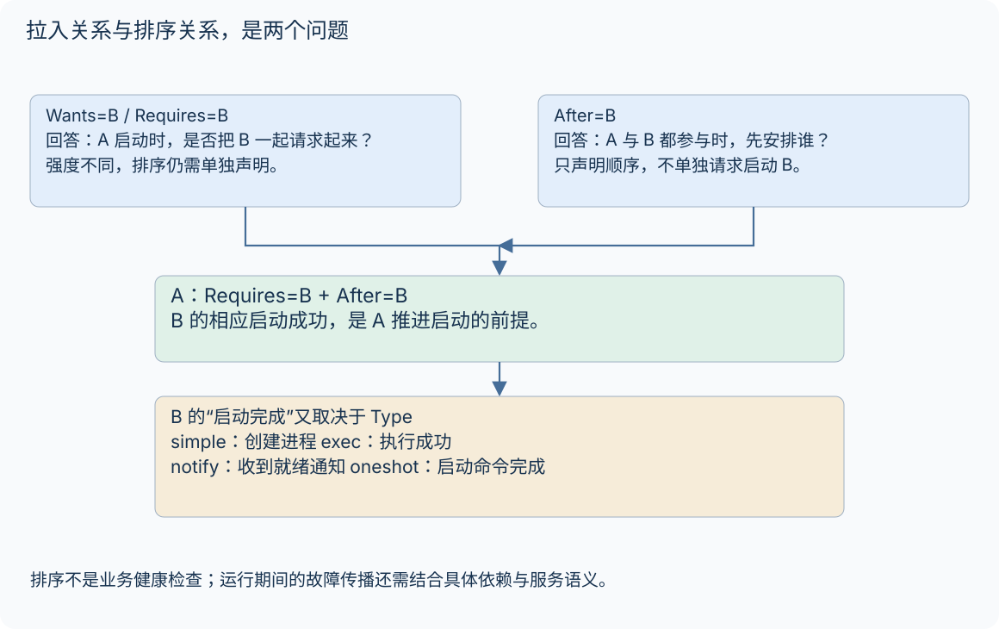
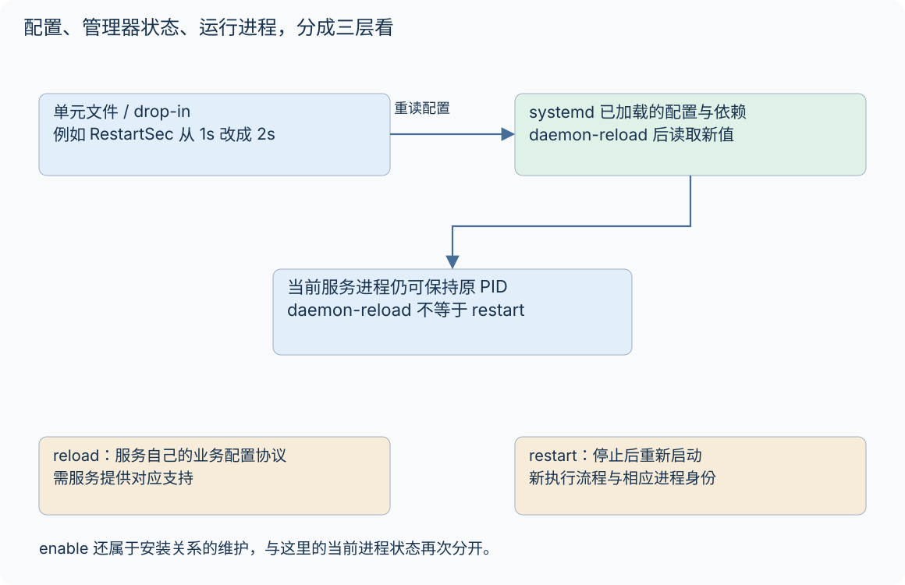
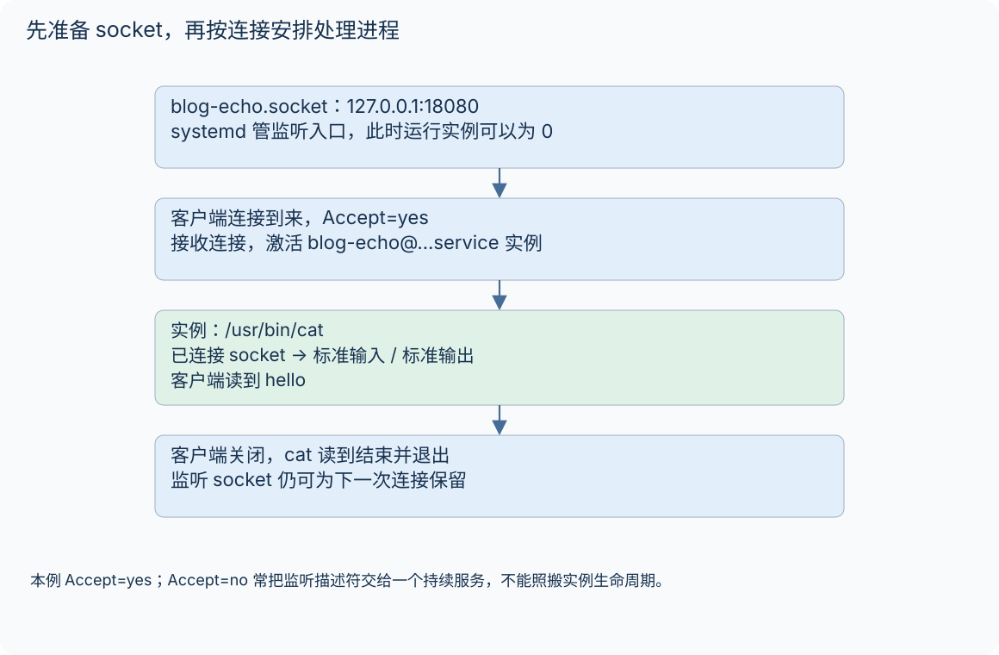

[上一篇](/p/linux-boot-root-login/)把机器带到最终根文件系统，并确认 PID 1 运行 systemd。接下来不只是“依次运行几个脚本”：服务可能互相依赖、启动失败、派生子进程，也可能直到有请求才需要运行。

本篇先读本机 SSH 配置，再用独立的 `blog-lab.service` 观察启动、停止和配置重载，最后用回环 socket 与 timer 展示按需执行。重点是理解管理模型，而不是列出全部 systemctl 子命令。

实测环境为 Ubuntu ARM64，内核 `6.8.0-149-generic`，systemd `259.5-0ubuntu3.4`。文档对照 systemd 259 系列；配置中的 `User=lxj`、`Group=lxj` 对应本机已有账户，复现时替换为实际普通用户。实验单元放在 `/run/systemd/system`，结束后清理，没有改动 SSH 配置或永久启用实验服务。

收尾系列：[启动与账户](/p/linux-boot-root-login/) · **systemd 服务管理** · [namespace 与 cgroup v2](/p/linux-namespaces-cgroup-v2/)。

## 一、开机之后，谁在管理系统

### 1.1 PID 1 不只是第一个编号

内核可以先运行 initramfs 中的 `/init`，再由它交接到最终根中的 systemd；本机走的就是这条路线。最终系统管理器负责组织挂载、服务和相关系统状态。

系统 PID 1 有几项特殊责任：

| 机制 | 为什么要关注 |
| --- | --- |
| 信号处理 | Linux 对初始进程的信号递达有特殊规则，不能完全照搬普通守护进程的默认终止行为 |
| 孤儿接管与回收 | 在相应收割关系下接管后代，处理可等待的退出状态，避免无人收尾 |
| 退出后果 | 系统初始 PID 1 结束会触发严重后果；某个 PID 命名空间的 init 结束又有自己的清理规则 |

所以“不能随便退出”不是一个神奇的不死属性，而是初始进程的职责和内核约束。systemd 需要更新自身时可以按协议 reexec，保持进程身份；这与停止一个普通服务不同。[Linux v6.8 退出实现](https://github.com/torvalds/linux/blob/v6.8/kernel/exit.c)

### 1.2 一个程序名，多个管理位置

| 身份 | 管理什么 |
| --- | --- |
| 系统 init | 作为系统 PID 1 承接用户空间初始化与全局生命周期 |
| 系统服务管理器 | 维护 unit 状态、依赖、启动停止与故障处理 |
| cgroup 组织者 | 把服务进程纳入相应控制组，连接生命周期和资源管理 |
| 用户服务管理器 | 每用户实例管理该用户的服务，通常不是系统 PID 1 |

`systemctl` 默认访问系统管理器，`systemctl --user` 访问相应用户实例。服务文件放在哪里、用哪一个管理器执行，决定它属于哪套配置与权限范围。

## 二、unit 用统一框架管理不同对象

### 2.1 先看 SSH 服务的关键几行

本机 `systemctl cat ssh.service` 中，与本篇有关的部分如下，其他指令未摘录：

```ini
[Unit]
Description=OpenBSD Secure Shell server
After=network.target nss-user-lookup.target auditd.service

[Service]
ExecStartPre=/usr/sbin/sshd -t
ExecStart=/usr/sbin/sshd -D $SSHD_OPTS
ExecReload=/usr/sbin/sshd -t
ExecReload=/bin/kill -HUP $MAINPID
KillMode=process
Restart=on-failure
Type=notify

[Install]
WantedBy=multi-user.target
Alias=sshd.service
```

| 部分 | 负责什么 |
| --- | --- |
| `[Unit]` | 通用描述、依赖、排序与条件等 |
| `[Service]` | 进程启动、就绪、重载、重启和终止协议 |
| `[Install]` | enable 等安装操作使用的关系，不是每次运行时顺序执行的脚本段 |

本机实际单元名是 `ssh.service`，`sshd.service` 是别名。`ExecStart` 通常直接执行程序，不默认经过 shell；需要管道、重定向或 shell 内建时，要明确运行 shell。这里的 SSH 参数来自单元自己的配置和环境，不应随意换成当前交互 shell 的解释。

### 2.2 service、socket、mount、timer 为什么都能成为 unit

统一的是管理器中的名称、状态、依赖和操作框架，而不是它们执行完全相同的工作：

| 类型 | 表达什么 | 例子 |
| --- | --- | --- |
| `.service` | 受管理的服务执行流程 | ssh、下面的 blog-lab |
| `.socket` | 受管理的监听入口 | 按连接触发服务 |
| `.mount` / `.automount` | 挂载及按访问触发挂载 | fstab 生成的 boot.mount |
| `.device` | 管理器看到的适用设备状态 | 参与设备与挂载依赖 |
| `.timer` / `.path` | 时间或路径条件触发 | 触发相应服务执行任务 |
| `.target` | 一组依赖的组织与同步位置 | multi-user.target |
| `.slice` / `.scope` | 资源层级分组 / 已有进程等的运行范围 | system.slice、登录会话 scope |

unit 可以来自配置文件、generator 或运行时请求，不要求所有 unit 都有一份管理员手写的同名文件。[unit 类型与配置](https://www.freedesktop.org/software/systemd/man/259/systemd.unit.html)

### 2.3 target 是依赖组织，不是服务编号表

本机：

```bash
systemctl get-default
```

```text
graphical.target
```

这表示默认目标选择，并不独立证明屏幕上已经有桌面，也不保证所有业务服务都通过了健康检查。`graphical.target` 通常包含通向多用户系统的依赖关系，再加入图形相关服务。

target 与传统运行级别有兼容关联，但它本身是可参与依赖图的 unit，不只是一个 0～6 的整数。多个 target 可以同时处于 active，停止其中一个也不应被想象成自动倒放全部脚本。

## 三、依赖是图，不是顺序编号

### 3.1 先分清“需要谁”与“谁先启动”

传统 SysV 风格启动常通过目录中的 `S01`、`S02` 等编号组织脚本顺序；具体系统也可能有依赖扩展。systemd 原生单元把拉入关系与排序关系分别声明：

| 配置，写在 A 中 | 是否请求启动 B | 是否让 A 等 B 的启动顺序 | B 启动失败如何影响 A |
| --- | --- | --- | --- |
| `After=B` | 否 | 两者都参与时，A 排在 B 后 | 单靠排序不建立成功依赖 |
| `Wants=B` | 是 | 否 | B 失败一般不因此阻止 A |
| `Requires=B` | 是 | 否 | 与 `After=B` 配合时，B 启动失败会阻止 A 启动 |
| `Requires=B` 加 `After=B` | 是 | 是 | 同时表达所需对象与相应成功启动前提 |

`After` 不负责把 B 加入事务；`Requires` 不会自动补上相同排序。还要区分启动失败、显式停止和被依赖对象自己退出等情况，运行期强绑定可能需要 `BindsTo=` 等不同规则，不能只用一句“B 一有问题，A 必定死”概括。[依赖与排序语义](https://www.freedesktop.org/software/systemd/man/259/systemd.unit.html)



### 3.2 “B 启动完成”还取决于 Type

| Type | 管理器怎样判断启动阶段完成 | 使用上的含义 |
| --- | --- | --- |
| `simple` | 创建服务进程后即可继续安排 | 不保证程序 exec 或业务初始化已成功 |
| `exec` | 等相应程序执行成功进入后继续 | 能捕捉更多执行阶段错误，仍不等于业务已就绪 |
| `notify` | 等符合协议的 `READY=1` 通知 | 应用明确报告初始化完成，本机 SSH 使用它 |
| `oneshot` | 等指定启动命令执行完成 | 适合准备任务；配合 RemainAfterExit 可在进程结束后保留 active 状态 |

排序关系与启动类型一起决定后续任务何时推进。即便 `After=network.target` 已满足，也不表示网卡拿到了地址或远端服务器一定可达；`network-online.target` 还依赖相应等待实现，也不是全世界网络服务的健康证明。[服务启动类型](https://www.freedesktop.org/software/systemd/man/259/systemd.service.html)

### 3.3 用 critical-chain 看关键启动链

```bash
systemd-analyze critical-chain ssh.service
```

本次完整输出：

```text
The time when unit became active or started is printed after the "@" character.
The time the unit took to start is printed after the "+" character.

ssh.service +109ms
└─basic.target @637ms
  └─paths.target @611ms
    └─systemd-ask-password-console.path @279ms
      └─-.mount @104ms
        └─-.slice @104ms
```

`@` 表示相应激活或启动的时间位置，`+` 表示启动耗时。它突出当前记录中的关键链，不是全部依赖图，也不是整个开机期间所有进程的 CPU 用时。进一步看完整关系可结合 `systemctl list-dependencies`、`systemctl show -p After -p Requires -p Wants` 等入口。

## 四、用一个服务走完启动、修改与停止

### 4.1 准备两个独立实验单元

完整文件：[blog-prep.service](blog-prep.service)、[blog-lab.service](blog-lab.service)。先放入 `/run/systemd/system`，这里的配置在重启后不会作为持久配置保留。下面展示完整服务定义，账户名要按本机替换：

```ini
[Unit]
Description=Blog service management lab
Requires=blog-prep.service
After=blog-prep.service

[Service]
Type=exec
User=lxj
Group=lxj
ExecStart=/bin/sh -c 'echo lab started; /usr/bin/sleep infinity & wait'
Restart=on-failure
RestartSec=1s
KillMode=control-group
TimeoutStopSec=3s
NoNewPrivileges=yes

[Install]
WantedBy=multi-user.target
```

准备单元使用 `Type=oneshot` 执行 `/usr/bin/echo prep complete`，并设置 `RemainAfterExit=yes`。服务里的 shell 派生一个 sleep 后等待它，便于观察一个服务包含多个进程；它不是生产守护程序的推荐模板。

```bash
sudo install -m 0644 blog-prep.service blog-lab.service /run/systemd/system/
sudo systemctl daemon-reload
sudo systemctl start blog-lab.service
systemctl show blog-prep.service blog-lab.service -p Id -p ActiveState -p SubState
```

本次完整筛选输出：

```text
Id=blog-prep.service
ActiveState=active
SubState=exited

Id=blog-lab.service
ActiveState=active
SubState=running
```

prep 为 `active/exited`，lab 为 `active/running`。前者的命令已经退出，但管理器保留它的已完成状态；后者仍有持续运行进程。ActiveState 不应单独解释为“一定有一个活进程”。

### 4.2 start、enable 和 reload 改变不同的事

| 操作 | 对象与作用 |
| --- | --- |
| `start` / `stop` | 当前单元的运行状态与相应事务 |
| `enable` / `disable` | 按 `[Install]` 等建立或删除安装关系，影响未来如何被拉入；不默认等同立即启动或停止 |
| `enable --now` | 合并安装与当前启动动作 |
| `daemon-reload` | 管理器重读单元配置并重建相应依赖；不默认重启已运行服务 |
| `reload` | 请求服务按它支持的协议重读自己的业务配置，可能没有此操作 |
| `restart` | 执行相应停止与重新启动流程，涉及进程替换 |

本篇只在 `/run` 放置并手动启动实验，不执行永久 enable。长期配置通常在 `/etc/systemd/system` 维护本地覆盖，发行版文件常在 `/usr/lib/systemd/system`；需要与同名覆盖、drop-in 和生成器规则一起看。



### 4.3 drop-in 修改配置，不覆盖整份厂商单元

为实验服务创建 `/run/systemd/system/blog-lab.service.d/10-lab.conf`，内容为：

```ini
[Service]
RestartSec=2s
```

然后重载并观察：

```bash
sudo systemctl daemon-reload
systemctl show blog-lab.service -p MainPID -p RestartUSec -p DropInPaths
```

本次完整输出：

```text
DropInPaths=/run/systemd/system/blog-lab.service.d/10-lab.conf
RestartUSec=2s
MainPID=1566448
```

修改前 MainPID 同样为 `1566448`，RestartUSec 为 `1s`。新配置已被管理器读到，进程却没有因为 daemon-reload 自动换成另一个进程。其他影响执行环境的选项还可能需要重新启动才能实际应用。

日常可以用 `systemctl edit` 建立本地 drop-in，再用 `systemctl cat` 看主文件与覆盖、`systemctl show` 看加载后的属性。列表型指令和空赋值有自己的覆盖规则，不能把所有指令都理解成“最后一行简单替换”。

## 五、服务进程为什么能被成组管理

### 5.1 cgroup 先表达归属，再连接资源控制

控制组（cgroup，control group）把进程按层级组织，并由控制器实施相应资源管理。systemd 用它记录一个服务的进程集合，不只记住最初启动的主 PID。

```bash
systemctl show blog-lab.service -p ControlGroup --value
cat /sys/fs/cgroup/system.slice/blog-lab.service/cgroup.procs
```

本次输出分别是：

```text
/system.slice/blog-lab.service
```

```text
1566448
1566450
```

继续读取这些进程的 PID、父 PID 与程序名：

```bash
ps -o pid,ppid,comm --no-headers -p "$(paste -sd, /sys/fs/cgroup/system.slice/blog-lab.service/cgroup.procs)"
```

本次输出：

```text
1566448       1 sh
1566450 1566448 sleep
```

第一列 PID，第二列父 PID，最后是程序名。sleep 是 shell 的子进程，二者同时属于这个服务的控制组。进程父子树和服务资源归属树有关联，但不是同一棵树。[systemd 资源控制](https://www.freedesktop.org/software/systemd/man/259/systemd.resource-control.html)

### 5.2 stop 清理范围由 KillMode 等决定

实验明确使用 `KillMode=control-group`：停止后管理器按协议处理该组中剩余进程，结合停止命令、终止信号、超时和最终信号推进收尾。

```bash
sudo systemctl stop blog-lab.service
systemctl show blog-lab.service -p ActiveState -p SubState
test ! -e /sys/fs/cgroup/system.slice/blog-lab.service && echo cgroup_removed=yes
```

完整结果：

```text
ActiveState=inactive
SubState=dead
cgroup_removed=yes
```

本次两个实验进程已经结束，控制组也消失。相比只按一份 PID 文件找主进程，控制组为派生进程提供了明确归属；但实际终止仍受进程状态和配置影响，不应承诺任何进程都能立即被杀掉。

**本机 SSH 的 KillMode 恰好是 `process`，不是默认的 control-group。** 因此不能拿默认规则推断所有已安装服务。SSH 会话如何保留还与发行版配置和会话管理有关，分析时要读实际单元。[KillMode 与终止流程](https://www.freedesktop.org/software/systemd/man/259/systemd.kill.html)

### 5.3 slice 管层级，scope 管已有运行范围

| 类型 | 与进程的关系 |
| --- | --- |
| service | 管理器按服务协议启动并监督进程 |
| scope | 组织外部创建等已有进程的运行范围，例如登录会话 |
| slice | 给 service/scope 等提供层级分组和资源控制位置 |

常见的 `system.slice`、`user.slice` 让系统服务和用户会话处于不同分支。可以通过 `CPUWeight=`、`CPUQuota=`、`MemoryHigh=`、`MemoryMax=`、`TasksMax=` 等连接资源策略；具体数值怎样落到内核文件，留给[下一篇](/p/linux-namespaces-cgroup-v2/)。

## 六、按需执行：socket 与 timer

### 6.1 先有监听入口，再有处理连接的进程

本机 `ssh.socket` 和 `ssh.service` 都处于 active。已经有连接以后观察到 sshd 在运行，不能据此反推“socket 激活没有生效”，也不能承诺没人连接时服务必定立即退出。

使用独立回环端口更容易观察。完整配置：[blog-echo.socket](blog-echo.socket)、[blog-echo@.service](blog-echo@.service)。关键设置是：

```ini
# blog-echo.socket
[Socket]
ListenStream=127.0.0.1:18080
Accept=yes
```

```ini
# blog-echo@.service 中的类型相关部分
[Service]
Type=exec
User=lxj
Group=lxj
ExecStart=/usr/bin/cat
StandardInput=socket
StandardOutput=socket
StandardError=journal
NoNewPrivileges=yes
```

`Accept=yes` 使相应连接产生模板服务实例。systemd 接收连接后，把已连接套接字通过该配置交给 cat 的标准输入输出；cat 不需要自己调用 bind/listen。



```bash
sudo install -m 0644 blog-echo.socket blog-echo@.service /run/systemd/system/
sudo systemctl daemon-reload
sudo systemctl start blog-echo.socket
systemctl show blog-echo.socket -p ActiveState -p SubState -p Accept -p Listen
```

完整输出：

```text
ActiveState=active
SubState=listening
Accept=yes
Listen=127.0.0.1:18080 (Stream)
```

可以在另一个 Bash 终端连接，并暂时保持连接方便观察：

```bash
exec 3<>/dev/tcp/127.0.0.1/18080
printf 'hello\n' >&3
IFS= read -r line <&3
printf '%s\n' "$line"
```

本次 echo 结果：

```text
hello
```

观察服务实例数量：

```bash
systemctl list-units --type=service --state=running --no-legend 'blog-echo@*' | wc -l
```

| 观察点 | 本次实例数 |
| --- | --- |
| 没连接时 | 0 |
| 连接建立并保持时 | 1 |
| 客户端关闭，处理结束后 | 0 |

客户端关闭用 `exec 3>&-`，按实际状态等待收尾后再观察。这是本例按连接启动、处理后退出的行为；`Accept=no` 常把监听描述符交给一个持续服务，协议和生命周期不同。

按需激活可以避免提前运行暂时不需要的处理进程，也可把监听准备与应用初始化解耦，减少部分启动等待。是否节省内存、是否改善响应，还取决于应用；首次请求可能承担冷启动成本。[socket 激活与描述符传递](https://www.freedesktop.org/software/systemd/man/259/systemd.socket.html)

### 6.2 timer 管触发时机，service 管执行

完整文件：[blog-tick.timer](blog-tick.timer)、[blog-tick.service](blog-tick.service)。实验 timer 使用 `OnActiveSec=1s`、`AccuracySec=100ms`，指定执行 oneshot 服务；服务只输出 `timer fired`。

```bash
sudo install -m 0644 blog-tick.timer blog-tick.service /run/systemd/system/
sudo systemctl daemon-reload
sudo systemctl start blog-tick.timer
sudo journalctl -b _SYSTEMD_UNIT=blog-tick.service -n 1 -o cat --no-pager
```

等待触发后，本次完整筛选输出：

```text
timer fired
```

`OnActiveSec` 是相对激活时间，`OnCalendar` 表达日历计划。`Persistent=yes` 主要关联日历 timer 的漏跑补触发，不能当成所有 timer 都逐次补跑的开关。timer 的调度精度也不是硬实时保证。[timer 配置](https://www.freedesktop.org/software/systemd/man/259/systemd.timer.html)

## 七、journal 把消息与执行上下文接起来

### 7.1 结构化字段让日志可查询

本例服务直接写标准输出，journald 接入后记录消息与来源信息：

```bash
sudo journalctl -b _SYSTEMD_UNIT=blog-lab.service -n 1 -o export --no-pager | sed -n '/^MESSAGE=/p;/^_SYSTEMD_UNIT=/p'
```

完整筛选输出：

```text
MESSAGE=lab started
_SYSTEMD_UNIT=blog-lab.service
```

`MESSAGE` 是日志内容，`_SYSTEMD_UNIT` 关联产生日志的服务。记录还可以包含 PID、UID、启动标识、时间等字段；通过字段筛选，比只在文本中猜测程序名更明确。

`journalctl -u UNIT` 还会查询与 unit 相关的管理器消息，不意味着每条记录的 `_SYSTEMD_UNIT` 都恰好等于被查询服务。直接匹配字段与使用 `-u` 的便利查询，需要按目的选择。

### 7.2 持久存储与 rsyslog 是配置问题

journal 可以存于 `/run/log/journal` 等易失位置，也可以持久保存在 `/var/log/journal`，具体受 `Storage=` 和环境影响。本机存在持久目录，journald 与 rsyslog 都处于 active；这只确认它们运行，不能单靠服务状态推断消息具体怎样流转。

journald 可以接收内核日志、传统 syslog 接口、原生日志协议、服务标准输出错误等。rsyslog 则常用于传统日志文件、路由、远程收发等策略；它可以按配置读取 journal 或接收相应转发，两者不是永远固定的单一前后级关系。

排障常用 `journalctl -b` 限定本次启动，`-u UNIT` 按服务查看，`-f` 跟随；`--list-boots` 是否有旧记录又取决于保留情况。看到“没有日志”时，要区分时间范围、权限、保存策略和服务是否真的写出了消息。[journald 的来源与存储](https://www.freedesktop.org/software/systemd/man/259/systemd-journald.service.html)

## 八、从状态定位失败，并清理实验

### 8.1 先分清失败发生在哪个阶段

| 现象 | 优先看什么 |
| --- | --- |
| unit 找不到或语法有误 | `systemctl cat`、文件位置、`systemd-analyze verify` |
| 依赖不满足 | Requires/Wants/After、条件、相关 unit 与关键链 |
| `203/EXEC` 等执行错误 | 可执行文件、目录权限、解释器、挂载 noexec 等 |
| 启动超时 | Type 与实际就绪协议、初始化过程、TimeoutStartSec |
| 反复重启后停止重试 | 退出状态、Restart、重启间隔与启动速率限制 |
| active 却无法提供业务 | 应用自身状态、监听与配置，active 不代替端到端检查 |

`systemctl status` 显示当前摘要，`show` 适合观察明确属性，`journalctl` 解释过程。先确定执行阶段，再修改配置，避免把所有失败都处理成“再 restart 一次”。

### 8.2 清理只属于本次实验的运行时文件

停止本篇创建的服务和触发器，确认连接已关闭后再删除配置：

```bash
sudo systemctl stop blog-echo.socket blog-tick.timer blog-lab.service blog-prep.service blog-tick.service
sudo rm -f /run/systemd/system/blog-prep.service /run/systemd/system/blog-lab.service /run/systemd/system/blog-echo.socket /run/systemd/system/blog-echo@.service /run/systemd/system/blog-tick.service /run/systemd/system/blog-tick.timer
sudo rm -f /run/systemd/system/blog-lab.service.d/10-lab.conf
sudo rmdir /run/systemd/system/blog-lab.service.d
sudo systemctl daemon-reload
```

本次实测已完成这些停止与清理。保留的 journal 记录是实验历史，不表示单元仍在运行。

systemd 使用内核提供的进程与资源机制，但不会把每个服务变成一台独立机器。[下一篇](/p/linux-namespaces-cgroup-v2/)继续区分：namespace 改变哪些资源视图，cgroup v2 又怎样约束这些进程的资源使用。

## 九、命令与接口速查

| 命令或配置 | 用途 |
| --- | --- |
| `systemctl cat/show/status` | 查看配置来源、加载属性与当前摘要 |
| `start/stop/restart/reload` | 操作当前运行流程，reload 需服务支持 |
| `enable/disable` | 管理安装关系，与当前运行状态分开 |
| `daemon-reload` | 重读单元和相应依赖，不默认重启进程 |
| `Requires/Wants/After` | 必需拉入、弱拉入与排序关系 |
| `Type=exec/notify/oneshot` | 声明执行与启动完成协议 |
| `KillMode`、`TimeoutStopSec` | 指定停止范围与超时等终止规则 |
| `systemd-analyze critical-chain` | 查看记录中的关键启动链，非全部依赖图 |
| `journalctl -b -u UNIT` | 查询本次启动中与相应 unit 相关的日志 |
| `systemd-analyze verify FILE` | 验证单元文件及其相关依赖配置，仍需实际运行验证业务 |

## 十、名词解释

| 名词 | 本篇含义 |
| --- | --- |
| unit | systemd 管理不同系统对象时使用的统一单元框架 |
| target | 组织一组依赖及同步位置的单元，不只是一个传统运行级别编号 |
| drop-in | 对已有单元追加或覆盖配置的片段 |
| 启动事务 | 一次请求所需的单元任务及依赖、排序等组织结果 |
| 就绪 | 按服务类型与协议达到管理器可继续安排后续工作的状态 |
| slice / scope | 资源层级分组 / 组织已有进程等的运行范围 |
| socket activation | 管理器先准备套接字，按请求激活服务并交付相应描述符的机制 |
| timer | 按相对或日历时间触发其他单元执行的调度对象 |
| journal | 带消息、来源、时间等结构化字段的日志记录体系 |
| cgroup | 内核组织进程层级并连接资源控制的机制，systemd 用它管理服务归属 |
