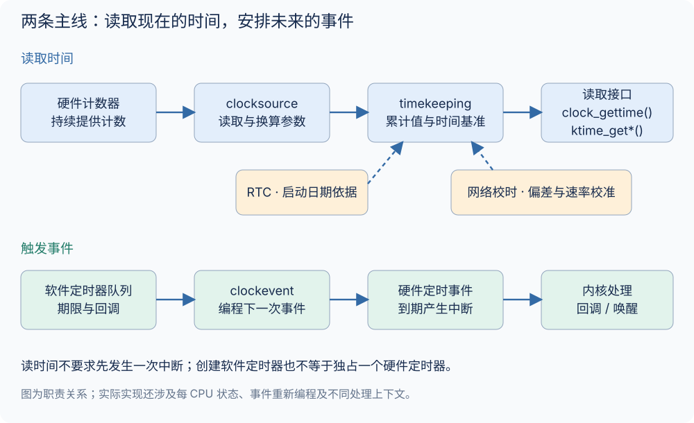
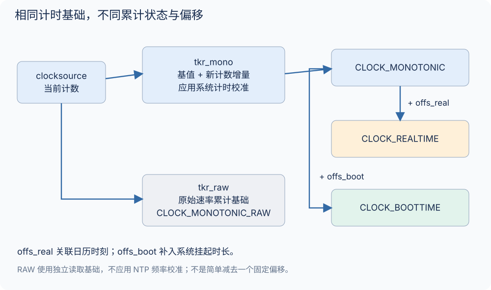
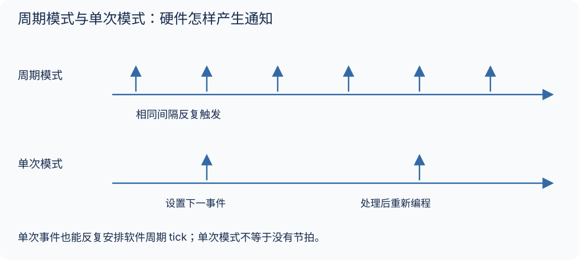
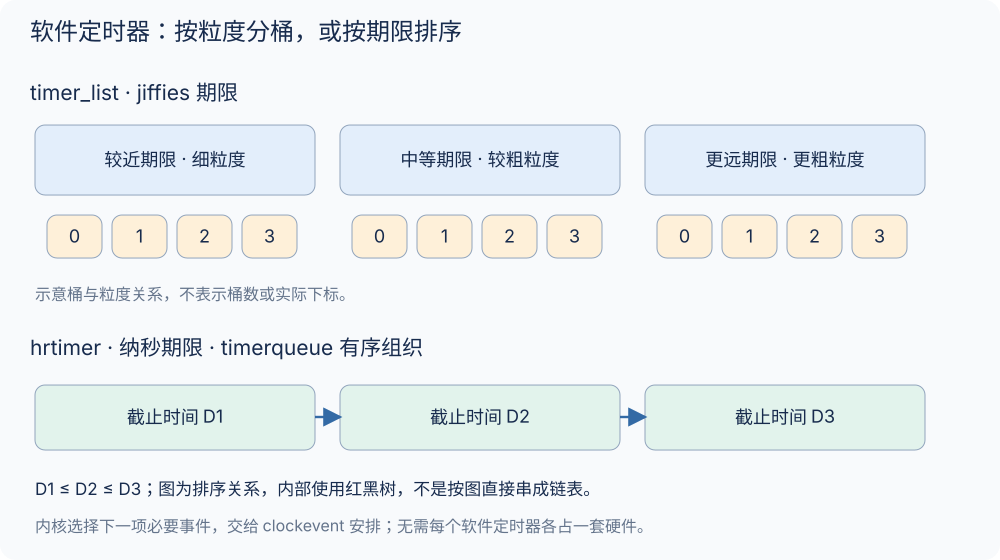
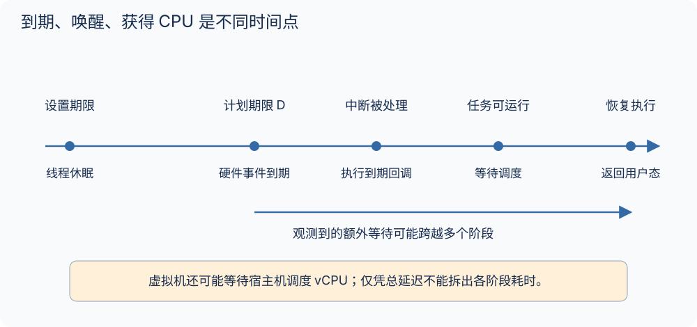
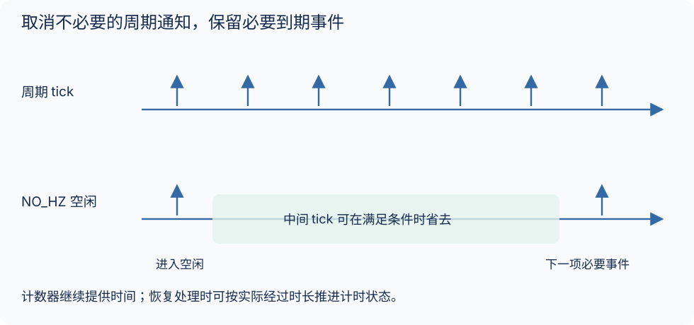

Linux 既要知道当前日期，也要测量一段代码用了多久，还要让休眠线程在期限到来后恢复执行。这些需求共用一部分计时基础，但使用的时间基准、内核对象和触发路径并不相同。

本篇文章沿两条线展开：**读取时间**，从硬件计数器到系统维护的时间；**触发事件**，从软件定时器的截止时间到硬件中断，再到回调与线程唤醒。最后介绍减少周期节拍的 NO_HZ，以及系统时间的校准。

实验环境是 VMware Fusion 中的 Ubuntu 26.04.1 ARM64，运行内核 `6.8.0-149-generic`，glibc 2.43。源码对照上游 Linux **v6.8**，发行版内核可能带有额外补丁。本文不展开时间轮桶计算、红黑树平衡及网络校时算法；源码摘录用 `/* … */` 标明省略字段或代码。



上半条线产生“现在是多少”，下半条线安排“到哪个时间点做什么”。RTC 为日期初始化等场景提供依据，网络校时服务则在运行中校准系统时间，它们都不要求应用每次读时间时重新查询外部设备或服务器。

## 一、先分清读到的是哪一种时间

### 1.1 日期、经过时长与 CPU 用时

通常所说的“世界时间”，在这里具体指**协调世界时（UTC，Coordinated Universal Time）**。系统墙上时间用于表示日期和时刻，本地时区影响它怎样显示。例如同一个时刻可以显示为 UTC 的 `08:00`，也可以显示为上海的 `16:00`，并不意味着经过了两段不同的时间。

Linux 对外提供多种时钟标识。读时间前需要先决定要回答哪个问题：

| 时钟标识 | 表示什么 | 校时与系统挂起的影响 | 常见用途 |
| --- | --- | --- | --- |
| `CLOCK_REALTIME` | 相对 Unix Epoch 的系统墙上时间，用于日历时刻 | 可以被设置而跳变，也受频率校准影响；计入系统挂起期间的流逝 | 日志、文件时间戳、指定日期的任务 |
| `CLOCK_MONOTONIC` | 单调经过时间，不因直接设置墙上时间而跳变 | 受渐进式频率校准影响；不计入系统挂起时间 | 测量时长、一般超时 |
| `CLOCK_BOOTTIME` | 包含系统挂起时长的单调经过时间 | 与 MONOTONIC 一样可受频率校准影响，额外计入挂起时间 | 跨系统挂起仍继续计时的期限 |
| `CLOCK_MONOTONIC_RAW` | 基于原始硬件计时速率累计的单调时间 | 不施加 NTP 频率校准；不计入系统挂起时间 | 观察底层计时速率与漂移 |
| `CLOCK_PROCESS_CPUTIME_ID` | 进程各线程累计消耗的 CPU 时间 | 不把普通等待或休眠时长记作 CPU 执行时间 | 计算任务的处理器开销 |
| `CLOCK_THREAD_CPUTIME_ID` | 当前线程消耗的 CPU 时间 | 与当前线程实际执行有关 | 单线程开销分析 |

Unix Epoch 是 `1970-01-01 00:00:00 UTC`。普通 POSIX 时间戳不把闰秒作为额外累计秒数表达。Linux 还提供国际原子时（TAI，International Atomic Time）基准的 `CLOCK_TAI`，用于有相应需求的场景，其正确性依赖系统维护正确的 TAI 偏移。本篇主要使用前表中的时钟。[clock_gettime 接口与时钟语义](https://man7.org/linux/man-pages/man2/clock_gettime.2.html)

这里的“系统挂起”是操作系统的 suspend。**进程调用 `sleep()` 时，MONOTONIC 仍然前进**；虚拟机被宿主机暂停时怎样处理经过时间，还取决于虚拟化平台，不能直接等同于来宾系统执行 suspend。

### 1.2 用一个程序读取六种时钟

保存为 [clocks.c](clocks.c)。程序依次读取时间值与接口报告的分辨率，两个字段分别用秒和九位小数表示：

```c
#define _POSIX_C_SOURCE 200809L
#include <stdio.h>
#include <stdlib.h>
#include <time.h>

struct clock_entry {
    const char *name;
    clockid_t id;
};

int main(void)
{
    const struct clock_entry clocks[] = {
        { "REALTIME", CLOCK_REALTIME },
        { "MONOTONIC", CLOCK_MONOTONIC },
        { "BOOTTIME", CLOCK_BOOTTIME },
        { "MONOTONIC_RAW", CLOCK_MONOTONIC_RAW },
        { "PROCESS_CPU", CLOCK_PROCESS_CPUTIME_ID },
        { "THREAD_CPU", CLOCK_THREAD_CPUTIME_ID }
    };

    for (size_t i = 0; i < sizeof(clocks) / sizeof(clocks[0]); i++) {
        struct timespec now, res;
        if (clock_gettime(clocks[i].id, &now) == -1 ||
            clock_getres(clocks[i].id, &res) == -1) {
            perror(clocks[i].name);
            return EXIT_FAILURE;
        }
        printf("%-13s now=%lld.%09ld res=%lld.%09ld\n",
               clocks[i].name, (long long)now.tv_sec, now.tv_nsec,
               (long long)res.tv_sec, res.tv_nsec);
    }
    return EXIT_SUCCESS;
}
```

编译运行：

```bash
gcc -std=c11 -O2 -Wall -Wextra -Werror clocks.c -o clocks
./clocks
```

本次完整输出：

```text
REALTIME      now=1795159222.723015368 res=0.000000001
MONOTONIC     now=533458.750925423 res=0.000000001
BOOTTIME      now=533458.750925714 res=0.000000001
MONOTONIC_RAW now=533456.139607788 res=0.000000001
PROCESS_CPU   now=0.000179417 res=0.000000001
THREAD_CPU    now=0.000180375 res=0.000000001
```

`REALTIME` 是日期时间戳，其他字段不能直接按相同日期解释。MONOTONIC 与 BOOTTIME 在这里接近，但程序依次读取它们，末尾几百纳秒的差异不是挂起证据。RAW 与 MONOTONIC 的累计值也不必相同，不能把这次读数的差值直接当作当前时钟频率误差。

这个单线程程序只执行了很短时间，所以 CPU 时间远小于系统经过时间。进程与线程时钟也是先后读取，后者稍大并不矛盾。

### 1.3 分辨率、准确度和唤醒延迟

全部 `res` 都是 `0.000000001`，表示接口报告的分辨率为 1 纳秒。这并不说明每次读数都能辨别真实世界中相差 1 纳秒的两个事件，也不保证线程会在截止时间之后 1 纳秒内运行。

| 概念 | 问的是哪件事 |
| --- | --- |
| 表示单位 | 返回值用秒、纳秒还是其他单位表达？ |
| 时钟分辨率 | 接口报告能够表达或区分的时间粒度是什么？ |
| 准确度与漂移 | 读数相对真实时间差多少，计时速率会偏多少？ |
| 定时与调度延迟 | 截止时间已到，回调或线程什么时候真正获得执行机会？ |

后面的休眠实验会再次看到这几个维度的区别。

## 二、RTC 与硬件计数器分别提供什么

### 2.1 RTC 保存日期依据

实时时钟（RTC，Real-Time Clock）通常由独立供电支持，在主机关机时继续维护日期。系统启动时可以读取它来初始化墙上时间；运行中应用读时间通常使用内核维护的系统时间。[RTC 框架说明](https://docs.kernel.org/6.8/admin-guide/rtc.html)

本次虚拟机通过固件接口提供 RTC。查看：

```bash
cat /sys/class/rtc/rtc0/name
cat /sys/class/rtc/rtc0/hctosys
```

依次输出：

```text
rtc-efi rtc-efi.0
1
```

`rtc-efi` 是来宾看到的 RTC 驱动名称，虚拟机中并不意味着来宾直接控制一块独立电池供电芯片。`hctosys=1` 表示该 RTC 用于启动时的系统时间设置，不能据此判断运行中的系统时间是否已经与网络时间同步。

RTC 常按 UTC 保存，时区转换留给系统软件。后面的 `timedatectl` 输出中，`LocalRTC=no` 就表示 RTC 未按本地时区解释。

### 2.2 计数器测量流逝，中断设备提供通知

硬件计数器持续改变数值。知道计数频率后，就能把两次读取之间的差值换算为经过时间。它的计数频率与 CPU 当前执行指令的主频不是同一概念。

另一种硬件能力是设置一个未来事件，到时发出中断。ARM 通用定时器体系可以提供这两类能力，Linux 分别用 clocksource 与 clockevent 接口管理。x86 上则常见时间戳计数器（TSC，Time Stamp Counter）等计时来源，具体选用设备应以当前机器为准。

在实验机上执行：

```bash
cat /sys/devices/system/clocksource/clocksource0/current_clocksource
cat /sys/devices/system/clocksource/clocksource0/available_clocksource
cat /sys/devices/system/clockevents/clockevent0/current_device
```

依次输出，去掉第二行末尾的空格：

```text
arch_sys_counter
arch_sys_counter
arch_sys_timer
```

前两行说明当前计时来源与可用来源，第三行是该 clockevent 实例使用的设备。`clockevent0` 中的编号不要直接当作 CPU 编号；设备与处理器的关系还需要结合其注册与绑定信息看。

两个名称对应 ARM 通用定时器驱动中的计数来源和事件设备。即使它们来自同一套硬件，**读计数值与设置下一次中断仍是两项独立职责**。[ARM 通用定时器驱动](https://github.com/torvalds/linux/blob/v6.8/drivers/clocksource/arm_arch_timer.c)

## 三、clocksource 怎样变成系统时间

### 3.1 从计数差值换算纳秒

`struct clocksource` 中与读取相关的字段如下，其余省略：

```c
struct clocksource {
    u64 (*read)(struct clocksource *cs);
    u64 mask;
    u32 mult;
    u32 shift;
    /* … */
};
```

`read()` 从设备取得计数，`mask` 表示有效计数位，`mult` 与 `shift` 用于定点换算。核心关系可以概括为：

```text
delta_cycles = (now_cycles - last_cycles) & mask
delta_ns ≈ (delta_cycles × mult) >> shift
```

计算的是**计数增量**，不能把任意设备当前的计数值直接理解成日期时间。假设计数器频率为 100 MHz，增加 250000 次就经过 `250000 / 100000000 = 0.0025` 秒，即 2.5 毫秒。这是换算示意，不是本次虚拟机的实测频率。

取掩码可处理有效计数位上的一次回绕。例如 8 位计数器从 `250` 走到 `4`，差值为 `(4 - 250) & 255 = 10`。若任由它完整回绕多圈，两次读数就不足以恢复真实间隔，所以内核还需要遵守该来源允许的读取与更新时间范围。[clocksource 定义](https://github.com/torvalds/linux/blob/v6.8/include/linux/clocksource.h) · [计数换算说明](https://docs.kernel.org/6.8/timers/timekeeping.html)

### 3.2 timekeeper 保存累计值与各时间基准的关系

计数差值需要接到已经累计的系统时间上。内核的 `struct timekeeper` 管理这些状态。下面只保留相关成员：

```c
struct timekeeper {
    struct tk_read_base tkr_mono;
    struct tk_read_base tkr_raw;
    /* … */
    ktime_t offs_real;
    ktime_t offs_boot;
    ktime_t offs_tai;
    /* … */
};
```

其中 `struct tk_read_base` 又保存 clocksource 指针、`cycle_last`、换算参数与时间基值。它把“上次积累到哪里”和“从哪个计数继续读”关联起来。



图中先从计数增量得到 MONOTONIC，随后用相应偏移得到 REALTIME、BOOTTIME 等基准。RAW 有独立的读取累计状态，不施加 NTP 频率校准。图是关系概括，具体实现还要处理小数精度、计数回绕和并发更新。

| 字段或对象 | 记录什么 |
| --- | --- |
| `tkr_mono` | 受系统计时校准影响的单调时间读取基础 |
| `tkr_raw` | 原始计时速率下的读取基础 |
| `offs_real` | 从单调时间转换到墙上时间的偏移 |
| `offs_boot` | 从单调时间转换到包含挂起时长的时间所需偏移 |
| `offs_tai` | 从单调时间转换到 TAI 基准的偏移 |

设置墙上时间时，内核需要调整相关状态，使 REALTIME 改变的同时维持 MONOTONIC 的连续性。网络校时也能逐渐调整计时速率，因此 MONOTONIC 的“单调”不等于“完全不受校时影响”。[timekeeper 与 tk_read_base 定义](https://github.com/torvalds/linux/blob/v6.8/include/linux/timekeeper_internal.h)

内核调用者通过 `ktime_get()`、`ktime_get_real()`、`ktime_get_boottime()` 等接口选择基准。`ktime_t` 是内核使用的纳秒时间类型；`struct timespec64` 则把秒与纳秒分开保存。接口及后缀也决定返回形式，例如 `ktime_get_ns()` 直接返回纳秒数。[内核时间读取接口](https://docs.kernel.org/6.8/core-api/timekeeping.html)

### 3.3 读取时为何不必等待下一个 tick

内核读取 MONOTONIC 的 `ktime_get()` 中有下面这段循环，省略其余代码：

```c
/* … */
do {
    seq = read_seqcount_begin(&tk_core.seq);
    base = tk->tkr_mono.base;
    nsecs = timekeeping_get_ns(&tk->tkr_mono);
} while (read_seqcount_retry(&tk_core.seq, seq));

return ktime_add_ns(base, nsecs);
```

它在累计基值之上，加上从硬件计数取得的新经过时间。即使累计状态上次更新发生在更早时刻，这次读取也能补上其后的增量，不必等周期节拍来临才把时间向前推进。

顺序计数器 `seqcount` 用于检测读取期间是否与写侧更新交叉。如果状态在读取过程中发生了不一致的变化，就重新读取；它本身不负责串行化多个写者，写侧仍需相应保护。[ktime_get 实现](https://github.com/torvalds/linux/blob/v6.8/kernel/time/timekeeping.c)

### 3.4 用户态读时间为何可能没有系统调用

虚拟动态共享对象（vDSO，virtual Dynamic Shared Object）是内核映射到进程地址空间的一段代码。C 库可以通过它读取共享计时状态，并在支持的平台上读取计数器，以减少频繁陷入内核的开销。无法走快速路径时仍可退回系统调用。[vDSO 说明](https://man7.org/linux/man-pages/man7/vdso.7.html)

对前面的程序进行跟踪：

```bash
strace -qq -e trace=clock_gettime -o clocks.trace ./clocks >/dev/null
cat clocks.trace
```

这一次跟踪的完整输出是：

```text
clock_gettime(CLOCK_PROCESS_CPUTIME_ID, {tv_sec=0, tv_nsec=1095167}) = 0
clock_gettime(CLOCK_THREAD_CPUTIME_ID, {tv_sec=0, tv_nsec=1131084}) = 0
```

程序读取了六种时钟，跟踪只记录到 CPU 时钟对应的两次系统调用。其余读取在本环境下走了用户态快速路径，`strace` 不会把普通用户态函数调用记录成系统调用。这里也能看到，CPU 时间读取与系统时间读取的实现路径有所区别。

内核还有 `sched_clock()` 供调度与时间戳等内部场景使用，强调快速读取。其跨 CPU 一致性等性质依赖平台与实现；应用测量时长应使用合适的公开时钟接口，不必把它当作另一个通用墙上时间入口。

## 四、clockevent、tick 与 jiffies

### 4.1 clockevent 安排下一次硬件通知

读取 clocksource 是取值，clockevent 则把未来事件交给硬件。其核心对象如下，只保留部分成员：

```c
struct clock_event_device {
    void (*event_handler)(struct clock_event_device *);
    int (*set_next_event)(unsigned long evt,
                          struct clock_event_device *);
    int (*set_next_ktime)(ktime_t expires,
                          struct clock_event_device *);
    ktime_t next_event;
    /* … */
};
```

`set_next_event()` 是驱动提供的下一事件编程接口，参数是设备相关的计数间隔；支持相应能力的设备也可提供 `set_next_ktime()`。中断发生后，驱动通过 `event_handler()` 交给内核事件处理。前者面向硬件安排通知，后者面向内核分发通知。多处理器系统通常有每 CPU 的事件设备。若某个 CPU 的本地定时设备在深度空闲状态下停止，还可能需要广播事件机制代为安排唤醒。[clock_event_device 定义](https://github.com/torvalds/linux/blob/v6.8/include/linux/clockchips.h)



周期模式按固定节奏产生事件；单次模式每次只设下一次事件，需要时重新编程。**硬件处于单次模式，仍能由软件反复安排周期性 tick**，不能把“单次模式”直接等同于“没有节拍”。

### 4.2 tick 是周期性内核工作，HZ 是名义频率

节拍（tick）为调度记账、时间推进和定时工作等提供周期性处理机会。`CONFIG_HZ` 决定内核名义节拍频率，例如 `HZ=1000` 对应 `1 / 1000` 秒，即 1 毫秒的名义节拍间隔。

查看本机配置与用户态记账单位：

```bash
grep -E '^CONFIG_HZ(=|_[0-9]+=)' /boot/config-$(uname -r)
getconf CLK_TCK
```

依次输出：

```text
CONFIG_HZ_1000=y
CONFIG_HZ=1000
100
```

`CLK_TCK` 用来解释诸如 `/proc/<pid>/stat` 中 CPU 时间的时钟滴答单位，通常与内核内部的 `USER_HZ` 约定相关。它不负责查询编译内核时选择的 `CONFIG_HZ`。本机的 `100` 与 `1000` 同时存在完全合理。

还需要分开硬件计数频率、名义 tick 频率和实际中断次数。tick 可以被暂停，硬件中断也可能服务其他定时器，因此不能简单将 `/proc/interrupts` 中某个定时器中断的增量当作 `HZ`。

### 4.3 jiffies 表达粗粒度时间进度

`jiffies` 是内核中按节拍单位表达的时间计数，`jiffies_64` 提供 64 位计数。它适合普通超时与经过时长判断，不能直接当作 Unix 日期时间戳。内核初始化值也不要求是零。

常见用法如下，是内核上下文中的接口示意：

```c
unsigned long deadline = jiffies + msecs_to_jiffies(100);

if (time_after_eq(jiffies, deadline)) {
    /* 已到期限。 */
}
```

`msecs_to_jiffies()` 处理单位换算。`time_after()`、`time_after_eq()` 等辅助宏利用差值解释处理回绕附近的比较，适用的时间跨度仍受计数宽度和半范围约束，不能用它比较任意遥远的两个时间点。直接写 `jiffies >= deadline` 则可能在回绕附近出错。[jiffies 接口](https://github.com/torvalds/linux/blob/v6.8/include/linux/jiffies.h)

在 NO_HZ 场景中，jiffies 也不要求每经过一个单位就恰好发生一次中断。内核可以根据实际经过的时间，一次补齐多个单位；后文再回到这个问题。

## 五、两类软件定时器怎样等待到期

### 5.1 timer_list 与时间轮

设备超时、协议重试等场景常使用普通内核定时器。`struct timer_list` 的相关字段如下：

```c
struct timer_list {
    struct hlist_node entry;
    unsigned long expires;
    void (*function)(struct timer_list *);
    u32 flags;
    /* … */
};
```

`expires` 用 jiffies 表达期限，`entry` 把对象挂到定时器容器中，`function` 是到期回调，`flags` 记录处理器归属及行为标记等信息。初始化通常使用 `timer_setup()`，更新期限可用 `mod_timer()`。[timer_list 定义](https://github.com/torvalds/linux/blob/v6.8/include/linux/timer_types.h)

时间轮将定时器分入不同粒度的桶，到期处理时按桶找到候选对象。Linux v6.8 采用分层且不需要向低层重新级联的设计，较远期限使用更粗粒度，隐含了到期批处理。这里不按早期经典时间轮的级联过程展开。[v6.8 时间轮实现说明](https://github.com/torvalds/linux/blob/v6.8/kernel/time/timer.c)

### 5.2 hrtimer 按截止时间组织

高精度定时器（hrtimer，high-resolution timer）以纳秒时间类型表达期限。下面保留与队列和回调相关的成员：

```c
struct hrtimer {
    struct timerqueue_node node;
    ktime_t _softexpires;
    enum hrtimer_restart (*function)(struct hrtimer *);
    struct hrtimer_clock_base *base;
    /* … */
};
```

`node` 将定时器接入按期限排序的队列，并保存用于排序的到期时间；`base` 将它关联到相应处理器与时钟基准；`function` 是回调。`_softexpires` 表示最早允许到期的时刻，当调用者允许一定时间余量时，队列还可以据此合并处理机会。[hrtimer 定义](https://github.com/torvalds/linux/blob/v6.8/include/linux/hrtimer_types.h)



图中时间轮按粒度聚合同类超时，hrtimer 队列按截止时间排序。hrtimer 使用的 `timerqueue` 基于红黑树，连接成员仍然嵌在定时器对象中。处理器上的多个软件定时器由内核协调下一事件，而不是每创建一个定时器就分配一套硬件。

`hrtimer_init()` 选择时钟基准与模式，`hrtimer_start()` 设置期限。高精度运行还依赖系统配置与可用事件设备；hrtimer 数据结构本身不意味着硬件一定能够在任意纳秒点精确产生中断。

### 5.3 回调执行在哪种上下文

| 项目 | 普通定时器 | hrtimer |
| --- | --- | --- |
| 典型对象 | `timer_list` | `hrtimer` |
| 期限表示 | jiffies | `ktime_t`，纳秒时间 |
| 主要组织方式 | 分层时间轮 | 按期限排序的 timerqueue |
| 典型用途 | 大量普通超时 | 精细期限、休眠唤醒等 |
| 回调上下文 | 通常由 `TIMER_SOFTIRQ` 处理 | 有硬中断与软中断路径，受模式和实时内核配置等影响 |

软中断是内核延后处理的一种上下文，并不意味着可以随意睡眠。定时器回调应保持简短，确实需要可睡眠的后续处理时，可以提交到工作队列等合适上下文。

取消定时器也要考虑回调是否正在执行、是否可能被重新设置。释放包含定时器的外层对象前，必须按照所用接口的同步与退出协议完成清理，不能只把它从一个队列摘下就立即释放。

## 六、一次休眠怎样变成唤醒

### 6.1 相对等待与绝对期限

相对等待表达“从现在开始再等 20 毫秒”。绝对期限表达“等到某个时钟上的 D 时刻”。`TIMER_ABSTIME` 指定后者，这个 D 不一定是日历时间，例如 MONOTONIC 的绝对期限属于其单调时间轴。

周期工作若每次在处理结束后再相对等待一个周期，会把处理耗时与此前的延迟累计到后续周期。以初始时间为基准安排 `start + k × period`，可以保持计划期限固定。不过若执行已经落后，过期的绝对等待会立即返回，程序仍需自行决定补做还是跳过遗漏周期。

下面保存为 [sleep-lab.c](sleep-lab.c)。先等待到 100 毫秒后的期限，再按同一个起点安排三个 20 毫秒周期。代码读取 CPU 时间，方便对比休眠时长与实际处理器开销：

```c
#define _POSIX_C_SOURCE 200809L
#include <errno.h>
#include <stdio.h>
#include <stdlib.h>
#include <string.h>
#include <time.h>

static struct timespec read_clock(clockid_t id)
{
    struct timespec t;
    if (clock_gettime(id, &t) == -1) {
        perror("clock_gettime");
        exit(EXIT_FAILURE);
    }
    return t;
}

static struct timespec add_ms(struct timespec t, long ms)
{
    t.tv_nsec += ms * 1000000L;
    t.tv_sec += t.tv_nsec / 1000000000L;
    t.tv_nsec %= 1000000000L;
    return t;
}

static double diff_ms(struct timespec end, struct timespec start)
{
    return (end.tv_sec - start.tv_sec) * 1000.0 +
           (end.tv_nsec - start.tv_nsec) / 1000000.0;
}

static void sleep_until(struct timespec deadline)
{
    int err;
    do {
        err = clock_nanosleep(CLOCK_MONOTONIC, TIMER_ABSTIME,
                              &deadline, NULL);
    } while (err == EINTR);
    if (err != 0) {
        fprintf(stderr, "clock_nanosleep: %s\n", strerror(err));
        exit(EXIT_FAILURE);
    }
}

int main(void)
{
    struct timespec start = read_clock(CLOCK_MONOTONIC);
    struct timespec cpu_start = read_clock(CLOCK_PROCESS_CPUTIME_ID);
    sleep_until(add_ms(start, 100));
    struct timespec end = read_clock(CLOCK_MONOTONIC);
    struct timespec cpu_end = read_clock(CLOCK_PROCESS_CPUTIME_ID);

    printf("sleep target=100.000 ms elapsed=%.3f ms cpu=%.3f ms\n",
           diff_ms(end, start), diff_ms(cpu_end, cpu_start));

    start = read_clock(CLOCK_MONOTONIC);
    for (int i = 1; i <= 3; i++) {
        struct timespec deadline = add_ms(start, i * 20);
        sleep_until(deadline);
        end = read_clock(CLOCK_MONOTONIC);
        printf("period=%d target=%.3f ms elapsed=%.3f ms late=%.3f ms\n",
               i, i * 20.0, diff_ms(end, start), diff_ms(end, deadline));
    }
    return EXIT_SUCCESS;
}
```

`clock_nanosleep()` 与许多系统接口不同，失败时直接返回正的错误号，所以这里用 `strerror(err)` 解释错误。被信号打断时，绝对期限保持不变，重试也不会重新增加一整个等待间隔。[clock_nanosleep 说明](https://man7.org/linux/man-pages/man2/clock_nanosleep.2.html)

### 6.2 实测休眠时间与 CPU 时间

```bash
gcc -std=c11 -O2 -Wall -Wextra -Werror sleep-lab.c -o sleep-lab
./sleep-lab
```

本次完整输出：

```text
sleep target=100.000 ms elapsed=102.126 ms cpu=0.036 ms
period=1 target=20.000 ms elapsed=20.915 ms late=0.915 ms
period=2 target=40.000 ms elapsed=42.129 ms late=2.129 ms
period=3 target=60.000 ms elapsed=60.153 ms late=0.153 ms
```

第一行经过约 102 毫秒，但进程只消耗约 0.036 毫秒 CPU 时间。后面三行的目标分别为初始点之后 20、40、60 毫秒，第二次的延迟没有直接加到第三个计划期限上。每次运行的延迟都会变化，跟踪工具与虚拟化调度也会影响结果。

另一次运行跟踪系统调用：

```bash
strace -qq -e trace=clock_nanosleep -o sleep.trace ./sleep-lab >/dev/null
cat sleep.trace
```

完整输出：

```text
clock_nanosleep(CLOCK_MONOTONIC, TIMER_ABSTIME, {tv_sec=533459, tv_nsec=28186280}, NULL) = 0
clock_nanosleep(CLOCK_MONOTONIC, TIMER_ABSTIME, {tv_sec=533459, tv_nsec=51306874}, NULL) = 0
clock_nanosleep(CLOCK_MONOTONIC, TIMER_ABSTIME, {tv_sec=533459, tv_nsec=71306874}, NULL) = 0
clock_nanosleep(CLOCK_MONOTONIC, TIMER_ABSTIME, {tv_sec=533459, tv_nsec=91306874}, NULL) = 0
```

四次调用分别对应最初的 100 毫秒等待和三个周期。结构体是传入的绝对期限，不是本次等待时长，也不是返回时刻。两段输出来自不同运行，不应将具体时间戳逐项相减来解释前一次的延迟。

### 6.3 内核对象与唤醒链路

休眠使用 `struct hrtimer_sleeper`，将定时器和需要唤醒的任务关联起来：

```c
struct hrtimer_sleeper {
    struct hrtimer timer;
    struct task_struct *task;
};
```

本例的主要路径如下。它是按场景整理的阶段关系，不是跟踪工具打印的完整内核调用栈：

| 阶段 | v6.8 中的相关入口 | 对象与状态怎样改变 |
| --- | --- | --- |
| 接收等待请求 | `clock_nanosleep` 系统调用、`common_nsleep_timens()` | 读取期限与时钟标识，绝对时间还需处理时间命名空间偏移 |
| 准备等待 | `hrtimer_nanosleep()` | 建立关联当前任务的 sleeper 与到期回调 |
| 入队并让出 CPU | `do_nanosleep()` | 设置可中断睡眠状态，启动定时器，必要时调用 `schedule()` |
| 到期处理 | 高精度事件路径中的 `hrtimer_interrupt()` 等 | 检查期限并执行相应回调；软模式还有对应软中断路径 |
| 唤醒任务 | `hrtimer_wakeup()` → `wake_up_process()` | 清除 sleeper 的等待任务标记，并使目标任务可以继续运行 |
| 恢复执行 | 调度器选择任务后 | 结束等待与清理，系统调用返回用户态 |

`hrtimer_wakeup()` 的核心动作可直接从源码看到：

```c
static enum hrtimer_restart hrtimer_wakeup(struct hrtimer *timer)
{
    struct hrtimer_sleeper *t =
        container_of(timer, struct hrtimer_sleeper, timer);
    struct task_struct *task = t->task;

    t->task = NULL;
    if (task)
        wake_up_process(task);

    return HRTIMER_NORESTART;
}
```

这里再次用到 `container_of()`，从回调收到的内嵌 `hrtimer` 找回 sleeper，再取得任务指针。设置睡眠状态、启动定时器和检查任务标记的配合，也需要覆盖“回调在真正调用 `schedule()` 之前就到期”的情况。[休眠系统调用分发](https://github.com/torvalds/linux/blob/v6.8/kernel/time/posix-timers.c) · [hrtimer 休眠与唤醒实现](https://github.com/torvalds/linux/blob/v6.8/kernel/time/hrtimer.c)



从计划期限沿图向右看，硬件事件交付、内核处理与任务调度都会产生延迟。虚拟机还可能等待宿主机重新调度虚拟 CPU。因此本次约 2 毫秒的超出不能只归因于 `HZ`，也不能据此推断某个内部阶段恰好花了多少时间。

此外，线程的 **timer slack** 允许内核在一定余量内合并部分到期处理，减少唤醒。查看当前 shell 的值：

```bash
cat /proc/self/timerslack_ns
```

本次为：

```text
50000
```

即 50 微秒，子进程通常继承。它是允许合并的余量，不是总体唤醒延迟的上限，不能用这 50 微秒保证线程在之后立刻运行。[timer slack 规则](https://man7.org/linux/man-pages/man2/PR_SET_TIMERSLACK.2const.html)

### 6.4 其他等待接口放在哪里

| 需求 | 相关接口 | 与本篇的关系 |
| --- | --- | --- |
| 用户线程等待 | `nanosleep()`、`clock_nanosleep()` | 用休眠让出 CPU，到期后唤醒 |
| 将到期通知加入事件循环 | `timerfd_create()`、`timerfd_settime()` | 到期后文件描述符可读，可配合 `poll/epoll`；读取一个 64 位到期计数 |
| 内核上下文允许睡眠 | `msleep()`、`usleep_range()` 等 | 根据时长与精度要求选择睡眠接口 |
| 内核极短延时或不能睡眠的上下文 | `udelay()` 等 | 忙等期间占用 CPU，不等同于任务休眠 |

`timerfd` 的到期计数是自上次有效读取或重新设置之后累计的次数，周期定时器来不及处理时可能一次读到大于 1 的值。[timerfd 接口](https://man7.org/linux/man-pages/man2/timerfd_create.2.html)

## 七、NO_HZ 与系统时间校准

### 7.1 没有周期节拍，时间仍然前进

空闲 CPU 如果没有近期工作，继续每毫秒接收一次调度节拍，会产生不必要的唤醒。NO_HZ 允许在满足条件时暂停这些周期性 tick，再根据下一项必要工作设置事件。



图中空闲期间取消了中间几个 tick，但保留下一项工作的到期事件。恢复处理时，内核可以读取实际经过时间，推进相关状态。v6.8 的 `tick_do_update_jiffies64()` 会根据经过的时间计算需要补上的 tick 数量，再更新 `jiffies_64`。

高精度模式下，调度 tick 本身也可以由 hrtimer 驱动。`tick_nohz_highres_handler()` 处理相关周期工作，并根据 tick 是否停止决定是否继续安排下一周期。这样就把前面的 hrtimer、单次事件和节拍接在了一起。[tick 与 jiffies 更新实现](https://github.com/torvalds/linux/blob/v6.8/kernel/time/tick-sched.c)

### 7.2 IDLE 与 FULL 的条件不同

| 方式 | 主要作用 |
| --- | --- |
| 周期节拍 | 持续按周期提供调度 tick |
| `NO_HZ_IDLE` | CPU 空闲且满足条件时暂停调度 tick |
| `NO_HZ_FULL` | 对指定 CPU，在满足更严格条件时也减少运行任务期间的调度 tick，典型条件之一是仅有一个可运行任务 |

FULL 还涉及维护任务的处理器安排、运行状态与其他 tick 依赖，并不保证完全没有中断。设备事件、必要定时器及处理器间中断仍可发生。[NO_HZ 机制与约束](https://docs.kernel.org/6.8/timers/no_hz.html)

实验机中的相关配置：

```bash
grep -E '^CONFIG_(NO_HZ[^=]*|HIGH_RES_TIMERS)=' /boot/config-$(uname -r)
```

输出：

```text
CONFIG_NO_HZ_COMMON=y
CONFIG_NO_HZ_FULL=y
CONFIG_NO_HZ=y
CONFIG_HIGH_RES_TIMERS=y
```

编译支持不等于已经选择 CPU 运行 FULL 模式。还需要看启动配置与 `/sys/devices/system/cpu/nohz_full` 等实际状态。本次该文件没有列出 CPU，不能因为 `CONFIG_NO_HZ_FULL=y` 就宣称实验已验证 FULL 模式。

### 7.3 NTP 校准的是哪一层

网络时间协议（NTP，Network Time Protocol）帮助系统参考外部时间校准墙上时间。用户态校时服务测量偏差，再通过相关内核接口调整计时状态。

小偏差可以逐渐调整速率，较大偏差在特定策略下也可能直接设置时间。因此 REALTIME 可能跳变，MONOTONIC 虽然保持单调，也会受渐进速率调整影响；RAW 则不施加这类频率校准。时区配置只影响本地显示，不承担校准职责。

查看本次状态：

```bash
timedatectl show -p Timezone -p LocalRTC -p NTP -p NTPSynchronized
```

输出：

```text
Timezone=Etc/UTC
LocalRTC=no
NTP=yes
NTPSynchronized=yes
```

这里表示系统采用 UTC 时区、RTC 未按本地时区解释，校时服务已启用且系统报告已同步。这些状态没有给出与外部参考时间之间的实时误差上限，也不能单靠它们判断具体使用了哪一个服务器。

回到开头的两条线：clocksource 与 timekeeping 产生可读取的时间，软件定时器与 clockevent 安排未来事件；tick 服务周期性内核工作，NO_HZ 减少不必要的周期通知。RTC 与网络校时为日期和计时校准提供依据，调度器最终决定被唤醒线程何时运行。

## 八、命令与接口速查

| 命令或接口 | 用途与关键参数 |
| --- | --- |
| `clock_gettime()` / `clock_getres()` | 读取指定时钟的当前值与报告分辨率，成功 `0`，失败 `-1` 并设置 `errno` |
| `clock_nanosleep()` | 指定时钟等待；`TIMER_ABSTIME` 表示绝对期限；返回 `0` 或正错误号 |
| `strace -e trace=clock_gettime` | 观察实际发生的读时间系统调用，不会显示纯用户态 vDSO 调用 |
| `strace -e trace=clock_nanosleep` | 观察等待使用的时钟、模式与期限 |
| `getconf CLK_TCK` | 获取用户态 CPU 时间记账使用的每秒滴答数，不等同于 `CONFIG_HZ` |
| `current_clocksource` / `available_clocksource` | `/sys/devices/system/clocksource/clocksource0/` 下的当前与可用计时来源 |
| `current_device` | `/sys/devices/system/clockevents/clockevent*/` 下的事件设备名称 |
| `/sys/class/rtc/rtc0/name`、`hctosys` | 查看 RTC 驱动及其是否用于启动时设定系统时间 |
| `/proc/self/timerslack_ns` | 当前进程相应线程的定时合并余量，单位纳秒 |
| `timedatectl show` | 查看时区、RTC 解释方式与校时状态 |
| `ktime_get*()` | 内核按基准与返回形式选择时间读取接口 |
| `msecs_to_jiffies()`、`time_after_eq()` | 普通内核超时的单位转换与回绕相关比较 |
| `timer_setup()`、`mod_timer()` | 初始化普通内核定时器、更新其 jiffies 期限 |
| `hrtimer_init()`、`hrtimer_start()` | 初始化高精度定时器、设置到期时间 |
| `timerfd_create()`、`timerfd_settime()` | 建立通过文件描述符通知到期的定时器，并设置期限与周期 |

## 九、名词解释

| 名词 | 本篇含义 |
| --- | --- |
| UTC | 协调世界时，用于解释日历时刻的国际时间标准 |
| 墙上时间 | 可用于表示日期与时刻的系统时间，可能被设置或校准 |
| RTC | 通常在关机后仍维护日期的实时时钟，虚拟机可由虚拟设备或固件接口提供 |
| clocksource | 从计数来源读取数值，并提供换算所需参数的内核抽象 |
| timekeeping | 累计计时进度、维护各时间基准及其转换状态的内核机制 |
| clockevent | 将未来事件编程到设备，并将到期中断交给内核处理的抽象 |
| tick / HZ | 周期性内核节拍，以及内核名义每秒节拍数 |
| jiffies | 以节拍单位表示的内核时间计数，常用于粗粒度超时 |
| ktime_t | 内核使用的纳秒时间类型，具体时间基准由接口及上下文决定 |
| 时间轮 | 按时间粒度分桶组织普通定时器的结构 |
| hrtimer | 使用纳秒时间与有序到期队列的高精度定时器机制 |
| vDSO | 内核映射到用户地址空间、用于提供部分高效接口的代码对象 |
| seqcount | 通过顺序计数检测读写交叉、使读者必要时重试的同步工具 |
| timer slack | 允许内核合并部分到期通知的时间余量 |
| NO_HZ | 在满足条件时减少调度时钟节拍的机制 |
| NTP | 用于参考网络时间进行时钟同步与校准的协议 |
