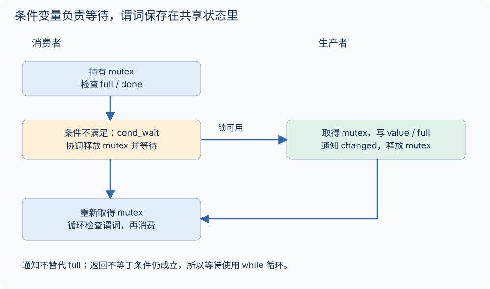
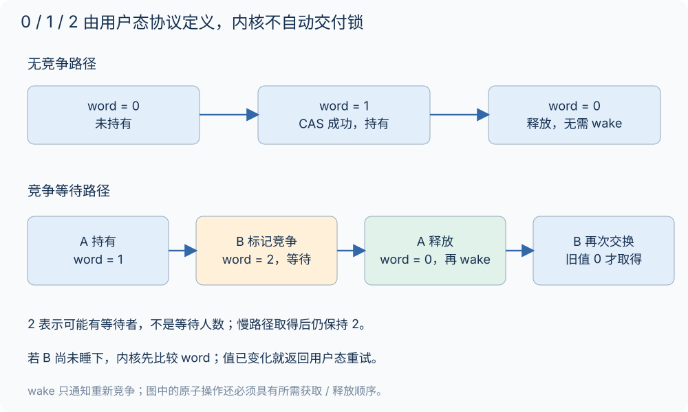
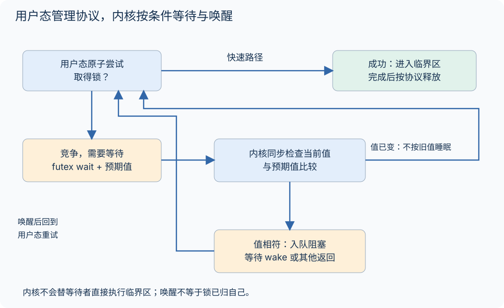
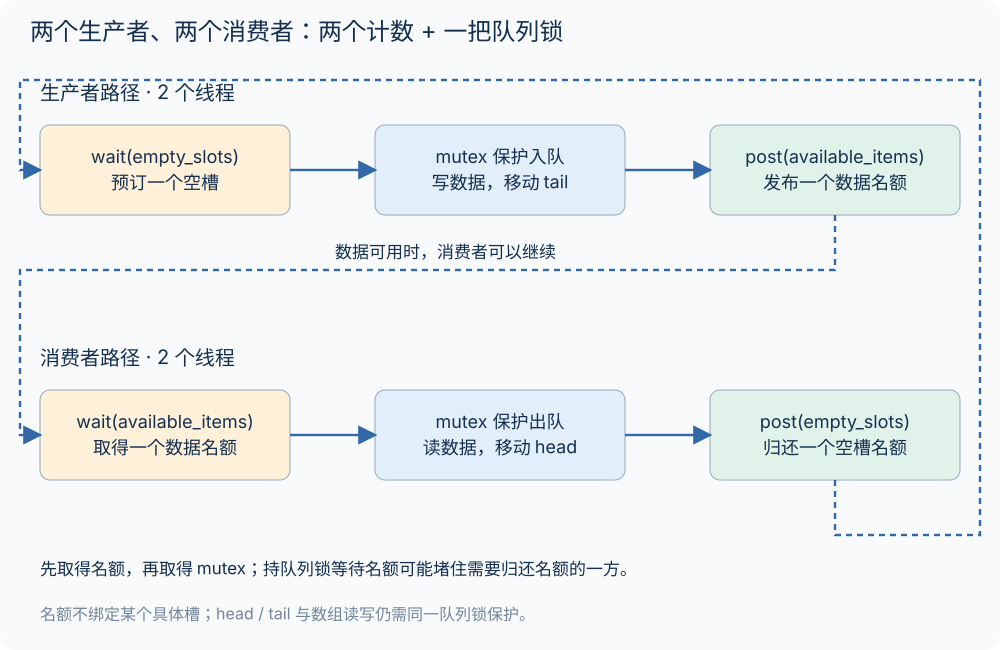

线程共享地址空间，只解决了能访问同一份数据的问题。什么时候可以修改、没有数据时怎样等待、等待期间是否占用 CPU，还需要同步机制。本篇先用单槽生产者消费者区分互斥与条件等待，再用三态锁说明 futex 的分工，最后将队列扩展为多生产者、多消费者，观察信号量怎样管理数据与空槽数量。

本系列实验环境为 VMware Fusion 中的 Ubuntu 26.04.1 ARM64，运行内核 `6.8.0-149-generic`，glibc 2.43。源码对照上游 **Linux v6.8**，发行版可能带有额外补丁。源码摘录用 `/* … */` 标明省略部分，接口示意与实测程序分别说明。

系列位置：[1. 对象模型](/p/linux-process-task-model/) · [2. 生命周期](/p/linux-process-lifecycle/) · [3. 调度](/p/linux-process-scheduling/) · [4. 执行上下文](/p/linux-kernel-execution-context/) · **5. 用户态同步** · [6. 内核同步](/p/linux-kernel-synchronization/)。

## 一、保护状态与等待条件分别做什么

### 1.1 一份槽位需要两类规则

假设生产者往一个槽位放数字，消费者取走数字。槽位是否已满与槽位内容必须协调更新，否则消费者可能读到尚未准备好的值，生产者也可能覆盖尚未取走的数据。

互斥锁保证同一时刻只有合适的持有者修改这组共享状态。条件变量允许线程在“槽位有数据”或“槽位变空”尚未成立时等待。条件变量上的一次通知不能代替共享状态本身。



图中的判断对象是受锁保护的谓词 `full`。线程唤醒后还要重新获得锁、再次判断条件，因为通知并不保证条件此刻仍成立，也允许出现伪唤醒。

### 1.2 可复现的生产与消费

保存为 [sync-lab.c](sync-lab.c)。一个消费者线程与主线程生产者共用单槽，消费完三个值后退出：

```c
#include <pthread.h>
#include <stdio.h>
#include <stdlib.h>
#include <string.h>

static pthread_mutex_t lock = PTHREAD_MUTEX_INITIALIZER;
static pthread_cond_t changed = PTHREAD_COND_INITIALIZER;
static int full, value, done;
static int total;

static void check(int err, const char *what)
{
    if (err) {
        fprintf(stderr, "%s: %s\n", what, strerror(err));
        exit(EXIT_FAILURE);
    }
}

static void *consumer(void *arg)
{
    (void)arg;
    check(pthread_mutex_lock(&lock), "lock");
    for (;;) {
        while (!full && !done)
            check(pthread_cond_wait(&changed, &lock), "wait");
        if (!full && done)
            break;
        total += value;
        printf("consume=%d\n", value);
        full = 0;
        check(pthread_cond_signal(&changed), "signal");
    }
    check(pthread_mutex_unlock(&lock), "unlock");
    return NULL;
}

int main(void)
{
    pthread_t thread;
    check(pthread_create(&thread, NULL, consumer, NULL), "create");
    for (int i = 1; i <= 3; i++) {
        check(pthread_mutex_lock(&lock), "lock");
        while (full)
            check(pthread_cond_wait(&changed, &lock), "wait");
        value = i;
        full = 1;
        check(pthread_cond_signal(&changed), "signal");
        check(pthread_mutex_unlock(&lock), "unlock");
    }
    check(pthread_mutex_lock(&lock), "lock");
    done = 1;
    check(pthread_cond_signal(&changed), "signal");
    check(pthread_mutex_unlock(&lock), "unlock");
    check(pthread_join(thread, NULL), "join");
    printf("total=%d\n", total);
    check(pthread_cond_destroy(&changed), "destroy cond");
    check(pthread_mutex_destroy(&lock), "destroy mutex");
    return EXIT_SUCCESS;
}
```

```bash
gcc -std=c11 -O2 -Wall -Wextra -Werror -pthread sync-lab.c -o sync-lab
./sync-lab
```

本次完整输出：

```text
consume=1
consume=2
consume=3
total=6
```

`done` 表示不再产生新值，不表示槽位已经清空。消费者只有在 `!full && done` 时退出，所以最后一个值即使尚未消费，也不会因为生产者结束而丢失。主线程在 `pthread_join()` 返回后读取 `total`，不与消费者更新并发。

## 二、mutex 与条件变量怎样配合

### 2.1 mutex 保护一组不变量

`value`、`full` 与 `done` 的相应访问都由同一把 mutex 保护。写入 `value` 后再把 `full` 设为 1，这两步在锁保护下构成对其他使用者可理解的状态变化。

常见 pthread mutex 有所有者约束，应由取得它的线程按接口规则解锁。它不是计数器，也不能由任意其他线程在事件到来时代为解锁来模拟通知。

用户态接口返回值同样需要区分：大多数 pthread 操作失败直接返回错误号；POSIX 信号量接口通常返回 `-1` 并设置 `errno`。本例的 `check()` 用于前一类接口。

### 2.2 cond_wait 的三个动作

`pthread_cond_wait(&changed, &lock)` 要求调用者已经持有对应 mutex。它将“释放 mutex 并进入条件等待”按接口要求协调起来，返回前还会重新取得 mutex。等待期间生产者因此能够拿到锁并修改谓词。

```c
while (!full && !done)
    check(pthread_cond_wait(&changed, &lock), "wait");
```

这里必须用循环重新判断。`pthread_cond_signal()` 唤醒等待者的通知语义，不保证等待者马上执行，也不会保存一张让未来线程无条件消费的事件票据。[条件等待规则](https://man7.org/linux/man-pages/man3/pthread_cond_wait.3p.html)

本例只有一个生产者、一个消费者，两者分别在等待槽位空和非空，不会同时都因这两个相反谓词等待；若扩展为多生产者多消费者，需要重新设计通知与等待者选择，不能机械认为同一个条件变量的 `signal` 总会选中需要的那一类线程。

## 三、从用户态快速路径到 futex

### 3.1 用户态决定谁持锁，futex 协助等待与唤醒

理解普通 `FUTEX_WAIT` / `FUTEX_WAKE` 时，可以先把职责分开：**用户态用原子操作管理锁状态；内核在指定 futex word 上检查等待条件、把线程排入等待队列，之后处理唤醒。**

futex word 是一个对齐的 32 位状态字。内核的普通等待接口不认识“这个地址存的是 mutex 还是条件变量状态”，也不会因为返回用户态就自动把锁交给等待者。它提供的是比较并阻塞、查找并唤醒等原语，完整同步协议由使用者建立。请求等待也不保证一定睡下，请求唤醒也不保证真的找到等待者，所以不能机械数成每次竞争恰好一次 wait 加一次 wake。

这一解释限定普通等待/唤醒路径。优先级继承（PI，Priority Inheritance）futex 等接口会让内核参与锁所有权与优先级协调，因此不能把全部 futex 功能概括为“内核完全不管锁”。[futex 接口与操作类型](https://man7.org/linux/man-pages/man2/futex.2.html)

### 3.2 一把锁为什么需要 0、1、2 三种状态

下面借鉴 glibc 普通低层锁的三态思路，库侧源码固定对照 glibc 2.42，实验机器实际使用 2.43。锁状态由用户态约定，**不是所有 futex 对象都必须遵守的内核编码**：

| word | 本例约定 | 对解锁侧的意义 |
| --- | --- | --- |
| 0 | 未被持有 | 可以尝试原子取得 |
| 1 | 已持有，没有标记潜在等待者 | 解锁可以只把值改回 0 |
| 2 | 已持有，可能有等待者或即将等待者 | 解锁后请求内核唤醒一个等待者 |

“可能”很关键，2 不是精确的等待线程数量。即使此刻无人真正睡下，也可以保留这个标记，解锁时多做一次可能无实际唤醒的操作。[glibc 2.42 的低层锁状态约定](https://github.com/bminor/glibc/blob/glibc-2.42/sysdeps/nptl/lowlevellock.h)

下面是**解释协议的伪代码**，不是 `pthread_mutex_lock()` 的完整源码。比较并交换（CAS，Compare-And-Swap）在这里用 `cas_acquire()` 表示，仅在值等于预期时替换，并返回旧值；`exchange_acquire/release()` 无条件交换并返回旧值。它们的返回约定不要与 C11 比较交换函数返回布尔值的形式混用：

```c
/* 加锁：word 初始为 0。 */
void lock(void)
{
    if (cas_acquire(&word, 0, 1) == 0)
        return;

    while (exchange_acquire(&word, 2) != 0)
        wait_while_equal(&word, 2);
}

/* 解锁：由已取得锁的线程调用。 */
void unlock(void)
{
    if (exchange_release(&word, 0) == 2)
        wake_one(&word);
}
```

这里 `wait_while_equal()` 封装普通 futex 等待：等待前由内核比较 word 是否仍为 2，值已变化或等待被打断时允许回到外层循环，其他错误需要处理。`wake_one()` 请求唤醒至多一个适当等待者。进程内实现可选相应 PRIVATE 操作；这些辅助名不是可以直接调用的标准 C 接口。

`acquire/release` 表达取得与释放所需的内存顺序，不能省略成几次对普通整数的无同步赋值。本篇只解释协议，下一篇再展开顺序关系。[glibc 2.42 的竞争等待路径](https://github.com/bminor/glibc/blob/glibc-2.42/nptl/lowlevellock.c)

### 3.3 从取得锁到唤醒，沿三种情况走一遍



**没有竞争时**，CAS 把 0 改为 1，立即取得锁。解锁把 1 改回 0，不需要请求唤醒。这条加锁与解锁路径都可以留在用户态。

**出现竞争时**，线程 B 的 CAS 看到锁已被持有，进入循环，把 word 改为 2。若 exchange 返回 1 或 2，说明它尚未取得锁，才请求 `FUTEX_WAIT`。线程 A 解锁时把 2 改为 0，知道可能有人等待，于是执行 `FUTEX_WAKE`。

**B 醒来时**，没有直接跳进临界区。它再次做 exchange；只有旧值为 0，才表示这一次取得了锁。另一个线程可能先抢到，因此唤醒后仍可能再次等待。慢路径取得后保留状态 2，可以让随后释放继续照顾其他潜在等待者。

| 时刻 | A | B | word |
| --- | --- | --- | --- |
| 初始 | CAS 成功取得 | 尚未请求 | 1 |
| B 竞争 | 继续持锁 | 标记竞争，准备等待 | 2 |
| A 释放 | 改为 0，再请求 wake | 可能已排队，也可能尚未进入内核等待 | 0，直到被再次取得 |
| B 重试 | 已离开临界区 | exchange 若返回 0，取得锁 | 2 |

这也解释了为什么“只加锁不展示解锁”的片段不够完整：等待者把自己睡下以后，需要释放者按同一状态协议通知它。futex 的返回并不等于锁所有权已经交接。

### 3.4 为什么要在内核里再比较一次

B 把 word 标成 2 后，还没有立刻进入内核，A 就可能先释放并调用 wake。如果 B 接下来无条件睡眠，就可能错过这次唤醒。

`FUTEX_WAIT` 的比较并阻塞语义覆盖了这个交叉：如果内核检查时 word 已经不是预期的 2，就返回 `EAGAIN`，B 回到用户态重试。如果 B 已按协议进入等待，A 的对应 wake 则能查找并唤醒等待者。状态再次变化时，也应按当时的值和之后的解锁协议继续判断，不能把一次观察当成永久条件。



在 v6.8 中可沿 `futex_wait()`、`futex_wait_setup()`、`futex_wait_queue()` 看重新比较与等待组织，再沿 `futex_wake()` 看唤醒。对于不同进程，识别共享等待对象还与后备存储有关，不要求虚拟地址数值相同。[v6.8 等待唤醒源码](https://github.com/torvalds/linux/blob/v6.8/kernel/futex/waitwake.c)

### 3.5 跟踪本次程序的内核参与

```bash
strace -f -c -e trace=futex ./sync-lab
```

本次完整输出如下，统计数值会随调度与竞争改变：

```text
strace: Process 1559421 attached
consume=1
consume=2
consume=3
total=6
% time     seconds  usecs/call     calls    errors syscall
------ ----------- ----------- --------- --------- ----------------
  0.00    0.000000           0        14         1 futex
------ ----------- ----------- --------- --------- ----------------
100.00    0.000000           0        14         1 total
```

这证明该次运行发生了 futex 系统调用，并不说明每次锁操作都进了内核。`errors` 是系统调用错误返回的统计，其中可能包括竞争协议中正常处理的值已变化等情况，不能直接当作程序错误计数。这里汇总时间显示为零还受计时与输出分辨率影响，不表示执行没有成本。

## 四、信号量表达可用数量

### 4.1 把单槽扩展为多生产者、多消费者

信号量保存可用数量。`sem_wait()` 成功取得一个名额，数量不足时等待；`sem_post()` 增加一个名额，并可能唤醒等待者。它没有 mutex 的所有者约束，增加名额与取得名额的可以是不同线程。

将本篇开头的队列扩展为：**两个生产者、两个消费者、三个缓冲槽**。生产者需要知道“还有没有空槽”，消费者需要知道“还有没有已发布的数据”，因此使用两个信号量，再用一把 mutex 保护实际队列结构。

| 同步对象 | 初始值 | 表达什么 |
| --- | --- | --- |
| `empty_slots` | 3 | 尚可取得的空槽名额 |
| `available_items` | 0 | 尚可取得的已发布数据名额 |
| `queue_lock` | 未锁定 | 保护数组内容、读写下标及相关统计 |



### 4.2 两个计数与一把锁怎样配合

每个生产者执行下面的顺序：

1. `sem_wait(empty_slots)`，预订一个空槽。
2. 取得 `queue_lock`，写入数据并移动尾下标，再释放 mutex。
3. `sem_post(available_items)`，发布一份可消费数据。

消费者执行对应的另一半：

1. `sem_wait(available_items)`，取得一份数据名额。
2. 取得 `queue_lock`，读取数据并移动头下标，再释放 mutex。
3. `sem_post(empty_slots)`，归还一个空槽名额。

**信号量解决数量是否足够，mutex 解决多线程怎样修改同一队列。** 即使两个生产者都取得了空槽名额，也不能同时无保护地修改同一个尾下标。

等待信号量放在取得队列 mutex 之前。如果队列已满，生产者持着 mutex 等空槽，而消费者又需要这把 mutex 才能出队归还空槽，就形成等待环。[sem_wait 与 sem_post 的数量语义](https://man7.org/linux/man-pages/man3/sem_wait.3.html)

还要避免一个过强的断言：`empty_slots + available_items` 不保证在每条指令处都恰好等于容量。线程可能已取得名额，却尚未完成入队或对应 post；只有排除这些在途操作、在合适的静止观察点，两个计数才能直接对应空槽与已发布条目数量。

### 4.3 运行完整有界队列

完整源码为 [mpmc-lab.c](mpmc-lab.c)，包含两个生产者、两个消费者、错误处理、队列统计和退出协调。下面摘出实际入队函数，`take_token()` 处理 `sem_wait()` 的 `EINTR` 重试及错误，`give_token()` 检查 `sem_post()`：

```c
static void put(int value)
{
    take_token(&empty_slots);
    check(pthread_mutex_lock(&queue_lock), "lock");
    queue[tail] = value;
    tail = (tail + 1) % CAPACITY;
    if (value != 0)
        produced[produced_count++] = value;
    check(pthread_mutex_unlock(&queue_lock), "unlock");
    give_token(&available_items);
}
```

消费者的 `get()` 按对应顺序取得数据名额、互斥出队、归还空槽。测试用 mutex 同时保护入队顺序、出队顺序和重复值检测，完整源码可直接编译：

```bash
gcc -std=c11 -O2 -Wall -Wextra -Werror -pthread mpmc-lab.c -o mpmc-lab
./mpmc-lab
```

本次完整输出：

```text
producers=2 consumers=2 capacity=3
enqueue: 1 2 3 4 5 6
dequeue: 1 2 3 4 5 6
produced=6 consumed=6 sum=21 duplicates=0
consumer0=3 consumer1=3
verified=yes
```

每个生产者生成三个不同值，总计 1–6，预期和为 21。本次入队与出队顺序相同，没有重复或遗漏；每个消费者都处理了三个值。调度变化可能改变生产者之间的交错和消费者分工，不保证下一次仍均分，也不保证入队值永远按数值排序。

先进先出（FIFO，First In, First Out）是按**实际入队顺序**取出，不是自动按数值排序。`verified=yes` 表示本次程序检查了数量、顺序、总和及每个数据值的覆盖和重复情况，不是对全部并发情况的形式证明。

### 4.4 消费者怎样知道没有下一份数据

普通信号量只表达数量，不自动带有“所有生产者已经结束”的含义。如果生产结束后两个消费者还在等数据，它们不会仅凭生产者线程退出就自行返回。

本例由主线程先 `join` 两个生产者，确认不会再产生正常数据，再通过同一队列放入两个值为 0 的结束标记，每个消费者取到一个后退出。0 不属于正常数据范围，每个标记也遵守空槽、入队、出队与归还协议。

由于结束标记放在所有正常数据之后，FIFO 队列不会跳过尚未出队的正常数据。主线程随后 `join` 两个消费者，再销毁同步对象与队列；不在仍有等待者时销毁信号量。

### 4.5 线程共享与进程共享

`sem_init()` 的 `pshared=0` 用于进程内线程共享；非零用于进程共享，信号量对象本身也必须位于正确的共享内存中。将一个普通堆对象地址传给两个 fork 后的进程，并不自动得到跨进程同步。[sem_init 说明](https://man7.org/linux/man-pages/man3/sem_init.3.html)

pthread mutex、条件变量也有相应进程共享属性，默认对象通常是进程内使用。设置属性和实际共享同一后备存储缺一不可。进程异常退出、健壮锁及资源恢复协议属于进一步设计，不能依靠一个 `pshared` 参数包办。

## 五、原子操作、锁与退出协议

### 5.1 原子计数不自动保护一整组状态

C 语言中多个线程无同步地访问同一普通变量，至少一个是写入时，可能构成数据竞争并导致未定义行为。不能用“这次计数刚好正确”证明程序安全，也不能用 `volatile` 代替同步。

原子加法适合独立计数等场景，但若要一起维护槽位内容、是否已满和退出条件，仍需证明整个协议的一致性。原子操作还带有内存顺序选择，下一篇会通过 release/acquire 具体解释发布关系。[C11 草案的多线程与原子规则](https://www.open-std.org/jtc1/sc22/wg14/www/docs/n1570.pdf)

### 5.2 按问题选择同步对象

| 需求 | 常见机制 | 需要证明什么 |
| --- | --- | --- |
| 保护一组共享状态 | mutex、适合场景的读写锁 | 所有相关访问遵守同一保护规则 |
| 等待某条件成立 | 条件变量与 mutex | 谓词在锁下判断，返回后重新检查 |
| 限制并发名额 | semaphore | 每次取得与归还平衡，对象确实共享 |
| 独立原子更新 | C 原子操作 | 原子性及所需内存顺序足够 |
| 短等待时不愿阻塞 | 适合场景的自旋方案 | 不长期占用 CPU，不饿死其他执行者 |

退出时应先改变停止谓词并通知等待者，再等待线程完成，最后销毁同步对象与外层内存。持锁执行 `pthread_join()` 时，若被等待线程退出也需要这把锁，就会形成等待环。

## 六、命令与接口速查

| 接口或命令 | 用途 |
| --- | --- |
| `pthread_mutex_lock()` / `unlock()` | 取得和释放互斥锁，按 pthread 规则返回错误号 |
| `pthread_cond_wait()` | 在对应 mutex 保护下协调释放锁、等待、重新加锁 |
| `pthread_cond_signal()` / `broadcast()` | 通知一个或全部适当等待者，不替代谓词 |
| `pthread_join()` | 等待线程完成，并提供结束同步 |
| `sem_init()` / `sem_wait()` / `sem_post()` | 初始化、取得、增加信号量名额 |
| `sem_destroy()` | 在没有使用者等接口前提下销毁信号量 |
| `strace -f -c -e trace=futex` | 汇总程序及线程发生的 futex 系统调用 |
| `FUTEX_WAIT` / `FUTEX_WAKE` | 普通比较并等待 / 唤醒适当等待者，不自动取得用户态锁 |

## 七、名词解释

| 名词 | 本篇含义 |
| --- | --- |
| 临界区 | 按同步规则保护的一段共享状态访问 |
| 谓词 | 决定线程是否可以继续的状态条件，例如 full |
| 伪唤醒 | 条件等待返回却不能据此断言业务条件已成立的情况 |
| futex word | futex 协议操作的对齐 32 位共享状态字 |
| 三态锁 | 本篇用 0、1、2 表达未持有、无竞争持有、可能有等待者的用户态协议 |
| 有界队列 | 具有固定容量、满时生产者需等待的队列 |
| FIFO | 按入队先后次序取出数据的组织规则 |
| 快速路径 | 在用户态原子操作等条件满足时完成的无阻塞路径 |
| 进程共享同步对象 | 属性与后备存储均满足跨进程共享要求的对象 |
| 数据竞争 | 不符合语言同步规则的并发冲突访问，可能导致未定义行为 |
| 所有者 | 按互斥协议取得并负责释放相应锁的执行者 |
