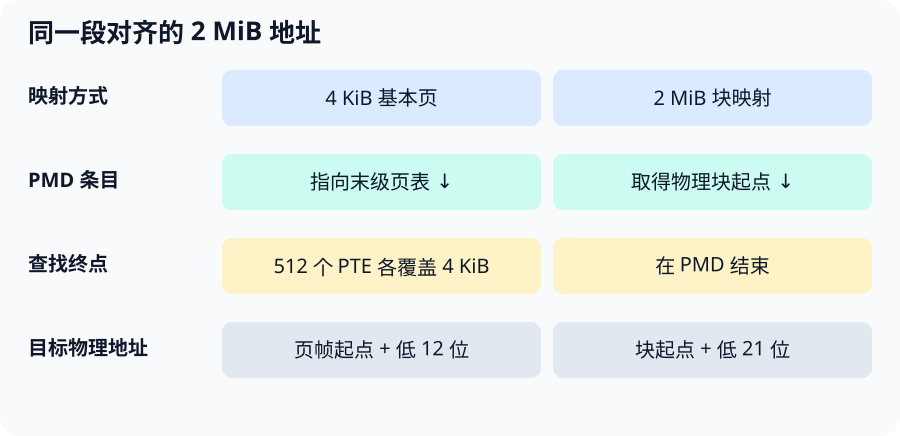
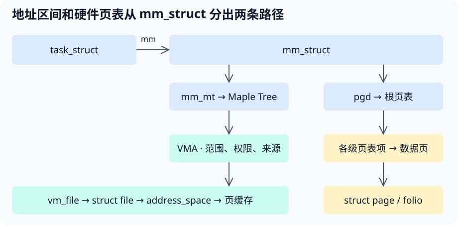
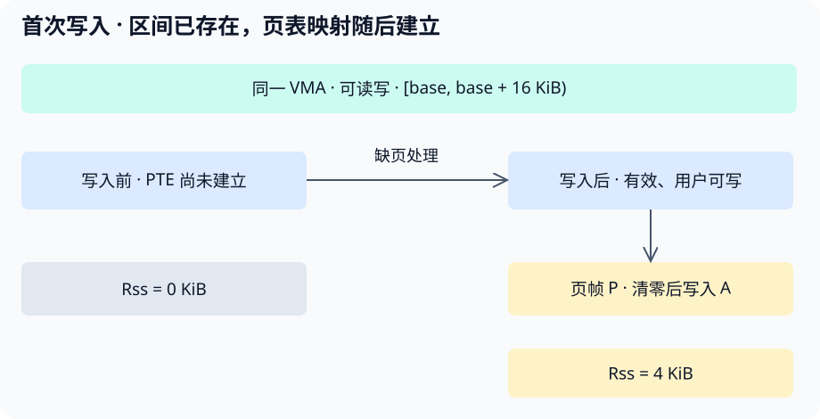

程序执行 `bytes[0] = 'A'` 时，指针里保存的是虚拟地址。中央处理器（CPU，Central Processing Unit）最终需要找到存放这个字节的物理位置。这个过程中，硬件按什么规则查页表？如果当前地址还没有对应的物理页，内核又从哪里知道该分配什么？

本篇围绕一次用户态匿名映射的首次写入展开，再沿同一条转换路径说明文件映射、写时复制和内核地址的区别。实验使用 Ubuntu ARM64 虚拟机，源码对照上游 Linux v6.8。下面的配置来自来宾内核，文中“物理地址”也以这台来宾所见的地址为准。硬件虚拟化还可能继续把来宾物理地址转换为宿主物理地址。

```text
$ uname -mr
6.8.0-149-generic aarch64
$ getconf PAGE_SIZE
4096
$ grep -E 'CONFIG_(ARM64_VA_BITS|PGTABLE_LEVELS|ARM64_4K_PAGES)=' "/boot/config-$(uname -r)"
CONFIG_PGTABLE_LEVELS=4
CONFIG_ARM64_4K_PAGES=y
CONFIG_ARM64_VA_BITS=48
```

## 一、先观察一次还没有物理后备的写入

### 1.1 创建映射，让程序停在写入之前

下面的程序申请四个基本页，用 `MADV_NOHUGEPAGE` 让本次映射按基本页观察。程序打印进程编号、页大小和起始地址，在第一次写入前、写入后各暂停一次。两次暂停时都从另一个终端读取 `/proc`。

将代码保存为 `translation.c`。

```c
#define _GNU_SOURCE
#include <stdio.h>
#include <stdlib.h>
#include <sys/mman.h>
#include <unistd.h>

int main(void)
{
    setbuf(stdout, NULL);
    long page = sysconf(_SC_PAGESIZE);
    if (page <= 0)
        return EXIT_FAILURE;
    size_t length = 4 * (size_t)page;
    void *base = mmap(NULL, length, PROT_READ | PROT_WRITE,
                      MAP_PRIVATE | MAP_ANONYMOUS, -1, 0);
    if (base == MAP_FAILED) {
        perror("mmap");
        return EXIT_FAILURE;
    }
    if (madvise(base, length, MADV_NOHUGEPAGE) == -1) {
        perror("madvise");
        return EXIT_FAILURE;
    }
    printf("pid = %ld, page_size = %ld, base = %p\n",
           (long)getpid(), page, base);
    puts("Press Enter to write page 0.");
    getchar();
    volatile unsigned char *bytes = base;
    bytes[0] = 'A';
    puts("Press Enter to unmap.");
    getchar();
    if (munmap(base, length) == -1) {
        perror("munmap");
        return EXIT_FAILURE;
    }
    return EXIT_SUCCESS;
}
```

```bash
cc -Wall -Wextra -O0 -g translation.c -o translation
./translation
```

本次在 ARM64 虚拟机上编译运行，程序先输出：

```text
pid = 1542545, page_size = 4096, base = 0xe3641fbd5000
Press Enter to write page 0.
```

`pid` 用来选择 `/proc` 里的进程目录，`page_size` 以字节显示基本页大小，`base` 是 `mmap()` 返回的虚拟地址。

### 1.2 先在 maps 中定位这次申请的区间

程序第一次暂停时，在另一个终端设置进程标识（PID，Process ID）和地址。下面的值来自同一次实测，复现时换成自己的输出。

```bash
pid=1542545
base=e3641fbd5000
grep "^$base-" "/proc/$pid/maps"
```

```text
e3641fbd5000-e3641fbd9000 rw-p 00000000 00:00 0
```

这里 `grep` 的 `^` 要求地址出现在行首，末尾的 `-` 对应区间起止地址之间的分隔符。本次区间的起点恰好等于 `base`。若筛选没有输出，可以先执行 `cat "/proc/$pid/maps"`，按 `start <= base < end` 找包含它的区间，再用该行的起点筛选。属性相同的相邻映射可以合并，起点和申请地址也就可能不同。

| 输出字段 | 本次的值 | 怎样理解 |
| --- | --- | --- |
| 地址区间 | `e3641fbd5000-e3641fbd9000` | 左闭右开，两端相减为 `0x4000`，即 16 KiB |
| 权限 | `rw-p` | 可读、可写，采用私有映射 |
| 文件偏移 | `00000000` | 本次为匿名映射 |
| 设备号、inode | `00:00 0` | 这个区间没有关联的文件 |
| 路径 | 空白 | 内核没有为本区间显示文件路径或特殊名称 |

`maps` 已经列出了合法的可写区间。接下来用 `smaps` 检查它当时占用了多少物理内存。 [Linux v6.8 procfs 文档](https://docs.kernel.org/6.8/filesystems/proc.html)

### 1.3 用 smaps 对照写入前后的物理占用

下面用 `sed` 从选中区间的标题行一直打印到 `VmFlags` 行，再由 `grep -E` 只保留表里要解释的字段。这个筛选可在两个暂停点重复运行。

```bash
sed -n "/^$base-/,/^VmFlags:/p" "/proc/$pid/smaps" | grep -E '^[0-9a-f]+-|^(Size|KernelPageSize|MMUPageSize|Rss|Private_Dirty|Anonymous|AnonHugePages|VmFlags):'
```

第一次暂停时，实测输出为：

```text
e3641fbd5000-e3641fbd9000 rw-p 00000000 00:00 0
Size:                 16 kB
KernelPageSize:        4 kB
MMUPageSize:           4 kB
Rss:                   0 kB
Private_Dirty:         0 kB
Anonymous:             0 kB
AnonHugePages:         0 kB
VmFlags: rd wr mr mw me ac nh
```

`MMUPageSize` 中的 MMU（Memory Management Unit，内存管理单元）指执行地址翻译的硬件。`Rss` 是驻留集大小（Resident Set Size）。这里有 16 KiB 虚拟区间，驻留量是 0。

回到程序所在终端，按一次 Enter。程序向第一个字节写入 `A` 后再次暂停：

```text
Press Enter to unmap.
```

在观察终端重新执行同一条 `sed` 命令：

```text
e3641fbd5000-e3641fbd9000 rw-p 00000000 00:00 0
Size:                 16 kB
KernelPageSize:        4 kB
MMUPageSize:           4 kB
Rss:                   4 kB
Private_Dirty:         4 kB
Anonymous:             4 kB
AnonHugePages:         0 kB
VmFlags: rd wr mr mw me ac nh
```

| 字段 | 写入前 → 写入后 | 这一步发生了什么 |
| --- | --- | --- |
| `Size` | 16 → 16 kB | 区间边界保持 16 KiB |
| `KernelPageSize / MMUPageSize` | 4 → 4 kB | 本次按基本页分配和映射 |
| `Rss` | 0 → 4 kB | 第一次写入后有一页驻留 |
| `Private_Dirty` | 0 → 4 kB | 写入产生一页私有脏页 |
| `Anonymous` | 0 → 4 kB | 这页数据以匿名页作为后备 |
| `AnonHugePages` | 0 → 0 kB | 本次该字段统计的匿名透明大页占用为零 |
| `VmFlags` | `rd wr mr mw me ac nh` | 区间属性保持一致 |

`rd / wr` 表示当前允许读、写，`mr / mw / me` 表示允许的读、写、执行属性上限，`ac` 表示该区间参与内存承诺记账，`nh` 表示关闭透明大页。这些标志也解释了本次实验的条件。

这两次采样里，变化出现在驻留量和页状态，地址边界与区间权限保持一致。后面的缺页路径要解释的正是这次“多出一个 4 KiB 数据页”的过程。最后在程序终端再按一次 Enter，程序撤销映射并退出。 [Linux v6.8 smaps 字段说明](https://docs.kernel.org/6.8/filesystems/proc.html)

## 二、有效映射存在时，硬件怎样完成访问

### 2.1 当前地址空间怎样提供页表根

当前任务的 `task_struct.mm` 指向它使用的 `mm_struct`，其中 `pgd` 是内核访问根页表的入口。调度切换地址空间时，ARM64 内核选择相应的地址翻译上下文，将根表的物理基址用于配置转换表基址寄存器（TTBR，Translation Table Base Register）。用户映射通过 TTBR0_EL1 使用相应根表。EL1 表示异常级别 1（Exception Level 1）。

因此，硬件查找的第一张表由当前翻译上下文确定，同一个虚拟地址在两个进程中可以沿不同的根表得到不同的物理位置。第四章再展开这些内核对象的字段。 [Linux v6.8 ARM64 上下文切换](https://github.com/torvalds/linux/blob/v6.8/arch/arm64/mm/context.c)

### 2.2 TLB 保存已经用过的地址翻译

MMU 负责地址翻译和权限检查。它首先尝试使用快表（TLB，Translation Lookaside Buffer）中的缓存翻译。命中且允许本次写入时，可以直接得到目标物理地址。缓存项还保存权限与地址空间标识等信息。

如果缺少可用缓存项，硬件会从当前地址空间的页表根开始查找。页表查找成功后，可以缓存结果并继续执行。这次查找本身可以完全由硬件完成。只有遇到缺失映射、权限冲突等需要软件处理的情况，才沿异常入口进入内核。


图中回到“重试”的箭头很重要。首次写入时，缺页处理先建立映射，返回用户态后再执行原来那条写指令。 [Linux v6.8 页表文档](https://docs.kernel.org/6.8/mm/page_tables.html)

### 2.3 4 KiB 页保留低 12 位偏移

先假设映射已经存在。虚拟地址（VA，Virtual Address）`0x123456789abc` 的低 12 位为 `0xabc`，表示目标字节在当前 4 KiB 页中的位置。其余位负责在地址空间里选择虚拟页。

页表最终给出物理页帧号（PFN，Page Frame Number）。若示意中的 PFN 为 `0x45678`，则页帧起点是 `0x45678000`，加上 `0xabc` 得到物理地址（PA，Physical Address）`0x45678abc`。后面会用同一个 VA 拆解每一级索引。

## 三、四级页表怎样逐层缩小范围

### 3.1 为什么一张表还要再分层

48 位地址空间能容纳 2⁴⁸ 字节。每 4 KiB 建一个条目，需要 2³⁶ 个条目。若每项 8 字节，一张完全展开的线性表就要 512 GiB，哪怕进程只使用几页，也难以承担这样的开销。

分层后，只为已使用的地址分支分配下级表。以本例为单位，每张 4 KiB 页表可容纳 `4096 / 8 = 512` 项。选择其中一项要用 9 位，四层正好消耗 `9 × 4 = 36` 位，再加 12 位偏移，组成 48 位地址。一个上级条目可以让整片未使用的范围保持空缺。 [Linux v6.8 页表层级](https://docs.kernel.org/6.8/mm/page_tables.html)

### 3.2 把同一个地址拆成四个索引

下表是对 `0x123456789abc` 的**地址演算**。本例使用未标记的用户地址，位 63–48 为零。

| 地址位 | 本机硬件层级 | Linux 中实际生效的层级 | 十进制索引 |
| --- | --- | --- | ---: |
| 47–39 | Level 0 | PGD（Page Global Directory，全局页目录） | 36 |
| 38–30 | Level 1 | PUD（Page Upper Directory，上层页目录） | 209 |
| 29–21 | Level 2 | PMD（Page Middle Directory，中层页目录） | 179 |
| 20–12 | Level 3 | PTE（Page Table Entry，页表项）所在层 | 393 |
| 11–0 | 页内位置 | 页内偏移 | 2748，即 `0xabc` |

Linux 通用代码还定义了 P4D（Page Four-level Directory，四级页目录）这一层。对当前四级配置，它被**折叠**，通用代码仍可经过这个接口，硬件查找时则使用表里列出的四级。其他架构、页大小和地址位宽需要重新核对层级。 [ARM64 v6.8 地址布局](https://docs.kernel.org/6.8/arch/arm64/memory.html)


下面给四张表各指定一个**示意物理基址**。索引来自上表，基址及条目内容用于演算。

| 本次查找 | 当前表的物理基址 | 读取条目的物理地址 | 从有效条目提取的结果 |
| --- | --- | --- | --- |
| PGD 第 36 项 | `0x100000` | `0x100000 + 36 × 8 = 0x100120` | 下级表在 `0x200000` |
| PUD 第 209 项 | `0x200000` | `0x200000 + 209 × 8 = 0x200688` | 下级表在 `0x300000` |
| PMD 第 179 项 | `0x300000` | `0x300000 + 179 × 8 = 0x300598` | 下级表在 `0x400000` |
| PTE 第 393 项 | `0x400000` | `0x400000 + 393 × 8 = 0x400c48` | 数据页帧起点是 `0x45678000` |

每一级先算出**条目存储位置**，读取条目，再从内容中提取下一级表地址。到了末级，提取的是数据页帧地址，随后加 `0xabc` 得到 `0x45678abc`。表格里的 `0x400c48` 存放页表项，最终的 `0x45678abc` 才对应程序要访问的字节。

这里分配的下级页表本身也占 RAM（Random Access Memory，随机存取存储器）。页表页保存条目，数据页保存程序的内容。首次映射时，内核可能既需要页表页，也需要数据页。

### 3.3 大页为什么可以提前结束查找

在支持 2 MiB 块映射的当前配置里，一个 PMD 条目可以直接覆盖整个对齐的 2 MiB 区间。硬件在 Level 2 取得物理块起点，保留 VA 的低 21 位作为偏移，页表查找就此结束。用基本页映射同一范围时，该 PMD 指向一张含 512 个 PTE 的表，每项负责 4 KiB。



大页把地址翻译的覆盖范围扩大，同时要求相应的物理范围和虚拟范围满足连续、对齐等条件。Linux 也可以用更大的内存对象配合多个 PTE 映射，判断实际翻译粒度时要看查找终止在哪一级。 [Linux v6.8 页表文档](https://docs.kernel.org/6.8/mm/page_tables.html)

### 3.4 一个页表项同时包含地址和属性

当前 ARM64 配置使用 64 位描述符。下图摘出本篇涉及的字段，省略内存属性、共享属性和软件标志等其他位。输出地址的具体编码还受物理地址位宽和架构特性影响。


| 字段 | 含义 | 对访问的影响 |
| --- | --- | --- |
| Valid，位 0 | 硬件描述符是否有效 | 无效时无法沿该描述符正常完成当前翻译 |
| 类型，位 1 与层级共同解释 | 指向下级表，或在允许层级作为块、页映射 | 决定继续查找还是取得输出地址 |
| 输出地址 | 下级表或被映射内存的物理基址 | 与索引或页内偏移配合使用 |
| AP（Access Permissions，访问权限），位 7–6 | 描述特权、用户访问与读写权限 | 权限不足可产生异常，还要结合其他架构控制 |
| AF（Access Flag，访问标志），位 10 | 标记条目是否被访问 | 按硬件能力和配置，由硬件更新或通过异常交给内核处理 |
| DBM（Dirty Bit Management，脏位管理），位 51 | 配合硬件脏状态管理 | 在支持并启用时，与读写权限位一起参与记录写入 |
| PXN / UXN，位 53 / 54 | 特权执行禁止（Privileged Execute Never）及用户执行禁止（User Execute Never） | 限制从该映射取指 |

Linux 的 `pte_young()` 检查 AF。`pte_dirty()` 综合软件脏标志和架构支持的硬件脏状态。页表项记录的访问、修改状态还能被内核用于页管理，文件页的脏状态则另有 folio 等对象参与维护。 [Linux v6.8 ARM64 描述符](https://github.com/torvalds/linux/blob/v6.8/arch/arm64/include/asm/pgtable-hwdef.h) · [页表状态助手](https://github.com/torvalds/linux/blob/v6.8/arch/arm64/include/asm/pgtable.h)

### 3.5 页的状态分别保存在哪里

| 状态所在对象 | 常见状态 | 在访问路径中的用途 |
| --- | --- | --- |
| VMA | 区间存在，允许读、写或执行 | 缺页处理核对本次访问是否合法 |
| 页表项 | 有效、写保护、已访问、脏、交换编码 | 决定硬件翻译和内核缺页分支 |
| `struct page` / folio | 引用、锁、脏状态等 | 管理数据页的使用、缓存与生命周期 |
| TLB | 缓存的地址翻译、权限和上下文标识 | 在后续访问中复用结果，修改映射时维护失效 |

Linux 还区分 `pte_none()`、`pte_present()` 等软件状态。以 ARM64 为例，`pte_present()` 也涵盖内核用 `PTE_PROT_NONE` 标识的情况，是否“在场”与硬件 Valid 位要分别检查。无效描述符的位置也可以保存内核定义的交换编码，缺页处理据此恢复相应数据。 [Linux v6.8 ARM64 软件页表状态](https://github.com/torvalds/linux/blob/v6.8/arch/arm64/include/asm/pgtable.h)

## 四、映射尚未建立时，内核凭什么补齐它

### 4.1 task_struct、mm_struct 和 VMA 保存不同的状态

虚拟内存区域（VMA，Virtual Memory Area）记录合法地址范围、权限和来源。页表描述当前逐页或按大页建立的翻译。第一次实验中，`mmap()` 可以先建立 VMA，再在访问时补齐页表映射。



| 对象或成员 | 在本次访问中的用途 |
| --- | --- |
| `task_struct.mm` | 从当前任务取得它的用户地址空间 |
| `mm_struct.mm_mt` | 用 Maple Tree 按虚拟地址查找 VMA |
| `mm_struct.pgd` | 从内核虚拟地址访问该地址空间的根页表 |
| `vm_area_struct.vm_start / vm_end` | 判断异常地址是否落在区间内 |
| `vm_flags`、`vm_page_prot` | 保存区间标志以及建立映射使用的保护属性 |
| `vm_mm` | 回到所属的 `mm_struct` |
| `vm_file`、`vm_pgoff` | 对文件映射，定位后备文件和区间起始页偏移 |
| `vm_ops` | 提供文件映射等场景使用的缺页处理回调 |

同一进程的普通线程可以让各自的 `task_struct.mm` 指向同一个 `mm_struct`，因而看到同一套用户映射。`fork()` 通常为子进程创建独立的地址空间描述和页表，原有私有页可以先通过写时复制（COW，Copy-on-Write）共享。 [Linux v6.8 内存对象定义](https://github.com/torvalds/linux/blob/v6.8/include/linux/mm_types.h) · [任务创建实现](https://github.com/torvalds/linux/blob/v6.8/kernel/fork.c)

### 4.2 mm_struct 怎样组织整个地址空间

下面按 Linux v6.8 摘录与本篇相关的字段。为集中观察成员，省略了外围的匿名结构和无关字段，字段类型与名称保持源码形式。

```c
struct mm_struct {
    /* … */
    struct maple_tree mm_mt;
    /* … */
    pgd_t *pgd;
    /* … */
    struct rw_semaphore mmap_lock;
    /* … */
};
```

`mm_mt` 把虚拟区间组织进 Maple Tree。缺页处理拿到异常地址，就可以通过这棵树查找覆盖它的 VMA。`pgd` 提供根页表的内核访问入口，后续代码从这里逐层找到对应的页表项。`mmap_lock` 是读写信号量，映射的查找和修改要在适用的锁协议下进行。v6.8 也支持部分场景的每 VMA 锁路径，因此源码中可以看到不同的加锁入口。

第一次实验中，申请成功后 `mm_mt` 中已经有覆盖目标地址的 VMA。直到首次写入，缺页处理才沿 `pgd` 取得相应条目，并建立需要的数据页映射。 [Linux v6.8 mm_struct](https://github.com/torvalds/linux/blob/v6.8/include/linux/mm_types.h#L734) · [ARM64 的 VMA 查找路径](https://github.com/torvalds/linux/blob/v6.8/arch/arm64/mm/fault.c#L530)

### 4.3 vm_area_struct 怎样描述一个区间

下面同样是相关字段摘录，源码中的联合体等外围布局已省略。

```c
struct vm_area_struct {
    unsigned long vm_start;
    unsigned long vm_end;
    /* … */
    struct mm_struct *vm_mm;
    pgprot_t vm_page_prot;
    /* … */
    const vm_flags_t vm_flags;
    /* … */
    const struct vm_operations_struct *vm_ops;
    unsigned long vm_pgoff;
    struct file *vm_file;
    /* … */
};
```

| 字段 | 对第一次实验意味着什么 |
| --- | --- |
| `vm_start / vm_end` | 本次采样区间为 `[0xe3641fbd5000, 0xe3641fbd9000)` |
| `vm_mm` | 指回当前程序的地址空间对象 |
| `vm_flags` | 记录可读、可写、私有、禁用透明大页等区间属性 |
| `vm_page_prot` | 为建立页表映射准备保护属性，实际条目还会结合故障场景设置 |
| `vm_file` | 这段匿名映射取空指针 |
| `vm_pgoff` | 对文件映射，它按基本页记录区间起点对应的文件偏移 |
| `vm_ops` | 文件、设备等映射可以通过回调提供缺页处理能力 |

`maps` 的权限列、`smaps` 的 `VmFlags` 来自区间属性的展示。驻留量则需要结合页表和页状态统计。只有 VMA 里的 `VM_WRITE`，还不能保证当前页表项已经可写，例如写时复制的条目会先设置写保护。 [Linux v6.8 VMA 定义](https://github.com/torvalds/linux/blob/v6.8/include/linux/mm_types.h#L619) · [procfs 展示实现](https://github.com/torvalds/linux/blob/v6.8/fs/proc/task_mmu.c)

### 4.4 页表项、物理页和缺页现场各保存什么

页表项类型如 `pte_t` 用来封装硬件描述符。以本篇 ARM64 配置的末级条目为例，内容包含输出地址及有效性、访问权限等属性。`pte_t *` 指向条目在页表页中的存储位置。`struct page *` 则指向物理页帧的元数据。修改一个条目，会改变地址翻译，更新页引用计数则会改变内核管理的引用状态。

一次缺页处理还需要一个临时的 `struct vm_fault`。下面按用途摘录其中几个真实成员，省略了外围匿名结构、联合体和其他成员。

```c
struct vm_fault {
    /* … */
    struct vm_area_struct *vma;
    pgoff_t pgoff;
    unsigned long address;
    /* … */
    enum fault_flag flags;
    pmd_t *pmd;
    pud_t *pud;
    /* … */
    struct page *page;
    /* … */
    pte_t *pte;
    spinlock_t *ptl;
    /* … */
};
```

`address` 保存页对齐后的故障地址，`flags` 表明本次是否写入等条件。`vma` 提供区间和后备信息，`pgoff` 可用来定位文件页。`pmd / pud / pte` 让处理函数访问当前查到的条目，成员是否有效取决于走到哪个分支及是否持有相应锁。`page` 可供回调返回数据页，`ptl` 指向保护相应页表操作的自旋锁。

这四种状态因此能连起来看。VMA 说明目标地址允许做什么，页表项说明当前映射在哪里，`struct page` 跟踪页帧的内核状态，`vm_fault` 把本次异常处理需要的信息传给后续函数。 [Linux v6.8 vm_fault](https://github.com/torvalds/linux/blob/v6.8/include/linux/mm.h#L495) · [ARM64 页表类型](https://github.com/torvalds/linux/blob/v6.8/arch/arm64/include/asm/pgtable-types.h)

### 4.5 跟一次匿名首次写入的源码

在本次 ARM64、普通基本页场景中，路径可按下面几步阅读。表中省略了锁、重试和错误分支，便于对应第一次实验中的写入。

| 入口 | 对当前访问做什么 |
| --- | --- |
| ARM64 `do_page_fault()` | 读取异常地址和访问类型，为当前地址寻找 VMA，检查权限 |
| `handle_mm_fault()` | 进入通用内存故障处理，组织本次处理状态 |
| `__handle_mm_fault()` | 查找各级条目，按需分配缺少的下级页表 |
| `handle_pte_fault()` | 根据末级状态选择处理分支 |
| `do_anonymous_page()` | 为匿名首次写入取得清零的数据页，并安装可写映射 |
| 异常返回 | 原写指令重试，把 `A` 写到刚建立的数据后备中 |

在 v6.8 中可以从 `pgd_offset()`、`p4d_offset()`、`pud_alloc()`、`pmd_alloc()` 等调用核对层级推进。缺页处理会带着 `vm_fault` 保存 VMA、地址、访问标志以及有关条目指针。这个临时对象帮助函数之间传递处理现场。 [ARM64 缺页入口](https://github.com/torvalds/linux/blob/v6.8/arch/arm64/mm/fault.c) · [通用缺页实现](https://github.com/torvalds/linux/blob/v6.8/mm/memory.c)

### 4.6 第一次写入前后，哪些对象变了

将第一章的实际地址 `0xe3641fbd5000` 和 `smaps` 输出放回内核路径。下面的 P 是新取得页帧的符号，具体 PFN 未在实验中读取。



| 状态 | 写入前 | 写入后 |
| --- | --- | --- |
| VMA | 覆盖该地址，允许读写 | 同一范围，继续允许读写 |
| 末级条目 | 尚无该页的有效映射 | 安装指向页帧 P 的用户可写映射 |
| 页表页 | 下级表可能尚未创建 | 处理过程中补齐需要的表 |
| 数据后备 | 本次四页都未驻留 | 第一页有清零后写入 `A` 的数据后备 |
| `smaps` | `Rss / Anonymous / Private_Dirty = 0` | 三个字段都是 4 kB |

“分配清零页”保证匿名页中未写入的字节具有零值语义。页表项准备完成后，异常返回，原指令通过新映射完成写入。实验所展示的 4 KiB 增量对应数据后备，页表自身的内存另有统计。

### 4.7 文件映射怎样找到数据

若 VMA 关联文件，异常地址还能换算成文件页索引。设区间起点是 `vm_start`，基本页大小为 `PAGE_SIZE`，文件页索引为：

```text
vm_pgoff + (fault_address - vm_start) / PAGE_SIZE
```

整数除法舍去页内偏移。VMA 关联的 `struct file` 可以取得文件的 `address_space`，它管理文件的页缓存。通用处理通过 `vm_ops->fault` 等接口取得相应页，缓存中已有内容时可以直接建立映射，需要读盘时则等待数据到位。普通文件映射常用 `filemap_fault()`，具体文件和设备可以提供自己的回调。 [Linux v6.8 文件映射缺页](https://github.com/torvalds/linux/blob/v6.8/mm/filemap.c)

页帧对应的 `struct page` 保存该页的内核元数据，页缓存也会用 folio 把一个或多个基本页作为整体管理。硬件从页表项读取地址和权限，内核使用这些对象管理引用、缓存和回收。

## 五、为什么有些缺页能恢复，有些会结束程序

### 5.1 处理结果取决于区间和页状态

| 访问现场 | 内核可能采取的动作 |
| --- | --- |
| 有可写匿名 VMA，但首次写入的页尚未建立 | 分配清零页并安装映射 |
| 读取普通匿名区间的未驻留页 | 在适用情况下映射共享零页，后续写入再取得独立页 |
| 文件映射缺少有效条目 | 查页缓存，必要时读取文件 |
| 有交换项 | 根据交换信息恢复页，再更新映射 |
| 私有映射因写时复制而写保护 | 若原页仍需共享，复制内容并让写入方映射新页，也可能在能够独占时复用原页 |
| 找不到合法区间，或区间禁止本次访问 | 可能向进程发送 `SIGSEGV`（Segmentation Violation） |
| 文件映射访问到文件结尾之外的整页等情况 | 可能向进程发送 `SIGBUS`（Bus Error） |


缺页会记录为 minor fault（次缺页）或 major fault（主缺页）等统计。这个区分主要看处理是否需要相应的输入输出等待，页缓存命中和匿名分配通常体现为次缺页。快表未命中但页表查找成功时，访问可以继续由硬件完成。 [Linux v6.8 缺页分支](https://github.com/torvalds/linux/blob/v6.8/mm/memory.c) · [文件映射实现](https://github.com/torvalds/linux/blob/v6.8/mm/filemap.c)

### 5.2 更新页表后，还要处理旧的缓存翻译

例如 `mprotect()` 把一页改为只读，或 `munmap()` 撤销映射时，CPU 上可能还留着旧的 TLB 项。内核需要按架构规则更新条目并维护相关缓存翻译。多 CPU 同时使用一个地址空间时，还可能需要通知其他 CPU 失效旧项。

地址空间标识（ASID，Address Space Identifier）使 TLB 能区分不同地址空间的翻译。任务切换时，内核选择相应的页表上下文及标识，后续硬件访问才能使用正确的映射。 [Linux v6.8 ARM64 上下文切换](https://github.com/torvalds/linux/blob/v6.8/arch/arm64/mm/context.c) · [TLB 维护接口](https://github.com/torvalds/linux/blob/v6.8/arch/arm64/include/asm/tlbflush.h)

### 5.3 建立、改权和撤销映射怎样改变这些状态

| 操作 | VMA | 页表与数据页 | TLB |
| --- | --- | --- | --- |
| 普通按需匿名 `mmap()` | 建立区间，可能与相邻区间合并 | 数据页与下级页表可等访问时建立 | 按实际映射变动维护 |
| `mprotect()` | 更新范围权限，必要时拆分或合并区间 | 更新已有映射的保护属性 | 使旧权限的缓存翻译失效 |
| `munmap()` | 移除指定范围，必要时拆分区间 | 撤销条目，释放相应映射引用 | 在适当时机完成失效，避免旧翻译访问已回收内存 |

`munmap()` 后，一个数据页可能还被其他映射或页缓存引用。内核按引用和页管理规则决定能否回收，页表页的释放同样要遵循并发访问与 TLB 维护的时序。 [Linux v6.8 映射管理](https://github.com/torvalds/linux/blob/v6.8/mm/mmap.c) · [改权实现](https://github.com/torvalds/linux/blob/v6.8/mm/mprotect.c) · [TLB 维护接口](https://docs.kernel.org/6.8/core-api/cachetlb.html)

## 六、内核访问地址时，页表根和映射用途怎样变化

### 6.1 用户页表根与内核页表根

第二章介绍的用户翻译上下文使用 TTBR0_EL1。当前 ARM64 配置的内核映射通常由 TTBR1_EL1 指定另一套页表根，其常驻内核映射的组织入口包括 `swapper_pg_dir`。

`mm->pgd` 给内核提供根表的虚拟访问入口，硬件寄存器中使用相应的物理基址。内核负责上下文切换与页表维护，MMU 根据当前架构状态完成查找。启用内核页表隔离等机制后，异常进入、退出时还会有相应的页表切换细节。 [Linux v6.8 ARM64 内存布局](https://docs.kernel.org/6.8/arch/arm64/memory.html)

### 6.2 线性映射、vmalloc 与 vmemmap 各自映射什么

| 内核地址区域 | 被映射的内容 | 地址关系 |
| --- | --- | --- |
| 线性映射，也称直接映射 | 内核需要通过该区域访问的系统 RAM | 在适用范围内，通过布局规定的偏移关系换算 |
| `vmalloc` 区域 | 一组内核需要连续访问的页 | 虚拟地址连续，物理页可以分散，由页表连接 |
| `vmemmap` 区域 | 页帧的 `struct page` 元数据 | 在对应内存模型中按 PFN 索引页描述对象 |
| 内核镜像映射 | 内核代码和静态数据 | 按内核镜像布局及权限建立映射 |


同一个数据页帧可以有用户虚拟地址和内核虚拟地址。内核通过直接映射访问到的仍是这页数据，`vmemmap` 对应位置保存的是描述这页的元数据。使用 `virt_to_phys()` 一类换算前，要满足该接口对地址来源的要求。`vmalloc` 和用户指针需要沿各自映射取得页及物理位置。 [Linux v6.8 ARM64 地址转换定义](https://github.com/torvalds/linux/blob/v6.8/arch/arm64/include/asm/memory.h)

## 七、命令和接口速查

| 命令或接口 | 本篇用途 |
| --- | --- |
| `getconf PAGE_SIZE` | 查询基本页字节数 |
| `grep -E 'CONFIG_(ARM64_VA_BITS\|PGTABLE_LEVELS\|ARM64_4K_PAGES)=' /boot/config-$(uname -r)` | 核对编译配置中的地址位宽和页表层级 |
| `cc -Wall -Wextra -O0 -g translation.c -o translation` | 编译实验，保留调试信息 |
| `cat /proc/<pid>/maps` | 查看地址区间、权限和映射来源 |
| `less /proc/<pid>/smaps` | 按区间查看驻留等统计，按 q 退出 |
| `mprotect()` | 修改指定地址范围的访问权限 |
| `mmap()`、`munmap()` | 建立、撤销虚拟区间 |
| `madvise(..., MADV_NOHUGEPAGE)` | 对实验映射关闭透明大页 |
| `/proc/<pid>/pagemap` | 提供按虚拟页索引的映射信息，PFN 可见性受权限限制 |

`pagemap` 可用于进一步观察映射状态。PFN 字段的读取受 `CAP_SYS_ADMIN` 能力检查限制，即使能打开文件，也要核对字段是否因权限被清零。本篇的 PFN 和多级索引图使用标明的地址演算。 [Linux v6.8 pagemap 文档](https://docs.kernel.org/6.8/admin-guide/mm/pagemap.html)

## 八、名词解释

| 名词 | 本篇中的含义 |
| --- | --- |
| VA、PA | 指令使用的虚拟地址，以及翻译得到的物理地址 |
| MMU、TLB | 完成地址翻译的硬件单元，以及缓存翻译的硬件结构 |
| PGD、P4D、PUD、PMD、PTE | Linux 通用代码中的页表层级，具体配置可以折叠某些层 |
| PFN | 按基本页大小给物理页帧编的号 |
| VMA、`mm_struct` | 一个连续虚拟区间的描述，以及组织整个用户地址空间的对象 |
| `address_space` | 文件页缓存等后备对象的管理结构 |
| 缺页异常 | 当前访问需要内核介入处理的地址翻译或权限异常 |
| COW（Copy-on-Write，写时复制） | 共享内容在私有写入时按需分离的机制 |
| ASID | 区分地址空间上下文的硬件标识 |
| TTBR | ARM64 用来指定地址翻译表基址的寄存器 |
| `struct page`、folio | 页帧元数据，以及可包含一个或多个基本页的内核管理对象 |
