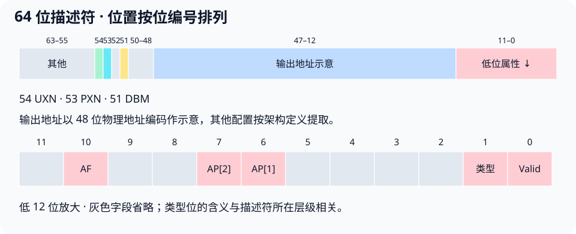
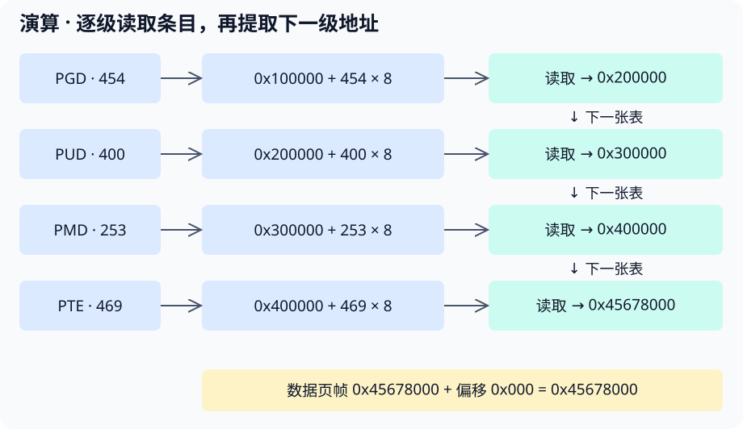
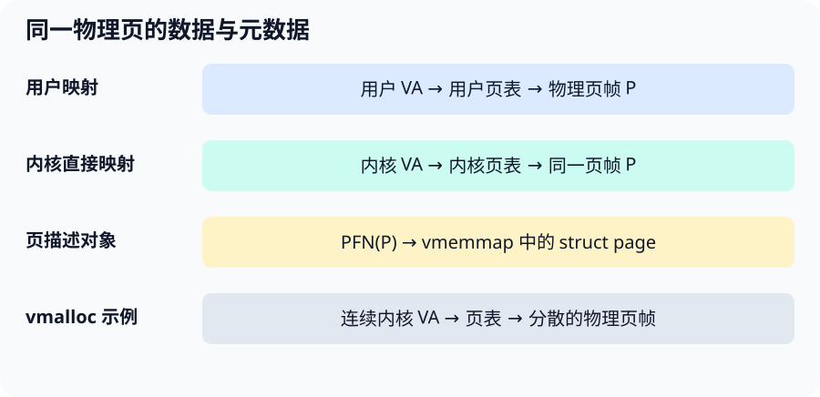

本篇先按虚拟地址从低到高看清进程中的代码、数据、堆、映射和栈，再从一次用户指针读取出发，按“进程 → 虚拟地址空间 → 页表映射 → 物理页”的顺序说明地址转换。先准备好一页内容，再观察读取前后的区间，用同一个实测地址演算四级查表。首次写入时怎样建立数据后备，接在第三篇展开。

实验虚拟机为 ARM64，运行 Linux `6.8.0-149-generic`。基本页是 4 KiB，内核配置为 48 位虚拟地址、四级硬件页表。源码参照上游 Linux v6.8，物理地址以这台虚拟机所见范围为准。

```text
$ getconf PAGE_SIZE
4096
$ grep -E 'CONFIG_(ARM64_VA_BITS|PGTABLE_LEVELS|ARM64_4K_PAGES)=' "/boot/config-$(uname -r)"
CONFIG_PGTABLE_LEVELS=4
CONFIG_ARM64_4K_PAGES=y
CONFIG_ARM64_VA_BITS=48
```

本篇使用的对象、虚拟区间、物理页及 `mmap / madvise` 接口关系，可对照[第一篇的概念说明](/p/linux-memory-management-basics/)。

## 一、在进程里准备一页可读取的数据

### 1.1 先看进程虚拟地址空间的整体布局

进程使用的指针落在一个按地址编号的**线性虚拟地址空间**中。“线性”表示地址可以比较大小、按字节递增，不表示整段地址都已映射，更不表示背后是一整块连续物理内存。先按从低地址到高地址的方向认识常见区域：


图是常见布局的示意，不按大小比例绘制，也不规定所有进程必须遵循完全相同的顺序。实际位置受架构、可执行文件类型、动态加载器与地址空间布局随机化（ASLR，Address Space Layout Randomization）影响。尤其是共享库、匿名映射和内核提供的特殊映射，可能交错排列。

| 区域 | 保存什么 | 怎样从运行进程观察 |
| --- | --- | --- |
| 程序代码与只读数据 | 指令、常量等 | 可执行文件对应的 `r-xp`、`r--p` 等映射 |
| 可写静态数据与 BSS | 已初始化的可写全局/静态对象，以及零初始化对象 | 程序的可写映射及可能紧邻的匿名映射，通常没有单独的 BSS 标签 |
| brk 堆 | 分配器可能使用的可扩展区间 | 存在时标为 `[heap]`；并非所有 `malloc()` 对象都在这里 |
| 文件与匿名映射 | 共享库、映射文件、独立内存申请等 | 有文件路径或路径为空的 VMA；线程栈也可能属于匿名映射 |
| 主线程用户栈 | 活跃调用的栈帧，以及启动时放置的参数、环境变量等 | 通常标为 `[stack]`；其他线程栈不一定有同样标签 |
| 特殊映射 | 内核向用户态提供的辅助代码与数据 | 如 `[vdso]`、`[vvar]`，具体名称与架构有关 |
| 空洞和保护区域 | 尚未建立映射的范围，或禁止访问的范围 | 空洞表现为相邻行地址不连续；`---p` 则是存在但无读写执行权限的映射 |

BSS 是 Block Started by Symbol 的传统名称。它对应程序中需要零初始化的一类存储，而不是磁盘文件里必须逐字节保存的零值内容。可执行与可链接格式（ELF，Executable and Linkable Format）中的节和运行时 VMA 也不一一对应，不能把一行 `rw-p` 简单等同于整个 `.data` 或 `.bss`。

在常见布局中，扩展 brk 堆会提高它的上边界，主线程栈向较低地址扩展。但这不表示二者之间始终空无一物，也不表示两者可以无限增长；地址限制、其他映射、保护间隔和资源限制都会影响扩展。`mmap()` 也没有一个适用于所有调用的固定增长方向。

本节图只画**用户地址空间**。用户进程不能因为进入系统调用就用普通用户指针任意访问内核地址；内核映射与页表切换在后文单独说明。

### 1.2 创建程序，停在读取指令前

本篇的“读取”指 C 代码通过指针读取内存，例如 `value = bytes[0]`。文件描述符接口 `read()` 还涉及文件或设备的实现。

下面的 `read-lab.c` 先建立匿名映射并写入 `A`，让内容准备好，再暂停等待观察。随后执行一次 `volatile` 指针读取，打印结果并再次暂停。准备数据的首次写入由[第三篇](/p/linux-malloc-brk-mmap/)展开。

```c
#include <stdio.h>
#include <stdlib.h>
#include <sys/mman.h>
#include <unistd.h>

int main(void)
{
    setbuf(stdout, NULL);
    setbuf(stdin, NULL);
    long page = sysconf(_SC_PAGESIZE);
    if (page <= 0)
        return EXIT_FAILURE;

    void *base = mmap(NULL, (size_t)page, PROT_READ | PROT_WRITE,
                      MAP_PRIVATE | MAP_ANONYMOUS, -1, 0);
    if (base == MAP_FAILED) {
        perror("mmap");
        return EXIT_FAILURE;
    }
    if (madvise(base, (size_t)page, MADV_NOHUGEPAGE) == -1) {
        perror("madvise");
        return EXIT_FAILURE;
    }
    volatile unsigned char *bytes = base;
    bytes[0] = 'A';
    printf("pid = %ld, base = %p\n", (long)getpid(), base);
    puts("stage = ready");
    getchar();

    unsigned char value = bytes[0];
    printf("value = %c\n", value);
    puts("stage = read");
    getchar();

    return munmap(base, (size_t)page) == 0 ? EXIT_SUCCESS : EXIT_FAILURE;
}
```

```bash
cc -Wall -Wextra -O0 -g read-lab.c -o read-lab
./read-lab
```

这次实测的两个暂停点输出如下，中间按一次 Enter。

```text
pid = 1548472, base = 0xefedca8f9000
stage = ready
value = A
stage = read
```

### 1.3 从 procfs 读取当前进程的区间

在观察终端用进程标识（PID，Process ID）选择目录。每次暂停都运行同一组命令。

```bash
pid=1548472
base=efedca8f9000
grep "^$base-" "/proc/$pid/maps"
sed -n "/^$base-/,/^VmFlags:/p" "/proc/$pid/smaps" | grep -E '^[0-9a-f]+-|^(Size|Rss|Private_Dirty|Anonymous|AnonHugePages):'
```

`grep` 选择以区间起点开头的行，`sed` 选出该区间的统计块，第二个 `grep` 保留要比较的字段。若区间与相邻映射合并，先从 `maps` 找到包含 `base` 的区间，再用实际起点筛选。

两个暂停点选出的字段都如下：

```text
efedca8f9000-efedca8fa000 rw-p 00000000 00:00 0
Size:                  4 kB
Rss:                   4 kB
Private_Dirty:         4 kB
Anonymous:             4 kB
AnonHugePages:         0 kB
```

| 字段 | 对这次观测的解释 |
| --- | --- |
| 地址和 `rw-p` | 左闭右开的 4 KiB 区间，可读、可写，私有映射 |
| `00:00 0` 与空白路径 | 这段匿名内存没有对应的普通文件 |
| `Size` | 本次区间大小为 4 KiB |
| `Rss` | 驻留集大小（Resident Set Size），读取前后都有一页驻留 |
| `Private_Dirty / Anonymous` | 准备阶段写入的内容属于私有匿名页 |
| `AnonHugePages` | 本次采用基本页 |

实验确认准备好的内容读回为 `A`，区间及所选驻留统计保持一致。快表是否命中和真实物理页帧号不能由这些输出直接得出，下面沿硬件机制说明可能的访问路径，物理基址统一标为演算。最后按 Enter 结束程序。 [Linux v6.8 procfs 文档](https://docs.kernel.org/6.8/filesystems/proc.html)

### 1.4 把完整 maps 放回布局图中

只看目标页还不够，可以在程序停在 `stage = ready` 时，从另一个终端读取完整布局：

```bash
cat /proc/1562283/maps
```

将 PID 替换为当前程序打印的值。下面是同一台 ARM64 虚拟机的一次**独立补充采样**，程序编译为 `/tmp/read-lab-layout`，PID 为 `1562283`，`base` 为 `0xfb115f59b000`；它与前面用于查表演算的采样不是同一次运行。此次完整输出如下：

```text
b41babae0000-b41babae1000 r-xp 00000000 fc:00 2309                       /tmp/read-lab-layout
b41babaff000-b41babb00000 r--p 0000f000 fc:00 2309                       /tmp/read-lab-layout
b41babb00000-b41babb01000 rw-p 00010000 fc:00 2309                       /tmp/read-lab-layout
fb115f390000-fb115f539000 r-xp 00000000 fc:00 1946                       /usr/lib/aarch64-linux-gnu/libc.so.6
fb115f539000-fb115f54d000 ---p 001a9000 fc:00 1946                       /usr/lib/aarch64-linux-gnu/libc.so.6
fb115f54d000-fb115f550000 r--p 001ad000 fc:00 1946                       /usr/lib/aarch64-linux-gnu/libc.so.6
fb115f550000-fb115f552000 rw-p 001b0000 fc:00 1946                       /usr/lib/aarch64-linux-gnu/libc.so.6
fb115f552000-fb115f55e000 rw-p 00000000 00:00 0
fb115f563000-fb115f58d000 r-xp 00000000 fc:00 1943                       /usr/lib/aarch64-linux-gnu/ld-linux-aarch64.so.1
fb115f59b000-fb115f59c000 rw-p 00000000 00:00 0
fb115f59c000-fb115f59e000 rw-p 00000000 00:00 0
fb115f59e000-fb115f5a0000 r--p 00000000 00:00 0                          [vvar]
fb115f5a0000-fb115f5a1000 r-xp 00000000 00:00 0                          [vdso]
fb115f5a1000-fb115f5a3000 r--p 0002e000 fc:00 1943                       /usr/lib/aarch64-linux-gnu/ld-linux-aarch64.so.1
fb115f5a3000-fb115f5a4000 rw-p 00030000 fc:00 1943                       /usr/lib/aarch64-linux-gnu/ld-linux-aarch64.so.1
fb115f5a4000-fb115f5a5000 rw-p 00000000 00:00 0
ffffcf127000-ffffcf148000 rw-p 00000000 00:00 0                          [stack]
```

`maps` 按地址递增排列，每行范围左闭右开。沿输出从上到下，可以找到：

| 本次采样 | 对应布局中的位置 | 读这几行时要注意什么 |
| --- | --- | --- |
| 三行 `/tmp/read-lab-layout` | 主程序的代码与数据映射 | 同一个文件按不同权限和文件偏移分为多个区域 |
| `libc.so.6` 与 `ld-linux-aarch64.so.1` | C 库与动态加载器 | 一个共享库也有多段映射，并非一个整体 `r-xp` 区间 |
| `fb115f59b000-fb115f59c000` | 本次手动创建的匿名页 | 由程序打印的 base 确认；不能仅凭空白路径判断用途 |
| `[vvar]`、`[vdso]` | 特殊辅助映射 | 与加载器映射交错，说明示意图不是严格顺序模板 |
| `[stack]` | 主线程当前栈映射 | 这一行范围不等于它未来一定能够扩展到的全部范围 |

此次没有 `[heap]`：程序使用 `mmap()` 准备实验页，并未保证分配器建立可见的 brk 堆。其他空白路径的匿名映射也不能全部称为“堆”。地址行之间还有大段空洞，例如主程序与 libc 之间；空洞不会因为位于进程地址范围内，就自动占用等量 RAM。

`r`、`w`、`x` 分别表示可读、可写、可执行，`p` 表示私有映射，`s` 表示共享映射；私有文件映射的修改通常通过写时复制隔离。其后的列依次是文件偏移、设备号、inode 编号与可选路径。**这些是虚拟映射的属性，不能据此判断每一页是否驻留、物理页是否连续或实际占用多少内存**；驻留情况要结合前面的 `smaps` 等接口。[procfs 的 maps 字段说明](https://docs.kernel.org/6.8/filesystems/proc.html)

有了这张整体地图，后面要跟踪的只是其中一个匿名 VMA 中的一个地址：先找到管理整个地址空间的 `mm_struct`，再沿页表把该地址转换成物理位置。

## 二、从当前进程找到它的虚拟地址空间

### 2.1 task_struct、mm_struct 和 VMA 保存不同的状态

虚拟内存区域（VMA，Virtual Memory Area）记录合法地址范围、权限和来源。页表描述当前逐页或按大页建立的翻译。本次准备阶段结束时，VMA 和数据页映射都已经存在。普通读取由硬件完成地址翻译，VMA 提供内核维护和异常处理所需的区间依据。

图中的成员箭头表示指针或索引入口。数据页到 `struct page` 的关系表示元数据描述，硬件查表路径在取得数据页地址后结束。


同一进程的普通线程可以让各自的 `task_struct.mm` 指向同一个 `mm_struct`，因而看到同一套用户映射。`fork()` 通常为子进程创建独立的地址空间描述和页表，原有私有页可以先通过写时复制（COW，Copy-on-Write）共享。 [Linux v6.8 内存对象定义](https://github.com/torvalds/linux/blob/v6.8/include/linux/mm_types.h) · [任务创建实现](https://github.com/torvalds/linux/blob/v6.8/kernel/fork.c)

### 2.2 mm_struct 怎样组织整个地址空间

下面按 Linux v6.8 摘录与本篇相关的字段。为集中观察成员，省略了外围的匿名结构和无关字段，字段类型与名称保持源码形式。

```c
struct mm_struct {
    /* … */
    struct maple_tree mm_mt;
    /* … */
    pgd_t *pgd;
    /* … */
    struct rw_semaphore mmap_lock;
    /* … */
};
```

`mm_mt` 把虚拟区间组织进 Maple Tree。缺页处理拿到异常地址，就可以通过这棵树查找覆盖它的 VMA。`pgd` 提供根页表的内核访问入口，后续代码从这里逐层找到对应的页表项。`mmap_lock` 是读写信号量，映射的查找和修改要在适用的锁协议下进行。v6.8 也支持部分场景的每 VMA 锁路径，因此源码中可以看到不同的加锁入口。

准备完成后，`mm_mt` 已能索引覆盖 `base` 的 VMA，`pgd` 也关联到该页的映射。内核以这些对象维护地址空间，普通读取时由硬件使用已经准备好的页表。 [Linux v6.8 mm_struct](https://github.com/torvalds/linux/blob/v6.8/include/linux/mm_types.h#L734) · [ARM64 的 VMA 查找路径](https://github.com/torvalds/linux/blob/v6.8/arch/arm64/mm/fault.c#L530)

地址布局还可以与 `mm_struct` 的边界字段对照：`start_code / end_code` 记录代码范围，`start_data / end_data` 记录数据范围，`start_brk / brk` 记录 brk 堆边界，`start_stack` 记录初始栈位置，`arg_start / arg_end` 与 `env_start / env_end` 记录参数及环境字符串范围。它们不是另一套页表，也不能代替 VMA 集合；尤其 `start_stack` 不是当前栈指针，单靠它无法得到当前栈映射的完整上下界。[v6.8 mm_struct 的边界字段](https://github.com/torvalds/linux/blob/v6.8/include/linux/mm_types.h)

### 2.3 vm_area_struct 怎样描述一个区间

下面同样是相关字段摘录，源码中的联合体等外围布局已省略。

```c
struct vm_area_struct {
    unsigned long vm_start;
    unsigned long vm_end;
    /* … */
    struct mm_struct *vm_mm;
    pgprot_t vm_page_prot;
    /* … */
    const vm_flags_t vm_flags;
    /* … */
    const struct vm_operations_struct *vm_ops;
    unsigned long vm_pgoff;
    struct file *vm_file;
    /* … */
};
```

| 字段 | 对本次进程意味着什么 |
| --- | --- |
| `vm_start / vm_end` | 本次采样区间为 `[0xefedca8f9000, 0xefedca8fa000)` |
| `vm_mm` | 指回当前程序的地址空间对象 |
| `vm_flags` | 记录可读、可写、私有、禁用透明大页等区间属性 |
| `vm_page_prot` | 为建立页表映射准备保护属性，实际条目还会结合故障场景设置 |
| `vm_file` | 这段匿名映射取空指针 |
| `vm_pgoff` | 对文件映射，它按基本页记录区间起点对应的文件偏移 |
| `vm_ops` | 文件、设备等映射可以通过回调提供缺页处理能力 |

`maps` 的权限列、`smaps` 的 `VmFlags` 来自区间属性的展示。驻留量则需要结合页表和页状态统计。只有 VMA 里的 `VM_WRITE`，还不能保证当前页表项已经可写，例如写时复制的条目会先设置写保护。 [Linux v6.8 VMA 定义](https://github.com/torvalds/linux/blob/v6.8/include/linux/mm_types.h#L619) · [procfs 展示实现](https://github.com/torvalds/linux/blob/v6.8/fs/proc/task_mmu.c)

## 三、从地址空间选择硬件翻译上下文

### 3.1 当前地址空间怎样提供页表根

当前任务的 `task_struct.mm` 指向它使用的 `mm_struct`，其中 `pgd` 是内核访问根页表的入口。调度切换地址空间时，ARM64 内核选择相应的地址翻译上下文，将根表的物理基址用于配置转换表基址寄存器（TTBR，Translation Table Base Register）。用户映射通过 TTBR0_EL1 使用相应根表。EL1 表示异常级别 1（Exception Level 1）。

因此，硬件查找的第一张表由当前翻译上下文确定，同一个虚拟地址在两个进程中可以沿不同的根表得到不同的物理位置。这些字段对应上一节的地址空间对象。 [Linux v6.8 ARM64 上下文切换](https://github.com/torvalds/linux/blob/v6.8/arch/arm64/mm/context.c)

### 3.2 TLB 保存已经用过的地址翻译

内存管理单元（MMU，Memory Management Unit）负责地址翻译和权限检查。它首先尝试使用快表（TLB，Translation Lookaside Buffer）中的缓存翻译。命中且允许本次读取时，可以直接得到目标物理地址。缓存项还保存权限与地址空间标识（ASID，Address Space Identifier）等信息。

如果缺少可用缓存项，硬件会从当前地址空间的页表根开始查找。页表查找成功后，可以缓存结果并继续执行。这次查找本身可以完全由硬件完成。只有遇到缺失映射、权限冲突等需要软件处理的情况，才沿异常入口进入内核。


图中回到“重试”的箭头很重要。本篇沿图中的成功翻译分支继续，缺少有效映射时的处理转入第三篇。 [Linux v6.8 页表文档](https://docs.kernel.org/6.8/mm/page_tables.html)

### 3.3 4 KiB 页保留低 12 位偏移

用第一章实际打印出的地址演算。先假设该页的映射已经建立。虚拟地址（VA，Virtual Address）`0xefedca8f9000` 的低 12 位为 `0x000`，表示目标字节在当前 4 KiB 页中的位置。其余位负责在地址空间里选择虚拟页。

页表最终给出物理页帧号（PFN，Page Frame Number）。若示意中的 PFN 为 `0x45678`，则页帧起点是 `0x45678000`，加上 `0x000` 得到物理地址（PA，Physical Address）`0x45678000`。本次读取恰好落在页起点，所以偏移为零。同页内下一个字节的地址为 `0xefedca8f9001`，偏移变为 1，对应的示意物理地址为 `0x45678001`。

## 四、从虚拟地址逐级查到物理页

### 4.1 为什么一张表还要再分层

48 位地址空间能容纳 2⁴⁸ 字节。每 4 KiB 建一个条目，需要 2³⁶ 个条目。若每项 8 字节，一张完全展开的线性表就要 512 GiB，哪怕进程只使用几页，也难以承担这样的开销。

分层后，只为已使用的地址分支分配下级表。以本例为单位，每张 4 KiB 页表可容纳 `4096 / 8 = 512` 项。选择其中一项要用 9 位，四层正好消耗 `9 × 4 = 36` 位，再加 12 位偏移，组成 48 位地址。一个上级条目可以让整片未使用的范围保持空缺。 [Linux v6.8 页表层级](https://docs.kernel.org/6.8/mm/page_tables.html)

### 4.2 一个页表项同时包含地址和属性

当前 ARM64 配置使用 64 位描述符。下图上半部分按位编号排列描述符，下半部分放大低 12 位。灰色字段省略内存属性、共享属性和软件标志等细节。输出地址的具体编码还受物理地址位宽和架构特性影响。



| 字段 | 含义 | 对访问的影响 |
| --- | --- | --- |
| Valid，位 0 | 硬件描述符是否有效 | 无效时无法沿该描述符正常完成当前翻译 |
| 类型，位 1 与层级共同解释 | 指向下级表，或在允许层级作为块、页映射 | 决定继续查找还是取得输出地址 |
| 输出地址 | 下级表或被映射内存的物理基址 | 与索引或页内偏移配合使用 |
| AP（Access Permissions，访问权限），位 7–6 | 描述特权、用户访问与读写权限 | 权限不足可产生异常，还要结合其他架构控制 |
| AF（Access Flag，访问标志），位 10 | 标记条目是否被访问 | 按硬件能力和配置，由硬件更新或通过异常交给内核处理 |
| DBM（Dirty Bit Management，脏位管理），位 51 | 配合硬件脏状态管理 | 在支持并启用时，与读写权限位一起参与记录写入 |
| PXN / UXN，位 53 / 54 | 特权执行禁止（Privileged Execute Never）及用户执行禁止（User Execute Never） | 限制从该映射取指 |

Linux 的 `pte_young()` 检查 AF。`pte_dirty()` 综合软件脏标志和架构支持的硬件脏状态。页表项记录的访问、修改状态还能被内核用于页管理，文件页的脏状态则另有 folio 等对象参与维护。 [Linux v6.8 ARM64 描述符](https://github.com/torvalds/linux/blob/v6.8/arch/arm64/include/asm/pgtable-hwdef.h) · [页表状态助手](https://github.com/torvalds/linux/blob/v6.8/arch/arm64/include/asm/pgtable.h)

### 4.3 把同一个地址拆成四个索引

下表是对 `0xefedca8f9000` 的**地址演算**。本例使用未标记的用户地址，位 63–48 为零。

| 地址位 | 本机硬件层级 | Linux 中实际生效的层级 | 十进制索引 |
| --- | --- | --- | ---: |
| 47–39 | Level 0 | PGD（Page Global Directory，全局页目录） | 479 |
| 38–30 | Level 1 | PUD（Page Upper Directory，上层页目录） | 439 |
| 29–21 | Level 2 | PMD（Page Middle Directory，中层页目录） | 84 |
| 20–12 | Level 3 | PTE（Page Table Entry，页表项）所在层 | 249 |
| 11–0 | 页内位置 | 页内偏移 | 0，即 `0x000` |

Linux 通用代码还定义了 P4D（Page Four-level Directory，四级页目录）这一层。对当前四级配置，它被**折叠**，通用代码仍可经过这个接口，硬件查找时则使用表里列出的四级。其他架构、页大小和地址位宽需要重新核对层级。 [ARM64 v6.8 地址布局](https://docs.kernel.org/6.8/arch/arm64/memory.html)



下面给四张表各指定一个**示意物理基址**。索引来自上表，基址及条目内容用于演算。

| 本次查找 | 当前表的物理基址 | 读取条目的物理地址 | 从有效条目提取的结果 |
| --- | --- | --- | --- |
| PGD 第 479 项 | `0x100000` | `0x100000 + 479 × 8 = 0x100ef8` | 下级表在 `0x200000` |
| PUD 第 439 项 | `0x200000` | `0x200000 + 439 × 8 = 0x200db8` | 下级表在 `0x300000` |
| PMD 第 84 项 | `0x300000` | `0x300000 + 84 × 8 = 0x3002a0` | 下级表在 `0x400000` |
| PTE 第 249 项 | `0x400000` | `0x400000 + 249 × 8 = 0x4007c8` | 数据页帧起点是 `0x45678000` |

每一级先算出**条目存储位置**，读取条目，再从内容中提取下一级表地址。到了末级，提取的是数据页帧地址，随后加 `0x000` 得到 `0x45678000`。表格里的 `0x4007c8` 存放页表项，最终的 `0x45678000` 才对应程序要访问的字节。

这里分配的下级页表本身也占 RAM（Random Access Memory，随机存取存储器）。页表页保存条目，数据页保存程序的内容。首次映射时，内核可能既需要页表页，也需要数据页。

### 4.4 页的状态分别保存在哪里

| 状态所在对象 | 常见状态 | 在访问路径中的用途 |
| --- | --- | --- |
| VMA | 区间存在，允许读、写或执行 | 缺页处理核对本次访问是否合法 |
| 页表项 | 有效、写保护、已访问、脏、交换编码 | 决定硬件翻译和内核缺页分支 |
| `struct page` / folio | 引用、锁、脏状态等 | 管理数据页的使用、缓存与生命周期 |
| TLB | 缓存的地址翻译、权限和上下文标识 | 在后续访问中复用结果，修改映射时维护失效 |

Linux 还区分 `pte_none()`、`pte_present()` 等软件状态。以 ARM64 为例，`pte_present()` 也涵盖内核用 `PTE_PROT_NONE` 标识的情况，是否“在场”与硬件 Valid 位要分别检查。无效描述符的位置也可以保存内核定义的交换编码，缺页处理据此恢复相应数据。 [Linux v6.8 ARM64 软件页表状态](https://github.com/torvalds/linux/blob/v6.8/arch/arm64/include/asm/pgtable.h)

本次进程已准备好数据，成功分支在取得物理地址后完成读取。遇到无效条目或权限问题时，硬件把异常交给内核，具体分支见第五节。

### 4.5 大页为什么可以提前结束查找

在支持 2 MiB 块映射的当前配置里，一个 PMD 条目可以直接覆盖整个对齐的 2 MiB 区间。硬件在 Level 2 取得物理块起点，保留 VA 的低 21 位作为偏移，页表查找就此结束。用基本页映射同一范围时，该 PMD 指向一张含 512 个 PTE 的表，每项负责 4 KiB。


大页把地址翻译的覆盖范围扩大，同时要求相应的物理范围和虚拟范围满足连续、对齐等条件。Linux 也可以用更大的内存对象配合多个 PTE 映射，判断实际翻译粒度时要看查找终止在哪一级。 [Linux v6.8 页表文档](https://docs.kernel.org/6.8/mm/page_tables.html)

## 五、读取何时需要内核介入

| 当前情况 | 后续路径 |
| --- | --- |
| TLB 命中且权限允许 | 用缓存翻译访问对应物理地址 |
| TLB 未命中，但页表有效且权限允许 | 硬件查表后继续访问 |
| 合法区间尚无有效页映射 | 进入缺页，匿名读取可能使用零页，文件映射可能从页缓存取得数据 |
| 页已换出 | 根据交换信息恢复内容并重新建立映射 |
| 区间或访问权限不满足 | 内核按异常条件处理，可能向进程发送信号 |

当末级位置记录交换项时，`handle_pte_fault()` 可以转入 `do_swap_page()`。内核根据交换类型和位置查交换缓存，或从后备恢复内容，取得相应页后安装有效映射，再重试读取。虚拟地址保持原值，恢复后所用物理页帧可以变化。共享关系则可能让其他进程同时映射同一份内容。 [Linux v6.8 换入路径](https://github.com/torvalds/linux/blob/v6.8/mm/memory.c) · [共享与交换概念](/p/linux-memory-management-basics/)

文件映射的 VMA 可以通过 `vm_file` 和 `vm_pgoff` 定位后备文件及页偏移。私有写入还可能涉及写时复制，这些情况都会在缺页时使用区间属性。第三篇以匿名首次写入为主线，跟到取得物理页、安装条目和重试指令。

## 六、读取到的内容位于哪一页

硬件取得页帧起点，加上虚拟地址中的页内偏移，就得到本次读取的物理地址。若处理器缓存中已有相应数据，数据访问可以由缓存满足，实际是否产生内存总线访问取决于缓存层级状态。

本次指针读取返回 `A`，准备阶段和读取阶段使用同一个用户地址及映射。内核对象维护映射关系和页生命周期，硬件在普通成功访问中按页表或 TLB 完成翻译。

### 6.1 用户与内核的地址别名

第三章介绍的用户翻译上下文使用 TTBR0_EL1。当前 ARM64 配置的内核映射通常由 TTBR1_EL1 指定另一套页表根，其常驻内核映射的组织入口包括 `swapper_pg_dir`。

`mm->pgd` 给内核提供根表的虚拟访问入口，硬件寄存器中使用相应的物理基址。内核负责上下文切换与页表维护，MMU 根据当前架构状态完成查找。启用内核页表隔离等机制后，异常进入、退出时还会有相应的页表切换细节。 [Linux v6.8 ARM64 内存布局](https://docs.kernel.org/6.8/arch/arm64/memory.html)

### 6.2 线性映射、vmalloc 与 vmemmap 各自映射什么

| 内核地址区域 | 被映射的内容 | 地址关系 |
| --- | --- | --- |
| 线性映射，也称直接映射 | 内核需要通过该区域访问的系统 RAM | 在适用范围内，通过布局规定的偏移关系换算 |
| `vmalloc` 区域 | 一组内核需要连续访问的页 | 虚拟地址连续，物理页可以分散，由页表连接 |
| `vmemmap` 区域 | 页帧的 `struct page` 元数据 | 在对应内存模型中按 PFN 索引页描述对象 |
| 内核镜像映射 | 内核代码和静态数据 | 按内核镜像布局及权限建立映射 |



同一个数据页帧可以有用户虚拟地址和内核虚拟地址。内核通过直接映射访问到的仍是这页数据，`vmemmap` 对应位置保存的是描述这页的元数据。使用 `virt_to_phys()` 一类换算前，要满足该接口对地址来源的要求。`vmalloc` 和用户指针需要沿各自映射取得页及物理位置。 [Linux v6.8 ARM64 地址转换定义](https://github.com/torvalds/linux/blob/v6.8/arch/arm64/include/asm/memory.h)

## 七、命令和接口速查

| 命令或接口 | 本篇用途 |
| --- | --- |
| `getconf PAGE_SIZE` | 查询基本页字节数 |
| `grep -E 'CONFIG_(ARM64_VA_BITS\|PGTABLE_LEVELS\|ARM64_4K_PAGES)=' /boot/config-$(uname -r)` | 核对编译配置中的地址位宽和页表层级 |
| `cc -Wall -Wextra -O0 -g read-lab.c -o read-lab` | 编译读取实验，保留调试信息 |
| `cat /proc/<pid>/maps` | 查看地址区间、权限和映射来源 |
| `less /proc/<pid>/smaps` | 按区间查看驻留等统计，按 q 退出 |
| `mprotect()` | 修改指定地址范围的访问权限 |
| `mmap()`、`munmap()` | 建立、撤销虚拟区间 |
| `madvise(..., MADV_NOHUGEPAGE)` | 对实验映射关闭透明大页 |
| `/proc/<pid>/pagemap` | 提供按虚拟页索引的映射信息，PFN 可见性受权限限制 |

`pagemap` 可用于进一步观察映射状态。PFN 字段的读取受 `CAP_SYS_ADMIN` 能力检查限制，即使能打开文件，也要核对字段是否因权限被清零。本篇的 PFN 和多级索引图使用标明的地址演算。 [Linux v6.8 pagemap 文档](https://docs.kernel.org/6.8/admin-guide/mm/pagemap.html)

## 八、名词解释

| 名词 | 本篇中的含义 |
| --- | --- |
| VA、PA | 指令使用的虚拟地址，以及翻译得到的物理地址 |
| MMU、TLB | 完成地址翻译的硬件单元，以及缓存翻译的硬件结构 |
| PGD、P4D、PUD、PMD、PTE | Linux 通用代码中的页表层级，具体配置可以折叠某些层 |
| PFN | 按基本页大小给物理页帧编的号 |
| VMA、`mm_struct` | 一个连续虚拟区间的描述，以及组织整个用户地址空间的对象 |
| `address_space` | 文件页缓存等后备对象的管理结构 |
| 缺页异常 | 当前访问需要内核介入处理的地址翻译或权限异常 |
| COW（Copy-on-Write，写时复制） | 共享内容在私有写入时按需分离的机制 |
| ASID | 区分地址空间上下文的硬件标识 |
| TTBR | ARM64 用来指定地址翻译表基址的寄存器 |
| `struct page`、folio | 页帧元数据，以及可包含一个或多个基本页的内核管理对象 |
